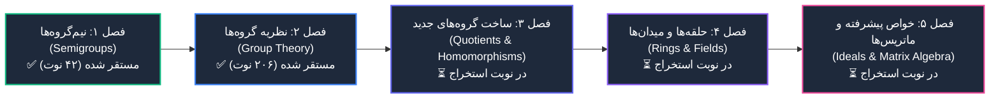

# 🌐 نقشه راه کلان درس مبانی جبر و ماتریس‌ها (Master Course MOC)

> [!abstract] چشم‌انداز دوره و گذار به تفکر جبری
> درس **مبانی جبر و ماتریس‌ها**، نخستین و اساسی‌ترین مدخل ورود به قلمرو **جبر مجرد (Abstract Algebra)** در ریاضیات دانشگاهی است. در این دوره، نگاهمان را از «محاسبات عددی صرف» فراتر برده و به مطالعه **الگوها، تقارن‌ها و ساختارهای صوری حاکم بر عملگرها** می‌پردازیم.
> 
> * **مدرس منبع:** دکتر علیرضا علائیان (دانشگاه علم و صنعت ایران)
> * **معماری دانشی:** منطبق بر استاندارد بین‌المللی **UMKO v1.1**، ساختار اتمیک زتل‌کاستن و شیوه‌نامه جامع نگارش والت.

---

## 🗺️ سرفصل‌های ۵گانه دوره و پیشرفت پایگاه دانش

سیر یادگیری این درس از ساده‌ترین دستگاه‌های جبری تک‌عملگری آغاز شده و گام‌به‌گام به سمت ساختارهای غنی‌تر چندعملگری پیش می‌رود:



### ۱. [[00-درسنامه و نقشه راه فصل اول - نیم‌گروه‌ها|فصل اول: نیم‌گروه‌ها (Semigroups)]] — [✅ مستقر و نهایی‌شده]
* **تمرکز محوری:** اعمال دوتایی، بسته بودن، خاصیت شرکت‌پذیری، قضیه شرکت‌پذیری تعمیم‌یافته، قوانین توان‌ها، عناصر همانی و وارون، زیرنیم‌گروه‌ها و دام‌های مفهومی.
* **آمار اتم‌های دانشی:** ۴۲ یادداشت اتمیک (شامل ۹ مفهوم، ۳ ویژگی، ۵ قضیه، ۵ اثبات، ۸ مثال، ۱ مثال نقض، ۵ مسئله، ۵ حل تشریحی و ۱ دام شناختی).
* **پوشه استقرار:** `فصل اول - نیم‌گروه‌ها/`

### ۲. فصل دوم: نظریه گروه‌ها (Group Theory) — [مستقر شده]
* **سند درسنامه و راهنمای فرامتنی:** [[00-درسنامه و نقشه راه فصل دوم - گروه‌ها]]
* **تمرکز محوری:** تعریف گروه، مرتبه گروه و عنصر، گروه‌های آبلی و متقارن ($S_n$)، زیرگروه‌ها، قضیه لاگرانژ، هم‌مجموعه‌ها (Cosets)، گروه‌های دوری، زیرگروه‌های نرمال، گروه‌های خارج‌قسمتی، هم‌ریختی‌ها و قضایای اول و دوم یک‌ریختی نوتر (شامل ۲۰۶ نوت اتمیک).
* **پوشه استقرار:** `فصل دوم - گروه‌ها/`

### ۳. فصل سوم: ساخت گروه‌های جدید و هم‌ریختی‌ها — [در نوبت استخراج]
* **تمرکز محوری:** زیرگروه‌های نرمال، گروه خارج‌قسمتی (Quotient Groups)، هم‌ریختی‌ها، قضیه اول یکریختی و ضرب مستقیم گروه‌ها.

### ۴. فصل چهارم: حلقه‌ها و میدان‌ها (Rings & Fields) — [در نوبت استخراج]
* **تمرکز محوری:** دستگاه‌های دو‌عملگری، تعریف حلقه، حوزه‌های صحیح (Integral Domains)، میدان‌ها، مقسوم‌علیه‌های صفر و مشخصه حلقه.

### ۵. فصل پنجم: خواص پیشرفته حلقه‌ها، ایده‌آل‌ها و ماتریس‌ها — [در نوبت استخراج]
* **تمرکز محوری:** ایده‌آل‌های چپ، راست و دوطرفه، حلقه‌های خارج‌قسمتی، حلقه‌های چندجمله‌ای، میدان کسرهای یک حوزه، و ارتباط عمیق با جبر خطی و ماتریس‌ها.

---

## 📂 ساختار پوشه‌بندی و ناوبری پروژه

پایگاه دانش درس با تفکیک دقیق لایه‌های اسناد اولیه، فصول درسی و نقشه‌های راه سازمان‌دهی شده است:

```
مبانی جبر و ماتریس ها/
├── 00-MOC نقشه راه کلان درس مبانی جبر و ماتریس‌ها.md     (همین سند - قطب‌نمای دوره)
│
├── 00-مراجع و اسناد اولیه/
│   ├── PDFها و اسناد مرجع/                              (فایل‌های Sec1 و Sec2 اسکن جزوه)
│   └── متن خام OCR و ماتریس فاز ۱/                       (متن خام استخراج‌شده و ماتریس ۴۲ اتم)
│
└── فصل اول - نیم‌گروه‌ها/
    ├── 00-درسنامه و نقشه راه فصل اول - نیم‌گروه‌ها.md     (درسنامه اصلی و فهرست روایی فصل)
    ├── 01-مفاهیم و خواص پایه/                           (۷ فایل اتمیک)
    ├── 02-کاتالوگ مثال‌ها/                              (۵ فایل اتمیک)
    ├── 03-توان‌ها و شرکت‌پذیری تعمیم‌یافته/              (۵ فایل اتمیک)
    ├── 04-عناصر همانی و معکوس/                          (۸ فایل اتمیک)
    ├── 05-زیرنیم‌گروه‌ها و دام‌های مفهومی/               (۶ فایل اتمیک)
    ├── 06-تمرین‌ها و حل‌های تشریحی/                     (۱۰ فایل اتمیک)
    └── 07-نقشه‌های راه یادگیری/                          (۳ نقشه راه تخصصی موضوعی)
```

---

## 🎯 نقشه‌های راه موضوعی برای مطالعه و تدریس هوشمند

برای پاسخ به نیازهای گوناگون مخاطبان (مطالعه عمیق دانشگاهی، مرور تستی و کنکور، و تحلیل گراف وابستگی)، نقشه‌های زیر در دسترس است:

1. 🏛️ **[[نقشه راه مسیر دانشگاهی و اثبات‌های صوری (Academic Proof Track)|مسیر آکادمیک و اثبات‌های صوری]]:**  
   ویژه تسلط بر زنجیره‌های استنتاجی، براهین استقرایی و درک هندسه منطقی قضایا.
2. ✍️ **[[نقشه راه حل مسئله و کارگاه تمرین‌ها (Problem Solving Track)|مسیر حل مسئله و آمادگی آزمون]]:**  
   ویژه کارگاه حل مسائل، تمرین‌های پایان فصل، نردبان‌های ۵پله‌ای سقراطی پولیا و ترفندهای محاسباتی.
3. 📊 **[[نقشه گراف وابستگی و درخت یادگیری (Concept Dependency Graph)|گراف وابستگی مفاهیم و تحلیل DAG]]:**  
   تجسم تعاملی سلسله‌مراتب مفاهیم، آزمون Strict DAG و سطوح شش‌گانه حیطه شناختی بلوم.

---

## 📑 مراجع و استانداردهای پشتیبان
* **شیوه‌نامه نگارش والت:** [[00-MOC نقشه راه شیوه‌نامه نگارش]]
* **اسکیمای متادیتا و فرانت‌متر:** [[02-راهنمای فرانت‌متر و شناسنامه YAML]]
* **راهنمای لاتک و KaTeX:** [[03-شیوه‌نامه استاندارد فرمول‌ها و نمادهای لاتک (LaTeX)]]
* **دستورالعمل حل مسائل:** [[08-راهنمای حل مسائل، تست‌های کنکور و نردبان سقراطی]]
