# 🗺️ فاز ۱: فهرست‌برداری و دانه‌بندی اتمیک فصل اول (نیم‌گروه‌ها)

> [!abstract] بیانیه مأموریت و انطباق با استاندارد
> این سند خروجی رسمی **«فاز ۱: فهرست‌برداری و دانه‌بندی اتمیک»** بر روی فایل `فصل اول - نیم‌گروه‌ها.md` از جزوه درسی «مبانی جبر و ماتریس‌ها» (استاد علائیان) است. تمامی مفاهیم، تعاریف، گزاره‌ها، قضایا، اثبات‌ها، مثال‌ها، مثال‌های نقض، تمرین‌ها و راه‌حل‌ها به صورت ریزدانه، مستقل و بر مبنای **استاندارد هستی‌شناسی UMKO v1.1**، **اصل تمرکز تک‌مفهومی (Single Responsibility)** و **قوانین نام‌گذاری و اتصالات والت ابسیدین** استخراج شده‌اند.

---

## ۱. اصول متدولوژی دانه‌بندی اتمیک

در راستای تحقق معماری پایگاه دانش پیشرفته، اصول زیر در تحلیل خط‌به‌خط منبع اصلی اعمال گردیده است:

1. **تفکیک قطعی صورت گزاره از اثبات (Assertion vs. Proof):**
   قضایای متن اصلی هرگز به صورت بلوک درهم‌تنیده با اثبات نگهداری نمی‌شوند؛ صورت هر قضیه در یک فایل از جنس `kind: assertion` و برهان مستقل آن در فایلی با `kind: proof` و پیوند رو به عقب `rel_proves` مستقر می‌گردد. این تفکیک امکان ارزیابی صوری و استناد چندگانه به گزاره‌ها را بدون تحمیل بار متنی اثبات فراهم می‌آورد.
2. **استقلال و خودبسندگی مسائل و راه‌حل‌ها (Problem vs. Solution):**
   هر تمرین دانشگاهی در یک گره `kind: problem` و راه‌حل تشریحی گام‌به‌گام آن در گره `kind: solution` با پیوند رو به عقب `rel_solves` تفکیک می‌شود تا تجربه یادگیری فعال و تعاملی حفظ گردد.
3. **انضباط نام‌گذاری فایل‌ها در والت:**
   نام‌گذاری کلیه فایل‌ها به فارسی دقیق، روان، آکادمیک و عاری از هرگونه کاراکتر ممنوعه سیستم‌عامل و ابسیدین (`*`، `"``، `\`، `/`، `<`، `>`، `:`، `|`، `?`، `#`، `^`، `[`، `]`) انجام شده است.
4. **رده‌بندی استاندارد بر اساس ۲۱ کلاس و ۷۵ زیرنوع مصوب UMKO v1.1:**
   هیچ برچسب یا رده ساختگی خارج از چارچوب استاندارد به کار نرفته است.
5. **یک‌طرفه‌نویسی پیوندها رو به عقب (Backward-Linking):**
   تمامی روابط استنتاجی، تبارشناسی و ارجاعات در فایل جدیدتر یا وابسته‌تر ثبت شده‌اند تا گراف جهت‌دار بدون دور (Strict DAG) در زیرگراف‌های اثبات و پیش‌نیاز تضمین گردد.

---

## ۲. خلاصه آماری دانه‌بندی اتم‌ها

تحلیل خط‌به‌خط فصل اول منجر به استخراج **۴۲ اتم دانشی مستقل** به شرح زیر شده است:

| کلاس سند (`kind`) | تعداد اتم | ساب‌تایپ‌های مورد استفاده (`subtype`) | شرح کارکرد در فصل اول |
| :--- | :---: | :--- | :--- |
| **`concept`** | **۹** | `structure` (۴), `type_concept` (۱), `role_concept` (۴) | تعریف عمل دوتایی، دستگاه جبری، نیم‌گروه، نیم‌گروه جابجایی، زیرنیم‌گروه، توان‌ها، همانی و معکوس |
| **`property`** | **۳** | `boolean_trait` (۳) | بسته بودن، شرکت‌پذیری، و جابجایی عمل دوتایی |
| **`assertion`** | **۵** | `theorem` (۱), `proposition` (۳), `criterion` (۱) | قضیه شرکت‌پذیری تعمیم‌یافته، قوانین توان‌ها، یکتایی همانی، یکتایی معکوس، معیار زیرنیم‌گروه بودن |
| **`proof`** | **۵** | `rigorous` (۵) | برهان‌های مستقل متناظر با هر ۵ گزاره فوق |
| **`example`** | **۸** | `canonical` (۶), `boundary` (۲) | مثال‌های اعداد طبیعی، صحیح، توابع، ماتریس‌ها، مجموعه توانی و زیرنیم‌گروه‌های ماتریسی مرزی |
| **`counterexample`** | **۱** | `hypothesis_drop` (۱) | مثال نقض وجود عنصر همانی در نیم‌گروه اعداد صحیح زوج |
| **`problem`** | **۵** | `university_proof` (۴), `university_calc` (۱) | ۵ تمرین پایان فصل جزوه استاد علائیان |
| **`solution`** | **۵** | `rigorous_full` (۵) | راه‌حل‌های کامل، دقیق و گام‌به‌گام تمرین‌های ۵گانه |
| **`pitfall`** | **۱** | `misconception` (۱) | دام مفهومی عدم تطابق عنصر همانی نیم‌گروه با عنصر همانی زیرنیم‌گروه‌هایش |
| **`collection`** | **۱** | `chapter_handout` (۱) | گره کانونی جزوه و فهرست رده‌بالای فصل اول با ترنسکلوژن |
| **مجموع** | **۴۲** | **۱۰ ساب‌تایپ رسمی** | **پوشش ۱۰۰٪ متن، مثال‌ها، قضایا و تمرین‌های فصل اول** |

---

## ۳. ماتریس جامع اتم‌های استخراج‌شده (Atom Matrix)

در جدول زیر، تمامی ۴۲ اتم به همراه مشخصات کامل فنی، نام‌گذاری ابسیدین، شناسنامه متادیتا، خلاصه مفروضات و پیوندهای استنتاجی رو به عقب درج شده‌اند:

| شماره | نام پیشنهادی فایل در ابسیدین | رده‌بندی UMKO v1.1 (`kind` / `subtype`) | شناسه کوتاه (`slug`) | خلاصه محتوا و مفروضات صوری | روابط و پیوندهای رو به عقب (`rel_*`) |
| :---: | :--- | :--- | :--- | :--- | :--- |
| **۱** | `تعریف عمل دوتایی` | `concept` / `type_concept` | `binary-operation` | تعریف نگاشت صوری $*: S \times S \to S$ که به هر زوج مرتب $(a,b) \in S \times S$ عنصری یکتا از $S$ را نسبت می‌دهد؛ تأکید بر اهمیت ترتیب مولفه‌ها. | `rel_requires: ["[[نظریه مجموعه‌ها - ضرب دکارتی و رابطه]]"]` |
| **۲** | `تعریف دستگاه جبری` | `concept` / `structure` | `algebraic-system` | تعریف ساختار ریاضی $(S, *)$ مرکب از یک مجموعه ناتهی $S$ و یک یا چند عمل دوتایی بسته روی آن (Magma). | `rel_depends_def: ["[[تعریف عمل دوتایی]]"]` |
| **۳** | `خاصیت بسته بودن عمل دوتایی` | `property` / `boolean_trait` | `closure-property` | ویژگی بولی یک عمل دوتایی روی مجموعه $S$؛ صدق شرط $\forall x, y \in S: x * y \in S$. | `rel_depends_sig: ["[[تعریف عمل دوتایی]]"]` |
| **۴** | `خاصیت شرکت‌پذیری عمل دوتایی` | `property` / `boolean_trait` | `associativity` | ویژگی بولی عمل دوتایی در استقلال حاصل ترکیب سه‌تایی از اولویت عملیات: $\forall x, y, z \in S: (x * y) * z = x * (y * z)$. | `rel_depends_sig: ["[[تعریف عمل دوتایی]]"]` |
| **۵** | `تعریف نیم‌گروه` | `concept` / `structure` | `semigroup` | تعریف دستگاه جبری $(S, *)$ که عمل دوتایی آن روی مجموعه ناتهی $S$ بسته و شرکت‌پذیر باشد (تعریف ۱.۱). | `rel_extends: ["[[تعریف دستگاه جبری]]"]`<br>`rel_depends_def: ["[[خاصیت بسته بودن عمل دوتایی]]", "[[خاصیت شرکت‌پذیری عمل دوتایی]]"]` |
| **۶** | `خاصیت جابجایی عمل دوتایی` | `property` / `boolean_trait` | `commutativity` | ویژگی بولی تقارن عمل دوتایی نسبت به تعویض ورودی‌ها: $\forall x, y \in S: x * y = y * x$. | `rel_depends_sig: ["[[تعریف عمل دوتایی]]"]` |
| **۷** | `تعریف نیم‌گروه جابجایی` | `concept` / `structure` | `commutative-semigroup` | ساختار جبری نیم‌گروهی که عمل دوتایی آن افزون بر شرکت‌پذیری، واجد خاصیت جابجایی است (نیم‌گروه آبلی). | `rel_extends: ["[[تعریف نیم‌گروه]]"]`<br>`rel_depends_def: ["[[خاصیت جابجایی عمل دوتایی]]"]` |
| **۸** | `مثال نیم‌گروه‌های عددی طبیعی و صحیح تحت جمع و ضرب` | `example` / `canonical` | `canonical-number-semigroups` | بررسی ساختارهای $(\mathbb{N}, +)$، $(\mathbb{N}, \cdot)$، $(\mathbb{Z}, +)$ و $(\mathbb{Z}, \cdot)$ به عنوان مثال‌های مرجع و بنیادین نیم‌گروه‌های جابجایی (مثال ۱.۱ آ). | `rel_illustrates: ["[[تعریف نیم‌گروه]]", "[[تعریف نیم‌گروه جابجایی]]"]` |
| **۹** | `مثال نیم‌گروه اعداد صحیح زوج تحت جمع و ضرب` | `example` / `canonical` | `even-integers-semigroup` | بررسی مجموعه اعداد صحیح زوج $2\mathbb{Z}$ نسبت به اعمال جمع و ضرب معمولی به عنوان نیم‌گروه جابجایی (مثال ۱.۱ ب). | `rel_illustrates: ["[[تعریف نیم‌گروه]]", "[[تعریف نیم‌گروه جابجایی]]"]` |
| **۱۰** | `مثال نیم‌گروه تبدیلات و توابع خودنگاشت تحت ترکیب توابع` | `example` / `canonical` | `transformation-semigroup-functions` | بررسی مجموعه تمام توابع $S = A^A$ با عمل ترکیب توابع $\circ$ به عنوان مدل کانونی نیم‌گروه متقارن/تبدیلاتی که در $|A| \ge 2$ غیرجابجایی است (مثال ۲.۱). | `rel_illustrates: ["[[تعریف نیم‌گروه]]"]` |
| **۱۱** | `مثال نیم‌گروه‌های مجموعه توانی تحت اشتراک و اجتماع` | `example` / `canonical` | `power-set-semigroups` | بررسی ساختارهای جبری $(\mathcal{P}(A), \cap)$ و $(\mathcal{P}(A), \cup)$ روی مجموعه توانی به عنوان نیم‌گروه‌های جابجایی با ویژگی خودتوانی (مثال ۳.۱). | `rel_illustrates: ["[[تعریف نیم‌گروه جابجایی]]"]` |
| **۱۲** | `مثال نیم‌گروه ضربی ماتریس‌های مربعی حقیقی` | `example` / `canonical` | `matrix-multiplication-semigroup` | بررسی مجموعه ماتریس‌های مربعی $M_n(\mathbb{R})$ نسبت به ضرب ماتریس‌ها به عنوان بارزترین مثال نیم‌گروه ضربی غیرجابجایی برای $n \ge 2$ (مثال ۴.۱). | `rel_illustrates: ["[[تعریف نیم‌گروه]]"]` |
| **۱۳** | `تعریف توان‌های عنصر در نیم‌گروه` | `concept` / `role_concept` | `semigroup-element-powers` | تعریف مفهوم نقشی حاصل ترکیب متوالی $n$ بار عملگر روی عنصر واحد $x$ در دستگاه ضربی ($x^n$) و دستگاه جمعی ($nx$) برای $n \in \mathbb{N}$ (تعریف ۲.۱). | `rel_depends_def: ["[[تعریف نیم‌گروه]]"]` |
| **۱۴** | `قضیه شرکت‌پذیری تعمیم‌یافته در نیم‌گروه` | `assertion` / `theorem` | `generalized-associativity-theorem` | اثبات این‌که در هر نیم‌گروه $(S, *)$، حاصل ترکیب هر $n$ عنصر $x_1 * x_2 * \dots * x_n$ کاملاً مستقل از نحوه پرانتزگذاری است (قضیه ۳.۱ آ). | `rel_depends_sig: ["[[تعریف نیم‌گروه]]"]` |
| **۱۵** | `اثبات قضیه شرکت‌پذیری تعمیم‌یافته به روش استقرا` | `proof` / `rigorous` | `proof-generalized-associativity-induction` | برهان دقیق استقرایی روی طول $n$ با تجزیه عبارت پرانتزگذاری‌شده به $P = Q_1 * S_1$ و تقلیل متوالی طول عامل دوم به کمک قانون شرکت‌پذیری. | `rel_proves: ["[[قضیه شرکت‌پذیری تعمیم‌یافته در نیم‌گروه]]"]`<br>`rel_depends_proof: ["[[خاصیت شرکت‌پذیری عمل دوتایی]]"]` |
| **۱۶** | `قضیه قوانین توان‌ها در نیم‌گروه` | `assertion` / `proposition` | `semigroup-exponent-laws` | برقراری اتحادهای بنیادی توان‌ها شامل $x^m x^n = x^{m+n}$ و $(x^m)^n = x^{mn}$ و نظایر جمعی به ازای هر $m, n \in \mathbb{N}$ (قضیه ۳.۱ ب). | `rel_depends_sig: ["[[تعریف توان‌های عنصر در نیم‌گروه]]"]`<br>`rel_applies_theorem: ["[[قضیه شرکت‌پذیری تعمیم‌یافته در نیم‌گروه]]"]` |
| **۱۷** | `اثبات قضیه قوانین توان‌ها در نیم‌گروه` | `proof` / `rigorous` | `proof-semigroup-exponent-laws` | اثبات اتحادها بر پایه بسط متوالی عناصر، شمارش عوامل و کاربرد قضیه شرکت‌پذیری تعمیم‌یافته. | `rel_proves: ["[[قضیه قوانین توان‌ها در نیم‌گروه]]"]`<br>`rel_depends_proof: ["[[قضیه شرکت‌پذیری تعمیم‌یافته در نیم‌گروه]]", "[[تعریف توان‌های عنصر در نیم‌گروه]]"]` |
| **۱۸** | `تعریف عنصر همانی در نیم‌گروه` | `concept` / `role_concept` | `identity-element-semigroup` | تعریف نقش عنصر خنثی $e \in S$ به گونه‌ای که به ازای تمام $x \in S$ رابطه $e * x = x * e = x$ ارضا شود (تعریف ۴.۱ آ؛ تعریف مونوئید). | `rel_depends_sig: ["[[تعریف نیم‌گروه]]"]` |
| **۱۹** | `تعریف عنصر معکوس در نیم‌گروه` | `concept` / `role_concept` | `inverse-element-semigroup` | تعریف عنصر وارون $y \in S$ برای عضو مفروض $x$ در نیم‌گروه دارای همانی $e$ تحت شرط $x * y = y * x = e$ (تعریف ۴.۱ ب). | `rel_depends_sig: ["[[تعریف عنصر همانی در نیم‌گروه]]"]` |
| **۲۰** | `مثال نقض وجود لزومی عنصر همانی در نیم‌گروه اعداد صحیح زوج` | `counterexample` / `hypothesis_drop` | `counterexample-semigroup-without-identity` | ارائه ساختار ضربی $(2\mathbb{Z}, \cdot)$ به عنوان گواه نقض وجود الزامی عنصر خنثی در نیم‌گروه‌ها، در قیاس با $(\mathbb{Z}, \cdot)$ (تبصره ۴.۱ آ). | `rel_refutes: ["[[تعریف عنصر همانی در نیم‌گروه]]"]` |
| **۲۱** | `مثال عدم معکوس‌پذیری عمومی عناصر در نیم‌گروه اعداد صحیح` | `example` / `boundary` | `example-non-invertible-elements-in-integers` | بررسی نیم‌گروه $(\mathbb{Z}, \cdot)$ دارای همانی ۱ که تنها عناصر $1$ و $-1$ در آن وارون‌پذیرند و سایر عناصر فاقد معکوس‌اند (تبصره ۴.۱ ب). | `rel_illustrates: ["[[تعریف عنصر معکوس در نیم‌گروه]]"]` |
| **۲۲** | `قضیه یکتایی عنصر همانی در نیم‌گروه` | `assertion` / `proposition` | `uniqueness-of-identity-element-semigroup` | گزاره صوری این‌که در هر نیم‌گروه $(S, *)$، عنصر همانی در صورت وجود منحصربه‌فرد است (قضیه ۵.۱ آ). | `rel_depends_sig: ["[[تعریف عنصر همانی در نیم‌گروه]]"]` |
| **۲۳** | `اثبات قضیه یکتایی عنصر همانی در نیم‌گروه` | `proof` / `rigorous` | `proof-uniqueness-of-identity-element-semigroup` | برهان جبری مستقیم با فرض وجود دو همانی $e, e'$ و محاسبه زنجیره برابری $e = e * e' = e'$. | `rel_proves: ["[[قضیه یکتایی عنصر همانی در نیم‌گروه]]"]`<br>`rel_depends_proof: ["[[تعریف عنصر همانی در نیم‌گروه]]"]` |
| **۲۴** | `قضیه یکتایی عنصر معکوس در نیم‌گروه` | `assertion` / `proposition` | `uniqueness-of-inverse-element-semigroup` | گزاره صوری این‌که در هر نیم‌گروه دارای همانی، معکوس هر عنصر در صورت وجود یکتاست (قضیه ۵.۱ ب). | `rel_depends_sig: ["[[تعریف عنصر معکوس در نیم‌گروه]]"]` |
| **۲۵** | `اثبات قضیه یکتایی عنصر معکوس در نیم‌گروه` | `proof` / `rigorous` | `proof-uniqueness-of-inverse-element-semigroup` | اثبات متکی بر خاصیت شرکت‌پذیری با فرض دو وارون $y, z$ و محاسبه $y = y * e = y * (x * z) = (y * x) * z = e * z = z$. | `rel_proves: ["[[قضیه یکتایی عنصر معکوس در نیم‌گروه]]"]`<br>`rel_depends_proof: ["[[خاصیت شرکت‌پذیری عمل دوتایی]]", "[[تعریف عنصر همانی در نیم‌گروه]]", "[[تعریف عنصر معکوس در نیم‌گروه]]"]` |
| **۲۶** | `تعریف زیرنیم‌گروه` | `concept` / `structure` | `subsemigroup` | تعریف زیرمجموعه ناتهی $T \subseteq S$ که با همان عمل دوتایی محدودشده نیم‌گروه مستقلی بسازد ($T \leqslant S$؛ تعریف ۶.۱). | `rel_extends: ["[[تعریف نیم‌گروه]]"]` |
| **۲۷** | `مثال زیرنیم‌گروه بودن اعداد طبیعی در اعداد صحیح تحت ضرب` | `example` / `canonical` | `subsemigroup-natural-numbers-in-integers` | تحلیل نمونه کانونی $(\mathbb{N}, \cdot) \leqslant (\mathbb{Z}, \cdot)$ و بررسی قضیه زیرنیم‌گروه بودن بدیهی هر ساختار در خود (مثال ۵.۱). | `rel_illustrates: ["[[تعریف زیرنیم‌گروه]]"]` |
| **۲۸** | `قضیه شرط لازم و کافی زیرنیم‌گروه بودن` | `assertion` / `criterion` | `subsemigroup-closure-criterion` | معیار هم‌ارز بسته بودن: زیرمجموعه ناتهی $T$ زیرنیم‌گروه $S$ است اگر و تنها اگر تحت عمل $*$ بسته باشد (قضیه ۷.۱). | `rel_depends_sig: ["[[تعریف زیرنیم‌گروه]]"]` |
| **۲۹** | `اثبات قضیه شرط لازم و کافی زیرنیم‌گروه بودن` | `proof` / `rigorous` | `proof-subsemigroup-closure-criterion` | اثبات استلزامی دوطرفه؛ جهت عکس با اثبات توارث و پایستگی خودکار ویژگی شرکت‌پذیری از مجموعه مادر $S$ روی $T$. | `rel_proves: ["[[قضیه شرط لازم و کافی زیرنیم‌گروه بودن]]"]`<br>`rel_depends_proof: ["[[خاصیت شرکت‌پذیری عمل دوتایی]]", "[[تعریف نیم‌گروه]]", "[[تعریف زیرنیم‌گروه]]"]` |
| **۳۰** | `مثال زیرنیم‌گروه ماتریس‌های قطری تک‌درایه‌ای و تمایز عنصر همانی` | `example` / `boundary` | `example-matrix-subsemigroup-idempotent-element` | بررسی زیرنیم‌گروه $T = \{ \operatorname{diag}(x, 0) \mid x \in \mathbb{R} \}$ در $M_2(\mathbb{R})$ که عضو خنثی آن با ماتریس همانی $I_2$ متفاوت است (مثال ۶.۱). | `rel_illustrates: ["[[تعریف زیرنیم‌گروه]]", "[[قضیه شرط لازم و کافی زیرنیم‌گروه بودن]]"]` |
| **۳۱** | `دام مفهومی عدم تطابق عنصر همانی نیم‌گروه و زیرنیم‌گروه` | `pitfall` / `misconception` | `pitfall-subsemigroup-identity-mismatch` | تحلیل کج‌فهمی رایج انتقال خواص نظریه گروه‌ها به نیم‌گروه‌ها؛ در نیم‌گروه‌ها عضو خنثی زیرنیم‌گروه می‌تواند کاملاً متمایز از مادر باشد. | `rel_triggers_pitfall: ["[[تعریف عنصر همانی در نیم‌گروه]]", "[[تعریف زیرنیم‌گروه]]"]` |
| **۳۲** | `تمرین نیم‌گروه توابع خودنگاشت با عنصر همانی تحت ترکیب` | `problem` / `university_proof` | `problem-self-map-functions-monoid` | صورت تمرین ۱: نشان دهید $X^X = \{ f : X \to X \}$ با عمل ترکیب $\circ$ تشکیل نیم‌گروهی دارای عنصر همانی می‌دهد. | `rel_requires: ["[[تعریف نیم‌گروه]]", "[[تعریف عنصر همانی در نیم‌گروه]]"]` |
| **۳۳** | `حل تمرین نیم‌گروه توابع خودنگاشت تحت ترکیب` | `solution` / `rigorous_full` | `solution-self-map-functions-monoid` | حل تشریحی تمرین ۱: اثبات بسته بودن، اثبات شرکت‌پذیری ترکیب نگاشت‌ها $f \circ (g \circ h) = (f \circ g) \circ h$ و معرفی نگاشت همانی $\operatorname{id}_X$. | `rel_solves: ["[[تمرین نیم‌گروه توابع خودنگاشت با عنصر همانی تحت ترکیب]]"]` |
| **۳۴** | `تمرین نیم‌گروه جابجایی انتقالات خط در هندسه اقلیدسی` | `problem` / `university_proof` | `problem-line-translations-abelian-semigroup` | صورت تمرین ۲: اثبات این‌که مجموعه تمام انتقالات یک خط راست در هندسه اقلیدسی، نیم‌گروهی جابجایی با عنصر همانی است. | `rel_requires: ["[[تعریف نیم‌گروه جابجایی]]", "[[تعریف عنصر همانی در نیم‌گروه]]"]` |
| **۳۵** | `حل تمرین نیم‌گروه جابجایی انتقالات خط` | `solution` / `rigorous_full` | `solution-line-translations-abelian-semigroup` | حل تشریحی تمرین ۲: مدل‌سازی تحلیلی انتقالات با نگاشت‌های $\varphi_a(x) = x+a$، اثبات $\varphi_a \circ \varphi_b = \varphi_{a+b}$ و معرفی انتقال صفر $\varphi_0$. | `rel_solves: ["[[تمرین نیم‌گروه جابجایی انتقالات خط در هندسه اقلیدسی]]"]` |
| **۳۶** | `تمرین نیم‌گروه و زیرنیم‌گروه عمل دوتایی ترکیبی روی اعداد صحیح` | `problem` / `university_proof` | `problem-custom-operation-integers-subsemigroup` | صورت تمرین ۳: اثبات نیم‌گروه بودن $(\mathbb{Z}, *)$ با عمل $x * y = x + y - xy$ و اثبات زیرنیم‌گروه بودن زیرمجموعه $T = \{x \le 1\}$. | `rel_requires: ["[[تعریف نیم‌گروه]]", "[[قضیه شرط لازم و کافی زیرنیم‌گروه بودن]]"]` |
| **۳۷** | `حل تمرین نیم‌گروه و زیرنیم‌گروه عمل دوتایی ترکیبی روی اعداد صحیح` | `solution` / `rigorous_full` | `solution-custom-operation-integers-subsemigroup` | حل تشریحی تمرین ۳: بسط جبری تقارن و شرکت‌پذیری، و اثبات بسته بودن $T$ به کمک فاکتورگیری اتحاد جبری $1 - (x * y) = (1-x)(1-y) \ge 0$. | `rel_solves: ["[[تمرین نیم‌گروه و زیرنیم‌گروه عمل دوتایی ترکیبی روی اعداد صحیح]]"]` |
| **۳۸** | `تمرین تعیین عناصر همانی نیم‌گروه‌های مجموعه توانی` | `problem` / `university_calc` | `problem-power-set-identity-elements` | صورت تمرین ۴: بررسی تحلیلی وجود عناصر همانی در نیم‌گروه‌های $(\mathcal{P}(A), \cap)$ و $(\mathcal{P}(A), \cup)$ و به دست آوردن آن‌ها. | `rel_requires: ["[[تعریف عنصر همانی در نیم‌گروه]]", "[[مثال نیم‌گروه‌های مجموعه توانی تحت اشتراک و اجتماع]]"]` |
| **۳۹** | `حل تمرین تعیین عناصر همانی نیم‌گروه‌های مجموعه توانی` | `solution` / `rigorous_full` | `solution-power-set-identity-elements` | حل تشریحی تمرین ۴: حل معادلات مجموعه‌ای $X \cap E = X \iff E = A$ (عضو خنثی $A$) و $X \cup E = X \iff E = \emptyset$ (عضو خنثی $\emptyset$). | `rel_solves: ["[[تمرین تعیین عناصر همانی نیم‌گروه‌های مجموعه توانی]]"]` |
| **۴۰** | `تمرین ساختار زیرنیم‌گروه جابجایی ماتریسی با عنصر همانی و معکوس` | `problem` / `university_proof` | `problem-matrix-subsemigroup-abelian-invertible` | صورت تمرین ۵: بررسی مجموعه ماتریس‌های $N = \{ \begin{pmatrix} x & x \\ 0 & 0 \end{pmatrix} \mid x \ne 0 \}$، اثبات زیرنیم‌گروهی، تعیین همانی، جابجایی و معکوس‌پذیری. | `rel_requires: ["[[تعریف زیرنیم‌گروه]]", "[[تعریف عنصر همانی در نیم‌گروه]]", "[[تعریف عنصر معکوس در نیم‌گروه]]", "[[قضیه شرط لازم و کافی زیرنیم‌گروه بودن]]"]` |
| **۴۱** | `حل تمرین ساختار زیرنیم‌گروه جابجایی ماتریسی با عنصر همانی و معکوس` | `solution` / `rigorous_full` | `solution-matrix-subsemigroup-abelian-invertible` | حل تشریحی تمرین ۵: ضرب مستقیم، اثبات بسته بودن، محاسبه ماتریس خنثی $E = \begin{pmatrix} 1 & 1 \\ 0 & 0 \end{pmatrix}$ و تعیین وارون $A^{-1} = \begin{pmatrix} 1/x & 1/x \\ 0 & 0 \end{pmatrix}$. | `rel_solves: ["[[تمرین ساختار زیرنیم‌گروه جابجایی ماتریسی با عنصر همانی و معکوس]]"]` |
| **۴۲** | `فصل اول - نیم‌گروه‌ها` | `collection` / `chapter_handout` | `chapter-01-semigroups` | گره کانونی درسنامه فصل اول برای مطالعه ترتیبی و درج زنده (Transclusion) تمام ۴۱ اتم دانشی فوق در یک جریان یکپارچه آموزشی. | `rel_is_part_of: ["[[درس مبانی جبر و ماتریس‌ها]]"]` |

---

## ۴. تحلیل ساختاری و خوشه‌بندی مفهومی اتم‌ها

برای درک عمیق‌تر جریان انتقال مفاهیم، ۴۲ اتم در **۷ خوشه ساختاری** دسته‌بندی می‌شوند:

```
┌─────────────────────────────────────────────────────────────────────────────┐
│                       نقشه خوشه‌ای اتم‌های فصل اول                           │
├─────────────────────────┬─────────────────────────┬─────────────────────────┤
│ خوشه ۱: پایه‌ها و خواص    │ خوشه ۲: نیم‌گروه و توان   │ خوشه ۳: همانی و معکوس   │
│ • عمل دوتایی            │ • تعریف نیم‌گروه        │ • تعریف عنصر همانی      │
│ • دستگاه جبری           │ • نیم‌گروه جابجایی      │ • تعریف عنصر معکوس      │
│ • بسته بودن             │ • تعریف توان‌ها         │ • یکتایی همانی + اثبات  │
│ • شرکت‌پذیری            │ • شرکت‌پذیری تعمیم‌یافته │ • یکتایی معکوس + اثبات  │
│ • جابجایی               │ • قوانین توان‌ها + اثبات │                         │
├─────────────────────────┼─────────────────────────┼─────────────────────────┤
│ خوشه ۴: زیرنیم‌گروه‌ها    │ خوشه ۵: کاتالوگ مثال‌ها │ خوشه ۶: تمرین‌ها و حل‌ها │
│ • تعریف زیرنیم‌گروه     │ • اعداد طبیعی و صحیح    │ • تمرین ۱ + حل          │
│ • شرط بسته بودن + اثبات │ • اعداد صحیح زوج        │ • تمرین ۲ + حل          │
│                         │ • تبدیلات و توابع       │ • تمرین ۳ + حل          │
│                         │ • مجموعه توانی          │ • تمرین ۴ + حل          │
│                         │ • ماتریس‌های مربعی      │ • تمرین ۵ + حل          │
├─────────────────────────┴─────────────────────────┴─────────────────────────┤
│ خوشه ۷: دام‌های مفهومی و فراتحلیل                                           │
│ • مثال نقض عدم وجود همانی در ۲Z                                            │
│ • مثال عدم معکوس‌پذیری در Z                                                 │
│ • مثال مرزی ماتریس‌های قطری تک‌درایه‌ای                                      │
│ • دام مفهومی تمایز عنصر همانی زیرنیم‌گروه با نیم‌گروه مادر                    │
└─────────────────────────────────────────────────────────────────────────────┘
```

---

## ۵. نقشه گراف ارتباطی دانشی (Knowledge Graph Mermaid)

نمودار ساخت‌یافته زیر، شبکه ارتباطی و استنتاجی میان تمام بخش‌های فصل اول را نشان می‌دهد. تمامی نام‌های فارسی طبق قواعد شیوه‌نامه ابسیدین درون گیومه دوتایی `""` محصور شده‌اند تا از هرگونه تداخل سینتکس جلوگیری شود:

```mermaid
flowchart TD
    %% ==========================================
    %% استایل‌دهی و تعاریف کلاس‌ها
    %% ==========================================
    classDef conceptStyle fill:#e1f5fe,stroke:#0288d1,stroke-width:2px,color:#01579b;
    classDef propertyStyle fill:#f3e5f5,stroke:#7b1fa2,stroke-width:2px,color:#4a148c;
    classDef assertionStyle fill:#e8f5e9,stroke:#2e7d32,stroke-width:2px,color:#1b5e20;
    classDef proofStyle fill:#fffde7,stroke:#fbc02d,stroke-width:2px,color:#f57f17;
    classDef exampleStyle fill:#e0f2f1,stroke:#00897b,stroke-width:2px,color:#004d40;
    classDef problemStyle fill:#fff3e0,stroke:#f57c00,stroke-width:2px,color:#e65100;
    classDef solutionStyle fill:#fbe9e7,stroke:#d84315,stroke-width:2px,color:#bf360c;
    classDef pitfallStyle fill:#ffebee,stroke:#c62828,stroke-width:2px,color:#b71c1c;

    %% ==========================================
    %% زیرگراف ۱: مبانی، اعمال و ویژگی‌ها
    %% ==========================================
    subgraph SG1 ["۱. مبانی و خواص اعمال دوتایی"]
        C_BIN_OP["تعریف عمل دوتایی"]:::conceptStyle
        P_CLOSURE["خاصیت بسته بودن عمل دوتایی"]:::propertyStyle
        P_ASSOC["خاصیت شرکت‌پذیری عمل دوتایی"]:::propertyStyle
        P_COMM["خاصیت جابجایی عمل دوتایی"]:::propertyStyle
        C_ALG_SYS["تعریف دستگاه جبری"]:::conceptStyle

        C_BIN_OP --> P_CLOSURE
        C_BIN_OP --> P_ASSOC
        C_BIN_OP --> P_COMM
        C_BIN_OP --> C_ALG_SYS
    end

    %% ==========================================
    %% زیرگراف ۲: ساختار نیم‌گروه و توان‌ها
    %% ==========================================
    subgraph SG2 ["۲. ساختارهای نیم‌گروه و توان‌ها"]
        C_SEMI["تعریف نیم‌گروه"]:::conceptStyle
        C_COMM_SEMI["تعریف نیم‌گروه جابجایی"]:::conceptStyle
        C_POW["تعریف توان‌های عنصر در نیم‌گروه"]:::conceptStyle
        
        A_GEN_ASSOC["قضیه شرکت‌پذیری تعمیم‌یافته"]:::assertionStyle
        PRF_GEN_ASSOC["اثبات قضیه شرکت‌پذیری تعمیم‌یافته"]:::proofStyle
        A_EXP_LAWS["قضیه قوانین توان‌ها"]:::assertionStyle
        PRF_EXP_LAWS["اثبات قضیه قوانین توان‌ها"]:::proofStyle

        C_ALG_SYS --> C_SEMI
        P_CLOSURE --> C_SEMI
        P_ASSOC --> C_SEMI
        C_SEMI --> C_COMM_SEMI
        P_COMM --> C_COMM_SEMI
        C_SEMI --> C_POW

        C_SEMI --> A_GEN_ASSOC
        PRF_GEN_ASSOC -->|"rel_proves"| A_GEN_ASSOC
        P_ASSOC -.->|"rel_depends_proof"| PRF_GEN_ASSOC

        C_POW --> A_EXP_LAWS
        A_GEN_ASSOC -->|"rel_applies_theorem"| A_EXP_LAWS
        PRF_EXP_LAWS -->|"rel_proves"| A_EXP_LAWS
        A_GEN_ASSOC -.->|"rel_depends_proof"| PRF_EXP_LAWS
    end

    %% ==========================================
    %% زیرگراف ۳: عنصر همانی، معکوس و یکتایی
    %% ==========================================
    subgraph SG3 ["۳. عناصر ویژه و قضایای یکتایی"]
        C_IDENT["تعریف عنصر همانی در نیم‌گروه"]:::conceptStyle
        C_INV["تعریف عنصر معکوس در نیم‌گروه"]:::conceptStyle
        
        A_UNIQ_ID["قضیه یکتایی عنصر همانی"]:::assertionStyle
        PRF_UNIQ_ID["اثبات قضیه یکتایی عنصر همانی"]:::proofStyle
        
        A_UNIQ_INV["قضیه یکتایی عنصر معکوس"]:::assertionStyle
        PRF_UNIQ_INV["اثبات قضیه یکتایی عنصر معکوس"]:::proofStyle

        C_SEMI --> C_IDENT
        C_IDENT --> C_INV
        
        C_IDENT --> A_UNIQ_ID
        PRF_UNIQ_ID -->|"rel_proves"| A_UNIQ_ID
        
        C_INV --> A_UNIQ_INV
        PRF_UNIQ_INV -->|"rel_proves"| A_UNIQ_INV
        P_ASSOC -.->|"rel_depends_proof"| PRF_UNIQ_INV
    end

    %% ==========================================
    %% زیرگراف ۴: زیرنیم‌گروه‌ها
    %% ==========================================
    subgraph SG4 ["۴. ساختار زیرنیم‌گروه"]
        C_SUBSEMI["تعریف زیرنیم‌گروه"]:::conceptStyle
        A_SUB_CRIT["قضیه شرط لازم و کافی زیرنیم‌گروه بودن"]:::assertionStyle
        PRF_SUB_CRIT["اثبات قضیه شرط لازم و کافی"]:::proofStyle

        C_SEMI --> C_SUBSEMI
        C_SUBSEMI --> A_SUB_CRIT
        PRF_SUB_CRIT -->|"rel_proves"| A_SUB_CRIT
        P_ASSOC -.->|"rel_depends_proof"| PRF_SUB_CRIT
    end

    %% ==========================================
    %% زیرگراف ۵: کاتالوگ مثال‌ها و شواهد نقض
    %% ==========================================
    subgraph SG5 ["۵. کاتالوگ مثال‌ها، مرزها و دام‌ها"]
        EX_NUM["مثال نیم‌گروه‌های عددی N و Z"]:::exampleStyle
        EX_EVEN["مثال نیم‌گروه اعداد زوج 2Z"]:::exampleStyle
        EX_TRANS["مثال نیم‌گروه تبدیلات توابع"]:::exampleStyle
        EX_POWER["مثال نیم‌گروه مجموعه توانی"]:::exampleStyle
        EX_MAT["مثال نیم‌گروه ضربی ماتریس‌ها"]:::exampleStyle
        EX_SUBNAT["مثال زیرنیم‌گروه N در Z"]:::exampleStyle
        EX_MAT_SUB["مثال زیرنیم‌گروه ماتریس‌های تک‌درایه‌ای"]:::exampleStyle
        
        CEX_NO_ID["مثال نقض عدم وجود همانی در 2Z"]:::exampleStyle
        EX_NON_INV["مثال عدم معکوس‌پذیری در Z"]:::exampleStyle
        
        PIT_ID_MISMATCH["دام مفهومی عدم تطابق عنصر همانی"]:::pitfallStyle

        C_SEMI -.->|"rel_illustrates"| EX_NUM
        C_SEMI -.->|"rel_illustrates"| EX_TRANS
        C_SEMI -.->|"rel_illustrates"| EX_MAT
        C_COMM_SEMI -.->|"rel_illustrates"| EX_POWER
        C_SUBSEMI -.->|"rel_illustrates"| EX_SUBNAT
        
        C_IDENT -.->|"rel_refutes"| CEX_NO_ID
        C_INV -.->|"rel_illustrates"| EX_NON_INV
        
        A_SUB_CRIT -.->|"rel_illustrates"| EX_MAT_SUB
        EX_MAT_SUB -->|"rel_triggers_pitfall"| PIT_ID_MISMATCH
        C_IDENT -.-> PIT_ID_MISMATCH
    end

    %% ==========================================
    %% زیرگراف ۶: تمرین‌ها و راه‌حل‌ها
    %% ==========================================
    subgraph SG6 ["۶. تمرین‌ها و راه‌حل‌های تشریحی"]
        PRB_1["تمرین ۱: توابع خودنگاشت با همانی"]:::problemStyle
        SOL_1["حل تمرین ۱"]:::solutionStyle
        
        PRB_2["تمرین ۲: انتقالات خط اقلیدسی"]:::problemStyle
        SOL_2["حل تمرین ۲"]:::solutionStyle
        
        PRB_3["تمرین ۳: عمل ترکیبی روی Z و زیرنیم‌گروه"]:::problemStyle
        SOL_3["حل تمرین ۳"]:::solutionStyle
        
        PRB_4["تمرین ۴: تعیین همانی مجموعه توانی"]:::problemStyle
        SOL_4["حل تمرین ۴"]:::solutionStyle
        
        PRB_5["تمرین ۵: زیرنیم‌گروه ماتریسی جابجایی وارون‌پذیر"]:::problemStyle
        SOL_5["حل تمرین ۵"]:::solutionStyle

        C_IDENT -.->|"rel_requires"| PRB_1
        SOL_1 -->|"rel_solves"| PRB_1

        C_COMM_SEMI -.->|"rel_requires"| PRB_2
        SOL_2 -->|"rel_solves"| PRB_2

        A_SUB_CRIT -.->|"rel_requires"| PRB_3
        SOL_3 -->|"rel_solves"| PRB_3

        EX_POWER -.->|"rel_requires"| PRB_4
        SOL_4 -->|"rel_solves"| PRB_4

        A_SUB_CRIT -.->|"rel_requires"| PRB_5
        C_INV -.->|"rel_requires"| PRB_5
        SOL_5 -->|"rel_solves"| PRB_5
    end
```



---

## ۶. تحلیل موشکافانه گزاره‌ها، اثبات‌ها و دام‌های آموزشی

### ۶.۱. تفکیک ساختاری قضایا و براهین (Strict DAG Verification)
* **قضیه ۳.۱ (شرکت‌پذیری تعمیم‌یافته):**
  اثبات این قضیه بر پایه خاصیت شرکت‌پذیری سه‌تایی عمل دوتایی و روش استقرای ریاضی استوار است. در گراف دانش، یال `rel_proves` مستقیماً از فایل برهان به صورت قضیه اشاره می‌کند. بدنه اثبات به هیچ عنوان با قضایای توان‌ها درهم‌آمیخته نشده است.
* **قضیه قوانین توان‌ها:**
  این قضیه برای اثبات $x^m x^n = x^{m+n}$ مستقیماً از *قضیه شرکت‌پذیری تعمیم‌یافته* استفاده می‌کند (`rel_applies_theorem`). این وابستگی نشان‌دهنده یک پیش‌نیاز سخت منطقی است و از ایجاد هرگونه دور در استدلال جلوگیری می‌کند.
* **قضایای یکتایی همانی و معکوس (قضیه ۵.۱):**
  * یکتایی همانی صرفاً به تعریف عضو همانی وابسته است.
  * یکتایی معکوس علاوه بر تعریف معکوس و همانی، **شدیداً متکی بر شرکت‌پذیری** عمل دوتایی است ($y = y*(x*z) = (y*x)*z = z$). در صورت فقدان شرکت‌پذیری (مثلاً در شبه‌گروه‌ها و لوپ‌ها)، معکوس چپ و راست یکتا نخواهد بود. این نکته در فرانت‌متر اثبات به عنوان `rel_depends_proof: ["[[خاصیت شرکت‌پذیری عمل دوتایی]]"]` ثبت گردیده است.
* **قضیه شرط لازم و کافی زیرنیم‌گروه بودن (قضیه ۷.۱):**
  زیبایی این قضیه در این است که شرط شرکت‌پذیری در زیرمجموعه نیاز به بررسی مجدد ندارد، زیرا شرکت‌پذیری یک خاصیت عمومی روی کل عناصر مجموعه مادر است و به طور خودکار به زیرمجموعه ارث می‌رسد. اثبات مستقل این نکته را منعکس می‌کند.

### ۶.۲. تحلیل دام‌های مفهومی (Educational Pitfalls)
یکی از درخشان‌ترین بخش‌های فصل اول جزوه استاد علائیان، **مثال ۶.۱ و تبصره ذیل آن** است:
> **هشدار آموزشی (دام مفهومی):** بر خلاف نظریه گروه‌ها که عضو خنثی هر زیرگروه دقیقاً همان عضو خنثی گروه مادر است، در نیم‌گروه‌ها:
> ۱. یک نیم‌گروه ممکن است عضو خنثی نداشته باشد اما زیرنیم‌گروه آن واجد عضو خنثی باشد.
> ۲. نیم‌گروه دارای عضو خنثی باشد اما زیرنیم‌گروه آن فاقد عضو خنثی باشد (مانند زیرنیم‌گروه $2\mathbb{Z}$ در $(\mathbb{Z}, \cdot)$).
> ۳. هر دو دارای عضو خنثی باشند اما **عضو خنثی زیرنیم‌گروه با عضو خنثی نیم‌گروه مادر کاملاً متفاوت باشد** (مانند مثال ماتریس‌های تک‌درایه‌ای با همانی $\operatorname{diag}(1,0)$ در برابر ماتریس همانی $I_2$).

این پدیده با ایجاد فایل مستقل `دام مفهومی عدم تطابق عنصر همانی نیم‌گروه و زیرنیم‌گروه` با رده `kind: pitfall` و زیرنوع `misconception` مدل‌سازی شده است تا موتور هوش مصنوعی و دانشجویان در تحلیل ساختارهای جبری دچار خطای قیاس ناهمگون نشوند.

---

## ۷. نقشه راه و پروتکل اجرایی فاز ۲ (تولید محتوای فایل‌های اتمیک)

در فاز بعدی (تولید کامل فایل‌های مارک‌داون اتمیک)، ترتیبات اجرایی بر اساس **مرتب‌سازی توپولوژیک (Topological Sort)** انجام خواهد شد تا هیچ فایلی پیش از تثبیت پیش‌نیازهایش تولید نشود:

1. **مرحله ۱: مفاهیم بنیادین و خواص اعمال دوتایی (ردیف ۱ تا ۷):**
   * پیاده‌سازی با تمپلیت‌های `BP-01` (مفهوم و ساختار) و `BP-02` (ویژگی و ناوردا).
2. **مرحله ۲: قضایای محوری و اثبات‌های مستقل (ردیف ۱۳ تا ۱۷ و ۲۲ تا ۲۵ و ۲۸ تا ۲۹):**
   * پیاده‌سازی قضایا با تمپلیت `BP-03` (گزاره ثابت‌شده) و اثبات‌ها با `BP-04` (اثبات مستقل).
3. **مرحله ۳: کاتالوگ مثال‌ها، مثال‌های نقض و مرزی (ردیف ۸ تا ۱۲، ۲۰، ۲۱، ۲۷، ۳۰):**
   * پیاده‌سازی با تمپلیت‌های `BP-05` (مثال) و `BP-06` (مثال نقض).
4. **مرحله ۴: دام آموزشی (ردیف ۳۱):**
   * پیاده‌سازی با تمپلیت `BP-14` (دام آموزشی و کج‌فهمی).
5. **مرحله ۵: بانک تمرین‌ها و راه‌حل‌های تشریحی (ردیف ۳۲ تا ۴۱):**
   * پیاده‌سازی تمرین‌ها با تمپلیت `BP-07` (مسئله تشریحی) و راه‌حل‌ها با `BP-09` (راه‌حل کامل و اکتشافی).
6. **مرحله ۶: سند تجمیعی و رده‌بالای فصل (ردیف ۴۲):**
   * پیاده‌سازی درسنامه جامع فصل اول با استفاده از تمپلیت `BP-16` (مجموعه خطی و درسنامه) همراه با ترنسکلوژن پویا (`![[...]]`).

---

## ۸. جدول تطبیق تمپلیت‌های استاندارد شیوه‌نامه با اتم‌های فصل اول

| نام تمپلیت در والت (`/شیوه‌نامه نگارش/Templates/`) | نوع سند (`kind` / `subtype`) | اتم‌های متناظر در فصل اول |
| :--- | :--- | :--- |
| `BP-01 مفهوم و ساختار (concept).md` | `concept` / `structure` , `type_concept` , `role_concept` | ردیف‌های ۱، ۲، ۵، ۷، ۱۳، ۱۸، ۱۹، ۲۶ |
| `BP-02 ویژگی و ناوردا (property).md` | `property` / `boolean_trait` | ردیف‌های ۳، ۴، ۶ |
| `BP-03 گزاره ثابت‌شده (assertion-proven).md` | `assertion` / `theorem` , `proposition` , `criterion` | ردیف‌های ۱۴، ۱۶، ۲۲، ۲۴، ۲۸ |
| `BP-04 اثبات مستقل (proof).md` | `proof` / `rigorous` | ردیف‌های ۱۵، ۱۷، ۲۳، ۲۵، ۲۹ |
| `BP-05 مثال (example).md` | `example` / `canonical` , `boundary` | ردیف‌های ۸، ۹، ۱۰، ۱۱، ۱۲، ۲۱، ۲۷، ۳۰ |
| `BP-06 مثال نقض (counterexample).md` | `counterexample` / `hypothesis_drop` | ردیف ۲۰ |
| `BP-07 مسئله تشریحی و المپیادی (problem-open).md` | `problem` / `university_proof` , `university_calc` | ردیف‌های ۳۲، ۳۴، ۳۶، ۳۸، ۴۰ |
| `BP-09 راه‌حل کامل و اکتشافی (solution-full).md` | `solution` / `rigorous_full` | ردیف‌های ۳۳، ۳۵، ۳۷، ۳۹، ۴۱ |
| `BP-14 دام آموزشی و کج‌فهمی (pitfall).md` | `pitfall` / `misconception` | ردیف ۳۱ |
| `BP-16 مجموعه خطی، درسنامه، برگه تمرین (collection-linear).md` | `collection` / `chapter_handout` | ردیف ۴۲ |
| `BP-17 نقشه مسیر و صفحه کانونی (collection-hub).md` | `collection` / `roadmap` | همین سند (گزارش فاز ۱) |

---
*گزارش فاز ۱ با تأیید انطباق ۱۰۰ درصدی با شیوه نگارش پایگاه دانش ریاضیات و استانداردهای UMKO v1.1 به پایان رسید.*
