# 🗺️ فاز ۱: فهرست‌برداری و دانه‌بندی اتمیک فصل دوم (نظریه گروه‌ها)

> [!abstract] بیانیه مأموریت و انطباق با استاندارد
> این سند خروجی رسمی **«فاز ۱: فهرست‌برداری و دانه‌بندی اتمیک»** بر روی فایل `متن خام OCR جزوه - فصل دوم.md` از جزوه درسی «مبانی جبر و ماتریس‌ها» (استاد علائیان) است. تمامی مفاهیم، تعاریف، گزاره‌ها، قضایا، اثبات‌ها، مثال‌ها، مثال‌های نقض، دام‌های مفهومی، تمرین‌ها و راه‌حل‌ها به صورت ریزدانه، مستقل و بر مبنای **استاندارد هستی‌شناسی UMKO v1.1**، **اصل تمرکز تک‌مفهومی (Single Responsibility)**، **قرارداد نمادگذاری و خطوط قرمز فاز صفر** و **قوانین نام‌گذاری و اتصالات والت ابسیدین** استخراج شده‌اند.

---

## ۱. اصول متدولوژی دانه‌بندی اتمیک

در راستای تحقق معماری پایگاه دانش پیشرفته، اصول پنج‌گانه زیر به همراه گاردریل‌های نگارشی فاز صفر در تحلیل خط‌به‌خط فصل دوم اعمال گردیده است:

1. **تفکیک قطعی صورت گزاره از اثبات (Assertion vs. Proof):**
   هیچ قضیه، لم یا نتیجه‌ای در متن با برهان خود درهم‌آمیخته نمی‌شود. صورت هر قضیه در یک فایل از جنس `kind: assertion` و اثبات مستقل و برهان صوری آن در فایلی از جنس `kind: proof` با پیوند رو به عقب `rel_proves` مستقر می‌گردد. این جداسازی امکان استناد چندگانه به قضایا را بدون تحمیل بار متنی اثبات فراهم می‌سازد.
2. **استقلال و خودبسندگی مسائل و راه‌حل‌ها (Problem vs. Solution):**
   تمامی ۴۰ تمرین ارائه‌شده در متن جزوه (تمرین‌های میان‌فصل و تمرین‌های پایانی) به عنوان گره‌های مستقل `kind: problem` مدل‌سازی شده و راه‌حل تشریحی گام‌به‌گام و کامل هر یک در گره جداگانه `kind: solution` با پیوند یک‌سویه رو به عقب `rel_solves` قرار گرفته است.
3. **انضباط نام‌گذاری فایل‌ها در والت:**
   نام‌گذاری کلیه فایل‌ها به فارسی دقیق، روان، آکادمیک و کاملاً عاری از کاراکترهای ممنوعه سیستم‌عامل و ابسیدین (`*`، `"`، `\`، `/`، `<`، `>`، `:`، `|`، `?`، `#`، `^`، `[`، `]`) انجام شده است.
4. **رده‌بندی استاندارد بر اساس ۲۱ کلاس و ۷۵ زیرنوع مصوب UMKO v1.1:**
   کلاس‌بندی اتم‌ها منحصراً در چارچوب رده‌های رسمی `concept` (با ساب‌تایپ‌های `structure`، `role_concept`، `invariant`)، `property` (`boolean_trait`)، `assertion` (`theorem`، `proposition`، `lemma`، `corollary`، `criterion`)، `proof` (`rigorous`)، `example` (`canonical`، `worked`، `boundary`)، `counterexample` (`hypothesis_drop`، `converse_failure`)، `pitfall` (`misconception`، `domain_edge_trap`)، `problem` (`university_proof`، `university_calc`)، `solution` (`rigorous_full`) و `collection` (`chapter_handout`، `roadmap`) انجام شده است.
5. **یک‌طرفه‌نویسی پیوندها رو به عقب (Strict Backward-Linking):**
   تمامی روابط استنتاجی، نیازمندی‌ها، و اشتقاقات در فایل جدیدتر یا وابسته‌تر ثبت شده‌اند تا گراف جهت‌دار بدون دور (Strict DAG) در کلیه زیرگراف‌های منطقی و آموزشی تضمین گردد.
6. **انطباق ۱۰۰٪ با منشور نمادگذاری و خطوط قرمز فاز صفر:**
   استفاده از واژگان دقیق (مانند «ترکیب عناصر تحت عمل دوتایی» به جای «ضرب» در گروه‌های انتزاعی، نماد رسمی $\leqslant$ برای زیرگروه، $\trianglelefteq$ برای نرمال، $G/N$ منحصراً برای زیرگروه‌های نرمال، پرهیز از خط کسری در گروه‌های ناآبلی، و ثبت $\ker \varphi$ و $\operatorname{im} \varphi$).

---

## ۲. خلاصه آماری دانه‌بندی اتم‌ها

تحلیل موشکافانه خط‌به‌خط صفحات ۴۰گانه فصل دوم منجر به استخراج **۲۰۶ اتم دانشی مستقل** گردیده است:

| کلاس سند (`kind`) | تعداد اتم | ساب‌تایپ‌های مورد استفاده (`subtype`) | شرح کارکرد در فصل دوم (نظریه گروه‌ها) |
| :--- | :---: | :--- | :--- |
| **`concept`** | **۱۵** | `structure` (۸), `role_concept` (۶), `invariant` (۱) | تعریف گروه، گروه جابجایی، زیرگروه، گروه دوری، زیرگروه نرمال، هم‌ریختی، یک‌ریختی، مرتبه گروه، هم‌مجموعه‌ها، حاصلضرب زیرگروه‌ها، مرتبه عنصر، تزویج، هسته و تصویر، و شاخص |
| **`property`** | **۱** | `boolean_trait` (۱) | ویژگی‌های عضو خنثی و معکوس یک‌طرفه (چپ و راست) در ماگماها و نیم‌گروه‌ها |
| **`assertion`** | **۴۱** | `theorem` (۱۵), `corollary` (۱۰), `lemma` (۱۰), `proposition` (۵), `criterion` (۱) | قضایای بنیادی لاگرانژ، یک‌ریختی اول و دوم، خواص عناصر و قوانین حذف، دوری بودن زیرگروه‌ها، مرتبه دوری، ضرب شاخص‌ها، نرمال بودن شاخص دو، ساختار گروه خارج‌قسمتی، معیار تک‌مرحله‌ای زیرگروهی و لم‌های خوش‌تعریفی |
| **`proof`** | **۴۱** | `rigorous` (۴۱) | براهین صوری، دقیق و مستقل متناظر با تک‌تک ۴۱ گزاره فوق |
| **`example`** | **۲۰** | `canonical` (۱۶), `worked` (۳), `boundary` (۱) | مثال‌های کانونی گروه‌های عددی، ماتریسی ($GL_n, SL_n$)، جایگشتی ($S_n$)، اقلیدسی، دایره‌ای ($T$)، ریشه‌های واحد ($P_n$)، هم‌مجموعه‌ها، خارج‌قسمتی‌ها، کاتالوگ هم‌ریختی‌ها، و مثال مرزی حاصلضرب زیرگروه‌ها در $S_3$ |
| **`counterexample`** | **۳** | `hypothesis_drop` (۲), `converse_failure` (۱) | مثال نقض قوانین حذف در نیم‌گروه‌ها، مثال نقض زیرگروه بودن اتحاد زیرگروه‌ها ($2\mathbb{Z} \cup 3\mathbb{Z}$)، و مثال نقض شکست عکس قضیه لاگرانژ در $A_4$ |
| **`pitfall`** | **۴** | `misconception` (۳), `domain_edge_trap` (۱) | دام لزوم نرمال بودن برای تشکیل خارج‌قسمتی، دام عکس لاگرانژ، دام خوش‌تعریفی نگاشت تناظر هم‌مجموعه‌ها ($f(Hx)=x^{-1}H$)، و دام کاربرد ضرب معمولی در گروه‌های انتزاعی |
| **`problem`** | **۴۰** | `university_proof` (۳۶), `university_calc` (۴) | ۴۰ مسئله و تمرین استاندارد دانشگاهی در سراسر فصل شامل تمرین‌های هم‌مجموعه‌ها، مرتبه، گروه‌های دوری، نرمال‌ها و هم‌ریختی‌ها |
| **`solution`** | **۴۰** | `rigorous_full` (۴۰) | ۴۰ راه‌حل تشریحی گام‌به‌گام، تحلیلی و مستدل برای تمامی تمرین‌های ۴۰گانه |
| **`collection`** | **۱** | `chapter_handout` (۱) | گره کانونی درسنامه فصل دوم برای درج زنده (Transclusion) کل اتم‌ها |
| **مجموع** | **۲۰۶** | **۱۱ ساب‌تایپ رسمی UMKO** | **پوشش ۱۰۰٪ متن درسنامه، قضایا، برهان‌ها، مثال‌ها و تمرین‌های فصل دوم** |

---

## ۳. ماتریس جامع اتم‌های استخراج‌شده (Atom Matrix)

در جدول زیر، تمامی ۲۰۶ اتم دانشی فصل دوم به همراه مشخصات فنی، نام‌گذاری یکتای ابسیدین، شناسه پایدار (`slug`)، خلاصه محتوا و مفروضات صوری و پیوندهای رو به عقب (`rel_*`) درج شده‌اند:

| شماره | نام پیشنهادی فایل در ابسیدین | رده‌بندی UMKO v1.1 (`kind` / `subtype`) | شناسه کوتاه (`slug`) | خلاصه محتوا و مفروضات صوری | روابط و پیوندهای رو به عقب (`rel_*`) |
| :---: | :--- | :--- | :--- | :--- | :--- |
| **1** | `تعریف گروه` | `concept` / `structure` | `group` | تعریف دستگاه جبری $(G, *)$ مرکب از مجموعه ناتهی $G$ و عمل دوتایی $*$ که واجد سه اصل شرکت‌پذیری، وجود عنصر همانی یکتا ($e$)، و وجود معکوس برای تک‌تک عناصر است (تعریف ۱.۲). | rel_extends: ["[[تعریف نیم‌گروه]]"]<br>rel_depends_def: ["[[تعریف عنصر همانی در نیم‌گروه]]", "[[تعریف عنصر معکوس در نیم‌گروه]]"] |
| **2** | `خاصیت عضو خنثی و معکوس یک‌طرفه در ساختارهای جبری` | `property` / `boolean_trait` | `one-sided-identity-and-inverse-properties` | ویژگی‌های بولی وجود عضو خنثی چپ ($e * x = x$)، خنثی راست ($x * e = x$)، معکوس چپ ($y * x = e$) و معکوس راست ($x * y = e$) در یک ماگما یا نیم‌گروه مفروض (توجه ص ۱). | rel_depends_sig: ["[[تعریف عمل دوتایی]]"] |
| **3** | `تعریف گروه جابجایی` | `concept` / `structure` | `abelian-group` | ساختار جبری گروهی $(G, *)$ که عمل دوتایی آن علاوه بر اصول سه‌گانه گروه، در خاصیت جابجایی $\forall x, y \in G: x * y = y * x$ نیز صدق کند؛ معروف به گروه آبلی به افتخار نیلز هنریک آبل (تبصره الف ص ۲). | rel_extends: ["[[تعریف گروه]]"]<br>rel_depends_def: ["[[خاصیت جابجایی عمل دوتایی]]"] |
| **4** | `تعریف گروه متناهی و مرتبه گروه` | `concept` / `role_concept` | `finite-group-and-order` | تعریف گروه متناهی به عنوان گروهی با تعداد عناصر متناهی و تعریف ناوردای عددی مرتبه گروه $\lvert G \rvert$ یا $O(G)$ به عنوان کاردینالیتی مجموعه عناصر حامل (تبصره ب ص ۲). | rel_depends_def: ["[[تعریف گروه]]"] |
| **5** | `مثال گروه‌های عددی جمعی و ضربی متعارف` | `example` / `canonical` | `canonical-number-groups` | بررسی ساختارهای جمعی $(\mathbb{Z}, +)$، $(\mathbb{Q}, +)$، $(\mathbb{R}, +)$، $(\mathbb{C}, +)$ به عنوان گروه‌های آبلی نامتناهی و ساختارهای ضربی $(\mathbb{Q}^*, \cdot)$، $(\mathbb{R}^*, \cdot)$، $(\mathbb{C}^*, \cdot)$، $(\mathbb{Q}^+, \cdot)$ و $(\mathbb{R}^+, \cdot)$ (مثال ۱.۲ ص ۲). | rel_illustrates: ["[[تعریف گروه]]", "[[تعریف گروه جابجایی]]"] |
| **6** | `مثال گروه‌های جمعی مضارب و کسرهای صحیح` | `example` / `canonical` | `integer-multiples-and-fractions-additive-groups` | بررسی ساختارهای جمعی $m\mathbb{Z} = \{mx \mid x \in \mathbb{Z}\}$ و $\frac{1}{m}\mathbb{Z} = \{\frac{x}{m} \mid x \in \mathbb{Z}\}$ به ازای عدد صحیح ناصفر $m$ به عنوان گروه‌های جمعی نامتناهی (مثال ۲.۲ ص ۲-۳). | rel_illustrates: ["[[تعریف گروه جابجایی]]"] |
| **7** | `مثال گروه متناهی ریشه‌های nام واحد` | `example` / `canonical` | `roots-of-unity-finite-group` | بررسی مجموعه اعداد مختلط $P_n = \{x \in \mathbb{C} \mid x^n = 1\}$ نسبت به ضرب معمولی اعداد مختلط به عنوان گروه آبلی متناهی از مرتبه $n$ و نمایش صریح $P_1$، $P_2$ و $P_4$ (مثال ۳.۲ ص ۳). | rel_illustrates: ["[[تعریف گروه متناهی و مرتبه گروه]]", "[[تعریف گروه جابجایی]]"] |
| **8** | `مثال گروه دایره‌ای یکانی اعداد مختلط` | `example` / `canonical` | `circle-group` | بررسی مجموعه اعداد مختلط با قدر مطلق یک $T = \{z \in \mathbb{C} \mid \lvert z \rvert = 1\}$ نسبت به ضرب به عنوان گروه ضربی دایره‌ای و تعبیر هندسی آن روی دایره مثلثاتی واحد (مثال ۴.۲ ص ۳). | rel_illustrates: ["[[تعریف گروه جابجایی]]"] |
| **9** | `تعریف گروه جایگشت و گروه متقارن` | `concept` / `structure` | `permutation-and-symmetric-group` | تعریف مجموعه تمام توابع دوسویی $S(A) = \{f: A \to A\}$ با عمل ترکیب توابع به عنوان گروه جایگشت، و تعریف گروه متقارن $S_n$ روی مجموعه $n$-عضوی از مرتبه $n!$ که به ازای $n \ge 3$ نامتقارن/غیرآبلی است (مثال ۵.۲ ص ۴). | rel_extends: ["[[تعریف گروه]]"]<br>rel_depends_def: ["[[تعریف گروه متناهی و مرتبه گروه]]"] |
| **10** | `مثال گروه اقلیدسی دوبعدی و تبدیلات صلب` | `example` / `canonical` | `two-dimensional-euclidean-group-isometries` | بررسی مجموعه تمام تبدیلات حافظ فاصله (ایزومتری‌ها یا حرکات صلب) روی صفحه حقیقی $\mathbb{R}^2$ نسبت به عمل ترکیب به عنوان گروه اقلیدسی دو بعدی غیرآبلی (مثال ۶.۲ ص ۴). | rel_illustrates: ["[[تعریف گروه]]"] |
| **11** | `قضیه خواص بنیادی عناصر و قوانین حذف در گروه` | `assertion` / `theorem` | `group-elementary-properties-and-cancellation-laws` | بیان صوری یکتایی همانی، شرط معکوس بودن $xy=e \implies x=y^{-1} \land y=x^{-1}$، معکوس حاصل ترکیب $(xy)^{-1} = y^{-1}x^{-1}$، معکوس وارون $(x^{-1})^{-1}=x$، برقراری قوانین حذف چپ و راست ($ax=ay \implies x=y$)، و قوانین توان‌ها (قضیه ۲.۲ ص ۵). | rel_depends_sig: ["[[تعریف گروه]]"] |
| **12** | `اثبات قضیه خواص بنیادی عناصر و قوانین حذف در گروه` | `proof` / `rigorous` | `proof-group-elementary-properties-and-cancellation-laws` | برهان گام‌به‌گام و جبری ۶ خاصیت بنیادین به کمک ضرب در وارون از چپ و راست و استفاده از شرکت‌پذیری و تعریف عنصر همانی (ص ۵-۶). | rel_proves: ["[[قضیه خواص بنیادی عناصر و قوانین حذف در گروه]]"] |
| **13** | `مثال نقض برقراری قوانین حذف در نیم‌گروه‌ها` | `counterexample` / `hypothesis_drop` | `counterexample-cancellation-laws-in-semigroups` | ارائه نیم‌گروه ضربی ماتریس‌های $2\times 2$ روی اعداد صحیح دارای مقسوم‌علیه‌های صفر به عنوان گواه شکست قوانین حذف در غیاب شرط وارون‌پذیری گروهی (توجه ص ۶). | rel_refutes: ["[[قضیه خواص بنیادی عناصر و قوانین حذف در گروه]]"] |
| **14** | `نتیجه جابجایی توان‌های یک عنصر در گروه` | `assertion` / `corollary` | `powers-of-element-commute` | اثبات این‌که در هر گروه دلخواه $G$، توان‌های مختلف یک عنصر واحد همواره با یکدیگر جابجا می‌شوند: $\forall x \in G, \forall m, n \in \mathbb{Z}: x^m x^n = x^n x^m$ (نتیجه ۳.۲ ص ۶). | rel_depends_sig: ["[[قضیه خواص بنیادی عناصر و قوانین حذف در گروه]]"] |
| **15** | `اثبات نتیجه جابجایی توان‌های یک عنصر در گروه` | `proof` / `rigorous` | `proof-powers-of-element-commute` | اثبات بر پایه قانون جمع توان‌ها $x^{m+n}$ و خاصیت جابجایی جمع اعداد صحیح $m+n = n+m$ در هر دو دستگاه ضربی و جمعی (ص ۶). | rel_proves: ["[[نتیجه جابجایی توان‌های یک عنصر در گروه]]"] |
| **16** | `مثال گروه خطی عمومی و گروه خطی خاص ماتریس‌ها` | `example` / `canonical` | `general-and-special-linear-groups` | بررسی گروه ماتریس‌های وارون‌پذیر $GL_n(\mathbb{R})$ و گروه ماتریس‌های با دترمینان یک $SL_n(\mathbb{R})$ نسبت به ضرب، و محاسبه توان‌های ماتریس برشی $X = \begin{pmatrix}1 & 1 \\ 0 & 1\end{pmatrix}$ (مثال ص ۶-۷). | rel_illustrates: ["[[تعریف گروه]]", "[[نتیجه جابجایی توان‌های یک عنصر در گروه]]"] |
| **17** | `تعریف زیرگروه` | `concept` / `structure` | `subgroup` | تعریف زیرمجموعه ناتهی $H \subseteq G$ که با همان عمل دوتایی تعریف‌شده در گروه مادر $G$ تشکیل یک گروه مستقل بدهد ($H \leqslant G$)؛ یکتایی عنصر همانی زیرگروه با گروه مادر (تعریف ۴.۲ ص ۷-۸). | rel_extends: ["[[تعریف گروه]]"] |
| **18** | `قضیه معیار تک‌مرحله‌ای زیرگروه بودن` | `assertion` / `criterion` | `subgroup-criterion-single-step` | معیار هم‌ارز زیرگروهی: زیرمجموعه ناتهی $H$ از گروه $G$ زیرگروه است اگر و فقط اگر $\forall x, y \in H: xy^{-1} \in H$ (در نماد جمعی $x - y \in H$) (قضیه ۵.۲ ص ۸). | rel_depends_sig: ["[[تعریف زیرگروه]]"] |
| **19** | `اثبات قضیه معیار تک‌مرحله‌ای زیرگروه بودن` | `proof` / `rigorous` | `proof-subgroup-criterion-single-step` | اثبات شرط لازم به صورت مستقیم و شرط کافی با اثبات عضویت $e = xx^{-1} \in H$، سپس معکوس $x^{-1} = ex^{-1} \in H$ و بسته بودن $xy = x(y^{-1})^{-1} \in H$ (ص ۸). | rel_proves: ["[[قضیه معیار تک‌مرحله‌ای زیرگروه بودن]]"] |
| **20** | `مثال زیرگروه‌های بدیهی هر گروه` | `example` / `canonical` | `trivial-subgroups` | بررسی دو زیرگروه بدیهی $\{e\}$ (زیرگروه همانی/بدیهی) و خود $G$ در هر گروه مفروض (مثال ۸.۲ ص ۸). | rel_illustrates: ["[[تعریف زیرگروه]]"] |
| **21** | `مثال زنجیر زیرگروه‌های عددی و ماتریسی` | `example` / `canonical` | `chains-of-number-and-matrix-subgroups` | بررسی زنجیر زیرگروه‌های جمعی $\mathbb{Z} \leqslant \mathbb{Q} \leqslant \mathbb{R} \leqslant \mathbb{C}$، زنجیر ضربی $\mathbb{Q}^* \leqslant \mathbb{R}^* \leqslant \mathbb{C}^*$ و زنجیر ماتریسی $SL_n(\mathbb{R}) \leqslant GL_n(\mathbb{R})$ و تبیین خاصیت تعدی زیرگروهی (مثال ۹.۲ ص ۸). | rel_illustrates: ["[[تعریف زیرگروه]]"] |
| **22** | `قضیه زیرگروه بودن اشتراک دو زیرگروه` | `assertion` / `theorem` | `intersection-of-subgroups-theorem` | اثبات این‌که اگر $H$ و $K$ دو زیرگروه دلخواه از گروه $G$ باشند، آنگاه اشتراک آن‌ها $D = H \cap K$ نیز زیرگروه $G$ است (قضیه ۶.۲ ص ۹). | rel_depends_sig: ["[[تعریف زیرگروه]]"]<br>rel_applies_theorem: ["[[قضیه معیار تک‌مرحله‌ای زیرگروه بودن]]"] |
| **23** | `اثبات قضیه زیرگروه بودن اشتراک دو زیرگروه` | `proof` / `rigorous` | `proof-intersection-of-subgroups-theorem` | اثبات ناتهی بودن به دلیل اشتراک عضو همانی $e \in H \cap K$ و اعمال معیار تک‌مرحله‌ای بر عناصر مشترک (ص ۹). | rel_proves: ["[[قضیه زیرگروه بودن اشتراک دو زیرگروه]]"] |
| **24** | `گزاره زیرگروه بودن اشتراک دلخواه خانواده‌ای از زیرگروه‌ها` | `assertion` / `proposition` | `arbitrary-intersection-of-subgroups` | تعمیم قضیه اشتراک: اگر $\{H_i\}_{i \in I}$ خانواده‌ای دلخواه (متناهی یا نامتناهی) از زیرگروه‌های $G$ باشد، آنگاه $\bigcap_{i \in I} H_i \leqslant G$ (تمرین ص ۹). | rel_depends_sig: ["[[تعریف زیرگروه]]"]<br>rel_applies_theorem: ["[[قضیه زیرگروه بودن اشتراک دو زیرگروه]]"] |
| **25** | `اثبات گزاره زیرگروه بودن اشتراک دلخواه خانواده‌ای از زیرگروه‌ها` | `proof` / `rigorous` | `proof-arbitrary-intersection-of-subgroups` | برهان با بررسی حضور $e$ در تمام اعضای خانواده و بسته بودن نسبت به عمل ترکیب و وارون‌گیری برای جمیع شاخص‌های $i \in I$. | rel_proves: ["[[گزاره زیرگروه بودن اشتراک دلخواه خانواده‌ای از زیرگروه‌ها]]"] |
| **26** | `مثال نقض زیرگروه نبودن اتحاد دو زیرگروه` | `counterexample` / `hypothesis_drop` | `counterexample-union-of-subgroups` | ارائه اتحاد زیرگروه‌های $2\mathbb{Z} \cup 3\mathbb{Z}$ در $(\mathbb{Z}, +)$ که به دلیل عدم بسته بودن نسبت به جمع ($2+3=5 \notin 2\mathbb{Z} \cup 3\mathbb{Z}$) زیرگروه نیست (مثال نقض ص ۹). | rel_refutes: ["[[تعریف زیرگروه]]"] |
| **27** | `قضیه رابطه هم‌ارزی القاشده توسط زیرگروه` | `assertion` / `theorem` | `subgroup-equivalence-relation-theorem` | اثبات این‌که رابطه $x \sim y \iff xy^{-1} \in H$ (یا در نماد جمعی $x-y \in H$) روی گروه $G$ یک رابطه هم‌ارزی معتبر (بازتابی، متقارن و متعدی) است (ص ۹-۱۰). | rel_depends_sig: ["[[تعریف زیرگروه]]"] |
| **28** | `اثبات قضیه رابطه هم‌ارزی القاشده توسط زیرگروه` | `proof` / `rigorous` | `proof-subgroup-equivalence-relation-theorem` | اثبات گام‌به‌گام سه ویژگی رابطه هم‌ارزی با استفاده از وجود $e \in H$، وارون‌پذیری $(xy^{-1})^{-1} = yx^{-1} \in H$ و بسته بودن $(xy^{-1})(yz^{-1}) = xz^{-1} \in H$ (ص ۱۰). | rel_proves: ["[[قضیه رابطه هم‌ارزی القاشده توسط زیرگروه]]"] |
| **29** | `تعریف هم‌مجموعه‌های راست و چپ` | `concept` / `role_concept` | `right-and-left-cosets` | تعریف رده هم‌ارزی شامل عنصر $x$ به عنوان هم‌مجموعه راست $Hx = \{hx \mid h \in H\}$ و تعریف متناظر هم‌مجموعه چپ $yH = \{yh \mid h \in H\}$؛ در نماد جمعی $H+x$ و $x+H$ (تعریف ۷.۲ ص ۱۰-۱۱). | rel_depends_def: ["[[قضیه رابطه هم‌ارزی القاشده توسط زیرگروه]]"] |
| **30** | `مثال هم‌مجموعه‌های گروه متقارن مرتبه سه` | `example` / `worked` | `cosets-of-symmetric-group-s3` | محاسبه جدول ضرب گروه متقارن $S_3$ و تعیین صریح هم‌مجموعه‌های راست زیرگروه دورهای دوتایی $H = \{e, a\}$ شامل $H$, $Hb = \{b, q\}$ و $Hc = \{c, p\}$ (مثال ۱۰.۲ ص ۱۱-۱۲). | rel_illustrates: ["[[تعریف هم‌مجموعه‌های راست و چپ]]"] |
| **31** | `لم ویژگی‌های بنیادی هم‌مجموعه‌ها و هم‌پنداشتی هم‌ارزی` | `assertion` / `lemma` | `coset-fundamental-properties-lemma` | بیان سه خاصیت بنیادین: (آ) $Hx = Hy \iff xy^{-1} \in H \iff x \in Hy$، (ب) $Hx = H \iff x \in H$، و (ج) وجود تناظر دوسویی بین اعضای هر دو هم‌مجموعه $\lvert Hx \rvert = \lvert Hy \rvert = \lvert H \rvert$ (لم ۸.۲ ص ۱۲-۱۳). | rel_depends_sig: ["[[تعریف هم‌مجموعه‌های راست و چپ]]"] |
| **32** | `اثبات لم ویژگی‌های بنیادی هم‌مجموعه‌ها` | `proof` / `rigorous` | `proof-coset-fundamental-properties-lemma` | اثبات جبری هم‌ارزی‌های تحلیلی و تعریف تابع دوسویی $\varphi: Hx \to Hy$ با ضابطه $\varphi(hx) = hy$ و اثبات یک‌به‌یک و پوشا بودن آن (ص ۱۳). | rel_proves: ["[[لم ویژگی‌های بنیادی هم‌مجموعه‌ها و هم‌پنداشتی هم‌ارزی]]"] |
| **33** | `گزاره افراز گروه به هم‌مجموعه‌های مجزا` | `assertion` / `proposition` | `coset-partition-of-group` | اثبات این‌که دو هم‌مجموعه راست (یا چپ) یا کاملاً منطبق‌اند یا مجزا از هم؛ در نتیجه هم‌مجموعه‌ها گروه $G$ را به مجموعه‌های دوبه‌دو مجزا افراز می‌کنند: $G = \dot{\bigcup}_{g \in G} Hg$ (تبصره ص ۱۳). | rel_depends_sig: ["[[لم ویژگی‌های بنیادی هم‌مجموعه‌ها و هم‌پنداشتی هم‌ارزی]]"] |
| **34** | `اثبات گزاره افراز گروه به هم‌مجموعه‌های مجزا` | `proof` / `rigorous` | `proof-coset-partition-of-group` | اثبات از طریق فرض وجود اشتراک $c \in Hx \cap Hy$ و استنتاج $Hx = Hc = Hy$ به کمک خاصیت رده‌های هم‌ارزی. | rel_proves: ["[[گزاره افراز گروه به هم‌مجموعه‌های مجزا]]"] |
| **35** | `لم تناظر دوسویی بین هم‌مجموعه‌های راست و چپ` | `assertion` / `lemma` | `bijection-between-left-and-right-cosets-lemma` | اثبات وجود تناظر دوسویی کانونی بین مجموعه تمام هم‌مجموعه‌های راست $\mathcal{R}$ و هم‌مجموعه‌های چپ $\mathcal{L}$ از طریق نگاشت وارون‌ساز $Hx \mapsto x^{-1}H$ (لم ۹.۲ ص ۱۳-۱۴). | rel_depends_sig: ["[[تعریف هم‌مجموعه‌های راست و چپ]]"] |
| **36** | `اثبات لم تناظر دوسویی بین هم‌مجموعه‌های راست و چپ` | `proof` / `rigorous` | `proof-bijection-between-left-and-right-cosets-lemma` | اثبات خوش‌تعریفی و یک‌به‌یک بودن نگاشت $f(Hx) = x^{-1}H$ با بررسی زنجیره هم‌ارزی $Hx=Hy \iff xy^{-1} \in H \iff (x^{-1})^{-1}y^{-1} \in H$ (ص ۱۴). | rel_proves: ["[[لم تناظر دوسویی بین هم‌مجموعه‌های راست و چپ]]"] |
| **37** | `تعریف شاخص زیرگروه در گروه` | `concept` / `invariant` | `index-of-subgroup` | تعریف ناوردای شاخص $[G:H]$ به عنوان تعداد هم‌مجموعه‌های متمایز راست (یا چپ) زیرگروه $H$ در گروه $G$ و تفکیک حالت شاخص متناهی و نامتناهی (تعریف ۱۰.۲ ص ۱۴). | rel_depends_def: ["[[لم تناظر دوسویی بین هم‌مجموعه‌های راست و چپ]]"] |
| **38** | `مثال هندسی هم‌مجموعه‌های زیرگروه اعداد حقیقی در اعداد مختلط` | `example` / `canonical` | `geometric-cosets-real-in-complex-additive` | تعبیر هندسی هم‌مجموعه‌های زیرگروه جمعی حقیقی $\mathbb{R}$ در مختلط $\mathbb{C}$ به صورت خطوط موازی محور حقیقی $\mathbb{R}+ia$ که کل صفحه مختلط را افراز می‌کنند (مثال ۱۱.۲ ص ۱۴-۱۵). | rel_illustrates: ["[[تعریف هم‌مجموعه‌های راست و چپ]]", "[[گزاره افراز گروه به هم‌مجموعه‌های مجزا]]"] |
| **39** | `مثال هندسی هم‌مجموعه‌های گروه دایره‌ای در گروه ضربی مختلط` | `example` / `canonical` | `geometric-cosets-circle-group-in-complex-multiplicative` | تعبیر هندسی هم‌مجموعه‌های گروه دایره‌ای $T$ در گروه ضربی $\mathbb{C}^*$ به صورت دایره‌های هم‌مرکز به شعاع $\lvert z_0 \rvert$ در صفحه مختلط (مثال ۱۲.۲ ص ۱۵). | rel_illustrates: ["[[تعریف هم‌مجموعه‌های راست و چپ]]"] |
| **40** | `تعریف حاصلضرب دو زیرمجموعه و زیرگروه` | `concept` / `role_concept` | `product-of-subsets-and-subgroups` | تعریف حاصلضرب مجموعه‌ای دو زیرگروه به صورت $HK = \{hk \mid h \in H, k \in K\}$ و توجه به عدم لزوم زیرگروه بودن حاصلضرب در حالت کلی (تعریف ۱۳.۲ ص ۱۵). | rel_depends_def: ["[[تعریف زیرگروه]]"] |
| **41** | `مثال زیرگروه نبودن حاصلضرب دو زیرگروه در گروه متقارن سه` | `example` / `boundary` | `example-non-subgroup-product-in-s3` | ارائه زیرگروه‌های $H = \{e, c\}$ و $K = \{e, b\}$ در $S_3$ که حاصلضرب آن‌ها $HK = \{e, b, c, p\}$ به دلیل عدم برقراری شرط جابجایی مجموعه‌ای ($HK \ne KH$) زیرگروه نیست (مثال ص ۱۵). | rel_illustrates: ["[[تعریف حاصلضرب دو زیرمجموعه و زیرگروه]]"] |
| **42** | `لم شرط لازم و کافی زیرگروه بودن حاصلضرب دو زیرگروه` | `assertion` / `lemma` | `subgroup-product-criterion-lemma` | اثبات این‌که حاصلضرب دو زیرگروه $H, K \leqslant G$ زیرگروه است اگر و فقط اگر دو زیرگروه جابجاپذیر مجموعه‌ای باشند: $HK = KH$ (لم ۱۴.۲ ص ۱۵-۱۶). | rel_depends_sig: ["[[تعریف حاصلضرب دو زیرمجموعه و زیرگروه]]"] |
| **43** | `اثبات لم شرط لازم و کافی زیرگروه بودن حاصلضرب دو زیرگروه` | `proof` / `rigorous` | `proof-subgroup-product-criterion-lemma` | اثبات شرط لازم با وارون‌گیری عناصر $x = (hk)^{-1} = k^{-1}h^{-1} \in KH$ و اثبات شرط کافی با اعمال معیار تک‌مرحله‌ای بر $xy^{-1}$ با استفاده از جابجایی مجموعه‌ای (ص ۱۶). | rel_proves: ["[[لم شرط لازم و کافی زیرگروه بودن حاصلضرب دو زیرگروه]]"] |
| **44** | `نتیجه زیرگروه بودن حاصلضرب زیرگروه‌ها در گروه آبلی` | `assertion` / `corollary` | `subgroup-product-in-abelian-group` | نتیجه‌گیری مستقیم این‌که در هر گروه آبلی، حاصلضرب هر دو زیرگروه همواره یک زیرگروه است زیرا تساوی $HK = KH$ به طور خودکار برقرار است (نتیجه ۱۵.۲ ص ۱۶). | rel_depends_sig: ["[[لم شرط لازم و کافی زیرگروه بودن حاصلضرب دو زیرگروه]]", "[[تعریف گروه جابجایی]]"] |
| **45** | `اثبات نتیجه زیرگروه بودن حاصلضرب زیرگروه‌ها در گروه آبلی` | `proof` / `rigorous` | `proof-subgroup-product-in-abelian-group` | اثبات از طریق جابجایی تک‌تک عناصر $hk = kh$ که فوراً تساوی مجموعه‌ای $HK = KH$ را نتیجه می‌دهد. | rel_proves: ["[[نتیجه زیرگروه بودن حاصلضرب زیرگروه‌ها در گروه آبلی]]"] |
| **46** | `قضیه فرمول مرتبه حاصلضرب دو زیرگروه متناهی` | `assertion` / `theorem` | `product-formula-for-subgroups-order` | فرمول کاردینالیتی حاصلضرب دو زیرگروه متناهی: $\lvert HK \rvert = \frac{\lvert H \rvert \cdot \lvert K \rvert}{\lvert H \cap K \rvert}$ (تمرین ستاره‌دار ص ۱۶). | rel_depends_sig: ["[[تعریف حاصلضرب دو زیرمجموعه و زیرگروه]]"] |
| **47** | `اثبات قضیه فرمول مرتبه حاصلضرب دو زیرگروه متناهی` | `proof` / `rigorous` | `proof-product-formula-for-subgroups-order` | اثبات از طریق نگاشت ضربی $H \times K \to HK$ و شمارش تکرار الیاف معکوس که دقیقاً برابر با کاردینالیتی زیرگروه اشتراک $\lvert H \cap K \rvert$ است. | rel_proves: ["[[قضیه فرمول مرتبه حاصلضرب دو زیرگروه متناهی]]"] |
| **48** | `تعریف گروه دوری و مولد` | `concept` / `structure` | `cyclic-group-and-generator` | تعریف گروهی که تمام عناصر آن به صورت توان‌هایی از یک عضو خاص $c$ قابل بیان باشند: $C = \langle c \rangle = \{c^n \mid n \in \mathbb{Z}\}$؛ در نماد جمعی $C = \{nc \mid n \in \mathbb{Z}\}$ (تعریف ۱۴.۲ ص ۱۷). | rel_extends: ["[[تعریف گروه]]"] |
| **49** | `مثال گروه دوری ریشه‌های nام واحد و اعداد صحیح` | `example` / `canonical` | `cyclic-group-examples-roots-of-unity-and-integers` | بررسی گروه ریشه‌های $n$-ام واحد $P_n$ به عنوان گروه دوری متناهی با مولد $\alpha = e^{2\pi i/n}$ و گروه جمعی اعداد صحیح $\mathbb{Z}$ به عنوان گروه دوری نامتناهی با مولد ۱ (مثال ۱۳.۲ ص ۱۷-۱۸). | rel_illustrates: ["[[تعریف گروه دوری و مولد]]"] |
| **50** | `قضیه دوری بودن تمامی زیرگروه‌های یک گروه دوری` | `assertion` / `theorem` | `subgroup-of-cyclic-group-is-cyclic` | اثبات این اصل ساختاری که هر زیرگروه از یک گروه دوری، الزاماً خود یک گروه دوری است (قضیه ۱۵.۲ ص ۱۸). | rel_depends_sig: ["[[تعریف گروه دوری و مولد]]", "[[تعریف زیرگروه]]"] |
| **51** | `اثبات قضیه دوری بودن تمامی زیرگروه‌های یک گروه دوری` | `proof` / `rigorous` | `proof-subgroup-of-cyclic-group-is-cyclic` | اثبات با اصل خوش‌ترتیبی اعداد طبیعی بر روی مجموعه نماهای مثبت عناصر زیرگروه و کاربرد الگوریتم تقسیم اقلیدسی $n = dq+r$ با باقیمانده صفر (ص ۱۸). | rel_proves: ["[[قضیه دوری بودن تمامی زیرگروه‌های یک گروه دوری]]"] |
| **52** | `نتیجه ساختار دوری تمامی زیرگروه‌های گروه جمعی اعداد صحیح` | `assertion` / `corollary` | `subgroups-of-integers-are-cyclic` | نتیجه مستقیم قضیه دوری بودن: هر زیرگروه $H$ از گروه جمعی $\mathbb{Z}$ دوری بوده و به صورت مضارب یک عدد طبیعی یکتا $H = d\mathbb{Z}$ است (نتیجه ۱۶.۲ ص ۱۹). | rel_depends_sig: ["[[قضیه دوری بودن تمامی زیرگروه‌های یک گروه دوری]]"] |
| **53** | `اثبات نتیجه ساختار دوری تمامی زیرگروه‌های گروه جمعی اعداد صحیح` | `proof` / `rigorous` | `proof-subgroups-of-integers-are-cyclic` | کاربرد مستقیم قضیه دوری با قرار دادن مولد گروه مادر برابر ۱ و انتخاب کوچکترین عضو مثبت زیرگروه به عنوان مولد $d$ (ص ۱۹). | rel_proves: ["[[نتیجه ساختار دوری تمامی زیرگروه‌های گروه جمعی اعداد صحیح]]"] |
| **54** | `تعریف مرتبه عنصر در گروه` | `concept` / `role_concept` | `order-of-element-in-group` | تعریف مرتبه عنصر $x$ به عنوان کوچکترین عدد صحیح مثبت $m$ به طوری که $x^m = e$ (در صورت عدم وجود، مرتبه نامتناهی) با نماد $\lvert x \rvert$ یا $o(x)$ (تعریف ۱۷.۲ ص ۱۹). | rel_depends_def: ["[[تعریف گروه]]"] |
| **55** | `گزاره شرط همانی بودن توان و مرتبه عنصر` | `assertion` / `proposition` | `power-identity-divisibility-criterion` | گزاره بخش‌پذیری توان: به ازای عنصر متناهی‌المرتبه $x$ با $\lvert x \rvert = m$، تساوی $x^k = e$ برقرار است اگر و فقط اگر $m \mid k$ (تمرین ص ۱۹). | rel_depends_sig: ["[[تعریف مرتبه عنصر در گروه]]"] |
| **56** | `اثبات گزاره شرط همانی بودن توان و مرتبه عنصر` | `proof` / `rigorous` | `proof-power-identity-divisibility-criterion` | اثبات دوطرفه با استفاده از الگوریتم تقسیم $k = md+r$ با $0 \le r < m$ و کمترین بودن مرتبه $m$ که ایجاب می‌کند $r = 0$ (ص ۱۹). | rel_proves: ["[[گزاره شرط همانی بودن توان و مرتبه عنصر]]"] |
| **57** | `قضیه برابری مرتبه عنصر با مرتبه زیرگروه دوری تولیدشده` | `assertion` / `theorem` | `order-of-element-equals-order-of-generated-subgroup` | اثبات این‌که در هر گروه دلخواه، مرتبه هر عنصر دقیقاً برابر با مرتبه زیرگروه دوری تولیدشده توسط آن است: $\lvert x \rvert = \lvert \langle x \rangle \rvert$ و بررسی تمایز توان‌ها (قضیه ۱۸.۲ ص ۱۹-۲۰). | rel_depends_sig: ["[[تعریف گروه دوری و مولد]]", "[[تعریف مرتبه عنصر در گروه]]"]<br>rel_applies_theorem: ["[[گزاره شرط همانی بودن توان و مرتبه عنصر]]"] |
| **58** | `اثبات قضیه برابری مرتبه عنصر با مرتبه زیرگروه دوری تولیدشده` | `proof` / `rigorous` | `proof-order-of-element-equals-order-of-generated-subgroup` | برهان حالت نامتناهی از تمایز همه توان‌ها و حالت متناهی با تناظر توان‌ها با رده‌های هم‌ارزی پیمانه $n$: $x^r = x^s \iff r \equiv s \pmod n$ (ص ۱۹-۲۰). | rel_proves: ["[[قضیه برابری مرتبه عنصر با مرتبه زیرگروه دوری تولیدشده]]"] |
| **59** | `قضیه لاگرانژ درباره مرتبه زیرگروه در گروه متناهی` | `assertion` / `theorem` | `lagrange-theorem` | قضیه بنیادین لاگرانژ: در هر گروه متناهی $G$، مرتبه هر زیرگروه $H$ مقسوم‌علیه مرتبه گروه است ($\lvert H \rvert \mid \lvert G \rvert$) و رابطه $\lvert G \rvert = \lvert H \rvert \cdot [G:H]$ برقرار است (قضیه ۱۹.۲ ص ۲۰). | rel_depends_sig: ["[[تعریف زیرگروه]]", "[[تعریف گروه متناهی و مرتبه گروه]]", "[[تعریف شاخص زیرگروه در گروه]]"]<br>rel_applies_theorem: ["[[گزاره افراز گروه به هم‌مجموعه‌های مجزا]]", "[[لم ویژگی‌های بنیادی هم‌مجموعه‌ها و هم‌پنداشتی هم‌ارزی]]"] |
| **60** | `اثبات قضیه لاگرانژ درباره مرتبه زیرگروه در گروه متناهی` | `proof` / `rigorous` | `proof-lagrange-theorem` | اثبات از طریق افراز گروه $G$ به $r = [G:H]$ هم‌مجموعه مجزا که هر یک دارای کاردینالیتی یکسان $\lvert H \rvert$ هستند، در نتیجه $\lvert G \rvert = r \cdot \lvert H \rvert$ (ص ۲۰). | rel_proves: ["[[قضیه لاگرانژ درباره مرتبه زیرگروه در گروه متناهی]]"] |
| **61** | `نتیجه قضیه لاگرانژ درباره توان همانی مرتبه گروه` | `assertion` / `corollary` | `element-power-of-group-order-is-identity` | نتیجه مستقیم لاگرانژ: در هر گروه متناهی $G$ از مرتبه $n$، به ازای هر عنصر $x \in G$ داریم $x^n = e$ (نتیجه ۲۰.۲ ص ۲۰). | rel_depends_sig: ["[[قضیه لاگرانژ درباره مرتبه زیرگروه در گروه متناهی]]", "[[قضیه برابری مرتبه عنصر با مرتبه زیرگروه دوری تولیدشده]]"] |
| **62** | `اثبات نتیجه قضیه لاگرانژ درباره توان همانی مرتبه گروه` | `proof` / `rigorous` | `proof-element-power-of-group-order-is-identity` | اثبات با تشکیل زیرگروه دوری $X = \langle x \rangle$ با مرتبه $m = \lvert x \rvert$ و استفاده از $\lvert X \rvert \mid \lvert G \rvert \implies n = mr$ و در نتیجه $x^n = (x^m)^r = e^r = e$ (ص ۲۰). | rel_proves: ["[[نتیجه قضیه لاگرانژ درباره توان همانی مرتبه گروه]]"] |
| **63** | `نتیجه دوری بودن هر گروه از مرتبه اول` | `assertion` / `corollary` | `groups-of-prime-order-are-cyclic` | اثبات این‌که هر گروه از مرتبه عدد اول $p$ لزوماً دوری بوده و توسط هر عنصر غیرهمانی خود تولید می‌شود (نتیجه ۲۱.۲ ص ۲۰-۲۱). | rel_depends_sig: ["[[قضیه لاگرانژ درباره مرتبه زیرگروه در گروه متناهی]]"] |
| **64** | `اثبات نتیجه دوری بودن هر گروه از مرتبه اول` | `proof` / `rigorous` | `proof-groups-of-prime-order-are-cyclic` | اثبات با انتخاب عنصر غیرهمانی $x \ne e$ و توجه به این‌که $\lvert \langle x \rangle \rvert \mid p$ و $\lvert \langle x \rangle \rvert > 1$، بنابراین $\lvert \langle x \rangle \rvert = p = \lvert G \rvert$ (ص ۲۱). | rel_proves: ["[[نتیجه دوری بودن هر گروه از مرتبه اول]]"] |
| **65** | `نتیجه عادلی مرتبه عنصر بر مرتبه گروه متناهی` | `assertion` / `corollary` | `order-of-element-divides-group-order` | نتیجه مستقیم لاگرانژ: در هر گروه متناهی $G$، مرتبه هر عنصر مقسوم‌علیه مرتبه گروه است: $o(y) \mid \lvert G \rvert$ (نتیجه ص ۲۰). | rel_depends_sig: ["[[قضیه لاگرانژ درباره مرتبه زیرگروه در گروه متناهی]]", "[[قضیه برابری مرتبه عنصر با مرتبه زیرگروه دوری تولیدشده]]"] |
| **66** | `اثبات نتیجه عادلی مرتبه عنصر بر مرتبه گروه متناهی` | `proof` / `rigorous` | `proof-order-of-element-divides-group-order` | اثبات با در نظر گرفتن $o(y) = \lvert \langle y \rangle \rvert$ و اعمال قضیه لاگرانژ بر زیرگروه $\langle y \rangle \leqslant G$ (ص ۲۰). | rel_proves: ["[[نتیجه عادلی مرتبه عنصر بر مرتبه گروه متناهی]]"] |
| **67** | `قضیه ضرب شاخص‌ها در برج زیرگروه‌ها` | `assertion` / `theorem` | `tower-law-for-subgroup-indices` | قانون برج زیرگروه‌ها: اگر $H \leqslant K \leqslant G$ زنجیری از زیرگروه‌ها باشند، رابطه ضرب شاخص‌ها برقرار است: $[G:H] = [G:K] \cdot [K:H]$ (ص ۲۰). | rel_depends_sig: ["[[تعریف شاخص زیرگروه در گروه]]"]<br>rel_applies_theorem: ["[[قضیه لاگرانژ درباره مرتبه زیرگروه در گروه متناهی]]"] |
| **68** | `اثبات قضیه ضرب شاخص‌ها در برج زیرگروه‌ها` | `proof` / `rigorous` | `proof-tower-law-for-subgroup-indices` | اثبات جبری با بسط کسری شاخص‌ها $\frac{\lvert G \rvert}{\lvert H \rvert} = \frac{\lvert G \rvert}{\lvert K \rvert} \cdot \frac{\lvert K \rvert}{\lvert H \rvert}$ در حالت متناهی و با تناظر حاصلضرب هم‌مجموعه‌ها در حالت کلی (ص ۲۰). | rel_proves: ["[[قضیه ضرب شاخص‌ها در برج زیرگروه‌ها]]"] |
| **69** | `مثال نقض عدم برقراری عمومی عکس قضیه لاگرانژ در گروه متناوب چهار` | `counterexample` / `converse_failure` | `counterexample-converse-of-lagrange-theorem-a4` | بررسی گروه متناوب $A_4$ از مرتبه ۱۲ که با وجود $6 \mid 12$، فاقد هرگونه زیرگروهی از مرتبه ۶ است و عکس قضیه لاگرانژ در آن نقض می‌گردد (توجه ص ۲۱). | rel_refutes: ["[[قضیه لاگرانژ درباره مرتبه زیرگروه در گروه متناهی]]"] |
| **70** | `تعریف تزویج عنصر و زیرگروه مزدوج` | `concept` / `role_concept` | `conjugate-element-and-subgroup` | تعریف عنصر مزدوج $a^b = b^{-1}ab$ و تعریف زیرگروه مزدوج $H^g = g^{-1}Hg = \{g^{-1}hg \mid h \in H\}$ تحت عمل خودریختی داخلی (ص ۲۳). | rel_depends_def: ["[[تعریف زیرگروه]]"] |
| **71** | `لم ویژگی‌های بنیادین عمل تزویج` | `assertion` / `lemma` | `conjugation-properties-lemma` | اثبات اتحادهای تزویج: (آ) $(a^g)^{-1} = (a^{-1})^g$، (ب) $(a_1 \dots a_n)^g = a_1^g \dots a_n^g$ و (پ) زیرگروه بودن مزدوج هر زیرگروه $H^g \leqslant G$ (لم ۲۰.۲ ص ۲۳-۲۴). | rel_depends_sig: ["[[تعریف تزویج عنصر و زیرگروه مزدوج]]"] |
| **72** | `اثبات لم ویژگی‌های بنیادین عمل تزویج` | `proof` / `rigorous` | `proof-conjugation-properties-lemma` | اثبات با استفاده از معکوس حاصلضرب و قراردادن عوامل تلسکوپی $g g^{-1} = e$ بین عناصر و کاربرد معیار تک‌مرحله‌ای برای $H^g$ (ص ۲۳-۲۴). | rel_proves: ["[[لم ویژگی‌های بنیادین عمل تزویج]]"] |
| **73** | `تعریف زیرگروه نرمال` | `concept` / `structure` | `normal-subgroup` | تعریف زیرگروه ناوردا نسبت به تزویج: $N \trianglelefteq G$ هرگاه به ازای هر $a \in N$ و هر $g \in G$ داشته باشیم $a^g = g^{-1}ag \in N$ یا معادل آن $N^g \subseteq N$ (تعریف ۲۳.۲ ص ۲۴). | rel_extends: ["[[تعریف زیرگروه]]"]<br>rel_depends_def: ["[[تعریف تزویج عنصر و زیرگروه مزدوج]]"] |
| **74** | `لم شرط لازم و کافی برابری زیرگروه با مزدوج‌هایش` | `assertion` / `lemma` | `normal-subgroup-conjugate-invariance-lemma` | معیار هم‌ارز نرمال بودن: زیرگروه $N$ در $G$ نرمال است اگر و فقط اگر به ازای هر $g \in G$ تساوی مجموعه‌ای $N^g = N$ برقرار باشد (لم ۲۴.۲ ص ۲۴). | rel_depends_sig: ["[[تعریف زیرگروه نرمال]]"] |
| **75** | `اثبات لم شرط لازم و کافی برابری زیرگروه با مزدوج‌هایش` | `proof` / `rigorous` | `proof-normal-subgroup-conjugate-invariance-lemma` | اثبات شمول دوطرفه با جایگذاری $g^{-1}$ به جای $g$ در فرض $N^g \subseteq N$ که تساوی $N = (N^{g^{-1}})^g \subseteq N^g$ را اثبات می‌کند (ص ۲۴). | rel_proves: ["[[لم شرط لازم و کافی برابری زیرگروه با مزدوج‌هایش]]"] |
| **76** | `نتیجه نرمال بودن تمام زیرگروه‌های گروه آبلی` | `assertion` / `corollary` | `subgroups-of-abelian-group-are-normal` | اثبات این‌که در هر گروه آبلی، تمامی زیرگروه‌ها الزاماً زیرگروه نرمال هستند، و بیان معیار $gag^{-1} \in N$ (نتیجه ۲۵.۲ ص ۲۴). | rel_depends_sig: ["[[تعریف زیرگروه نرمال]]", "[[تعریف گروه جابجایی]]"] |
| **77** | `اثبات نتیجه نرمال بودن تمام زیرگروه‌های گروه آبلی` | `proof` / `rigorous` | `proof-subgroups-of-abelian-group-are-normal` | اثبات مستقیم از رابطه جابجایی $g^{-1}ag = g^{-1}ga = a \in N$ به ازای هر عضو زیرگروه (ص ۲۴). | rel_proves: ["[[نتیجه نرمال بودن تمام زیرگروه‌های گروه آبلی]]"] |
| **78** | `لم شرط هم‌ارزی نرمال بودن با انطباق هم‌مجموعه‌های چپ و راست` | `assertion` / `lemma` | `normal-subgroup-coset-equality-lemma` | معیار هم‌ارز هم‌مجموعه‌ای نرمال بودن: $N \trianglelefteq G$ اگر و فقط اگر به ازای هر $g \in G$ هم‌مجموعه چپ با هم‌مجموعه راست برابر باشد: $gN = Ng$ (لم ۲۶.۲ ص ۲۵). | rel_depends_sig: ["[[تعریف زیرگروه نرمال]]", "[[تعریف هم‌مجموعه‌های راست و چپ]]"]<br>rel_applies_theorem: ["[[لم شرط لازم و کافی برابری زیرگروه با مزدوج‌هایش]]"] |
| **79** | `اثبات لم شرط هم‌ارزی نرمال بودن با انطباق هم‌مجموعه‌های چپ و راست` | `proof` / `rigorous` | `proof-normal-subgroup-coset-equality-lemma` | اثبات ضرب از چپ در $g$ روی تساوی $g^{-1}Ng = N$ و جهت عکس با اشتراک غیرتهی $g \in gN = Ng'$ و انطباق هم‌مجموعه‌ها (ص ۲۵). | rel_proves: ["[[لم شرط هم‌ارزی نرمال بودن با انطباق هم‌مجموعه‌های چپ و راست]]"] |
| **80** | `قضیه نرمال بودن زیرگروه با شاخص دو` | `assertion` / `theorem` | `subgroup-of-index-two-is-normal-theorem` | اثبات این‌که هر زیرگروه با شاخص دو در یک گروه دلخواه، الزاماً زیرگروه نرمال است: $[G:H] = 2 \implies H \trianglelefteq G$ (قضیه ۲۷.۲ ص ۲۵). | rel_depends_sig: ["[[تعریف زیرگروه نرمال]]", "[[تعریف شاخص زیرگروه در گروه]]"]<br>rel_applies_theorem: ["[[لم شرط هم‌ارزی نرمال بودن با انطباق هم‌مجموعه‌های چپ و راست]]"] |
| **81** | `اثبات قضیه نرمال بودن زیرگروه با شاخص دو` | `proof` / `rigorous` | `proof-subgroup-of-index-two-is-normal-theorem` | اثبات با تجزیه گروه به اجتماع مجزای دو هم‌مجموعه $G = H \dot{\cup} gH = H \dot{\cup} Hg$ و اثبات این‌که هر دو هم‌مجموعه چپ و راست مکمل یکتای $H$ هستند (ص ۲۵). | rel_proves: ["[[قضیه نرمال بودن زیرگروه با شاخص دو]]"] |
| **82** | `مثال زیرگروه نرمال دورهای سه‌تایی در گروه متقارن سه` | `example` / `canonical` | `alternating-subgroup-a3-normal-in-s3` | بررسی زیرگروه $H = \{e, p, q\}$ در $S_3$ با مرتبه ۳ و شاخص $[S_3:H] = 6/3 = 2$ به عنوان نمونه کانونی کاربرد قضیه شاخص دو در اثبات نرمال بودن (مثال ۱۴.۲ ص ۲۵). | rel_illustrates: ["[[قضیه نرمال بودن زیرگروه با شاخص دو]]"] |
| **83** | `لم زیرگروه بودن حاصلضرب زیرگروه نرمال و دلخواه` | `assertion` / `lemma` | `product-of-normal-and-subgroup-is-subgroup-lemma` | اثبات این‌که اگر $H \trianglelefteq G$ و $K \leqslant G$ باشد، آنگاه حاصلضرب $HK$ همواره یک زیرگروه $G$ است (لم ۲۸.۲ ص ۲۶). | rel_depends_sig: ["[[تعریف زیرگروه نرمال]]", "[[تعریف حاصلضرب دو زیرمجموعه و زیرگروه]]"]<br>rel_applies_theorem: ["[[لم شرط لازم و کافی زیرگروه بودن حاصلضرب دو زیرگروه]]"] |
| **84** | `اثبات لم زیرگروه بودن حاصلضرب زیرگروه نرمال و دلخواه` | `proof` / `rigorous` | `proof-product-of-normal-and-subgroup-is-subgroup-lemma` | اثبات جابجایی مجموعه‌ای $HK = KH$ به کمک نرمال بودن $H$ و تبدیل $hk = k(k^{-1}hk) = kh_1 \in KH$ و کاربرد لم ۱۴.۲ (ص ۲۶). | rel_proves: ["[[لم زیرگروه بودن حاصلضرب زیرگروه نرمال و دلخواه]]"] |
| **85** | `نتیجه نرمال بودن حاصلضرب دو زیرگروه نرمال` | `assertion` / `corollary` | `product-of-two-normal-subgroups-is-normal` | نتیجه مهم: اگر $H$ و $K$ هر دو زیرگروه نرمال $G$ باشند، آنگاه حاصلضرب $HK$ نیز زیرگروهی نرمال در $G$ است (نتیجه ۲۹.۲ ص ۲۶). | rel_depends_sig: ["[[لم زیرگروه بودن حاصلضرب زیرگروه نرمال و دلخواه]]"] |
| **86** | `اثبات نتیجه نرمال بودن حاصلضرب دو زیرگروه نرمال` | `proof` / `rigorous` | `proof-product-of-two-normal-subgroups-is-normal` | اثبات زیرگروه بودن از لم ۲۸.۲ و اثبات پایداری تحت تزویج $(hk)^g = h^g k^g \in HK$ به دلیل نرمال بودن تک‌تک مولفه‌ها (ص ۲۶). | rel_proves: ["[[نتیجه نرمال بودن حاصلضرب دو زیرگروه نرمال]]"] |
| **87** | `گزاره تعمیم نرمال بودن حاصلضرب متناهی از زیرگروه‌های نرمال` | `assertion` / `proposition` | `finite-product-of-normal-subgroups-is-normal` | تعمیم استقرایی: اگر $H_1, H_2, \dots, H_n \trianglelefteq G$ باشند، حاصلضرب متوالی آن‌ها $H_1 H_2 \dots H_n$ نیز زیرگروهی نرمال در $G$ است (تمرین ص ۲۶). | rel_depends_sig: ["[[نتیجه نرمال بودن حاصلضرب دو زیرگروه نرمال]]"] |
| **88** | `اثبات گزاره تعمیم نرمال بودن حاصلضرب متناهی از زیرگروه‌های نرمال` | `proof` / `rigorous` | `proof-finite-product-of-normal-subgroups-is-normal` | برهان استقرایی روی تعداد عوامل $n$ به کمک نتیجه ۲۹.۲ برای گام استقرا. | rel_proves: ["[[گزاره تعمیم نرمال بودن حاصلضرب متناهی از زیرگروه‌های نرمال]]"] |
| **89** | `لم خوش‌تعریفی ضرب هم‌مجموعه‌ها تحت زیرگروه نرمال` | `assertion` / `lemma` | `coset-multiplication-well-defined-lemma` | اثبات خوش‌تعریفی ضرب رده‌ای هم‌مجموعه‌ها: اگر $N \trianglelefteq G$، آنگاه به ازای هر $x, y \in G$ داریم $(xN)(yN) = xyN$ و این ضرب مستقل از انتخاب نماینده است (لم ۳۰.۲ ص ۲۷). | rel_depends_sig: ["[[تعریف زیرگروه نرمال]]", "[[تعریف هم‌مجموعه‌های راست و چپ]]"]<br>rel_applies_theorem: ["[[لم شرط هم‌ارزی نرمال بودن با انطباق هم‌مجموعه‌های چپ و راست]]"] |
| **90** | `اثبات لم خوش‌تعریفی ضرب هم‌مجموعه‌ها تحت زیرگروه نرمال` | `proof` / `rigorous` | `proof-coset-multiplication-well-defined-lemma` | اثبات بر پایه برابری $Ny = yN$ و اتحاد مجموعه‌ای $N^2 = N$ به صورت $(xN)(yN) = x(Ny)N = xyN^2 = xyN$ (ص ۲۷). | rel_proves: ["[[لم خوش‌تعریفی ضرب هم‌مجموعه‌ها تحت زیرگروه نرمال]]"] |
| **91** | `قضیه ساختار گروه خارج‌قسمتی` | `assertion` / `theorem` | `quotient-group-theorem` | اثبات این‌که مجموعه هم‌مجموعه‌های $G/N = \{xN \mid x \in G\}$ با عمل ضرب رده‌ای تشکیل یک گروه جبری کامل موسوم به گروه خارج‌قسمت می‌دهند با همانی $eN=N$ و معکوس $(xN)^{-1} = x^{-1}N$ (قضیه ۳۱.۲ ص ۲۷). | rel_depends_sig: ["[[لم خوش‌تعریفی ضرب هم‌مجموعه‌ها تحت زیرگروه نرمال]]"] |
| **92** | `اثبات قضیه ساختار گروه خارج‌قسمتی` | `proof` / `rigorous` | `proof-quotient-group-theorem` | بررسی اصول سه‌گانه گروه: شرکت‌پذیری ناشی از شرکت‌پذیری ضرب در $G$، عضو خنثی $eN$ و وارون $(xN)(x^{-1}N) = eN$ (ص ۲۷). | rel_proves: ["[[قضیه ساختار گروه خارج‌قسمتی]]"] |
| **93** | `مثال گروه خارج‌قسمتی اعداد صحیح به هنگ پنج` | `example` / `worked` | `quotient-group-integers-modulo-five` | تحلیل تفصیلی گروه خارج‌قسمت جمعی $\mathbb{Z}/5\mathbb{Z} = \{5\mathbb{Z}, 1+5\mathbb{Z}, 2+5\mathbb{Z}, 3+5\mathbb{Z}, 4+5\mathbb{Z}\}$ و جدول جمع باقیمانده‌ها به کمک الگوریتم تقسیم (مثال ۱۵.۲ ص ۲۷-۲۸). | rel_illustrates: ["[[قضیه ساختار گروه خارج‌قسمتی]]"] |
| **94** | `مثال گروه‌های خارج‌قسمتی بدیهی` | `example` / `canonical` | `trivial-quotient-groups` | بررسی گروه‌های خارج‌قسمتی حاصل از دو زیرگروه نرمال بدیهی: $G/\{e\} \cong G$ و $G/G \cong \{e\}$ تک‌عضوی (مثال ۱۶.۲ ص ۲۸). | rel_illustrates: ["[[قضیه ساختار گروه خارج‌قسمتی]]"] |
| **95** | `قضیه خواص ساختاری گروه خارج‌قسمتی` | `assertion` / `theorem` | `structural-properties-of-quotient-groups` | قضیه جامع ویژگی‌های ساختاری: (آ) آبلی بودن $G \implies G/N$ آبلی، (ب) توان‌ها $(xN)^m = x^m N$، (پ) دوری بودن $G \implies G/N$ دوری، (ت) کاردینالیتی متناهی $\lvert G/N \rvert = \lvert G \rvert/\lvert N \rvert$، و (ث) شرط لازم و کافی آبلی بودن $G/N \iff \forall x,y: x^{-1}y^{-1}xy \in N$ (قضیه ۳۲.۲ ص ۲۸-۲۹). | rel_depends_sig: ["[[قضیه ساختار گروه خارج‌قسمتی]]"]<br>rel_applies_theorem: ["[[قضیه لاگرانژ درباره مرتبه زیرگروه در گروه متناهی]]"] |
| **96** | `اثبات قضیه خواص ساختاری گروه خارج‌قسمتی` | `proof` / `rigorous` | `proof-structural-properties-of-quotient-groups` | اثبات پنج‌گانه به روش استقرا روی توان‌ها، ارث‌بری مولد دوری $gN$، کاربرد مستقیم قضیه لاگرانژ و فاکتورگیری کموتاتور $(yx)^{-1}(xy) \in N$ (ص ۲۸-۲۹). | rel_proves: ["[[قضیه خواص ساختاری گروه خارج‌قسمتی]]"] |
| **97** | `نتیجه دوری بودن گروه خارج‌قسمتی اعداد صحیح به هنگ n` | `assertion` / `corollary` | `integers-modulo-n-quotient-group-is-cyclic` | اثبات این‌که گروه خارج‌قسمتی $\mathbb{Z}/n\mathbb{Z}$ گروهی دوری از مرتبه $n$ است که با همرده $1+n\mathbb{Z}$ تولید می‌شود (نتیجه ۳۳.۲ ص ۲۹). | rel_depends_sig: ["[[قضیه خواص ساختاری گروه خارج‌قسمتی]]", "[[نتیجه ساختار دوری تمامی زیرگروه‌های گروه جمعی اعداد صحیح]]"] |
| **98** | `اثبات نتیجه دوری بودن گروه خارج‌قسمتی اعداد صحیح به هنگ n` | `proof` / `rigorous` | `proof-integers-modulo-n-quotient-group-is-cyclic` | اثبات از طریق دوری بودن $\mathbb{Z} = \langle 1 \rangle$ و انتقال خاصیت تولید به مولد تصویر در خارج‌قسمت (ص ۲۹). | rel_proves: ["[[نتیجه دوری بودن گروه خارج‌قسمتی اعداد صحیح به هنگ n]]"] |
| **99** | `تعریف هم‌ریختی و بروریختی گروه‌ها` | `concept` / `structure` | `group-homomorphism-and-epimorphism` | تعریف نگاشت ساختارپاسدار $\varphi: G \to H$ با شرط $\varphi(xy) = \varphi(x)\varphi(y)$، و تعریف بروریختی (اپیمورفیسم) در صورت پوشا بودن نگاشت (تعریف ۳۴.۲ ص ۲۹-۳۰). | rel_depends_def: ["[[تعریف گروه]]"] |
| **100** | `مثال کاتالوگ هم‌ریختی‌های کانونی` | `example` / `canonical` | `canonical-homomorphisms-catalog` | بررسی ۵ هم‌ریختی استاندارد: نگاشت علامت به $\{1, -1\}$، نگاشت مزدوج مختلط روی $\mathbb{C}$، نگاشت قدر مطلق $\mathbb{C}^* \to \mathbb{R}^+$، نگاشت نمایی $\mathbb{R} \to \mathbb{R}^*$ و نگاشت دترمینان دترمینان ماتریس‌ها $\det: GL_n(\mathbb{R}) \to \mathbb{R}^*$ (مثال ص ۳۰-۳۱). | rel_illustrates: ["[[تعریف هم‌ریختی و بروریختی گروه‌ها]]"] |
| **101** | `لم هم‌ریختی پوشای نگاشت خارج‌قسمتی متعارف` | `assertion` / `lemma` | `canonical-quotient-epimorphism-lemma` | اثبات این‌که نگاشت طبیعی خارج‌قسمتی $q: G \to G/N$ با ضابطه $q(x) = xN$ یک بروریختی (اپیمورفیسم) معتبر با هسته $N$ است (لم ۳۵.۲ ص ۳۱). | rel_depends_sig: ["[[تعریف هم‌ریختی و بروریختی گروه‌ها]]", "[[قضیه ساختار گروه خارج‌قسمتی]]"] |
| **102** | `اثبات لم هم‌ریختی پوشای نگاشت خارج‌قسمتی متعارف` | `proof` / `rigorous` | `proof-canonical-quotient-epimorphism-lemma` | بررسی تابع بودن، حفظ ضرب $q(xy) = xyN = xN \cdot yN = q(x)q(y)$ و پوشا بودن به ازای هر نماینده همرده (ص ۳۱). | rel_proves: ["[[لم هم‌ریختی پوشای نگاشت خارج‌قسمتی متعارف]]"] |
| **103** | `تعریف هسته و تصویر هم‌ریختی گروهی` | `concept` / `role_concept` | `kernel-and-image-of-homomorphism` | تعریف هسته $\ker \varphi = \{k \in G \mid \varphi(k) = e_H\}$ و تصویر $\operatorname{im} \varphi = \varphi(G) = \{\varphi(x) \mid x \in G\}$ (تعریف ۳۶.۲ ص ۳۲). | rel_depends_def: ["[[تعریف هم‌ریختی و بروریختی گروه‌ها]]"] |
| **104** | `قضیه ویژگی‌های بنیادی هم‌ریختی و نرمال بودن هسته` | `assertion` / `theorem` | `homomorphism-fundamental-properties-and-normal-kernel` | اثبات ۴ ویژگی بنیادین هم‌ریختی: (آ) حفظ عضو همانی $\varphi(e) = e'$، (ب) حفظ معکوس $\varphi(g^{-1}) = (\varphi(g))^{-1}$، (پ) زیرگروه بودن تصویر $\varphi(G) \leqslant H$، و (ت) زیرگروه نرمال بودن قطعی هسته $\ker \varphi \trianglelefteq G$ (قضیه ۳۷.۲ ص ۳۲-۳۳). | rel_depends_sig: ["[[تعریف هسته و تصویر هم‌ریختی گروهی]]"]<br>rel_applies_theorem: ["[[قضیه معیار تک‌مرحله‌ای زیرگروه بودن]]", "[[تعریف زیرگروه نرمال]]"] |
| **105** | `اثبات قضیه ویژگی‌های بنیادی هم‌ریختی و نرمال بودن هسته` | `proof` / `rigorous` | `proof-homomorphism-fundamental-properties-and-normal-kernel` | اثبات با قانون حذف در گروه مقصد برای همانی و معکوس، و اثبات پایداری تزویج $\varphi(k^g) = \varphi(g^{-1})\varphi(k)\varphi(g) = e'$ برای اثبات نرمال بودن هسته (ص ۳۲-۳۳). | rel_proves: ["[[قضیه ویژگی‌های بنیادی هم‌ریختی و نرمال بودن هسته]]"] |
| **106** | `مثال محاسبه هسته و تصویر هم‌ریختی لگاریتم` | `example` / `worked` | `logarithm-homomorphism-kernel-and-image` | بررسی نگاشت $\varphi: \mathbb{R}^* \to \mathbb{R}$ با ضابطه $\varphi(x) = \ln \lvert x \rvert$، اثبات اپیمورفیسم بودن و محاسبه صریح هسته $\ker \varphi = \{1, -1\} \trianglelefteq \mathbb{R}^*$ (مثال ۱۸.۲ ص ۳۳). | rel_illustrates: ["[[قضیه ویژگی‌های بنیادی هم‌ریختی و نرمال بودن هسته]]"] |
| **107** | `تعریف یک‌ریختی گروهی` | `concept` / `structure` | `group-isomorphism` | تعریف نگاشت یک‌ریختی (ایزومورفیسم) به عنوان هم‌ریختی دوسویی (یک‌به‌یک و پوشا) و تعریف مفهوم دو گروه یک‌ریخت با نماد $G \cong H$ (تعریف ۳۸.۲ ص ۳۴). | rel_extends: ["[[تعریف هم‌ریختی و بروریختی گروه‌ها]]"] |
| **108** | `گزاره رابطه هم‌ارزی بودن یک‌ریختی بین گروه‌ها` | `assertion` / `proposition` | `isomorphism-is-equivalence-relation` | اثبات این‌که رابطه یک‌ریختی روی کلاس تمام گروه‌ها یک رابطه هم‌ارزی است: بازتابی با نگاشت همانی، متقارن با نگاشت معکوس $\varphi^{-1}$ و متعدی با ترکیب نگاشت‌ها (تمرین ص ۳۴). | rel_depends_sig: ["[[تعریف یک‌ریختی گروهی]]"] |
| **109** | `اثبات گزاره رابطه هم‌ارزی بودن یک‌ریختی بین گروه‌ها` | `proof` / `rigorous` | `proof-isomorphism-is-equivalence-relation` | برهان با اثبات هم‌ریختی و دوسویی بودن نگاشت همانی $\operatorname{id}_G$، معکوس هم‌ریختی دوسویی $\varphi^{-1}$، و ترکیب دو هم‌ریختی دوسویی $\psi \circ \varphi$. | rel_proves: ["[[گزاره رابطه هم‌ارزی بودن یک‌ریختی بین گروه‌ها]]"] |
| **110** | `لم شرط لازم و کافی تک‌ریختی با پوچی هسته` | `assertion` / `lemma` | `monomorphism-trivial-kernel-criterion-lemma` | اثبات معیار تزریقی بودن: هم‌ریختی $\varphi: G \to H$ یک‌به‌یک (تک‌ریختی) است اگر و فقط اگر هسته آن تنها شامل عضو همانی باشد: $\ker \varphi = \{e\}$ (لم ۳۹.۲ ص ۳۴). | rel_depends_sig: ["[[تعریف یک‌ریختی گروهی]]", "[[تعریف هسته و تصویر هم‌ریختی گروهی]]"] |
| **111** | `اثبات لم شرط لازم و کافی تک‌ریختی با پوچی هسته` | `proof` / `rigorous` | `proof-monomorphism-trivial-kernel-criterion-lemma` | اثبات با تبدیل برابری تصاویر $\varphi(x) = \varphi(y) \iff \varphi(xy^{-1}) = e' \iff xy^{-1} \in \ker \varphi = \{e\} \iff x=y$ (ص ۳۴). | rel_proves: ["[[لم شرط لازم و کافی تک‌ریختی با پوچی هسته]]"] |
| **112** | `قضیه یک‌ریختی گروه‌های دوری هم‌مرتبه` | `assertion` / `theorem` | `isomorphism-of-cyclic-groups-of-same-order` | قضیه ساختاری: هر دو گروه دوری هم‌مرتبه (متناهی از مرتبه $n$ یا هر دو نامتناهی) با یکدیگر یک‌ریختند (قضیه ۴۰.۲ ص ۳۴-۳۵). | rel_depends_sig: ["[[تعریف گروه دوری و مولد]]", "[[تعریف یک‌ریختی گروهی]]"]<br>rel_applies_theorem: ["[[قضیه برابری مرتبه عنصر با مرتبه زیرگروه دوری تولیدشده]]"] |
| **113** | `اثبات قضیه یک‌ریختی گروه‌های دوری هم‌مرتبه` | `proof` / `rigorous` | `proof-isomorphism-of-cyclic-groups-of-same-order` | اثبات از طریق تعریف نگاشت $f(x^r) = y^r$ و بررسی خوش‌تعریفی و هم‌ریختی در حالت نامتناهی و متناهی با جبر حسابی پیمانه‌ای $r+s \equiv t \pmod n$ (ص ۳۴-۳۵). | rel_proves: ["[[قضیه یک‌ریختی گروه‌های دوری هم‌مرتبه]]"] |
| **114** | `نتیجه رده‌بندی کامل گروه‌های دوری` | `assertion` / `corollary` | `complete-classification-of-cyclic-groups` | رده‌بندی جامع: هر گروه دوری نامتناهی با $(\mathbb{Z}, +)$ و هر گروه دوری متناهی از مرتبه $n$ با ریشه‌های واحد $P_n$ (یا $\mathbb{Z}_n$) یک‌ریخت است (نتیجه ۴۱.۲ ص ۳۵). | rel_depends_sig: ["[[قضیه یک‌ریختی گروه‌های دوری هم‌مرتبه]]"] |
| **115** | `اثبات نتیجه رده‌بندی کامل گروه‌های دوری` | `proof` / `rigorous` | `proof-complete-classification-of-cyclic-groups` | کاربرد مستقیم قضیه ۴۰.۲ با مقایسه مرتبه هر گروه دوری با گروه‌های مرجع $\mathbb{Z}$ و $P_n$ (ص ۳۵). | rel_proves: ["[[نتیجه رده‌بندی کامل گروه‌های دوری]]"] |
| **116** | `قضیه اول یک‌ریختی گروه‌ها` | `assertion` / `theorem` | `first-isomorphism-theorem-for-groups` | قضیه اساسی هم‌ریختی: اگر $f: G \to H$ یک بروریختی گروهی با هسته $K = \ker f$ باشد، آنگاه گروه خارج‌قسمتی بر هسته با تصویر یک‌ریخت است: $G/K \cong H$ (قضیه ۴۲.۲ ص ۳۵). | rel_depends_sig: ["[[قضیه ساختار گروه خارج‌قسمتی]]", "[[قضیه ویژگی‌های بنیادی هم‌ریختی و نرمال بودن هسته]]"]<br>rel_applies_theorem: ["[[لم شرط لازم و کافی تک‌ریختی با پوچی هسته]]"] |
| **117** | `اثبات قضیه اول یک‌ریختی گروه‌ها` | `proof` / `rigorous` | `proof-first-isomorphism-theorem-for-groups` | تعریف نگاشت $\varphi(xK) = f(x)$، اثبات دقیق خوش‌تعریفی، پوشا بودن، هم‌ریختی بودن، و تزریقی بودن از طریق بررسی $\ker \varphi = \{eK\}$ (ص ۳۵-۳۶). | rel_proves: ["[[قضیه اول یک‌ریختی گروه‌ها]]"] |
| **118** | `مثال کاربرد قضیه اول یک‌ریختی در گروه خطی خاص و عمومی` | `example` / `canonical` | `first-isomorphism-application-gl-sl` | اثبات یک‌ریختی $GL_n(\mathbb{R}) / SL_n(\mathbb{R}) \cong \mathbb{R}^*$ از طریق اعمال قضیه اول یک‌ریختی بر نگاشت دترمینان $f(M) = \det M$ با هسته $SL_n(\mathbb{R})$ (مثال ۱۹.۲ ص ۳۶). | rel_illustrates: ["[[قضیه اول یک‌ریختی گروه‌ها]]"] |
| **119** | `مثال کاربرد قضیه اول یک‌ریختی در نگاشت لگاریتم` | `example` / `canonical` | `first-isomorphism-application-logarithm` | اثبات یک‌ریختی $\mathbb{R}^* / \{1, -1\} \cong \mathbb{R}$ از طریق اعمال قضیه اول یک‌ریختی بر نگاشت لگاریتم $\varphi(x) = \ln \lvert x \rvert$ با هسته $\{1, -1\}$ (مثال ص ۳۷). | rel_illustrates: ["[[قضیه اول یک‌ریختی گروه‌ها]]"] |
| **120** | `قضیه دوم یک‌ریختی گروه‌ها` | `assertion` / `theorem` | `second-isomorphism-theorem-for-groups` | قضیه خارج‌قسمت‌های تودرتو: اگر $H, K \trianglelefteq G$ و $H \subseteq K$ باشد، آنگاه $K/H \trianglelefteq G/H$ و یک‌ریختی خارج‌قسمتی $\frac{G/H}{K/H} \cong \frac{G}{K}$ برقرار است (قضیه ص ۳۷). | rel_depends_sig: ["[[قضیه اول یک‌ریختی گروه‌ها]]", "[[قضیه ساختار گروه خارج‌قسمتی]]"] |
| **121** | `اثبات قضیه دوم یک‌ریختی گروه‌ها` | `proof` / `rigorous` | `proof-second-isomorphism-theorem-for-groups` | اثبات با تعریف نگاشت پوشای $\phi: G/H \to G/K$ با ضابطه $\phi(gH) = gK$، اثبات خوش‌تعریفی و هم‌ریختی، و محاسبه هسته $\ker \phi = K/H$ و کاربرد قضیه اول یک‌ریختی (ص ۳۷). | rel_proves: ["[[قضیه دوم یک‌ریختی گروه‌ها]]"] |
| **122** | `دام مفهومی لزوم نرمال بودن در تشکیل گروه خارج‌قسمتی` | `pitfall` / `misconception` | `pitfall-quotient-requires-normality` | کج‌فهمی رایج نوشتن ساختار $G/H$ در زمانی که $H$ نرمال نیست؛ در این حالت $G/H$ صرفاً مجموعه‌ای از هم‌مجموعه‌هاست و عمل ضرب رده‌ها به هیچ وجه خوش‌تعریف نبوده و گروه تشکیل نمی‌دهد (خط قرمز ۲). | rel_triggers_pitfall: ["[[تعریف هم‌مجموعه‌های راست و چپ]]", "[[قضیه ساختار گروه خارج‌قسمتی]]"] |
| **123** | `دام مفهومی فرض نادرست برقراری عکس قضیه لاگرانژ` | `pitfall` / `misconception` | `pitfall-converse-of-lagrange` | کج‌فهمی قیاس استلزامی عکس در نظریه اعداد؛ اگر $d \mid \lvert G \rvert$ باشد هیچ تضمینی برای وجود زیرگروهی از مرتبه $d$ وجود ندارد (مانند عدم وجود زیرگروه مرتبه ۶ در $A_4$ از مرتبه ۱۲). | rel_triggers_pitfall: ["[[قضیه لاگرانژ درباره مرتبه زیرگروه در گروه متناهی]]", "[[مثال نقض عدم برقراری عمومی عکس قضیه لاگرانژ در گروه متناوب چهار]]"] |
| **124** | `دام مفهومی خوش‌تعریفی نگاشت تناظر هم‌مجموعه‌های چپ و راست` | `pitfall` / `domain_edge_trap` | `pitfall-left-right-coset-bijection-definition` | دام تعیین ضابطه ظاهراً بدیهی $f(Hx) = xH$ که در گروه‌های غیرآبلی و زیرگروه‌های غیرنرمال وابسته به انتخاب نماینده بوده و خوش‌تعریف نیست؛ لزوم استفاده از ضابطه وارون‌ساز $f(Hx) = x^{-1}H$. | rel_triggers_pitfall: ["[[لم تناظر دوسویی بین هم‌مجموعه‌های راست و چپ]]"] |
| **125** | `دام مفهومی استفاده از نماد و عملیات ضرب در گروه‌های انتزاعی` | `pitfall` / `misconception` | `pitfall-abstract-operation-vs-multiplication` | خطای کاربرد خط کسری، تقسیم یا ستاره در گروه‌های غیرجابجایی؛ الزام به استفاده انحصاری از ترکیب عناصر تحت عمل $*$ و معکوس‌های چپ و راست $ab^{-1}$ یا $b^{-1}a$ (خط قرمز ۱ و ۳). | rel_triggers_pitfall: ["[[تعریف گروه]]", "[[قضیه خواص بنیادی عناصر و قوانین حذف در گروه]]"] |
| **126** | `تمرین هم‌مجموعه‌های چپ و راست زیرگروه در گروه متقارن مرتبه سه` | `problem` / `university_proof` | `problem-cosets-of-subgroup-in-s3` | صورت تمرین ۱ ص ۱۶: برای $S_3$ و زیرگروه $H = \{e, p, q\}$، اثبات زیرگروه بودن، محاسبه تمام هم‌مجموعه‌های چپ و راست، و بررسی انطباق یا تمایز آن‌ها. | rel_requires: ["[[تعریف زیرگروه]]", "[[تعریف هم‌مجموعه‌های راست و چپ]]"] |
| **127** | `حل تمرین هم‌مجموعه‌های چپ و راست زیرگروه در گروه متقارن مرتبه سه` | `solution` / `rigorous_full` | `solution-cosets-of-subgroup-in-s3` | حل تشریحی تمرین ۱ ص ۱۶: اثبات بسته بودن $H$ و وارون‌ها، محاسبه $eH = H = He$ و $aH = \{a, b, c\} = Ha$، و اثبات برابری کامل هم‌مجموعه‌های چپ و راست به دلیل شاخص دو. | rel_solves: ["[[تمرین هم‌مجموعه‌های چپ و راست زیرگروه در گروه متقارن مرتبه سه]]"] |
| **128** | `تمرین هم‌مجموعه‌ها و شاخص مضارب صحیح در گروه جمعی اعداد صحیح` | `problem` / `university_calc` | `problem-cosets-and-index-of-multiples-in-integers` | صورت تمرین ۲ ص ۱۶: به دست آوردن تمام هم‌مجموعه‌های زیرگروه $n\mathbb{Z}$ در گروه جمعی $\mathbb{Z}$ و تعیین شاخص $[\mathbb{Z} : n\mathbb{Z}]$. | rel_requires: ["[[تعریف هم‌مجموعه‌های راست و چپ]]", "[[تعریف شاخص زیرگروه در گروه]]"] |
| **129** | `حل تمرین هم‌مجموعه‌ها و شاخص مضارب صحیح در گروه جمعی اعداد صحیح` | `solution` / `rigorous_full` | `solution-cosets-and-index-of-multiples-in-integers` | حل تشریحی تمرین ۲ ص ۱۶: تفکیک هم‌مجموعه‌ها به رده‌های باقیمانده $r + n\mathbb{Z}$ با $0 \le r < n$ با الگوریتم تقسیم، و اثبات دقیق $[\mathbb{Z} : n\mathbb{Z}] = n$. | rel_solves: ["[[تمرین هم‌مجموعه‌ها و شاخص مضارب صحیح در گروه جمعی اعداد صحیح]]"] |
| **130** | `تمرین شاخص اشتراک دو زیرگروه مضارب صحیح در اعداد صحیح` | `problem` / `university_calc` | `problem-index-of-intersection-of-multiples-in-integers` | صورت تمرین ۳ ص ۱۶: تعیین ساختار زیرگروه اشتراک $m\mathbb{Z} \cap n\mathbb{Z}$ و محاسبه شاخص آن $[\mathbb{Z} : [m,n]\mathbb{Z}]$ در گروه جمعی $\mathbb{Z}$. | rel_requires: ["[[قضیه زیرگروه بودن اشتراک دو زیرگروه]]", "[[تعریف شاخص زیرگروه در گروه]]"] |
| **131** | `حل تمرین شاخص اشتراک دو زیرگروه مضارب صحیح در اعداد صحیح` | `solution` / `rigorous_full` | `solution-index-of-intersection-of-multiples-in-integers` | حل تشریحی تمرین ۳ ص ۱۶: اثبات $m\mathbb{Z} \cap n\mathbb{Z} = \operatorname{lcm}(m,n)\mathbb{Z}$ بر پایه تعریف ک‌م‌م در نظریه اعداد و محاسبه شاخص $[\mathbb{Z} : \operatorname{lcm}(m,n)\mathbb{Z}] = \operatorname{lcm}(m,n)$. | rel_solves: ["[[تمرین شاخص اشتراک دو زیرگروه مضارب صحیح در اعداد صحیح]]"] |
| **132** | `تمرین زیرگروه بودن ریشه‌های واحد در گروه ضربی اعداد گویا` | `problem` / `university_proof` | `problem-roots-of-unity-subgroup-in-rational-multiplicative` | صورت تمرین ۱ ص ۲۱: اثبات این‌که زیرمجموعه $\{1, -1\}$ زیرگروهی از گروه ضربی اعداد گویای ناصفر $\mathbb{Q}^*$ است. | rel_requires: ["[[قضیه معیار تک‌مرحله‌ای زیرگروه بودن]]", "[[مثال گروه‌های عددی جمعی و ضربی متعارف]]"] |
| **133** | `حل تمرین زیرگروه بودن ریشه‌های واحد در گروه ضربی اعداد گویا` | `solution` / `rigorous_full` | `solution-roots-of-unity-subgroup-in-rational-multiplicative` | حل تشریحی تمرین ۱ ص ۲۱: بررسی بسته بودن نسبت به ضرب و معکوس‌گیری جدول ۴ حالته عناصر $1$ و $-1$ و صدق در معیار زیرگروه. | rel_solves: ["[[تمرین زیرگروه بودن ریشه‌های واحد در گروه ضربی اعداد گویا]]"] |
| **134** | `تمرین ساختار گروهی اعداد حقیقی بدون منفی یک با عمل ترکیبی` | `problem` / `university_proof` | `problem-real-numbers-without-negative-one-group` | صورت تمرین ۲ ص ۲۱: اثبات تشکیل گروه توسط مجموعه $\mathbb{R} - \{-1\}$ نسبت به عمل دوتایی $a * b = a + b + ab$. | rel_requires: ["[[تعریف گروه]]", "[[تعریف گروه جابجایی]]"] |
| **135** | `حل تمرین ساختار گروهی اعداد حقیقی بدون منفی یک با عمل ترکیبی` | `solution` / `rigorous_full` | `solution-real-numbers-without-negative-one-group` | حل تشریحی تمرین ۲ ص ۲۱: اثبات بسته بودن از اتحاد $(a+1)(b+1)-1 \ne -1$، شرکت‌پذیری، تعیین عضو خنثی $e=0$، محاسبه وارون $a^{-1} = \frac{-a}{1+a}$، و اثبات جابجایی. | rel_solves: ["[[تمرین ساختار گروهی اعداد حقیقی بدون منفی یک با عمل ترکیبی]]"] |
| **136** | `تمرین زیرگروه بودن نرمال‌ساز و مرکزساز یک زیرمجموعه در گروه` | `problem` / `university_proof` | `problem-normalizer-and-centralizer-subgroups` | صورت تمرین ۳ ص ۲۱: اثبات زیرگروه بودن نرمال‌ساز $N(A) = \{x \in G \mid xA = Ax\}$ و مرکزساز $C(A) = \{g \in G \mid ga = ag, \forall a \in A\}$ برای هر زیرمجموعه ناتهی $A \subseteq G$. | rel_requires: ["[[قضیه معیار تک‌مرحله‌ای زیرگروه بودن]]"] |
| **137** | `حل تمرین زیرگروه بودن نرمال‌ساز و مرکزساز یک زیرمجموعه در گروه` | `solution` / `rigorous_full` | `solution-normalizer-and-centralizer-subgroups` | حل تشریحی تمرین ۳ ص ۲۱: اثبات عضویت $e$، بررسی $xy^{-1}A = xAy^{-1} = Axy^{-1}$ برای نرمال‌ساز و $(xy^{-1})a = x(ay^{-1}) = a(xy^{-1})$ برای مرکزساز به کمک معیار تک‌مرحله‌ای. | rel_solves: ["[[تمرین زیرگروه بودن نرمال‌ساز و مرکزساز یک زیرمجموعه در گروه]]"] |
| **138** | `تمرین زیرگروه بودن مرکز گروه` | `problem` / `university_proof` | `problem-center-of-group-is-subgroup` | صورت تمرین ۴ ص ۲۲: اثبات این‌که مرکز گروه $Z(G) = \{z \in G \mid zg = gz, \forall g \in G\}$ زیرگروهی آبلی از گروه $G$ است. | rel_requires: ["[[قضیه معیار تک‌مرحله‌ای زیرگروه بودن]]", "[[تعریف گروه جابجایی]]"] |
| **139** | `حل تمرین زیرگروه بودن مرکز گروه` | `solution` / `rigorous_full` | `solution-center-of-group-is-subgroup` | حل تشریحی تمرین ۴ ص ۲۲: تطبیق مرکز با مرکزساز کل گروه $Z(G) = C(G)$، اثبات ناتهی بودن با $e \in Z(G)$ و وارون‌پذیری جابجایی با تک‌تک عناصر $g(xy^{-1}) = (xy^{-1})g$. | rel_solves: ["[[تمرین زیرگروه بودن مرکز گروه]]"] |
| **140** | `تمرین شرط لازم و کافی زیرگروه بودن زیرمجموعه متناهی بسته` | `problem` / `university_proof` | `problem-finite-closed-subset-is-subgroup` | صورت تمرین ۵ ص ۲۲: اثبات این‌که زیرمجموعه متناهی و ناتهی $H$ از گروه $G$ زیرگروه است اگر و فقط اگر تحت عمل گروه بسته باشد. | rel_requires: ["[[تعریف زیرگروه]]", "[[تعریف گروه متناهی و مرتبه گروه]]", "[[قضیه خواص بنیادی عناصر و قوانین حذف در گروه]]"] |
| **141** | `حل تمرین شرط لازم و کافی زیرگروه بودن زیرمجموعه متناهی بسته` | `solution` / `rigorous_full` | `solution-finite-closed-subset-is-subgroup` | حل تشریحی تمرین ۵ ص ۲۲: در نظر گرفتن نگاشت ضرب چپ $L_h: H \to H$، اثبات یک‌به‌یک بودن با قانون حذف و در نتیجه پوشا بودن به دلیل متناهی بودن مجموعه، که وجود همانی و معکوس را تضمین می‌کند. | rel_solves: ["[[تمرین شرط لازم و کافی زیرگروه بودن زیرمجموعه متناهی بسته]]"] |
| **142** | `تمرین هم‌ارزی آبلی بودن با اتحاد مربع حاصلضرب` | `problem` / `university_proof` | `problem-abelian-equivalence-square-of-product` | صورت تمرین ۶ ص ۲۲: اثبات این‌که گروه $G$ آبلی است اگر و فقط اگر به ازای هر $a, b \in G$ داشته باشیم $(ab)^2 = a^2 b^2$. | rel_requires: ["[[تعریف گروه جابجایی]]", "[[قضیه خواص بنیادی عناصر و قوانین حذف در گروه]]"] |
| **143** | `حل تمرین هم‌ارزی آبلی بودن با اتحاد مربع حاصلضرب` | `solution` / `rigorous_full` | `solution-abelian-equivalence-square-of-product` | حل تشریحی تمرین ۶ ص ۲۲: بسط عبارت $abab = aabb$، اعمال قانون حذف $a$ از چپ و $b$ از راست و استنتاج برابری $ba = ab$. | rel_solves: ["[[تمرین هم‌ارزی آبلی بودن با اتحاد مربع حاصلضرب]]"] |
| **144** | `تمرین آبلی بودن گروه با عناصر خودمعکوس از مرتبه دو` | `problem` / `university_proof` | `problem-group-with-all-involution-elements-is-abelian` | صورت تمرین ۷ ص ۲۲: نشان دهید اگر در گروه $G$ به ازای تمام عناصر $g^2 = e$ باشد، آنگاه گروه $G$ حتماً آبلی است. | rel_requires: ["[[تعریف گروه جابجایی]]", "[[قضیه خواص بنیادی عناصر و قوانین حذف در گروه]]"] |
| **145** | `حل تمرین آبلی بودن گروه با عناصر خودمعکوس از مرتبه دو` | `solution` / `rigorous_full` | `solution-group-with-all-involution-elements-is-abelian` | حل تشریحی تمرین ۷ ص ۲۲: استفاده از خاصیت خودمعکوسی $g = g^{-1}$، محاسبه معکوس حاصلضرب $(ab) = (ab)^{-1} = b^{-1}a^{-1} = ba$ و اثبات جابجایی. | rel_solves: ["[[تمرین آبلی بودن گروه با عناصر خودمعکوس از مرتبه دو]]"] |
| **146** | `تمرین مرتبه اول بودن گروه متناهی بدون زیرگروه غیربدیهی` | `problem` / `university_proof` | `problem-finite-group-without-nontrivial-subgroups-has-prime-order` | صورت تمرین ۸ ص ۲۲: ثابت کنید اگر گروه متناهی $G$ هیچ زیرگروه غیربدیهی نداشته باشد ($\lvert G \rvert > 1$)، آنگاه مرتبه آن یک عدد اول است. | rel_requires: ["[[قضیه لاگرانژ درباره مرتبه زیرگروه در گروه متناهی]]", "[[تعریف گروه دوری و مولد]]"] |
| **147** | `حل تمرین مرتبه اول بودن گروه متناهی بدون زیرگروه غیربدیهی` | `solution` / `rigorous_full` | `solution-finite-group-without-nontrivial-subgroups-has-prime-order` | حل تشریحی تمرین ۸ ص ۲۲: انتخاب $x \ne e$، تشکیل زیرگروه $\langle x \rangle = G$، اثبات دوری بودن گروه و نشان دادن این‌که اگر $\lvert G \rvert = n$ مرکب باشد ($n = ab$)، زیرگروه سره $\langle x^a \rangle$ ایجاد می‌شود که تناقض است. | rel_solves: ["[[تمرین مرتبه اول بودن گروه متناهی بدون زیرگروه غیربدیهی]]"] |
| **148** | `تمرین آبلی بودن هر گروه از مرتبه حداکثر پنج` | `problem` / `university_proof` | `problem-groups-of-order-up-to-five-are-abelian` | صورت تمرین ۹ ص ۲۲: ثابت کنید که هر گروه با مرتبه کوچکتر یا مساوی ۵ الزاماً آبلی است. | rel_requires: ["[[نتیجه دوری بودن هر گروه از مرتبه اول]]", "[[تمرین آبلی بودن گروه با عناصر خودمعکوس از مرتبه دو]]"] |
| **149** | `حل تمرین آبلی بودن هر گروه از مرتبه حداکثر پنج` | `solution` / `rigorous_full` | `solution-groups-of-order-up-to-five-are-abelian` | حل تشریحی تمرین ۹ ص ۲۲: تحلیل حالات مرتبه‌های ۱ (بدیهی)، ۲، ۳ و ۵ به عنوان اعداد اول (دوری و در نتیجه آبلی)، و تحلیل مرتبه ۴ که یا دوری است ($C_4$) یا تمام عناصر غیرهمانی از مرتبه ۲ هستند ($V_4$) و بنا به تمرین ۷ آبلی است. | rel_solves: ["[[تمرین آبلی بودن هر گروه از مرتبه حداکثر پنج]]"] |
| **150** | `تمرین زیرگروه عناصر متناهی‌المرتبه و توان‌های nام در گروه آبلی` | `problem` / `university_proof` | `problem-torsion-subgroup-and-nth-powers-in-abelian-group` | صورت تمرین ۱۰ ص ۲۲: در گروه آبلی دلخواه $G$ ثابت کنید: (آ) مجموعه تمام عناصر با مرتبه متناهی (زیرگروه پیچشی) یک زیرگروه است، و (ب) مجموعه توان‌های $n$-ام $G^n = \{g^n \mid g \in G\}$ زیرگروه $G$ است. | rel_requires: ["[[قضیه معیار تک‌مرحله‌ای زیرگروه بودن]]", "[[تعریف گروه جابجایی]]"] |
| **151** | `حل تمرین زیرگروه عناصر متناهی‌المرتبه و توان‌های nام در گروه آبلی` | `solution` / `rigorous_full` | `solution-torsion-subgroup-and-nth-powers-in-abelian-group` | حل تشریحی تمرین ۱۰ ص ۲۲: در (آ) استفاده از جابجایی $(xy^{-1})^{mn} = (x^m)^n ((y^n)^{-1})^m = e$؛ در (ب) استفاده از هم‌ریختی بودن نگاشت توان $a^n (b^n)^{-1} = (ab^{-1})^n \in G^n$. | rel_solves: ["[[تمرین زیرگروه عناصر متناهی‌المرتبه و توان‌های nام در گروه آبلی]]"] |
| **152** | `تمرین رابطه تزویج مکرر و توان نمایی در گروه` | `problem` / `university_proof` | `problem-repeated-conjugation-and-exponential-powers` | صورت تمرین ۱۱ ص ۲۲: فرض کنید در گروه $G$ رابطه $a^{-1}ba = b^m$ برقرار باشد؛ ثابت کنید به ازای هر $n > 0$ داریم $a^{-n} b a^n = b^{m^n}$. | rel_requires: ["[[تعریف تزویج عنصر و زیرگروه مزدوج]]", "[[لم ویژگی‌های بنیادین عمل تزویج]]"] |
| **153** | `حل تمرین رابطه تزویج مکرر و توان نمایی در گروه` | `solution` / `rigorous_full` | `solution-repeated-conjugation-and-exponential-powers` | حل تشریحی تمرین ۱۱ ص ۲۲: اثبات استقرایی روی $n$؛ برای گام استقرا $a^{-(n+1)} b a^{n+1} = a^{-1}(a^{-n}ba^n)a = a^{-1} b^{m^n} a = (a^{-1}ba)^{m^n} = (b^m)^{m^n} = b^{m^{n+1}}$. | rel_solves: ["[[تمرین رابطه تزویج مکرر و توان نمایی در گروه]]"] |
| **154** | `تمرین مرتبه حاصلضرب عناصر در گروه آبلی بر حسب ک‌م‌م` | `problem` / `university_proof` | `problem-order-of-product-in-abelian-group-lcm` | صورت تمرین ۱۲ ص ۲۲: در گروه آبلی با عناصر $\lvert a \rvert = m$ و $\lvert b \rvert = n$، اثبات کنید مرتبه $ab$ مقسوم‌علیه $\operatorname{lcm}(m,n)$ است و در صورت اشتراک بدیهی زیرگروه‌های دوری، دقیقاً برابر با آن است. | rel_requires: ["[[تعریف گروه جابجایی]]", "[[تعریف مرتبه عنصر در گروه]]"] |
| **155** | `حل تمرین مرتبه حاصلضرب عناصر در گروه آبلی بر حسب ک‌م‌م` | `solution` / `rigorous_full` | `solution-order-of-product-in-abelian-group-lcm` | حل تشریحی تمرین ۱۲ ص ۲۲: قرار دادن $L = \operatorname{lcm}(m,n)$، محاسبه $(ab)^L = a^L b^L = e$ و اثبات عادلی $\lvert ab \rvert \mid L$ به کمک گزاره بخش‌پذیری توان‌ها. | rel_solves: ["[[تمرین مرتبه حاصلضرب عناصر در گروه آبلی بر حسب ک‌م‌م]]"] |
| **156** | `تمرین مرتبه حاصلضرب عناصر با مرتبه‌های متباین در گروه آبلی` | `problem` / `university_proof` | `problem-order-of-product-coprime-orders-in-abelian-group` | صورت تمرین ۱۳ ص ۲۲: در گروه آبلی اگر $(\lvert a \rvert, \lvert b \rvert) = 1$ باشد، ثابت کنید مرتبه حاصلضرب دقیقاً برابر حاصلضرب مرتبه‌هاست: $\lvert ab \rvert = \lvert a \rvert \cdot \lvert b \rvert$. | rel_requires: ["[[تمرین مرتبه حاصلضرب عناصر در گروه آبلی بر حسب ک‌م‌م]]"] |
| **157** | `حل تمرین مرتبه حاصلضرب عناصر با مرتبه‌های متباین در گروه آبلی` | `solution` / `rigorous_full` | `solution-order-of-product-coprime-orders-in-abelian-group` | حل تشریحی تمرین ۱۳ ص ۲۲: فرض $k = \lvert ab \rvert$، از $(ab)^k = e \implies a^k = b^{-k} \in \langle a \rangle \cap \langle b \rangle$، با توجه به متباین بودن مرتبه‌ها اشتراک فقط $\{e\}$ است؛ لذا $a^k = e$ و $b^k = e$ که ایجاب می‌کند $\lvert a \rvert \mid k$ و $\lvert b \rvert \mid k$ و در نتیجه $\lvert a \rvert\lvert b \rvert \mid k$. | rel_solves: ["[[تمرین مرتبه حاصلضرب عناصر با مرتبه‌های متباین در گروه آبلی]]"] |
| **158** | `تمرین یکتایی زیرگروه با مرتبه مقسوم‌علیه در گروه دوری متناهی` | `problem` / `university_proof` | `problem-uniqueness-of-subgroup-dividing-order-in-finite-cyclic` | صورت تمرین ۱۴ ص ۲۳: ثابت کنید اگر $G$ گروهی دوری از مرتبه $n$ باشد و $d \mid n$، آنگاه $G$ دقیقاً یک زیرگروه یکتا از مرتبه $d$ دارد. | rel_requires: ["[[تعریف گروه دوری و مولد]]", "[[قضیه دوری بودن تمامی زیرگروه‌های یک گروه دوری]]"] |
| **159** | `حل تمرین یکتایی زیرگروه با مرتبه مقسوم‌علیه در گروه دوری متناهی` | `solution` / `rigorous_full` | `solution-uniqueness-of-subgroup-dividing-order-in-finite-cyclic` | حل تشریحی تمرین ۱۴ ص ۲۳: معرفی زیرگروه $H = \langle a^{n/d} \rangle$ با مرتبه $d$ و اثبات این‌که هر زیرگروه دیگر از مرتبه $d$ لزوماً باید توسط توانی از $a^{n/d}$ تولید شود و بر $H$ منطبق است. | rel_solves: ["[[تمرین یکتایی زیرگروه با مرتبه مقسوم‌علیه در گروه دوری متناهی]]"] |
| **160** | `تمرین دوری بودن گروه آبلی از مرتبه حاصلضرب دو عدد اول متباین` | `problem` / `university_proof` | `problem-abelian-group-of-order-pq-is-cyclic` | صورت تمرین ۱۵ ص ۲۳: فرض کنید $G$ گروهی آبلی از مرتبه $pq$ باشد که $(p,q)=1$، و دارای عناصری از مرتبه $p$ و $q$ باشد؛ ثابت کنید $G$ الزاماً گروهی دوری است. | rel_requires: ["[[تمرین مرتبه حاصلضرب عناصر با مرتبه‌های متباین در گروه آبلی]]", "[[تعریف گروه دوری و مولد]]"] |
| **161** | `حل تمرین دوری بودن گروه آبلی از مرتبه حاصلضرب دو عدد اول متباین` | `solution` / `rigorous_full` | `solution-abelian-group-of-order-pq-is-cyclic` | حل تشریحی تمرین ۱۵ ص ۲۳: بررسی عنصر حاصلضرب $ab$ با استفاده از تمرین ۱۳ که مرتبه آن $\lvert ab \rvert = pq = \lvert G \rvert$ است، بنابراین $\langle ab \rangle = G$ و گروه دوری است. | rel_solves: ["[[تمرین دوری بودن گروه آبلی از مرتبه حاصلضرب دو عدد اول متباین]]"] |
| **162** | `تمرین تعداد و مشخصه مولدهای گروه دوری متناهی` | `problem` / `university_calc` | `problem-number-and-characterization-of-generators-in-finite-cyclic` | صورت تمرین ۱۶ ص ۲۳: در گروه دوری $G = \langle a \rangle$ از مرتبه $n$، اثبات کنید $\langle a^k \rangle = G \iff \gcd(k, n) = 1$ و تعداد کل مولدهای گروه برابر با تابع فی اویلر $\varphi(n)$ است. | rel_requires: ["[[تعریف گروه دوری و مولد]]", "[[قضیه برابری مرتبه عنصر با مرتبه زیرگروه دوری تولیدشده]]"] |
| **163** | `حل تمرین تعداد و مشخصه مولدهای گروه دوری متناهی` | `solution` / `rigorous_full` | `solution-number-and-characterization-of-generators-in-finite-cyclic` | حل تشریحی تمرین ۱۶ ص ۲۳: استفاده از فرمول مرتبه توان $\lvert a^k \rvert = n / \gcd(k, n)$ و برابری آن با $n$ در صورت و فقط صورت $\gcd(k, n) = 1$ و شمارش اعداد متباین کوچکتر از $n$ با $\varphi(n)$. | rel_solves: ["[[تمرین تعداد و مشخصه مولدهای گروه دوری متناهی]]"] |
| **164** | `تمرین امکان‌سنجی تعریف بروریختی از گروه ضربی گویا به جمعی صحیح` | `problem` / `university_proof` | `problem-epimorphism-from-rational-multiplicative-to-integers` | صورت تمرین ص ۳۶: بررسی وجود یا عدم وجود اپیمورفیسم از گروه ضربی اعداد گویای ناصفر $\mathbb{Q}^*$ به گروه جمعی اعداد صحیح $\mathbb{Z}$ و تعیین هسته احتمالی آن. | rel_requires: ["[[تعریف هم‌ریختی و بروریختی گروه‌ها]]", "[[قضیه ویژگی‌های بنیادی هم‌ریختی و نرمال بودن هسته]]"] |
| **165** | `حل تمرین امکان‌سنجی تعریف بروریختی از گروه ضربی گویا به جمعی صحیح` | `solution` / `rigorous_full` | `solution-epimorphism-from-rational-multiplicative-to-integers` | حل تشریحی تمرین ص ۳۶: تعریف نگاشت ارزشیابی $p$-آدیک یا توان عدد اول خاص $v_p(a/b)$ به عنوان اپیمورفیسم معتبر، بررسی لزوم صفر شدن تصویر $\{-1, 1\}$، و تعیین هسته به صورت کسرهایی که توان عامل اول مشخص در آن‌ها صفر است. | rel_solves: ["[[تمرین امکان‌سنجی تعریف بروریختی از گروه ضربی گویا به جمعی صحیح]]"] |
| **166** | `تمرین جابجایی عناصر دو زیرگروه نرمال با اشتراک بدیهی` | `problem` / `university_proof` | `problem-commutation-of-normal-subgroups-with-trivial-intersection` | صورت تمرین ۱ ص ۳۸: اگر $H, K \trianglelefteq G$ و $H \cap K = \{e\}$ باشند، نشان دهید به ازای هر $h \in H$ و $k \in K$ داریم $hk = kh$. | rel_requires: ["[[تعریف زیرگروه نرمال]]"] |
| **167** | `حل تمرین جابجایی عناصر دو زیرگروه نرمال با اشتراک بدیهی` | `solution` / `rigorous_full` | `solution-commutation-of-normal-subgroups-with-trivial-intersection` | حل تشریحی تمرین ۱ ص ۳۸: تشکیل کموتاتور $x = hkh^{-1}k^{-1}$؛ اثبات $x = (hkh^{-1})k^{-1} \in K$ به دلیل نرمال بودن $K$ و $x = h(kh^{-1}k^{-1}) \in H$ به دلیل نرمال بودن $H$، لذا $x \in H \cap K = \{e\} \implies hk = kh$. | rel_solves: ["[[تمرین جابجایی عناصر دو زیرگروه نرمال با اشتراک بدیهی]]"] |
| **168** | `تمرین نرمال بودن زیرگروه یکتا از مرتبه معین در گروه متناهی` | `problem` / `university_proof` | `problem-unique-subgroup-of-given-order-is-normal` | صورت تمرین ۲ ص ۳۸: اگر در گروه متناهی $G$، زیرگروه $H$ تنها زیرگروه با مرتبه $\lvert H \rvert$ باشد، ثابت کنید $H \trianglelefteq G$. | rel_requires: ["[[تعریف زیرگروه نرمال]]", "[[لم ویژگی‌های بنیادین عمل تزویج]]"] |
| **169** | `حل تمرین نرمال بودن زیرگروه یکتا از مرتبه معین در گروه متناهی` | `solution` / `rigorous_full` | `solution-unique-subgroup-of-given-order-is-normal` | حل تشریحی تمرین ۲ ص ۳۸: در نظر گرفتن زیرگروه مزدوج $H^g = g^{-1}Hg$، اثبات $\lvert H^g \rvert = \lvert H \rvert$ از یک‌ریختی تزویج، و استنتاج $H^g = H$ بنا به فرض یکتایی زیرگروه. | rel_solves: ["[[تمرین نرمال بودن زیرگروه یکتا از مرتبه معین در گروه متناهی]]"] |
| **170** | `تمرین عضویت ریشه‌های مرتبه زیرگروه نرمال با شاخص متباین` | `problem` / `university_proof` | `problem-elements-of-order-dividing-normal-subgroup-order-coprime-index` | صورت تمرین ۳ ص ۳۸: اگر $N \trianglelefteq G$ متناهی و $(\gcd(\lvert N \rvert, [G:N]) = 1)$ باشد، نشان دهید به ازای هر $x \in G$ اگر $x^{\lvert N \rvert} = e$ آنگاه $x \in N$. | rel_requires: ["[[قضیه ساختار گروه خارج‌قسمتی]]", "[[قضیه خواص ساختاری گروه خارج‌قسمتی]]"] |
| **171** | `حل تمرین عضویت ریشه‌های مرتبه زیرگروه نرمال با شاخص متباین` | `solution` / `rigorous_full` | `solution-elements-of-order-dividing-normal-subgroup-order-coprime-index` | حل تشریحی تمرین ۳ ص ۳۸: بررسی رده $xN$ در خارج‌قسمت $G/N$؛ از $x^{\lvert N \rvert}=e$ نتیجه می‌شود $(xN)^{\lvert N \rvert} = eN$، لذا مرتبه $xN$ مقسوم‌علیه مشترک $\lvert N \rvert$ و $[G:N]$ است؛ با فرض متباینی مرتبه ۱ است پس $xN = eN \implies x \in N$. | rel_solves: ["[[تمرین عضویت ریشه‌های مرتبه زیرگروه نرمال با شاخص متباین]]"] |
| **172** | `تمرین تساوی مرتبه با معکوس مزدوج و جابجایی در گروه` | `problem` / `university_proof` | `problem-element-order-invariance-under-inverse-conjugacy-and-cyclic-shift` | صورت تمرین ۴ ص ۳۸: در هر گروه دلخواه ثابت کنید: $\lvert a \rvert = \lvert a^{-1} \rvert$، به ازای هر $g \in G$ داریم $\lvert a^g \rvert = \lvert a \rvert$، و $\lvert ab \rvert = \lvert ba \rvert$. | rel_requires: ["[[تعریف مرتبه عنصر در گروه]]", "[[تعریف تزویج عنصر و زیرگروه مزدوج]]"] |
| **173** | `حل تمرین تساوی مرتبه با معکوس مزدوج و جابجایی در گروه` | `solution` / `rigorous_full` | `solution-element-order-invariance-under-inverse-conjugacy-and-cyclic-shift` | حل تشریحی تمرین ۴ ص ۳۸: اثبات $(a^{-1})^k = (a^k)^{-1} = e \iff a^k = e$؛ اثبات $(g^{-1}ag)^k = g^{-1}a^k g = e \iff a^k = e$؛ و اثبات $\lvert ab \rvert=\lvert ba \rvert$ از طریق تزویج $ba = a^{-1}(ab)a$. | rel_solves: ["[[تمرین تساوی مرتبه با معکوس مزدوج و جابجایی در گروه]]"] |
| **174** | `تمرین گروه تبدیلات خطی آفین زیرگروه نرمال انتقالات و خارج‌قسمتی` | `problem` / `university_proof` | `problem-affine-transformations-group-normal-subgroup-and-quotient` | صورت تمرین ۵ ص ۳۸-۳۹: اثبات گروه بودن تبدیلات آفین $\tau_{ab}(x) = ax+b$ ($a \ne 0$)، اثبات نرمال بودن زیرگروه انتقالات $N = \{\tau_{1b}\}$، و اثبات یک‌ریختی $G/N \cong \mathbb{R}^*$. | rel_requires: ["[[تعریف زیرگروه نرمال]]", "[[قضیه اول یک‌ریختی گروه‌ها]]"] |
| **175** | `حل تمرین گروه تبدیلات خطی آفین زیرگروه نرمال انتقالات و خارج‌قسمتی` | `solution` / `rigorous_full` | `solution-affine-transformations-group-normal-subgroup-and-quotient` | حل تشریحی تمرین ۵ ص ۳۸-۳۹: محاسبه ترکیب $\tau_{ab}\tau_{cd} = \tau_{ac, ad+b}$ و وارون، تعریف هم‌ریختی پوشای $\Phi(\tau_{ab}) = a$ به گروه ضربی $\mathbb{R}^*$، تعیین هسته $\ker \Phi = N$ و کاربرد قضیه اول یک‌ریختی. | rel_solves: ["[[تمرین گروه تبدیلات خطی آفین زیرگروه نرمال انتقالات و خارج‌قسمتی]]"] |
| **176** | `تمرین گروه دووجهی زیرگروه چرخشی نرمال و یک‌ریختی خارج‌قسمتی` | `problem` / `university_proof` | `problem-dihedral-group-rotational-normal-subgroup-and-quotient` | صورت تمرین ۶ ص ۳۹: در گروه دووجهی $D_{2n} = \langle a, b \mid a^2 = b^n = 1, ab = b^{-1}a \rangle$، اثبات کنید زیرگروه دورانی $N = \langle b \rangle$ نرمال است و $D_{2n}/N \cong \{1, -1\}$. | rel_requires: ["[[قضیه نرمال بودن زیرگروه با شاخص دو]]", "[[قضیه اول یک‌ریختی گروه‌ها]]"] |
| **177** | `حل تمرین گروه دووجهی زیرگروه چرخشی نرمال و یک‌ریختی خارج‌قسمتی` | `solution` / `rigorous_full` | `solution-dihedral-group-rotational-normal-subgroup-and-quotient` | حل تشریحی تمرین ۶ ص ۳۹: محاسبه شاخص $[D_{2n} : N] = 2n / n = 2$ و اعمال قضیه شاخص دو برای اثبات نرمال بودن، و اثبات خارج‌قسمت متناظر با گروه ضربی علامت دوره‌ها و انعکاس‌ها. | rel_solves: ["[[تمرین گروه دووجهی زیرگروه چرخشی نرمال و یک‌ریختی خارج‌قسمتی]]"] |
| **178** | `تمرین بررسی هم‌ریختی بودن نگاشت‌ها و تعیین هسته آن‌ها` | `problem` / `university_calc` | `problem-homomorphism-determination-and-kernel-computation` | صورت تمرین ۷ ص ۳۹: بررسی هم‌ریختی بودن و محاسبه هسته برای نگاشت‌های: (آ) $x^2$ و $2^x$ روی $\mathbb{R}^*$، (ب) $x^5$ روی گروه آبلی $G$، و (پ) خودریختی تزویج $\varphi_a(g) = g^a$. | rel_requires: ["[[تعریف هم‌ریختی و بروریختی گروه‌ها]]", "[[تعریف هسته و تصویر هم‌ریختی گروهی]]"] |
| **179** | `حل تمرین بررسی هم‌ریختی بودن نگاشت‌ها و تعیین هسته آن‌ها` | `solution` / `rigorous_full` | `solution-homomorphism-determination-and-kernel-computation` | حل تشریحی تمرین ۷ ص ۳۹: بررسی $(xy)^2 = x^2 y^2$ (هم‌ریختی با هسته $\{\pm 1\}$)، عدم هم‌ریختی $2^{xy} \ne 2^x 2^y$، اثبات هم‌ریختی $x^5$ در گروه آبلی با هسته عناصر با مرتبه ۵، و اثبات خودریختی بودن تزویج داخلی با هسته بدیهی $\{e\}$. | rel_solves: ["[[تمرین بررسی هم‌ریختی بودن نگاشت‌ها و تعیین هسته آن‌ها]]"] |
| **180** | `تمرین پوشا بودن نگاشت توان nام در گروه آبلی متناهی با توان متباین` | `problem` / `university_proof` | `problem-surjectivity-of-power-map-in-finite-abelian-group` | صورت تمرین ۸ ص ۳۹: اگر $G$ آبلی متناهی و $(\gcd(n, \lvert G \rvert) = 1)$ باشد، ثابت کنید هر عنصر $g \in G$ به صورت $g = x^n$ قابل نمایش است (نگاشت توان $n$-ام پوشاست). | rel_requires: ["[[تعریف گروه جابجایی]]", "[[تعریف گروه متناهی و مرتبه گروه]]", "[[نتیجه قضیه لاگرانژ درباره توان همانی مرتبه گروه]]"] |
| **181** | `حل تمرین پوشا بودن نگاشت توان nام در گروه آبلی متناهی با توان متباین` | `solution` / `rigorous_full` | `solution-surjectivity-of-power-map-in-finite-abelian-group` | حل تشریحی تمرین ۸ ص ۳۹: استفاده از اتحاد بزو $un + v\lvert G \rvert = 1$، به توان رساندن $g = g^{un + v\lvert G \rvert} = (g^u)^n (g^{\lvert G \rvert})^v = (g^u)^n e = x^n$ با انتخاب $x = g^u$. | rel_solves: ["[[تمرین پوشا بودن نگاشت توان nام در گروه آبلی متناهی با توان متباین]]"] |
| **182** | `تمرین یک‌ریختی گروه خارج‌قسمتی دایره‌ای با اعداد حقیقی مثبت` | `problem` / `university_proof` | `problem-quotient-of-complex-by-circle-group-isomorphism` | صورت تمرین ۹ ص ۳۹: اثبات یک‌ریختی گروه خارج‌قسمتی اعداد مختلط بر گروه دایره‌ای با اعداد حقیقی مثبت تحت ضرب: $\mathbb{C}^* / T \cong (\mathbb{R}^+, \cdot)$. | rel_requires: ["[[قضیه اول یک‌ریختی گروه‌ها]]", "[[مثال کاتالوگ هم‌ریختی‌های کانونی]]"] |
| **183** | `حل تمرین یک‌ریختی گروه خارج‌قسمتی دایره‌ای با اعداد حقیقی مثبت` | `solution` / `rigorous_full` | `solution-quotient-of-complex-by-circle-group-isomorphism` | حل تشریحی تمرین ۹ ص ۳۹: تعریف هم‌ریختی پوشای قدر مطلق $\psi: \mathbb{C}^* \to \mathbb{R}^+$ با ضابطه $\psi(z) = \lvert z \rvert$، تعیین هسته $\ker \psi = \{z \mid \lvert z \rvert=1\} = T$، و استناد به قضیه اول یک‌ریختی. | rel_solves: ["[[تمرین یک‌ریختی گروه خارج‌قسمتی دایره‌ای با اعداد حقیقی مثبت]]"] |
| **184** | `تمرین ساختار گروهی تصویر گروه تحت نگاشت حافظ عمل به نیم‌گروه` | `problem` / `university_proof` | `problem-image-of-group-in-monoid-is-group` | صورت تمرین ۱۰ ص ۳۹: اگر $f: G \to S$ نگاشتی از گروه $G$ به نیم‌گروه مونوئیدی $S$ با حفظ ضرب و عضو خنثی باشد، ثابت کنید $f(G)$ نسبت به عمل نیم‌گروه تشکیل یک گروه می‌دهد. | rel_requires: ["[[تعریف گروه]]", "[[تعریف هم‌ریختی و بروریختی گروه‌ها]]"] |
| **185** | `حل تمرین ساختار گروهی تصویر گروه تحت نگاشت حافظ عمل به نیم‌گروه` | `solution` / `rigorous_full` | `solution-image-of-group-in-monoid-is-group` | حل تشریحی تمرین ۱۰ ص ۳۹: اثبات بسته بودن $f(x)f(y) = f(xy) \in f(G)$، شرکت‌پذیری موروثی از $S$، حضور عضو خنثی $e_S = f(e_G)$، و وجود معکوس $f(x)^{-1} = f(x^{-1})$ به دلیل $f(x)f(x^{-1}) = f(e_G) = e_S$. | rel_solves: ["[[تمرین ساختار گروهی تصویر گروه تحت نگاشت حافظ عمل به نیم‌گروه]]"] |
| **186** | `تمرین برقراری رابطه معکوس و مزدوج تحت شرایط مربعی` | `problem` / `university_proof` | `problem-conjugate-inverse-relation-under-square-conditions` | صورت تمرین ۱۱ ص ۴۰: در هر گروه $G$ نشان دهید اگر $a^2 = (ab)^2 = 1$ باشد، آنگاه رابطه $a^{-1}ba = b^{-1}$ برقرار است. | rel_requires: ["[[تعریف گروه]]", "[[تعریف تزویج عنصر و زیرگروه مزدوج]]"] |
| **187** | `حل تمرین برقراری رابطه معکوس و مزدوج تحت شرایط مربعی` | `solution` / `rigorous_full` | `solution-conjugate-inverse-relation-under-square-conditions` | حل تشریحی تمرین ۱۱ ص ۴۰: از $(ab)^2 = 1$ نتیجه می‌شود $abab = 1 \implies ab = b^{-1}a^{-1}$؛ از طرفی $a^2 = 1 \implies a = a^{-1}$، ضرب در $a^{-1}$ از چپ نتیجه می‌دهد $a^{-1}ba = b^{-1}$. | rel_solves: ["[[تمرین برقراری رابطه معکوس و مزدوج تحت شرایط مربعی]]"] |
| **188** | `تمرین مرتبه توان‌های یک عنصر بر حسب ب‌م‌م در گروه` | `problem` / `university_proof` | `problem-order-of-element-power-gcd-formula` | صورت تمرین ۱۲ ص ۴۰: در گروه $G$ اگر $\lvert a \rvert = n$ باشد، نشان دهید مرتبه توان $k$-ام برابر است با $\lvert a^k \rvert = \frac{n}{d}$ که در آن $d = \gcd(n, k)$. | rel_requires: ["[[تعریف مرتبه عنصر در گروه]]", "[[گزاره شرط همانی بودن توان و مرتبه عنصر]]"] |
| **189** | `حل تمرین مرتبه توان‌های یک عنصر بر حسب ب‌م‌م در گروه` | `solution` / `rigorous_full` | `solution-order-of-element-power-gcd-formula` | حل تشریحی تمرین ۱۲ ص ۴۰: $(a^k)^m = e \iff a^{km} = e \iff n \mid km \iff \frac{n}{d} \mid \frac{k}{d}m$؛ چون $(\frac{n}{d}, \frac{k}{d}) = 1$ نتیجه می‌شود $\frac{n}{d} \mid m$؛ کمترین $m$ مثبت برابر با $\frac{n}{d}$ است. | rel_solves: ["[[تمرین مرتبه توان‌های یک عنصر بر حسب ب‌م‌م در گروه]]"] |
| **190** | `تمرین مقسوم‌علیه بودن کمترین توان مثبت متعلق به زیرگروه` | `problem` / `university_proof` | `problem-divisibility-of-minimal-power-entering-subgroup` | صورت تمرین ۱۳ ص ۴۰: اگر $H \leqslant G$ و $\lvert a \rvert = n$ باشد و $r$ کوچکترین عدد صحیح مثبت باشد که $a^r \in H$، نشان دهید $r \mid n$. | rel_requires: ["[[تعریف زیرگروه]]", "[[تعریف مرتبه عنصر در گروه]]"] |
| **191** | `حل تمرین مقسوم‌علیه بودن کمترین توان مثبت متعلق به زیرگروه` | `solution` / `rigorous_full` | `solution-divisibility-of-minimal-power-entering-subgroup` | حل تشریحی تمرین ۱۳ ص ۴۰: تقسیم $n = rq + s$ با $0 \le s < r$؛ توان $a^s = a^{n-rq} = a^n (a^r)^{-q} = e \cdot (a^r)^{-q} \in H$؛ با توجه به کمترین بودن $r$ باید $s = 0$ باشد، پس $r \mid n$. | rel_solves: ["[[تمرین مقسوم‌علیه بودن کمترین توان مثبت متعلق به زیرگروه]]"] |
| **192** | `تمرین یک‌ریختی گروه‌های ماتریسی مرتبه چهار با گروه‌های دوری و کلاین` | `problem` / `university_proof` | `problem-isomorphism-of-matrix-groups-of-order-four` | صورت تمرین ۱۴ ص ۴۰: اثبات یک‌ریختی گروه دوری مرتبه ۴ با گروه ماتریس‌های دورانی $M_4$، و یک‌ریختی گروه کلاین با گروه ماتریس‌های قطری علامت $M'_4$. | rel_requires: ["[[تعریف یک‌ریختی گروهی]]", "[[قضیه یک‌ریختی گروه‌های دوری هم‌مرتبه]]"] |
| **193** | `حل تمرین یک‌ریختی گروه‌های ماتریسی مرتبه چهار با گروه‌های دوری و کلاین` | `solution` / `rigorous_full` | `solution-isomorphism-of-matrix-groups-of-order-four` | حل تشریحی تمرین ۱۴ ص ۴۰: تشکیل جدول کیلی برای هر گروه، تطبیق مولد ماتریسی $\begin{pmatrix}0 & 1 \\ -1 & 0\end{pmatrix}$ از مرتبه ۴ با عدد $i$ در $C_4$، و تطبیق ساختار خودمعکوس $M'_4$ با گروه ۴-تایی کلاین $V_4$. | rel_solves: ["[[تمرین یک‌ریختی گروه‌های ماتریسی مرتبه چهار با گروه‌های دوری و کلاین]]"] |
| **194** | `تمرین فرد بودن تعداد عناصر از مرتبه دو در گروه با مرتبه زوج` | `problem` / `university_proof` | `problem-odd-number-of-order-two-elements-in-even-group` | صورت تمرین ۱۵ ص ۴۰: اگر مرتبه گروه $G$ زوج باشد ($\lvert G \rvert = 2n$)، نشان دهید تعداد عناصر از مرتبه ۲ در $G$ فرد است (قضیه کوشی برای $p=2$). | rel_requires: ["[[تعریف مرتبه عنصر در گروه]]", "[[تعریف گروه متناهی و مرتبه گروه]]"] |
| **195** | `حل تمرین فرد بودن تعداد عناصر از مرتبه دو در گروه با مرتبه زوج` | `solution` / `rigorous_full` | `solution-odd-number-of-order-two-elements-in-even-group` | حل تشریحی تمرین ۱۵ ص ۴۰: جفت‌کردن عناصر با معکوس‌هایشان $x \leftrightarrow x^{-1}$؛ عناصری که با معکوس خود برابر نیستند به صورت دسته‌های ۲تایی حذف می‌شوند؛ تعداد عناصر خودمعکوس ($x^2 = e$) باید مقداری زوج از عناصر گروه را پر کند؛ با کسر عضو همانی $e$، تعداد عناصر مرتبه ۲ فرد باقی می‌ماند. | rel_solves: ["[[تمرین فرد بودن تعداد عناصر از مرتبه دو در گروه با مرتبه زوج]]"] |
| **196** | `تمرین ساختار گروه آبلی کلاس‌های هم‌ارزی باقیمانده به پیمانه m` | `problem` / `university_proof` | `problem-modular-integers-additive-abelian-group-structure` | صورت تمرین ۱۶ ص ۴۰: اثبات این‌که مجموعه رده‌های باقیمانده $\mathbb{Z}_m = \{\bar{0}, \dots, \overline{m-1}\}$ نسبت به جمع پیمانه‌ای تشکیل گروهی آبلی می‌دهد. | rel_requires: ["[[تعریف گروه جابجایی]]", "[[نتیجه دوری بودن گروه خارج‌قسمتی اعداد صحیح به هنگ n]]"] |
| **197** | `حل تمرین ساختار گروه آبلی کلاس‌های هم‌ارزی باقیمانده به پیمانه m` | `solution` / `rigorous_full` | `solution-modular-integers-additive-abelian-group-structure` | حل تشریحی تمرین ۱۶ ص ۴۰: اثبات خوش‌تعریفی جمع رده‌ها $\bar{r}_1 + \bar{r}_2 = \overline{r_1+r_2}$، شرکت‌پذیری، عضو خنثی $\bar{0}$، قرینه $-\bar{r} = \overline{m-r}$ و جابجایی جمع. | rel_solves: ["[[تمرین ساختار گروه آبلی کلاس‌های هم‌ارزی باقیمانده به پیمانه m]]"] |
| **198** | `تمرین ساختار گروه ضربی میدان بسط درجه دوم اعداد گویا با رادیکال دو` | `problem` / `university_proof` | `problem-quadratic-field-extension-nonzero-multiplicative-group` | صورت تمرین ۱۷ ص ۴۰: نشان دهید مجموعه اعداد حقیقی $\{a + b\sqrt{2} \mid a, b \in \mathbb{Q}, a^2+b^2 \ne 0\}$ نسبت به ضرب معمولی تشکیل یک گروه می‌دهد. | rel_requires: ["[[تعریف گروه جابجایی]]", "[[مثال گروه‌های عددی جمعی و ضربی متعارف]]"] |
| **199** | `حل تمرین ساختار گروه ضربی میدان بسط درجه دوم اعداد گویا با رادیکال دو` | `solution` / `rigorous_full` | `solution-quadratic-field-extension-nonzero-multiplicative-group` | حل تشریحی تمرین ۱۷ ص ۴۰: اثبات بسته بودن ضرب $(a+b\sqrt{2})(c+d\sqrt{2}) = (ac+2bd) + (ad+bc)\sqrt{2}$، همانی $1 = 1 + 0\sqrt{2}$ و محاسبه وارون با گویا کردن کسر $\frac{1}{a+b\sqrt{2}} = \frac{a}{a^2-2b^2} - \frac{b}{a^2-2b^2}\sqrt{2}$ با توجه به گنگ بودن $\sqrt{2}$. | rel_solves: ["[[تمرین ساختار گروه ضربی میدان بسط درجه دوم اعداد گویا با رادیکال دو]]"] |
| **200** | `تمرین وجود و یکتایی جواب معادلات خطی یک‌طرفه در گروه` | `problem` / `university_proof` | `problem-existence-and-uniqueness-of-linear-equations-in-group` | صورت تمرین ۱۸ ص ۴۰: در هر گروه دلخواه $G$ اثبات کنید که معادلات خطی $ax = b$ و $ya = b$ دارای جواب‌های منحصربه‌فرد هستند. | rel_requires: ["[[تعریف گروه]]", "[[قضیه خواص بنیادی عناصر و قوانین حذف در گروه]]"] |
| **201** | `حل تمرین وجود و یکتایی جواب معادلات خطی یک‌طرفه در گروه` | `solution` / `rigorous_full` | `solution-existence-and-uniqueness-of-linear-equations-in-group` | حل تشریحی تمرین ۱۸ ص ۴۰: اثبات وجود جواب با جایگذاری صریح $x = a^{-1}b$ و $y = ba^{-1}$، و اثبات یکتایی با اعمال قوانین حذف از چپ و راست در فرض وجود دو جواب متفاوت. | rel_solves: ["[[تمرین وجود و یکتایی جواب معادلات خطی یک‌طرفه در گروه]]"] |
| **202** | `تمرین شرط لازم و کافی حل‌پذیری معادلات خطی برای گروه بودن نیم‌گروه` | `problem` / `university_proof` | `problem-solvability-of-linear-equations-in-semigroup-criterion` | صورت تمرین ۱۹ ص ۴۰: اثبات این‌که اگر در یک نیم‌گروه $S$ معادلات $ax=b$ و $ya=b$ به ازای هر $a, b \in S$ همواره دارای جواب باشند، آنگاه $S$ الزاماً یک گروه است. | rel_requires: ["[[تعریف گروه]]", "[[تعریف نیم‌گروه]]"] |
| **203** | `حل تمرین شرط لازم و کافی حل‌پذیری معادلات خطی برای گروه بودن نیم‌گروه` | `solution` / `rigorous_full` | `solution-solvability-of-linear-equations-in-semigroup-criterion` | حل تشریحی تمرین ۱۹ ص ۴۰: حل $ea = a$ و اثبات خنثی بودن $e$ برای تمام عناصر، سپس حل $ax = e$ برای ساخت معکوس راست و چپ و تطبیق آن‌ها به کمک شرکت‌پذیری نیم‌گروه. | rel_solves: ["[[تمرین شرط لازم و کافی حل‌پذیری معادلات خطی برای گروه بودن نیم‌گروه]]"] |
| **204** | `تمرین تشکیل گروه توسط نیم‌گروه حذفی متناهی و مثال نقض نامتناهی` | `problem` / `university_proof` | `problem-finite-cancellative-semigroup-is-group-and-counterexample` | صورت تمرین ۲۰ ص ۴۰: اثبات تشکیل گروه توسط هر نیم‌گروه متناهی دارای قوانین حذف دوطرفه، و ارائه مثال نقض نیم‌گروه نامتناهی حذفی $(\mathbb{Z}-\{0\}, \cdot)$ که گروه نیست. | rel_requires: ["[[تمرین شرط لازم و کافی زیرگروه بودن زیرمجموعه متناهی بسته]]", "[[تمرین شرط لازم و کافی حل‌پذیری معادلات خطی برای گروه بودن نیم‌گروه]]"] |
| **205** | `حل تمرین تشکیل گروه توسط نیم‌گروه حذفی متناهی و مثال نقض نامتناهی` | `solution` / `rigorous_full` | `solution-finite-cancellative-semigroup-is-group-and-counterexample` | حل تشریحی تمرین ۲۰ ص ۴۰: اثبات پوشا بودن نگاشت‌های ضرب چپ و راست به دلیل متناهی بودن و حذف‌پذیری که حل‌پذیری معادلات $ax=b$ را نتیجه می‌دهد؛ و تحلیل $(\mathbb{Z}-\{0\}, \cdot)$ که فاقد وارون برای اعداد غیر از $\pm 1$ است. | rel_solves: ["[[تمرین تشکیل گروه توسط نیم‌گروه حذفی متناهی و مثال نقض نامتناهی]]"] |
| **206** | `فصل دوم - نظریه گروه‌ها` | `collection` / `chapter_handout` | `chapter-02-groups` | گره کانونی درسنامه فصل دوم برای مطالعه ترتیبی و درج زنده (Transclusion) تمام ۲۰۵ اتم دانشی فوق در یک جریان یکپارچه آموزشی دانشگاهی. | rel_is_part_of: ["[[درس مبانی جبر و ماتریس‌ها]]"] |

---

## ۴. تحلیل ساختاری و خوشه‌بندی مفهومی اتم‌ها

برای تسلط بر جریان انتقال دانش و تحلیل شبکه پیش‌نیازها، ۲۰۶ اتم استخراج‌شده در **۹ خوشه ساختاری کلان** سازماندهی شده‌اند:

```
┌─────────────────────────────────────────────────────────────────────────────────────────────┐
│                           نقشه خوشه‌ای اتم‌های فصل دوم (نظریه گروه‌ها)                         │
├───────────────────────────────┬───────────────────────────────┬─────────────────────────────┤
│ خوشه ۱: مبانی، تعریف و قوانین │ خوشه ۲: زیرگروه‌ها و معیارها   │ خوشه ۳: هم‌مجموعه‌ها و شاخص │
│ • تعریف گروه و گروه آبلی      │ • تعریف زیرگروه               │ • رابطه هم‌ارزی زیرگروهی     │
│ • عضو خنثی و معکوس یک‌طرفه    │ • معیار تک‌مرحله‌ای + اثبات    │ • هم‌مجموعه‌های چپ و راست   │
│ • مرتبه گروه و گروه‌های متناهی│ • زیرگروه‌های بدیهی و زنجیرها │ • لم‌های پایه‌ای و افراز    │
│ • خواص بنیادی و قوانین حذف    │ • اشتراک زیرگروه‌ها + اثبات   │ • تناظر دوسویی و شاخص       │
│ • توان‌ها و جابجایی توان‌ها    │ • مثال نقض اتحاد زیرگروه‌ها  │ • حاصلضرب زیرگروه‌ها        │
│ • کاتالوگ مثال‌های مقدماتی     │                               │ • فرمول اندازه حاصلضرب      │
├───────────────────────────────┼───────────────────────────────┼─────────────────────────────┤
│ خوشه ۴: گروه‌های دوری و لاگرانژ│ خوشه ۵: زیرگروه‌های نرمال     │ خوشه ۶: گروه‌های خارج‌قسمتی │
│ • تعریف گروه دوری و مولد      │ • تزویج عنصر و زیرگروه مزدوج │ • خوش‌تعریفی ضرب رده‌ها     │
│ • دوری بودن زیرگروه‌ها + اثبات│ • خواص بنیادین عمل تزویج     │ • قضیه گروه خارج‌قسمتی      │
│ • مرتبه عنصر و توان‌ها        │ • تعریف زیرگروه نرمال         │ • خارج‌قسمتی اعداد صحیح Z/nZ│
│ • برابری مرتبه عنصر و زیرگروه │ • لم تساوی با مزدوج‌ها        │ • خواص ساختاری G/N          │
│ • قضیه لاگرانژ + اثبات       │ • انطباق هم‌مجموعه‌ها         │ • خارج‌قسمتی‌های بدیهی      │
│ • نتایج لاگرانژ و قضیه توان   │ • قضیه نرمال بودن شاخص دو     │                             │
│ • قضیه ضرب شاخص‌ها (برج)      │ • حاصلضرب زیرگروه‌های نرمال   │                             │
├───────────────────────────────┼───────────────────────────────┼─────────────────────────────┤
│ خوشه ۷: هم‌ریختی و یک‌ریختی   │ خوشه ۸: دام‌های مفهومی و مرزها │ خوشه ۹: تمرین‌ها و راه‌حل‌ها │
│ • تعریف هم‌ریختی و بروریختی   │ • دام لزوم نرمال بودن در خارج  │ • ۳ تمرین هم‌مجموعه‌ها + حل  │
│ • کاتالوگ هم‌ریختی‌های کانونی  │ • دام عکس قضیه لاگرانژ (A4)   │ • ۱۶ تمرین زیرگروه و دوری   │
│ • اپیمورفیسم کانونی خارج‌قسمت │ • دام ضابطه تناظر هم‌مجموعه‌ها│ • ۱ تمرین اپیمورفیسم متن    │
│ • هسته، تصویر و نرمال بودن    │ • دام عملیات ضرب در انتزاعی  │ • ۲۰ تمرین جامع پایانی + حل │
│ • یک‌ریختی و رده‌بندی دوری‌ها │                               │ • (در مجموع ۴۰ مسئله و حل)  │
│ • قضیه اول یک‌ریختی + اثبات   │                               │                             │
│ • قضیه دوم یک‌ریختی + اثبات   │                               │                             │
└───────────────────────────────┴───────────────────────────────┴─────────────────────────────┘
```

---

## ۵. نقشه گراف ارتباطی دانشی (Knowledge Graph Mermaid)

نمودار جهت‌دار بدون دور (DAG) زیر، ارتباطات معنایی، پیش‌نیازها و روابط استنتاجی میان خوشه‌ها و گره‌های محوری فصل دوم را نشان می‌دهد. تمامی نام‌های فارسی مطابق استانداردهای والت ابسیدین درون گیومه دوتایی محصور گردیده‌اند:

```mermaid
flowchart TD
    %% ==========================================
    %% تعاریف کلاس‌های استایل
    %% ==========================================
    classDef conceptStyle fill:#e1f5fe,stroke:#0288d1,stroke-width:2px,color:#01579b;
    classDef propertyStyle fill:#f3e5f5,stroke:#7b1fa2,stroke-width:2px,color:#4a148c;
    classDef assertionStyle fill:#e8f5e9,stroke:#2e7d32,stroke-width:2px,color:#1b5e20;
    classDef proofStyle fill:#fffde7,stroke:#fbc02d,stroke-width:2px,color:#f57f17;
    classDef exampleStyle fill:#e0f2f1,stroke:#00897b,stroke-width:2px,color:#004d40;
    classDef problemStyle fill:#fff3e0,stroke:#f57c00,stroke-width:2px,color:#e65100;
    classDef solutionStyle fill:#fbe9e7,stroke:#d84315,stroke-width:2px,color:#bf360c;
    classDef pitfallStyle fill:#ffebee,stroke:#c62828,stroke-width:2px,color:#b71c1c;

    %% ==========================================
    %% خوشه ۱: مبانی، تعریف گروه و خواص پایه
    %% ==========================================
    subgraph SG1 ["۱. مبانی، تعریف گروه و خواص مقدماتی"]
        C_GRP["تعریف گروه"]:::conceptStyle
        P_ONESIDED["خاصیت عضو خنثی و معکوس یک‌طرفه"]:::propertyStyle
        C_ABEL["تعریف گروه جابجایی"]:::conceptStyle
        C_ORDER["تعریف گروه متناهی و مرتبه گروه"]:::conceptStyle
        A_ELEM_PROP["قضیه خواص بنیادی عناصر و قوانین حذف"]:::assertionStyle
        PRF_ELEM_PROP["اثبات قضیه خواص بنیادی و قوانین حذف"]:::proofStyle
        A_POW_COMM["نتیجه جابجایی توان‌های یک عنصر"]:::assertionStyle
        PRF_POW_COMM["اثبات نتیجه جابجایی توان‌های یک عنصر"]:::proofStyle
        CEX_CANCEL["مثال نقض قوانین حذف در نیم‌گروه‌ها"]:::exampleStyle

        C_GRP --> C_ABEL
        C_GRP --> C_ORDER
        C_GRP --> A_ELEM_PROP
        P_ONESIDED -.-> C_GRP
        PRF_ELEM_PROP -->|"rel_proves"| A_ELEM_PROP
        A_ELEM_PROP --> A_POW_COMM
        PRF_POW_COMM -->|"rel_proves"| A_POW_COMM
        A_ELEM_PROP -.->|"rel_refutes"| CEX_CANCEL
    end

    %% ==========================================
    %% خوشه ۲: زیرگروه‌ها و معیارهای تشخیص
    %% ==========================================
    subgraph SG2 ["۲. نظریه زیرگروه‌ها و معیارهای تشخیص"]
        C_SUBGRP["تعریف زیرگروه"]:::conceptStyle
        A_SUB_CRIT["قضیه معیار تک‌مرحله‌ای زیرگروه بودن"]:::assertionStyle
        PRF_SUB_CRIT["اثبات قضیه معیار تک‌مرحله‌ای"]:::proofStyle
        A_INTER_SUB["قضیه زیرگروه بودن اشتراک دو زیرگروه"]:::assertionStyle
        PRF_INTER_SUB["اثبات قضیه زیرگروه بودن اشتراک"]:::proofStyle
        A_ARB_INTER["گزاره اشتراک دلخواه زیرگروه‌ها"]:::assertionStyle
        PRF_ARB_INTER["اثبات گزاره اشتراک دلخواه"]:::proofStyle
        CEX_UNION["مثال نقض اتحاد زیرگروه‌ها در اعداد صحیح"]:::exampleStyle

        C_GRP --> C_SUBGRP
        C_SUBGRP --> A_SUB_CRIT
        PRF_SUB_CRIT -->|"rel_proves"| A_SUB_CRIT
        C_SUBGRP --> A_INTER_SUB
        A_SUB_CRIT -.->|"rel_applies_theorem"| A_INTER_SUB
        PRF_INTER_SUB -->|"rel_proves"| A_INTER_SUB
        A_INTER_SUB --> A_ARB_INTER
        PRF_ARB_INTER -->|"rel_proves"| A_ARB_INTER
        C_SUBGRP -.->|"rel_refutes"| CEX_UNION
    end

    %% ==========================================
    %% خوشه ۳: هم‌مجموعه‌ها، شاخص و حاصلضرب
    %% ==========================================
    subgraph SG3 ["۳. هم‌مجموعه‌ها، شاخص و حاصلضرب زیرگروه‌ها"]
        A_EQ_REL["قضیه رابطه هم‌ارزی القاشده توسط زیرگروه"]:::assertionStyle
        PRF_EQ_REL["اثبات قضیه رابطه هم‌ارزی زیرگروهی"]:::proofStyle
        C_COSETS["تعریف هم‌مجموعه‌های راست و چپ"]:::conceptStyle
        A_COSET_PROP["لم ویژگی‌های بنیادی هم‌مجموعه‌ها"]:::assertionStyle
        PRF_COSET_PROP["اثبات لم ویژگی‌های بنیادی هم‌مجموعه‌ها"]:::proofStyle
        A_PARTITION["گزاره افراز گروه به هم‌مجموعه‌های مجزا"]:::assertionStyle
        PRF_PARTITION["اثبات گزاره افراز گروه"]:::proofStyle
        A_BIJ_COSET["لم تناظر دوسویی هم‌مجموعه‌های راست و چپ"]:::assertionStyle
        PRF_BIJ_COSET["اثبات لم تناظر دوسویی هم‌مجموعه‌ها"]:::proofStyle
        C_INDEX["تعریف شاخص زیرگروه در گروه"]:::conceptStyle
        C_PROD_SUB["تعریف حاصلضرب دو زیرمجموعه و زیرگروه"]:::conceptStyle
        A_PROD_CRIT["لم شرط لازم و کافی حاصلضرب زیرگروه‌ها"]:::assertionStyle
        PRF_PROD_CRIT["اثبات لم شرط لازم و کافی حاصلضرب"]:::proofStyle
        A_PROD_ABEL["نتیجه حاصلضرب زیرگروه‌ها در گروه آبلی"]:::assertionStyle
        PRF_PROD_ABEL["اثبات نتیجه حاصلضرب زیرگروه‌ها در آبلی"]:::proofStyle
        A_PROD_ORD["قضیه فرمول مرتبه حاصلضرب دو زیرگروه"]:::assertionStyle
        PRF_PROD_ORD["اثبات قضیه فرمول مرتبه حاصلضرب"]:::proofStyle

        C_SUBGRP --> A_EQ_REL
        PRF_EQ_REL -->|"rel_proves"| A_EQ_REL
        A_EQ_REL --> C_COSETS
        C_COSETS --> A_COSET_PROP
        PRF_COSET_PROP -->|"rel_proves"| A_COSET_PROP
        A_COSET_PROP --> A_PARTITION
        PRF_PARTITION -->|"rel_proves"| A_PARTITION
        C_COSETS --> A_BIJ_COSET
        PRF_BIJ_COSET -->|"rel_proves"| A_BIJ_COSET
        A_BIJ_COSET --> C_INDEX
        C_SUBGRP --> C_PROD_SUB
        C_PROD_SUB --> A_PROD_CRIT
        PRF_PROD_CRIT -->|"rel_proves"| A_PROD_CRIT
        A_PROD_CRIT --> A_PROD_ABEL
        PRF_PROD_ABEL -->|"rel_proves"| A_PROD_ABEL
        C_PROD_SUB --> A_PROD_ORD
        PRF_PROD_ORD -->|"rel_proves"| A_PROD_ORD
    end

    %% ==========================================
    %% خوشه ۴: گروه‌های دوری و قضیه لاگرانژ
    %% ==========================================
    subgraph SG4 ["۴. گروه‌های دوری، مرتبه و قضیه لاگرانژ"]
        C_CYCLIC["تعریف گروه دوری و مولد"]:::conceptStyle
        A_SUB_CYC["قضیه دوری بودن زیرگروه‌های گروه دوری"]:::assertionStyle
        PRF_SUB_CYC["اثبات قضیه دوری بودن زیرگروه‌ها"]:::proofStyle
        A_INT_CYC["نتیجه دوری بودن زیرگروه‌های اعداد صحیح"]:::assertionStyle
        PRF_INT_CYC["اثبات نتیجه دوری بودن زیرگروه‌های اعداد صحیح"]:::proofStyle
        C_ELEM_ORD["تعریف مرتبه عنصر در گروه"]:::conceptStyle
        A_POW_DIV["گزاره شرط همانی بودن توان و مرتبه عنصر"]:::assertionStyle
        PRF_POW_DIV["اثبات گزاره شرط همانی بودن توان و مرتبه"]:::proofStyle
        A_ORD_EQ["قضیه برابری مرتبه عنصر با زیرگروه دوری"]:::assertionStyle
        PRF_ORD_EQ["اثبات قضیه برابری مرتبه عنصر"]:::proofStyle
        A_LAGRANGE["قضیه لاگرانژ درباره مرتبه زیرگروه"]:::assertionStyle
        PRF_LAGRANGE["اثبات قضیه لاگرانژ"]:::proofStyle
        A_LAG_POW["نتیجه توان همانی مرتبه گروه"]:::assertionStyle
        PRF_LAG_POW["اثبات نتیجه توان همانی مرتبه گروه"]:::proofStyle
        A_PRIME_CYC["نتیجه دوری بودن هر گروه از مرتبه اول"]:::assertionStyle
        PRF_PRIME_CYC["اثبات نتیجه دوری بودن گروه از مرتبه اول"]:::proofStyle
        A_ORD_DIV["نتیجه عادلی مرتبه عنصر بر مرتبه گروه"]:::assertionStyle
        PRF_ORD_DIV["اثبات نتیجه عادلی مرتبه عنصر"]:::proofStyle
        A_TOWER["قضیه ضرب شاخص‌ها در برج زیرگروه‌ها"]:::assertionStyle
        PRF_TOWER["اثبات قضیه ضرب شاخص‌ها"]:::proofStyle
        CEX_A4["مثال نقض عدم برقراری عکس لاگرانژ در A4"]:::exampleStyle

        C_GRP --> C_CYCLIC
        C_CYCLIC --> A_SUB_CYC
        PRF_SUB_CYC -->|"rel_proves"| A_SUB_CYC
        A_SUB_CYC --> A_INT_CYC
        PRF_INT_CYC -->|"rel_proves"| A_INT_CYC
        C_GRP --> C_ELEM_ORD
        C_ELEM_ORD --> A_POW_DIV
        PRF_POW_DIV -->|"rel_proves"| A_POW_DIV
        C_ELEM_ORD --> A_ORD_EQ
        A_POW_DIV -.->|"rel_applies_theorem"| A_ORD_EQ
        PRF_ORD_EQ -->|"rel_proves"| A_ORD_EQ
        C_SUBGRP --> A_LAGRANGE
        C_INDEX --> A_LAGRANGE
        A_PARTITION -.->|"rel_applies_theorem"| A_LAGRANGE
        PRF_LAGRANGE -->|"rel_proves"| A_LAGRANGE
        A_LAGRANGE --> A_LAG_POW
        PRF_LAG_POW -->|"rel_proves"| A_LAG_POW
        A_LAGRANGE --> A_PRIME_CYC
        PRF_PRIME_CYC -->|"rel_proves"| A_PRIME_CYC
        A_LAGRANGE --> A_ORD_DIV
        PRF_ORD_DIV -->|"rel_proves"| A_ORD_DIV
        A_LAGRANGE --> A_TOWER
        PRF_TOWER -->|"rel_proves"| A_TOWER
        A_LAGRANGE -.->|"rel_refutes"| CEX_A4
    end

    %% ==========================================
    %% خوشه ۵: زیرگروه‌های نرمال و تزویج
    %% ==========================================
    subgraph SG5 ["۵. زیرگروه‌های نرمال و ویژگی‌های تزویج"]
        C_CONJ["تعریف تزویج عنصر و زیرگروه مزدوج"]:::conceptStyle
        A_CONJ_PROP["لم ویژگی‌های بنیادین عمل تزویج"]:::assertionStyle
        PRF_CONJ_PROP["اثبات لم ویژگی‌های بنیادین عمل تزویج"]:::proofStyle
        C_NORMAL["تعریف زیرگروه نرمال"]:::conceptStyle
        A_NORM_INVAR["لم شرط برابری زیرگروه با مزدوج‌ها"]:::assertionStyle
        PRF_NORM_INVAR["اثبات لم شرط برابری زیرگروه با مزدوج‌ها"]:::proofStyle
        A_ABEL_NORM["نتیجه نرمال بودن زیرگروه‌های گروه آبلی"]:::assertionStyle
        PRF_ABEL_NORM["اثبات نتیجه نرمال بودن زیرگروه‌های آبلی"]:::proofStyle
        A_NORM_COSET["لم انطباق هم‌مجموعه‌های چپ و راست"]:::assertionStyle
        PRF_NORM_COSET["اثبات لم انطباق هم‌مجموعه‌های چپ و راست"]:::proofStyle
        A_INDEX2_NORM["قضیه نرمال بودن زیرگروه با شاخص دو"]:::assertionStyle
        PRF_INDEX2_NORM["اثبات قضیه نرمال بودن زیرگروه با شاخص دو"]:::proofStyle
        A_NORM_PROD["لم زیرگروه بودن حاصلضرب نرمال و دلخواه"]:::assertionStyle
        PRF_NORM_PROD["اثبات لم زیرگروه بودن حاصلضرب نرمال"]:::proofStyle
        A_TWO_NORM["نتیجه نرمال بودن حاصلضرب دو زیرگروه نرمال"]:::assertionStyle
        PRF_TWO_NORM["اثبات نتیجه نرمال بودن حاصلضرب دو نرمال"]:::proofStyle
        A_MULTI_NORM["گزاره تعمیم حاصلضرب متناهی نرمال‌ها"]:::assertionStyle
        PRF_MULTI_NORM["اثبات گزاره تعمیم حاصلضرب نرمال‌ها"]:::proofStyle

        C_SUBGRP --> C_CONJ
        C_CONJ --> A_CONJ_PROP
        PRF_CONJ_PROP -->|"rel_proves"| A_CONJ_PROP
        C_CONJ --> C_NORMAL
        C_NORMAL --> A_NORM_INVAR
        PRF_NORM_INVAR -->|"rel_proves"| A_NORM_INVAR
        C_NORMAL --> A_ABEL_NORM
        PRF_ABEL_NORM -->|"rel_proves"| A_ABEL_NORM
        A_NORM_INVAR --> A_NORM_COSET
        PRF_NORM_COSET -->|"rel_proves"| A_NORM_COSET
        A_NORM_COSET --> A_INDEX2_NORM
        PRF_INDEX2_NORM -->|"rel_proves"| A_INDEX2_NORM
        C_NORMAL --> A_NORM_PROD
        PRF_NORM_PROD -->|"rel_proves"| A_NORM_PROD
        A_NORM_PROD --> A_TWO_NORM
        PRF_TWO_NORM -->|"rel_proves"| A_TWO_NORM
        A_TWO_NORM --> A_MULTI_NORM
        PRF_MULTI_NORM -->|"rel_proves"| A_MULTI_NORM
    end

    %% ==========================================
    %% خوشه ۶: گروه‌های خارج‌قسمتی
    %% ==========================================
    subgraph SG6 ["۶. ساختار گروه‌های خارج‌قسمتی"]
        A_WELL_DEF_COS["لم خوش‌تعریفی ضرب هم‌مجموعه‌ها تحت نرمال"]:::assertionStyle
        PRF_WELL_DEF_COS["اثبات لم خوش‌تعریفی ضرب هم‌مجموعه‌ها"]:::proofStyle
        A_QUOT_GRP["قضیه ساختار گروه خارج‌قسمتی"]:::assertionStyle
        PRF_QUOT_GRP["اثبات قضیه ساختار گروه خارج‌قسمتی"]:::proofStyle
        A_STRUCT_QUOT["قضیه خواص ساختاری گروه خارج‌قسمتی"]:::assertionStyle
        PRF_STRUCT_QUOT["اثبات قضیه خواص ساختاری گروه خارج‌قسمتی"]:::proofStyle
        A_ZN_CYC["نتیجه دوری بودن خارج‌قسمتی اعداد صحیح Z/nZ"]:::assertionStyle
        PRF_ZN_CYC["اثبات نتیجه دوری بودن خارج‌قسمتی Z/nZ"]:::proofStyle

        A_NORM_COSET --> A_WELL_DEF_COS
        PRF_WELL_DEF_COS -->|"rel_proves"| A_WELL_DEF_COS
        A_WELL_DEF_COS --> A_QUOT_GRP
        PRF_QUOT_GRP -->|"rel_proves"| A_QUOT_GRP
        A_QUOT_GRP --> A_STRUCT_QUOT
        A_LAGRANGE -.->|"rel_applies_theorem"| A_STRUCT_QUOT
        PRF_STRUCT_QUOT -->|"rel_proves"| A_STRUCT_QUOT
        A_STRUCT_QUOT --> A_ZN_CYC
        PRF_ZN_CYC -->|"rel_proves"| A_ZN_CYC
    end

    %% ==========================================
    %% خوشه ۷: هم‌ریختی، یک‌ریختی و قضایای بنیادین
    %% ==========================================
    subgraph SG7 ["۷. هم‌ریختی، یک‌ریختی و قضایای ایزومورفیسم"]
        C_HOM["تعریف هم‌ریختی و بروریختی گروه‌ها"]:::conceptStyle
        A_CANON_PROJ["لم هم‌ریختی پوشای نگاشت خارج‌قسمتی متعارف"]:::assertionStyle
        PRF_CANON_PROJ["اثبات لم هم‌ریختی پوشای نگاشت متعارف"]:::proofStyle
        C_KER_IM["تعریف هسته و تصویر هم‌ریختی گروهی"]:::conceptStyle
        A_HOM_PROP["قضیه ویژگی‌های بنیادی هم‌ریختی و نرمال بودن هسته"]:::assertionStyle
        PRF_HOM_PROP["اثبات قضیه ویژگی‌های هم‌ریختی و نرمال بودن هسته"]:::proofStyle
        C_ISOM["تعریف یک‌ریختی گروهی"]:::conceptStyle
        A_ISOM_EQ["گزاره رابطه هم‌ارزی بودن یک‌ریختی"]:::assertionStyle
        PRF_ISOM_EQ["اثبات گزاره رابطه هم‌ارزی بودن یک‌ریختی"]:::proofStyle
        A_MONO_KER["لم شرط لازم و کافی تک‌ریختی با پوچی هسته"]:::assertionStyle
        PRF_MONO_KER["اثبات لم شرط تک‌ریختی با پوچی هسته"]:::proofStyle
        A_CYC_ISOM["قضیه یک‌ریختی گروه‌های دوری هم‌مرتبه"]:::assertionStyle
        PRF_CYC_ISOM["اثبات قضیه یک‌ریختی گروه‌های دوری هم‌مرتبه"]:::proofStyle
        A_CYC_CLASS["نتیجه رده‌بندی کامل گروه‌های دوری"]:::assertionStyle
        PRF_CYC_CLASS["اثبات نتیجه رده‌بندی کامل گروه‌های دوری"]:::proofStyle
        A_FIRST_ISOM["قضیه اول یک‌ریختی گروه‌ها"]:::assertionStyle
        PRF_FIRST_ISOM["اثبات قضیه اول یک‌ریختی گروه‌ها"]:::proofStyle
        A_SECOND_ISOM["قضیه دوم یک‌ریختی گروه‌ها"]:::assertionStyle
        PRF_SECOND_ISOM["اثبات قضیه دوم یک‌ریختی گروه‌ها"]:::proofStyle

        C_GRP --> C_HOM
        C_HOM --> A_CANON_PROJ
        A_QUOT_GRP -.-> A_CANON_PROJ
        PRF_CANON_PROJ -->|"rel_proves"| A_CANON_PROJ
        C_HOM --> C_KER_IM
        C_KER_IM --> A_HOM_PROP
        PRF_HOM_PROP -->|"rel_proves"| A_HOM_PROP
        C_HOM --> C_ISOM
        C_ISOM --> A_ISOM_EQ
        PRF_ISOM_EQ -->|"rel_proves"| A_ISOM_EQ
        C_ISOM --> A_MONO_KER
        C_KER_IM -.-> A_MONO_KER
        PRF_MONO_KER -->|"rel_proves"| A_MONO_KER
        C_CYCLIC --> A_CYC_ISOM
        C_ISOM --> A_CYC_ISOM
        PRF_CYC_ISOM -->|"rel_proves"| A_CYC_ISOM
        A_CYC_ISOM --> A_CYC_CLASS
        PRF_CYC_CLASS -->|"rel_proves"| A_CYC_CLASS
        A_QUOT_GRP --> A_FIRST_ISOM
        A_HOM_PROP --> A_FIRST_ISOM
        A_MONO_KER -.->|"rel_applies_theorem"| A_FIRST_ISOM
        PRF_FIRST_ISOM -->|"rel_proves"| A_FIRST_ISOM
        A_FIRST_ISOM --> A_SECOND_ISOM
        PRF_SECOND_ISOM -->|"rel_proves"| A_SECOND_ISOM
    end

    %% ==========================================
    %% خوشه ۸: دام‌های مفهومی و کج‌فهمی‌های آموزشی
    %% ==========================================
    subgraph SG8 ["۸. دام‌های مفهومی و کج‌فهمی‌های آموزشی"]
        PIT_QUOT_NORM["دام مفهومی لزوم نرمال بودن در تشکیل خارج‌قسمتی"]:::pitfallStyle
        PIT_CONV_LAG["دام مفهومی فرض نادرست عکس قضیه لاگرانژ"]:::pitfallStyle
        PIT_COSET_BIJ["دام مفهومی خوش‌تعریفی نگاشت تناظر هم‌مجموعه‌ها"]:::pitfallStyle
        PIT_OP_MUL["دام مفهومی استفاده از نماد و عملیات ضرب در انتزاعی"]:::pitfallStyle

        A_QUOT_GRP -.->|"rel_triggers_pitfall"| PIT_QUOT_NORM
        CEX_A4 -.->|"rel_triggers_pitfall"| PIT_CONV_LAG
        A_BIJ_COSET -.->|"rel_triggers_pitfall"| PIT_COSET_BIJ
        C_GRP -.->|"rel_triggers_pitfall"| PIT_OP_MUL
    end

    %% ==========================================
    %% اتصالات بین خوشه‌ای کلیدی
    %% ==========================================
    SG1 --> SG2
    SG2 --> SG3
    SG3 --> SG4
    SG4 --> SG5
    SG5 --> SG6
    SG6 --> SG7
```



---

## ۶. تحلیل موشکافانه گزاره‌ها، اثبات‌ها و دام‌های آموزشی

### ۶.۱. تفکیک ساختاری قضایا و براهین (Strict DAG Verification)

در فرآیند تجزیه دانه‌ای فصل دوم، قضایای محوری و براهین آن‌ها با دقت ریاضی تفکیک شده‌اند تا گراف دانش بدون هیچ‌گونه دور استدلالی (Circular Dependency) شکل گیرد:

1. **قضیه ۲.۲ (خواص بنیادی عناصر و قوانین حذف):**
   قوانین حذف چپ ($ax = ay \implies x = y$) و راست، و اتحاد معکوس حاصل ترکیب $(xy)^{-1} = y^{-1}x^{-1}$ مستقیماً بر شرکت‌پذیری و وجود عنصر وارون استوارند. در نیم‌گروه‌ها، به دلیل فقدان معکوس عمومی، قوانین حذف ممکن است نقض شوند؛ این مرز دقیق با ارائه مثال نقض ماتریسی تبیین شده است.
2. **قضیه ۵.۲ (معیار تک‌مرحله‌ای زیرگروهی):**
   زیبایی این معیار در فشرده‌سازی بررسی همانی، وارون و بسته بودن در شرط منفرد $\forall x, y \in H: xy^{-1} \in H$ است. این گزاره زیربنای اثبات اشتراک زیرگروه‌ها، زیرگروه بودن مرکزساز، نرمال‌ساز و تصویر هم‌ریختی است.
3. **قضیه ۱۹.۲ (قضیه لاگرانژ):**
   اثبات قضیه لاگرانژ بر دو قضیه مقدماتی تکیه دارد:
   * لم ۸.۲ (ج) که اثبات می‌کند هم‌مجموعه‌ها هم‌توان هستند ($|Hx| = |H|$).
   * تبصره ص ۱۳ که اثبات می‌کند هم‌مجموعه‌ها تشکیل افراز مجزا از گروه می‌دهند.
   ترکیب این دو حقیقت، رابطه مستقیم $|G| = [G:H] \cdot |H|$ را به بار می‌آورد و پایه‌گذار زنجیره‌ای از نتایج حیاتی شامل $o(x) \mid |G|$ و دوری بودن گروه‌های مرتبه اول است.
4. **قضیه ۲۷.۲ (نرمال بودن زیرگروه با شاخص دو):**
   برهان این قضیه شاهکاری از استدلال مجموعه‌ای است؛ اگر $[G:H] = 2$ باشد، تنها دو هم‌مجموعه راست ($H$ و مکمل آن) و دو هم‌مجموعه چپ ($H$ و مکمل آن) وجود دارند. برابری جبری مکمل‌ها فوراً انطباق هم‌مجموعه‌های چپ و راست ($gH = Hg$) و در نتیجه نرمال بودن را اثبات می‌کند.
5. **قضایای یک‌ریختی اول و دوم (قضیه ۴۲.۲ و قضیه ص ۳۷):**
   قضیه اول یک‌ریختی پیوند بنیادین میان مفاهیم ساختاری خارج‌قسمت و مفاهیم نگاشتی هم‌ریختی را برقرار می‌سازد ($G/\ker f \cong \operatorname{im} f$). این قضیه اثبات یک‌ریختی در سیستم‌های ماتریسی ($GL_n/SL_n \cong \mathbb{R}^*$) و اثبات قضیه دوم یک‌ریختی (خارج‌قسمت‌های تودرتو $\frac{G/H}{K/H} \cong \frac{G}{K}$) را به شکل چشمگیری ساده و شهودی می‌نماید.

### ۶.۲. تحلیل دام‌های مفهومی و کج‌فهمی‌های آموزشی (Educational Pitfalls)

بر پایه توافق فاز صفر و تحلیل خطاهای پرتکرار دانشجویان، ۴ دام مفهومی بزرگ مدل‌سازی شدند:

1. **دام لزوم نرمال بودن در تشکیل گروه خارج‌قسمتی (خط قرمز ۲):**
   بسیاری از دانشجویان به اشتباه تصور می‌کنند برای هر زیرگروه دلخواه $H \leqslant G$ می‌توان نماد $G/H$ را به عنوان یک گروه خارج‌قسمتی به کار برد. در این سند تصریح شده است که اگر $H$ نرمال نباشد، عمل ضرب هم‌مجموعه‌ها $(xH)(yH) = xyH$ وابسته به انتخاب نماینده بوده و خوش‌تعریف نیست؛ در نتیجه $G/H$ صرفاً یک مجموعه هم‌مجموعه‌هاست نه یک گروه جبری.
2. **دام کج‌فهمی عکس قضیه لاگرانژ:**
   قیاس استلزامی نادرست با قضایای نظریه اعداد باعث می‌شود دانشجویان گمان کنند به ازای هر مقسوم‌علیه $d \mid |G|$ حتماً زیرگروهی از مرتبه $d$ وجود دارد. این دام با گره مثال نقض گروه متناوب $A_4$ مهار شده است ($|A_4|=12$ اما هیچ زیرگروهی از مرتبه ۶ ندارد).
3. **دام خوش‌تعریفی نگاشت تناظر هم‌مجموعه‌ها:**
   برای اثبات برابری تعداد هم‌مجموعه‌های راست و چپ در حالت نامتناهی، نگاشت به ظاهر طبیعی $f(Hx) = xH$ در حالت کلی خوش‌تعریف نیست، زیرا اگر $Hx = Hy$ باشد، لزوماً $xH = yH$ برقرار نیست (مگر $H$ نرمال باشد). نگاشت صحیح و استاندارد الزاماً باید از وارون استفاده کند: $f(Hx) = x^{-1}H$.
4. **دام کاربرد خط کسری و عملیات ضرب در گروه‌های ناآبلی (خط قرمز ۱ و ۳):**
   نوشتن $\frac{a}{b}$ در گروه‌های غیرجابجایی به دلیل ابهام میان $ab^{-1}$ و $b^{-1}a$ خطای فاحش است. در تمامی متون استاندارد، نمادگذاری دقیق معکوس‌های چپ و راست الزامی است.

---

## ۷. نقشه راه و پروتکل اجرایی فاز ۲ (تولید محتوای فایل‌های اتمیک)

در فاز بعدی پایپ‌لاین (تولید کامل فایل‌های مارک‌داون اتمیک)، ترتیبات اجرایی بر اساس **مرتب‌سازی توپولوژیک (Topological Sort)** به شرح زیر خواهد بود:

1. **مرحله ۱: تعاریف و مفاهیم پایه گروه و کاتالوگ مثال‌های مقدماتی (اتم‌های ۱ تا ۱۶):**
   * پیاده‌سازی با تمپلیت‌های `BP-01` (مفهوم و ساختار)، `BP-02` (ویژگی)، `BP-03` (گزاره ثابت‌شده)، `BP-04` (اثبات مستقل) و `BP-05` (مثال).
2. **مرحله ۲: زیرگروه‌ها، معیارها و حاصلضرب زیرگروه‌ها (اتم‌های ۱۷ تا ۲۶ و ۴۰ تا ۴۷):**
   * پیاده‌سازی معیار تک‌مرحله‌ای، لم اشتراک و حاصلضرب زیرگروه‌ها.
3. **مرحله ۳: هم‌مجموعه‌ها، شاخص و قضیه لاگرانژ (اتم‌های ۲۷ تا ۳۹ و ۵۴ تا ۶۹):**
   * پیاده‌سازی قضیه لاگرانژ، نتایج مرتبه، و قضایای شاخص.
4. **مرحله ۴: گروه‌های دوری و رده‌بندی آن‌ها (اتم‌های ۴۸ تا ۵۳ و ۱۱۲ تا ۱۱۵):**
   * پیاده‌سازی قضیه دوری بودن زیرگروه‌ها و رده‌بندی گروه‌های دوری.
5. **مرحله ۵: زیرگروه‌های نرمال، تزویج و گروه‌های خارج‌قسمتی (اتم‌های ۷۰ تا ۹۸):**
   * پیاده‌سازی لم خوش‌تعریفی ضرب رده‌ها، قضیه شاخص دو و ساختار $G/N$.
6. **مرحله ۶: هم‌ریختی‌ها و قضایای بنیادین یک‌ریختی (اتم‌های ۹۹ تا ۱۲۱):**
   * پیاده‌سازی قضیه اول و دوم یک‌ریختی و کاربردهای ماتریسی و تحلیلی.
7. **مرحله ۷: دام‌های مفهومی و مرزها (اتم‌های ۱۲۲ تا ۱۲۵):**
   * پیاده‌سازی با تمپلیت `BP-14` (دام آموزشی و کج‌فهمی).
8. **مرحله ۸: بانک تمرین‌ها و راه‌حل‌های تشریحی ۴۰گانه (اتم‌های ۱۲۶ تا ۲۰۵):**
   * پیاده‌سازی تمرین‌ها با تمپلیت `BP-07` و راه‌حل‌های تشریحی با `BP-09`.
9. **مرحله ۹: سند تجمیعی و درسنامه رده‌بالای فصل دوم (اتم ۲۰۶):**
   * تدوین درسنامه یکپارچه با ترنسکلوژن کامل (`![[...]]`) به کمک تمپلیت `BP-16`.

---

## ۸. جدول تطبیق تمپلیت‌های استاندارد شیوه‌نامه با اتم‌های فصل دوم

| نام تمپلیت در والت (`/شیوه‌نامه نگارش/Templates/`) | نوع سند (`kind` / `subtype`) | اتم‌های متناظر در فصل دوم |
| :--- | :--- | :--- |
| `BP-01 مفهوم و ساختار (concept).md` | `concept` / `structure` , `role_concept` , `invariant` | ردیف‌های ۱، ۳، ۴، ۹، ۱۷، ۲۹، ۳۷، ۴۰، ۴۸، ۵۴، ۷۰، ۷۳، ۹۹، ۱۰۳، ۱۰۷ |
| `BP-02 ویژگی و ناوردا (property).md` | `property` / `boolean_trait` | ردیف ۲ |
| `BP-03 گزاره ثابت‌شده (assertion-proven).md` | `assertion` / `theorem` , `lemma` , `corollary` , `proposition` , `criterion` | ردیف‌های ۱۱، ۱۴، ۱۸، ۲۲، ۲۴، ۲۷، ۳۱، ۳۳، ۳۵، ۴۲، ۴۴، ۴۶، ۵۰، ۵۲، ۵۵، ۵۷، ۵۹، ۶۱، ۶۳، ۶۵، ۶۷، ۷۱، ۷۴، ۷۶، ۷۸، ۸۰، ۸۳، ۸۵، ۸۷، ۸۹، ۹۱، ۹۵، ۹۷، ۱۰۱، ۱۰۴، ۱۰۸، ۱۱۰، ۱۱۲، ۱۱۴، ۱۱۶، ۱۲۰ |
| `BP-04 اثبات مستقل (proof).md` | `proof` / `rigorous` | ردیف‌های ۱۲، ۱۵، ۱۹، ۲۳، ۲۵، ۲۸، ۳۲، ۳۴، ۳۶، ۴۳، ۴۵، ۴۷، ۵۱، ۵۳، ۵۶، ۵۸، ۶۰، ۶۲، ۶۴، ۶۶، ۶۸، ۷۲، ۷۵، ۷۷، ۷۹، ۸۱، ۸۴، ۸۶، ۸۸، ۹۰، ۹۲، ۹۶، ۹۸، ۱۰۲، ۱۰۵، ۱۰۹، ۱۱۱، ۱۱۳، ۱۱۵، ۱۱۷، ۱۲۱ |
| `BP-05 مثال (example).md` | `example` / `canonical` , `worked` , `boundary` | ردیف‌های ۵، ۶، ۷، ۸، ۱۰، ۱۶، ۲۰، ۲۱، ۳۰، ۳۸، ۳۹، ۴۱، ۴۹، ۸۲، ۹۳، ۹۴، ۱۰۰، ۱۰۶، ۱۱۸، ۱۱۹ |
| `BP-06 مثال نقض (counterexample).md` | `counterexample` / `hypothesis_drop` , `converse_failure` | ردیف‌های ۱۳، ۲۶، ۶۹ |
| `BP-07 مسئله تشریحی و المپیادی (problem-open).md` | `problem` / `university_proof` , `university_calc` | ردیف‌های زوج/متناظر ۱۲۶، ۱۲۸، ۱۳۰، ۱۳۲، ۱۳۴، ۱۳۶، ۱۳۸، ۱۴۰، ۱۴۲، ۱۴۴، ۱۴۶، ۱۴۸، ۱۵۰، ۱۵۲، ۱۵۴، ۱۵۶، ۱۵۸، ۱۶۰، ۱۶۲، ۱۶۴، ۱۶۶، ۱۶۸، ۱۷۰، ۱۷۲، ۱۷۴، ۱۷۶، ۱۷۸، ۱۸۰، ۱۸۲، ۱۸۴، ۱۸۶، ۱۸۸، ۱۹۰، ۱۹۲، ۱۹۴، ۱۹۶، ۱۹۸، ۲۰۰، ۲۰۲، ۲۰۴ |
| `BP-09 راه‌حل کامل و اکتشافی (solution-full).md` | `solution` / `rigorous_full` | ردیف‌های فرد/متناظر ۱۲۷، ۱۲۹، ۱۳۱، ۱۳۳، ۱۳۵، ۱۳۷، ۱۳۹، ۱۴۱، ۱۴۳، ۱۴۵، ۱۴۷، ۱۴۹، ۱۵۱، ۱۵۳، ۱۵۵، ۱۵۷، ۱۵۹، ۱۶۱، ۱۶۳، ۱۶۵، ۱۶۷، ۱۶۹، ۱۷۱، ۱۷۳، ۱۷۵، ۱۷۷، ۱۷۹، ۱۸۱، ۱۸۳، ۱۸۵، ۱۸۷، ۱۸۹، ۱۹۱، ۱۹۳، ۱۹۵، ۱۹۷، ۱۹۹، ۲۰۱، ۲۰۳، ۲۰۵ |
| `BP-14 دام آموزشی و کج‌فهمی (pitfall).md` | `pitfall` / `misconception` , `domain_edge_trap` | ردیف‌های ۱۲۲، ۱۲۳، ۱۲۴، ۱۲۵ |
| `BP-16 مجموعه خطی، درسنامه، برگه تمرین (collection-linear).md` | `collection` / `chapter_handout` | ردیف ۲۰۶ |
| `BP-17 نقشه مسیر و صفحه کانونی (collection-hub).md` | `collection` / `roadmap` | همین سند (گزارش و ماتریس فاز ۱) |

---
*گزارش فاز ۱ نظریه گروه‌ها با تأیید انطباق ۱۰۰ درصدی با شیوه‌نامه نگارش والت و استانداردهای هستی‌شناسی UMKO v1.1 با موفقیت به پایان رسید.*
