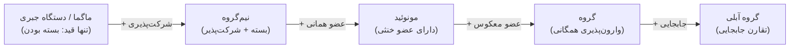

# 📘 تعریف دستگاه جبری

> [!abstract] انگیزه پیدایش و تصویر ذهنی (Intuition & Motivation)
> یک مجموعه محض در نظریه مجموعه‌ها، انباره‌ای ایستا از اعضاست که قواعدی برای برهم‌کنش میان آن‌ها تعریف نشده است. برای مطالعه رفتار محاسباتی، تقارن‌ها و ساختارهای جبری، نیاز به قالبی صلب داریم که مجموعه پایه را در کنار قوانین ترکیب پیوند دهد. مفهوم «دستگاه جبری» (یا ساختار جبری) این چارچوب بنیادین را فراهم می‌سازد و کالبد عام تمام شاخه‌های جبر مدرن به شمار می‌رود.
>
> تصویر ذهنی دستگاه جبری، یک زیست‌بوم محاسباتی مستقل است؛ مجموعه زمینه نقش اعضای این زیست‌بوم را دارد و اعمال جبری، قوانین واکنش و زایش عناصر درون آن مرز بسته را تعیین می‌کنند.

---

## ۱. تعریف صوری (Formal Definition)

> [!DEFINITION] تعریف صوری
> فرض کنید $S$ مجموعه‌ای ناتهی باشد و $*_1, *_2, \dots, *_k$ اعمالی دوتایی بر روی $S$ باشند. چندتایی مرتب:
> 
> $$(S, *_1, *_2, \dots, *_k)$$
> 
> یک **دستگاه جبری** (Algebraic System) یا **ساختار جبری** نامیده می‌شود. در حالتی که تنها یک عمل دوتایی $*$ روی مجموعه تعریف شده باشد، دستگاه $(S, *)$ را گاه «ماگما» (Magma) یا «گروپوید» (Groupoid) نیز می‌نامند.
> 
> شرایط صوری تحقق یک دستگاه جبری عبارت‌اند از:
> 1. **ناتهی بودن مجموعه زمینه (Carrier Set):** مجموعه حامل $S$ نباید تهی باشد ($S \neq \emptyset$).
> 2. **خوش‌تعریفی و [[خاصیت بسته بودن عمل دوتایی|بسته بودن اعمال]]:** به ازای هر اندیس $1 \le i \le k$، نگاشت $*_i \colon S \times S \to S$ یک [[تعریف عمل دوتایی|عمل دوتایی]] خوش‌تعریف و بسته بر روی $S$ باشد:
> 
> $$\forall x, y \in S \implies x *_i y \in S$$

---

## ۲. تعریف‌های هم‌ارز و ویژگی‌های کلیدی (Equivalents & Properties)

* **بیان‌های هم‌ارز:**
  * در جبر کلی (Universal Algebra)، دستگاه جبری به صورت زوج مرتب $\mathbf{A} = \langle A, \mathcal{F} \rangle$ تعریف می‌شود که در آن $A$ مجموعه حامل و $\mathcal{F}$ خانواده‌ای از اعمال متناهی‌المقدار (اعمال صفرتایی، یک‌تایی، دوتایی و نظایر آن) با آرایه‌های مشخص است. دستگاه جبری کلاسی علائیان حالت متداول متمرکز بر اعمال دوتایی است.
* **ویژگی‌های ساختاری اولیه:**
  * **سلسله‌مراتب اصول موضوعه:** دستگاه‌های جبری تک‌عملی بر حسب افزودن اصول موضوعه تدریجی، به ساختارهای غنی‌تر تکامل می‌یابند:

  * **دستگاه‌های چندعملی:** ساختارهایی مانند حلقه، میدان و جبر بول از ترکیب دو یا چند عمل دوتایی سازگار با قوانین توزیع‌پذیری شکل می‌گیرند.

---

## ۳. مصداق‌ها و مرز تعریف (Examples & Boundary Cases)

* **مثال کانونی:**
  * $(\mathbb{Z}, +)$ و $(\mathbb{Z}, \cdot)$: دستگاه‌های جبری تک‌عملی اعداد صحیح (رجوع به [[مثال نیم‌گروه‌های عددی طبیعی و صحیح تحت جمع و ضرب]]).
  * $(M_n(\mathbb{R}), \cdot)$: دستگاه جبری ضرب ماتریس‌های مربعی حقیقی (رجوع به [[مثال نیم‌گروه ضربی ماتریس‌های مربعی حقیقی]]).
  * $(\mathcal{P}(A), \cup, \cap)$: دستگاه جبری دوعملی روی مجموعه توانی تحت اجتماع و اشتراک (رجوع به [[مثال نیم‌گروه‌های مجموعه توانی تحت اشتراک و اجتماع]]).
  * $(\mathbb{R}, +, \cdot)$: دستگاه جبری دوعملی میدان اعداد حقیقی.
* **نامثال / نقض مرز تعریف:**
  * $(\mathbb{N}, -)$: یک دستگاه جبری نیست؛ زیرا تفریق روی اعداد طبیعی بسته نبوده و عمل دوتایی معتبری تولید نمی‌کند ($3 - 7 \notin \mathbb{N}$).
  * $(\emptyset, *)$: یک دستگاه جبری نیست؛ زیرا مجموعه زمینه طبق اصل تعریف باید ناتهی باشد.
  * $(\mathbb{R}, /)$: به دلیل عدم تعریف تقسیم بر صفر، یک دستگاه جبری روی $\mathbb{R}$ نیست.

---

## ۴. دام‌ها و هشدارهای مفهومی (Pitfalls)

> [!WARNING] دام رایج مفهومی
> ۱. **جدایی‌ناپذیری مجموعه از عمل:** یک مجموعه خام به خودی خود دستگاه جبری نیست. نوشتن صرف «مجموعه اعداد صحیح $\mathbb{Z}$» بیانگر دستگاه جبری نیست؛ ساختار جبری همواره نیازمند تصریح صریح عمل همراه آن است. برای نمونه، ساختار $(\mathbb{Z}, +)$ یک گروه آبلی است در حالی که ساختار $(\mathbb{Z}, \cdot)$ صرفاً یک نیم‌گروه مونوئیدی است.
>
> ۲. **اشتباه در فرض شرکت‌پذیری:** یک دستگاه جبری در عام‌ترین حالت خود (ماگما) هیچ فرضی درباره شرکت‌پذیری یا جابجایی اعمال ندارد؛ برای رسیدن به ساختار [[تعریف نیم‌گروه|نیم‌گروه]]، شرط شرکت‌پذیری باید به طور صریح ارزیابی یا اضافه گردد.
