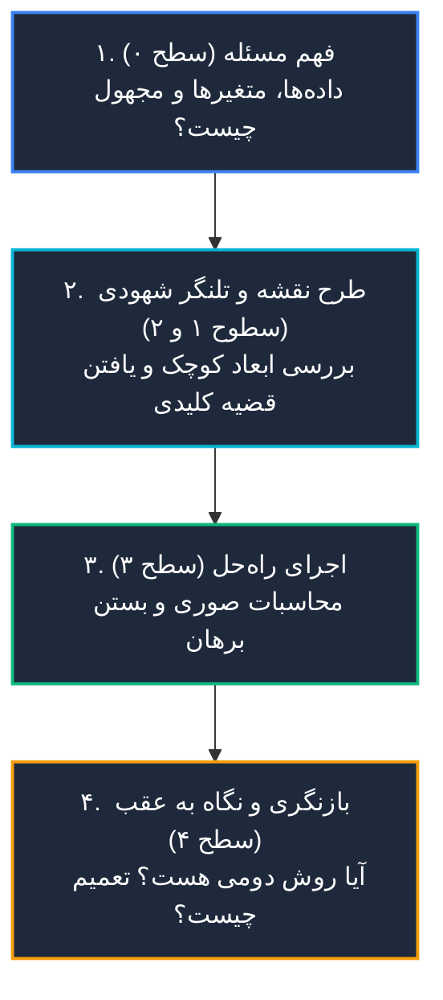

# ✍️ نقشه راه حل مسئله و کارگاه تمرین‌ها (Problem Solving Track)

> [!abstract] متدولوژی کارگاه حل مسئله
> این نقشه راه ویژه دانشجویانی است که می‌خواهند مفاهیم تئوریک را به **مهارت عملیاتی در حل تمرین‌ها، امتحانات میان‌ترم/پایان‌ترم و آزمون‌های کارشناسی ارشد** تبدیل کنند.  
> تمامی مسائل بر اساس **قانون عایق‌بندی ضد-لو-رفتن پاسخ** طراحی شده‌اند؛ یعنی شما ابتدا با صورت مسئله و **نردبان راهنمایی سقراطی پولیا (پله‌های ۰ تا ۴)** دست‌وپنجه نرم می‌کنید و تنها در صورت نیاز، راه‌حل تشریحی کامل را باز خواهید کرد.

---

## 🎯 ماتریس تمرین‌های ۵گانه فصل اول

| ردیف  | موضوع تمرین                  |                 ساختار جبری هدف                  | چالش اصلی مسئله                                                     |                        نردبان راهنمایی و حل                        |
| :---: | :--------------------------- | :----------------------------------------------: | :------------------------------------------------------------------ | :----------------------------------------------------------------: |
| **۱** | توابع خودنگاشت تحت ترکیب     |                  $(X^X, \circ)$                  | اثبات شرکت‌پذیری ترکیب نگاشت‌ها و تعیین همانی $\operatorname{id}_X$ |     [[تمرین نیم‌گروه توابع خودنگاشت با عنصر همانی تحت ترکیب]]      |
| **۲** | انتقالات خط راست در هندسه    |                   $(T, \circ)$                   | پارامتری‌سازی انتقالات $\varphi_a(x) = x+a$ و اثبات جابجایی         |      [[تمرین نیم‌گروه جابجایی انتقالات خط در هندسه اقلیدسی]]       |
| **۳** | عمل ترکیبی روی اعداد صحیح    |                $(\mathbb{Z}, *)$                 | کار با عمل $x+y-xy$ و اثبات زیرنیم‌گروه $T=\{x \le 1\}$             | [[تمرین نیم‌گروه و زیرنیم‌گروه عمل دوتایی ترکیبی روی اعداد صحیح]]  |
| **۴** | عناصر خنثی در جبر مجموعه‌ها  | $(\mathcal{P}(A), \cap), (\mathcal{P}(A), \cup)$ | حل معادلات مجموعه‌ای برای یافتن عضو همانی و تمایز با عضو صفر        |       [[تمرین تعیین عناصر همانی نیم‌گروه‌های مجموعه توانی]]        |
| **۵** | زیرنیم‌گروه ماتریس‌های منفرد |                   $(N, \cdot)$                   | کشف عضو همانی متمایز از $I_2$ و اثبات معکوس‌پذیری با $\det = 0$     | [[تمرین ساختار زیرنیم‌گروه جابجایی ماتریسی با عنصر همانی و معکوس]] |

---

## 🛠️ پروتکل ۴ مرحله‌ای جورج پولیا در حل مسائل این فصل

برای هر مسئله، مراحل زیر را طی کنید:

---

## ایستگاه ۱: توابع خودنگاشت و قضیه کیلی (تمرین ۱)
* ✍️ **مسئله:** [[تمرین نیم‌گروه توابع خودنگاشت با عنصر همانی تحت ترکیب]]
* 💡 **شگرد کلیدی:** اثبات شرکت‌پذیری ترکیب توابع به کمک ارزیابی روی عناصر دامنه:

  $$(f \circ (g \circ h))(x) = f((g \circ h)(x)) = f(g(h(x))) = ((f \circ g) \circ h)(x)$$
* 🗝️ **حل تشریحی:** [[حل تمرین نیم‌گروه توابع خودنگاشت تحت ترکیب]]
* 🚀 **پیوند ساختاری:** این تمرین سنگ‌بنای **قضیه نمایش کیلی در نیم‌گروه‌ها** است.

---

## ایستگاه ۲: مدل‌سازی هندسی و یکریختی‌ها (تمرین ۲)
* ✍️ **مسئله:** [[تمرین نیم‌گروه جابجایی انتقالات خط در هندسه اقلیدسی]]
* 💡 **شگرد کلیدی:** تبدیل مفهوم کیفی «انتقال خط» به فرمول تحلیلی $\varphi_a(x) = x + a$ و محاسبه ترکیب:

  $$(\varphi_a \circ \varphi_b)(x) = \varphi_a(x + b) = (x + b) + a = x + (a + b) = \varphi_{a+b}(x)$$
* 🗝️ **حل تشریحی:** [[حل تمرین نیم‌گروه جابجایی انتقالات خط]]
* 🚀 **پیوند ساختاری:** اثبات یکریختی ساختاری $(T, \circ) \cong (\mathbb{R}, +)$.

---

## ایستگاه ۳: شگردهای جبری و فاکتورگیری در اعمال غیراستاندارد (تمرین ۳)
* ✍️ **مسئله:** [[تمرین نیم‌گروه و زیرنیم‌گروه عمل دوتایی ترکیبی روی اعداد صحیح]]
* 💡 **شگرد کلیدی:** برای اثبات بسته بودن زیرمجموعه $T = \{x \in \mathbb{Z} \mid x \le 1\}$، از اتحاد جادویی زیر استفاده کنید:

  $$1 - (x * y) = 1 - (x + y - xy) = (1 - x)(1 - y)$$
  چون $x \le 1$ و $y \le 1$، حاصل‌ضرب دو عدد نامنفی همواره نامنفی است، لذا $1 - (x * y) \ge 0 \implies x * y \le 1$!
* 🗝️ **حل تشریحی:** [[حل تمرین نیم‌گروه و زیرنیم‌گروه عمل دوتایی ترکیبی روی اعداد صحیح]]

---

## ایستگاه ۴: معادلات مجموعه‌ای و دوگانگی در جبر بول (تمرین ۴)
* ✍️ **مسئله:** [[تمرین تعیین عناصر همانی نیم‌گروه‌های مجموعه توانی]]
* 💡 **شگرد کلیدی:**
  * در اشتراک: $X \cap E = X \implies E = A$ (مجموعه مرجع $A$ همانی است؛ تهی $\emptyset$ عضو جاذب یا صفر است).
  * در اجتماع: $X \cup E = X \implies E = \emptyset$ (تهی $\emptyset$ همانی است؛ مجموعه مرجع $A$ عضو جاذب است).
* 🗝️ **حل تشریحی:** [[حل تمرین تعیین عناصر همانی نیم‌گروه‌های مجموعه توانی]]

---

## ایستگاه ۵: چالش بزرگ ماتریس‌های منفرد (شاهکار تمرین ۵)
* ✍️ **مسئله:** [[تمرین ساختار زیرنیم‌گروه جابجایی ماتریسی با عنصر همانی و معکوس]]
* 💡 **شگرد کلیدی و هشدار دام مهلک:**
  * ماتریس‌های خانواده $A_x = \begin{pmatrix} x & x \\ 0 & 0 \end{pmatrix}$ همگی دارای دترمینان صفر هستند!
  * **تله رایج امتحانی:** گفتن اینکه «چون دترمینان صفر است پس معکوس ندارند».
  * **استدلال درست:** در دنیای درونی این زیرنیم‌گروه، ماتریس خنثی $E = \begin{pmatrix} 1 & 1 \\ 0 & 0 \end{pmatrix}$ است (نه $I_2$). معکوس هر ماتریس $A_x$ برابر است با:

    $$A_x^{-1} = \begin{pmatrix} 1/x & 1/x \\ 0 & 0 \end{pmatrix}$$
* 🗝️ **حل تشریحی:** [[حل تمرین ساختار زیرنیم‌گروه جابجایی ماتریسی با عنصر همانی و معکوس]]
* ⚠️ **مطالعه تکمیلی دام:** [[دام مفهومی عدم تطابق عنصر همانی نیم‌گروه و زیرنیم‌گروه]]
