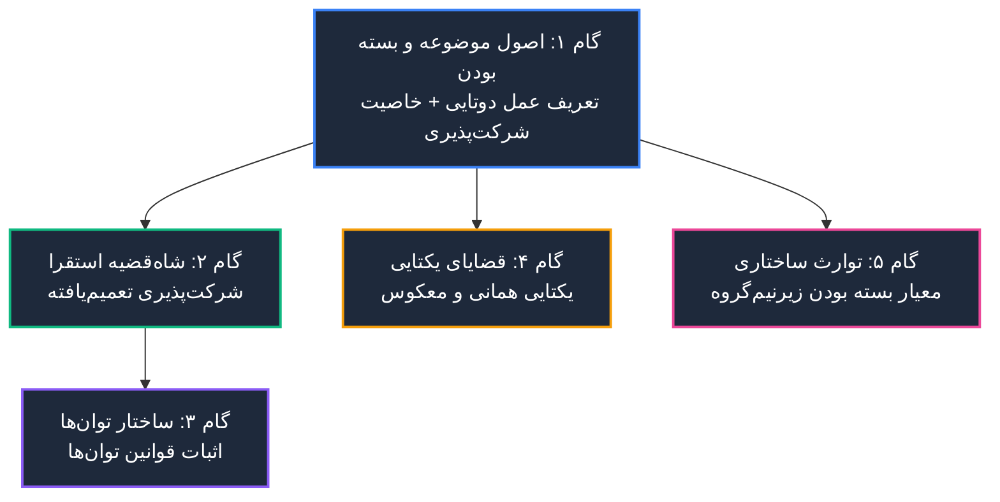

# 🏛️ نقشه راه مسیر دانشگاهی و اثبات‌های صوری (Academic Proof Track)

> [!abstract] هدف این مسیر یادگیری
> این نقشه راه ویژه دانشجویان و پژوهشگرانی تدوین شده است که هدفشان **تسلط بر براهین صوری، ظرافت‌های استقرایی و پی‌ریزی شالوده استنتاجی جبر مجرد** است. در این مسیر، از مثال‌های محاسباتی عبور کرده و مستقیماً روی **اصول موضوعه، ساختار قضایا، زنجیره‌های برهان و تحلیل شرایط مرزی فرض‌ها** تمرکز می‌کنیم.

---

## 🗺️ توالی گام‌های برهانی در فصل اول

---

## گام اول: پی‌ریزی اصول موضوعه و سورهای عمومی (Foundations)

یک نیم‌گروه صرفاً با دو اصل موضوعه تعریف می‌شود؛ اما همین دو اصل حامل نتایج شگفت‌انگیزی هستند:

1. 📘 **[[تعریف عمل دوتایی]]:** درک خوش‌تعریفی نگاشت $*: S \times S \to S$ و اصل تقدم مؤلفه‌ها.
2. 🏷️ **[[خاصیت بسته بودن عمل دوتایی]]:** بررسی دقیق شرط بسته بودن در زیرمجموعه‌ها.
3. 🏷️ **[[خاصیت شرکت‌پذیری عمل دوتایی]]:** تحلیل قید استقلال از پرانتزگذاری برای سه‌تایی‌ها: $(a * b) * c = a * (b * c)$.
4. 📘 **[[تعریف نیم‌گروه]]:** دستگاه جبری حاصل از تجمیع بسته بودن و شرکت‌پذیری.

---

## گام دوم: شاه‌قضیه شرکت‌پذیری تعمیم‌یافته و براهین استقرایی

چگونه از تساوی برای ۳ عنصر، به تساوی برای هر $n$ عنصر دلخواه می‌رسیم؟

1. 📌 **[[قضیه شرکت‌پذیری تعمیم‌یافته در نیم‌گروه]]:** صورت گزاره و تحلیل ضرورت فرض‌ها.
2. 🔍 **[[اثبات قضیه شرکت‌پذیری تعمیم‌یافته به روش استقرا]]:**  
   * **ایده محوری:** هر پرانتزگذاری به صورت $P = Q_1 * S_1$ تجزیه می‌شود. با اعمال مکرر شرکت‌پذیری، طول $S_1$ کاهش می‌یابد تا به فرم استاندارد $Q * x_n$ برسد.
   * **تکنیک برهان:** استقرای قوی ریاضی (Strong Induction).
3. 📌 **[[قضیه قوانین توان‌ها در نیم‌گروه]]:** برقراری اتحادهای بنیادی توان‌ها ($x^m x^n = x^{m+n}$ و $(x^m)^n = x^{mn}$).
4. 🔍 **[[اثبات قضیه قوانین توان‌ها در نیم‌گروه]]:** پیوند اثبات با قضیه شرکت‌پذیری تعمیم‌یافته و شمارش متوالی عوامل.

---

## گام سوم: قضایای یکتایی عناصر ویژه (Uniqueness Theorems)

در نیم‌گروه‌ها وجود عضو خنثی یا وارون تضمین نشده است؛ اما اصل شرکت‌پذیری تضمین می‌کند که **«در صورت وجود، این عناصر منحصربه‌فرد هستند»**:

1. 📘 **[[تعریف عنصر همانی در نیم‌گروه]]** و 📘 **[[تعریف عنصر معکوس در نیم‌گروه]]:** درک تمایز همانی چپ/راست و گذار به همانی دوطرفه.
2. 📌 **[[قضیه یکتایی عنصر همانی در نیم‌گروه]]:**
   * 🔍 **[[اثبات قضیه یکتایی عنصر همانی در نیم‌گروه]]:** بررسی زنجیره کلاسیک $e = e * e' = e'$.
3. 📌 **[[قضیه یکتایی عنصر معکوس در نیم‌گروه]]:**
   * 🔍 **[[اثبات قضیه یکتایی عنصر معکوس در نیم‌گروه]]:** کالبدشکافی برهان مبتنی بر شرکت‌پذیری:

     $$y = y * e = y * (x * z) = (y * x) * z = e * z = z$$
4. ⚡ **[[مثال نقض وجود لزومی عنصر همانی در نیم‌گروه اعداد صحیح زوج]]:** گواه نقض وجود الزامی همانی در ساختار ضربی $(2\mathbb{Z}, \cdot)$.

---

## گام چهارم: معیار زیرنیم‌گروه و توارث خواص (Substructures)

آیا برای اثبات این‌که یک زیرمجموعه، زیرنیم‌گروه است باید تمام اصول موضوعه را مجدداً چک کنیم؟ خیر!

1. 📘 **[[تعریف زیرنیم‌گروه]]:** زیرمجموعه ناتهی $T \subseteq S$ که با عمل محدودشده نیم‌گروه مستقلی بسازد.
2. 📌 **[[قضیه شرط لازم و کافی زیرنیم‌گروه بودن]]:** زیرمجموعه ناتهی $T$ زیرنیم‌گروه است اگر و تنها اگر تحت عمل بسته باشد.
3. 🔍 **[[اثبات قضیه شرط لازم و کافی زیرنیم‌گروه بودن]]:** اثبات چگونگی توارث خودکار خاصیت شرکت‌پذیری از مجموعه مادر به زیرمجموعه بدون نیاز به بررسی مجدد.
4. ⚠️ **[[دام مفهومی عدم تطابق عنصر همانی نیم‌گروه و زیرنیم‌گروه]]:**  
   * بررسی پدیده عناصر خودتوان ($e^2 = e$).
   * تحلیل مدل ماتریسی: چرا زیرنیم‌گروه می‌تواند عضو خنثایی متمایز از مادر داشته باشد؟
   * مطالعه موردی: [[مثال زیرنیم‌گروه ماتریس‌های قطری تک‌درایه‌ای و تمایز عنصر همانی]].

---

## 🎯 چک‌لیست تسلط بر مسیر آکادمیک
پیش از ورود به فصل دوم (گروه‌ها)، مطمئن شوید که می‌توانید احکام زیر را روی کاغذ سفید بدون مراجعه به جزوه اثبات کنید:
- [ ] اثبات استقرای قضیه شرکت‌پذیری تعمیم‌یافته برای $n$ عنصر.
- [ ] اثبات یکتایی عضو همانی در دو خط.
- [ ] اثبات یکتایی عضو معکوس به کمک خاصیت شرکت‌پذیری.
- [ ] اثبات این‌که چرا بسته بودن برای زیرنیم‌گروه بودن کافی است اما برای زیرگروه بودن کافی نیست.
