# 📊 نقشه گراف وابستگی و درخت یادگیری (Concept Dependency Graph)

> [!abstract] هدف این نقشه گراف
> این سند شبکه مفهومی فصل اول را در قالب یک **گراف جهت‌دار بدون دور (Strict DAG)** تجسم می‌کند. اگر در حین مطالعه یا حل یک مسئله احساس کردید مفهومی برایتان مبهم است، این گراف به شما نشان می‌دهد که دقیقاً کدام **گره پیش‌نیاز** را باید بازخوانی کنید. همچنین این ساختار مبنای ناوبری موتور هوش مصنوعی برای ارزیابی تسلط دانشجو است.

---

## ۱. نمای کلان جریان استنتاجی فصل اول (Topological DAG)

```mermaid
flowchart TD
    %% ==========================================
    %% تعاریف استایل‌ها بر پایه رده‌های UMKO
    %% ==========================================
    classDef conceptStyle fill:#1e293b,stroke:#38bdf8,stroke-width:2px,color:#fff;
    classDef propertyStyle fill:#1e293b,stroke:#c084fc,stroke-width:2px,color:#fff;
    classDef assertionStyle fill:#1e293b,stroke:#4ade80,stroke-width:2px,color:#fff;
    classDef proofStyle fill:#1e293b,stroke:#facc15,stroke-width:2px,color:#fff;
    classDef exampleStyle fill:#1e293b,stroke:#2dd4bf,stroke-width:2px,color:#fff;
    classDef problemStyle fill:#1e293b,stroke:#fb923c,stroke-width:2px,color:#fff;
    classDef pitfallStyle fill:#1e293b,stroke:#f43f5e,stroke-width:2px,color:#fff;

    %% ==========================================
    %% خوشه ۱: پایه‌ها و خواص
    %% ==========================================
    C1["تعریف عمل دوتایی"]:::conceptStyle
    C2["تعریف دستگاه جبری"]:::conceptStyle
    P3["خاصیت بسته بودن عمل دوتایی"]:::propertyStyle
    P4["خاصیت شرکت‌پذیری عمل دوتایی"]:::propertyStyle
    P6["خاصیت جابجایی عمل دوتایی"]:::propertyStyle
    C5["تعریف نیم‌گروه"]:::conceptStyle
    C7["تعریف نیم‌گروه جابجایی"]:::conceptStyle

    C1 --> C2
    C1 --> P3
    C1 --> P4
    C1 --> P6
    C2 --> C5
    P3 --> C5
    P4 --> C5
    C5 --> C7
    P6 --> C7

    %% ==========================================
    %% خوشه ۲: توان‌ها و شرکت‌پذیری تعمیم‌یافته
    %% ==========================================
    C13["تعریف توان‌های عنصر در نیم‌گروه"]:::conceptStyle
    A14["قضیه شرکت‌پذیری تعمیم‌یافته در نیم‌گروه"]:::assertionStyle
    PR15["اثبات قضیه شرکت‌پذیری تعمیم‌یافته به روش استقرا"]:::proofStyle
    A16["قضیه قوانین توان‌ها در نیم‌گروه"]:::assertionStyle
    PR17["اثبات قضیه قوانین توان‌ها در نیم‌گروه"]:::proofStyle

    C5 --> C13
    C5 --> A14
    A14 -.->|"rel_proves"| PR15
    P4 -.->|"rel_depends_proof"| PR15
    C13 --> A16
    A14 --> A16
    A16 -.->|"rel_proves"| PR17

    %% ==========================================
    %% خوشه ۳: همانی، معکوس و یکتایی‌ها
    %% ==========================================
    C18["تعریف عنصر همانی در نیم‌گروه"]:::conceptStyle
    C19["تعریف عنصر معکوس در نیم‌گروه"]:::conceptStyle
    A22["قضیه یکتایی عنصر همانی در نیم‌گروه"]:::assertionStyle
    PR23["اثبات قضیه یکتایی عنصر همانی در نیم‌گروه"]:::proofStyle
    A24["قضیه یکتایی عنصر معکوس در نیم‌گروه"]:::assertionStyle
    PR25["اثبات قضیه یکتایی عنصر معکوس در نیم‌گروه"]:::proofStyle

    C5 --> C18
    C18 --> C19
    C18 --> A22
    A22 -.->|"rel_proves"| PR23
    C19 --> A24
    A24 -.->|"rel_proves"| PR25
    P4 -.->|"rel_depends_proof"| PR25

    %% ==========================================
    %% خوشه ۴: زیرنیم‌گروه و معیارها
    %% ==========================================
    C26["تعریف زیرنیم‌گروه"]:::conceptStyle
    A28["قضیه شرط لازم و کافی زیرنیم‌گروه بودن"]:::assertionStyle
    PR29["اثبات قضیه شرط لازم و کافی زیرنیم‌گروه بودن"]:::proofStyle
    E30["مثال زیرنیم‌گروه ماتریس‌های قطری تک‌درایه‌ای"]:::exampleStyle
    PIT31["دام مفهومی عدم تطابق عنصر همانی نیم‌گروه و زیرنیم‌گروه"]:::pitfallStyle

    C5 --> C26
    C26 --> A28
    A28 -.->|"rel_proves"| PR29
    C26 --> E30
    C18 --> PIT31
    C26 --> PIT31
    E30 --> PIT31

    %% ==========================================
    %% خوشه ۵: تمرین‌های محوری
    %% ==========================================
    PROB32["تمرین ۱: توابع خودنگاشت"]:::problemStyle
    PROB34["تمرین ۲: انتقالات خط"]:::problemStyle
    PROB36["تمرین ۳: عمل ترکیبی اعداد صحیح"]:::problemStyle
    PROB38["تمرین ۴: مجموعه‌های توانی"]:::problemStyle
    PROB40["تمرین ۵: ساختار ماتریسی منفرد"]:::problemStyle

    C5 --> PROB32
    C18 --> PROB32
    C7 --> PROB34
    C18 --> PROB34
    C5 --> PROB36
    A28 --> PROB36
    C18 --> PROB38
    C26 --> PROB40
    C18 --> PROB40
    C19 --> PROB40
    A28 --> PROB40
```

---

## ۲. راهنمای رنگ‌بندی و دسته‌بندی گره‌ها (Legend)

* 🟦 **آبی تیره (`concept`):** تعاریف ساختارها و مفاهیم بنیادی (نیازمند فهم عمیق).
* 🟪 **بنفش (`property`):** ویژگی‌های بولی قابل صدق روی اعمال (بسته بودن، شرکت‌پذیری، جابجایی).
* 🟩 **سبز (`assertion`):** صورت رسمی قضایا و گزاره‌های ریاضی.
* 🟨 **زرد (`proof`):** براهین صوری کامل (متصل به قضایا با یال خط‌چین `rel_proves`).
* 🟩 **فیروزه‌ای (`example`):** مدل‌های مصداقی و مثال‌های کانونی/مرزی.
* 🟧 **نارنجی (`problem`):** تمرین‌های پایان فصل (وابسته به مفاهیم و قضایای بالادست).
* 🟥 **قرمز (`pitfall`):** دام‌های مفهومی و نقاط لغزش رایج دانشجویان.

---

## ۳. تحلیل سطوح شناختی بلوم در گره‌های فصل اول (Bloom's Taxonomy)

برای برنامه‌ریزی هدفمند مطالعه، گره‌ها بر اساس پیچیدگی شناختی در ۴ سطح رده‌بندی شده‌اند:

### سطح ۱: یادآوری و بازشناسی (Remember)
* [[تعریف عمل دوتایی]]
* [[تعریف توان‌های عنصر در نیم‌گروه]]

### سطح ۲: درک و فهم مفهومی (Understand)
* [[تعریف دستگاه جبری]]
* [[تعریف نیم‌گروه]] و [[تعریف نیم‌گروه جابجایی]]
* [[تعریف عنصر همانی در نیم‌گروه]] و [[تعریف عنصر معکوس در نیم‌گروه]]
* [[تعریف زیرنیم‌گروه]]
* کلیه فایل‌های مثال‌های کانونی (اعداد، توابع، ماتریس‌ها)

### سطح ۳: به‌کارگیری و اثبات (Apply)
* [[قضیه قوانین توان‌ها در نیم‌گروه]] و [[اثبات قضیه قوانین توان‌ها در نیم‌گروه]]
* [[قضیه یکتایی عنصر همانی در نیم‌گروه]] و اثبات آن
* [[قضیه یکتایی عنصر معکوس در نیم‌گروه]] و اثبات آن
* [[قضیه شرط لازم و کافی زیرنیم‌گروه بودن]] و اثبات آن
* کلیه مسائل و تمرین‌های ۵گانه فصل ([[تمرین نیم‌گروه توابع خودنگاشت با عنصر همانی تحت ترکیب|تمرین ۱]] تا [[تمرین ساختار زیرنیم‌گروه جابجایی ماتریسی با عنصر همانی و معکوس|تمرین ۵]])

### سطح ۴: تحلیل و کالبدشکافی ساختاری (Analyze & Evaluate)
* [[قضیه شرکت‌پذیری تعمیم‌یافته در نیم‌گروه]] و برهان استقرای قوی آن
* [[دام مفهومی عدم تطابق عنصر همانی نیم‌گروه و زیرنیم‌گروه]]
* [[مثال زیرنیم‌گروه ماتریس‌های قطری تک‌درایه‌ای و تمایز عنصر همانی]]

---

## ۴. ناوبری عیب‌یابی برای دانشجو (Self-Diagnosis Guide)

* **اگر در درک یکتایی معکوس مشکل دارید:**  
  $\to$ ابتدا [[خاصیت شرکت‌پذیری عمل دوتایی]] و [[تعریف عنصر همانی در نیم‌گروه]] را مجدداً مرور کنید.
* **اگر در حل تمرین ۳ (عمل ترکیبی $x+y-xy$) گیر کرده‌اید:**  
  $\to$ ابتدا [[قضیه شرط لازم و کافی زیرنیم‌گروه بودن]] را بخوانید و از اتحاد جبری فاکتورگیری استفاده کنید.
* **اگر در تمرین ۵ شگفت‌زده شده‌اید که چرا ماتریس‌های با دترمینان صفر وارون‌پذیرند:**  
  $\to$ بلافاصله به مطالعه [[دام مفهومی عدم تطابق عنصر همانی نیم‌گروه و زیرنیم‌گروه]] بپردازید!
