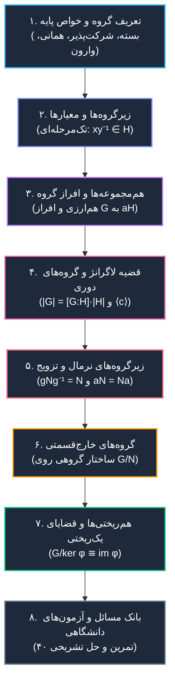

# 🧭 فصل دوم: نظریه گروه‌ها (Group Theory)

> [!abstract] بیانیه راهبردی و قطب‌نمای آموزشی فصل دوم
> به جهان تقارن، وارون‌پذیری و ساختارهای بنیادین جبر مجرد خوش آمدید. اگر در [[فصل اول - نیم‌گروه‌ها]] آموختیم که چگونه یک عمل دوتایی تنها با اتکا به شرط شرکت‌پذیری می‌تواند جریان برگشت‌ناپذیری از ترکیب عناصر بسازد، در این فصل با افزودن دو گوهر گران‌بها—**«عضو خنثی یکتا»** و **«وارون‌پذیری همگانی»**—وارد قلمرو شکوهمند **گروه‌ها (Groups)** می‌شویم.
> 
> این درسنامه یک طومار متنی سنگین نیست؛ بلکه یک **قطب‌نمای ناوبری فرامتنی (Hypertext Guide)** است که شما را در جریان پیوسته و منطقی **۲۰۵ اتم دانشی مستقل** هدایت می‌کند. هر مفهوم، قضیه، برهان صوری و مسئله در فایلی اختصاصی، ریزدانه و کپسوله‌شده زندگی می‌کند.

---

## 🗺️ نقشه راه و جریان منطقی یادگیری (Learning DAG)

---

## 🏛️ بخش ۱: مفاهیم بنیادین، تعریف گروه و قوانین حذف
نقطه آغازین، مجهز کردن ماگما و نیم‌گروه به تعادل تقارنی است.

1. **مبانی صوری:**
   * [[تعریف گروه]]: سیستم جبری $(G, *)$ با بسته بودن، شرکت‌پذیری، عنصر خنثی $e$ و وارون $x^{-1}$.
   * [[خاصیت عضو خنثی و معکوس یک‌طرفه در ساختارهای جبری]]: بررسی شرایط یک‌طرفه و تطابق در گروه.
   * [[تعریف گروه جابجایی]]: گروه‌های آبلی متقارن ($xy = yx$).
   * [[تعریف گروه متناهی و مرتبه گروه]]: تعریف $|G|$ یا $O(G)$.
2. **قوانین حاکم بر عناصر:**
   * [[قضیه خواص بنیادی عناصر و قوانین حذف در گروه]] و برهان مستقل آن در [[اثبات قضیه خواص بنیادی عناصر و قوانین حذف در گروه]]: حذف چپ ($ax=ay \implies x=y$) و معکوس ضرب $(xy)^{-1}=y^{-1}x^{-1}$.
   * [[نتیجه جابجایی توان‌های یک عنصر در گروه]] و [[اثبات نتیجه جابجایی توان‌های یک عنصر در گروه]]: اثبات $x^r x^s = x^s x^r$.
   * [[مثال نقض برقراری قوانین حذف در نیم‌گروه‌ها]]: مرز تفکیک نیم‌گروه از گروه.
3. **کاتالوگ مثال‌های مبنایی:**
   * گروه‌های عددی: [[مثال گروه‌های عددی جمعی و ضربی متعارف]] و [[مثال گروه‌های جمعی مضارب و کسرهای صحیح]].
   * گروه‌های تحلیلی و هندسی: [[مثال گروه متناهی ریشه‌های nام واحد]] ($P_n$) و [[مثال گروه دایره‌ای یکانی اعداد مختلط]] ($T$).
   * جایگشت‌ها و ماتریس‌ها: [[تعریف گروه جایگشت و گروه متقارن]] ($S_n$)، [[مثال گروه اقلیدسی دوبعدی و تبدیلات صلب]]، و [[مثال گروه خطی عمومی و گروه خطی خاص ماتریس‌ها]] ($GL_n, SL_n$).

---

## 🛡️ بخش ۲: زیرگروه‌ها و معیارهای صلب زیرگروهی
بررسی جزیره‌های پایدار درون گروه مادر.

1. **تعریف و ملاک تک‌مرحله‌ای:**
   * [[تعریف زیرگروه]]: زیرمجموعه ناتهی $H \leqslant G$ که خود یک گروه مستقل است.
   * [[قضیه معیار تک‌مرحله‌ای زیرگروه بودن]] و [[اثبات قضیه معیار تک‌مرحله‌ای زیرگروه بودن]]: شرط طلایی $\forall x, y \in H \implies xy^{-1} \in H$.
2. **خواص جبری و تقاطع‌ها:**
   * [[مثال زیرگروه‌های بدیهی هر گروه]]: زیرگروه‌های $\{e\}$ و $G$.
   * [[مثال زنجیر زیرگروه‌های عددی و ماتریسی]]: زنجیره‌های $\mathbb{Z} \leqslant \mathbb{Q} \leqslant \mathbb{R} \leqslant \mathbb{C}$ و $SL_n \leqslant GL_n$.
   * [[قضیه زیرگروه بودن اشتراک دو زیرگروه]] و [[گزاره زیرگروه بودن اشتراک دلخواه خانواده‌ای از زیرگروه‌ها]] همراه با براهین در [[اثبات قضیه زیرگروه بودن اشتراک دو زیرگروه]] و [[اثبات گزاره زیرگروه بودن اشتراک دلخواه خانواده‌ای از زیرگروه‌ها]].
   * [[مثال نقض زیرگروه بودن اجتماع دو زیرگروه]]: اثبات عدم زیرگروه بودن $2\mathbb{Z} \cup 3\mathbb{Z}$.

---

## 🧩 بخش ۳: هم‌مجموعه‌ها، شاخص و حاصلضرب زیرگروه‌ها
تقسیم قلمرو گروه به بلوک‌های هم‌اندازه از طریق انتقال زیرگروه.

1. **رابطه هم‌ارزی و تعریف هم‌مجموعه:**
   * [[رابطه هم‌ارزی القا شده توسط زیرگروه]] و اثبات رابطه هم‌ارزی در [[اثبات رابطه هم‌ارزی القا شده توسط زیرگروه]].
   * [[تعریف هم‌مجموعه راست و چپ زیرگروه]]: رده‌های $Hx$ و $xH$.
   * [[لم برابری عنصر با هم‌مجموعه خود تحت تعلق]] و [[اثبات لم برابری عنصر با هم‌مجموعه خود تحت تعلق]].
   * [[لم شرط لازم و کافی برابری دو هم‌مجموعه]] و برهان در [[اثبات لم شرط لازم و کافی برابری دو هم‌مجموعه]].
2. **افراز گروه و شاخص:**
   * [[لم افراز گروه به اجتماع مجزای هم‌مجموعه‌ها]] و [[اثبات لم افراز گروه به اجتماع مجزای هم‌مجموعه‌ها]].
   * [[لم تناظر دوسویی میان عناصر زیرگروه و هم‌مجموعه]] و برهان در [[اثبات لم تناظر دوسویی میان عناصر زیرگروه و هم‌مجموعه]]: اثبات $|Hx| = |H|$.
   * [[تعریف شاخص زیرگروه در گروه]]: نماد $[G : H]$ به عنوان تعداد هم‌مجموعه‌های متمایز.
   * [[لم تناظر دوسویی میان مجموعه‌های هم‌مجموعه‌های راست و چپ]] و [[اثبات لم تناظر دوسویی میان مجموعه‌های هم‌مجموعه‌های راست و چپ]].
3. **حاصلضرب زیرگروه‌ها:**
   * [[تعریف حاصلضرب دو زیرگروه]]: مجموعه $HK = \{hk \mid h \in H, k \in K\}$.
   * [[قضیه شرط لازم و کافی زیرگروه بودن حاصلضرب دو زیرگروه]] و [[اثبات قضیه شرط لازم و کافی زیرگروه بودن حاصلضرب دو زیرگروه]]: شرط $HK = KH$.
   * [[قضیه فرمول کاردینالیتی حاصلضرب دو زیرگروه متناهی]] و [[اثبات قضیه فرمول کاردینالیتی حاصلضرب دو زیرگروه متناهی]]: فرمول $|HK| = \frac{|H| \cdot |K|}{|H \cap K|}$.

---

## 👑 بخش ۴: قضیه لاگرانژ، مرتبه عناصر و گروه‌های دوری
قلب تپنده ساختار گروه‌های متناهی.

1. **شاه‌قضیه لاگرانژ و پیامدهای آن:**
   * [[قضیه لاگرانژ در گروه‌های متناهی]]: رابطه زرین $|G| = [G : H] \cdot |H|$.
   * برهان دقیق در [[اثبات قضیه لاگرانژ در گروه‌های متناهی]].
   * [[نتیجه عاد کردن مرتبه زیرگروه بر مرتبه گروه متناهی]]: $H \leqslant G \implies |H| \mid |G|$.
   * [[تعریف مرتبه عنصر در گروه]]: ناوردای $|x|$ یا $o(x)$.
   * [[نتیجه عاد کردن مرتبه هر عنصر بر مرتبه گروه]]: $x \in G \implies |x| \mid |G|$ و $x^{|G|} = e$.
   * [[نتیجه اول بودن مرتبه و دوری بودن گروه]]: هر گروه از مرتبه اول، دوری و آبلی است.
   * [[قضیه ضرب شاخص‌ها در زنجیر زیرگروه‌ها]] (برج زیرگروه‌ها): $[G : K] = [G : H] \cdot [H : K]$.
2. **گروه‌های دوری:**
   * [[تعریف گروه دوری و عنصر مولد]]: گروه $C = \langle c \rangle = \{c^n \mid n \in \mathbb{Z}\}$.
   * [[قضیه دوری بودن تمامی زیرگروه‌های یک گروه دوری]] و برهان استقرایی الگوریتم تقسیم در [[اثبات قضیه دوری بودن تمامی زیرگروه‌های یک گروه دوری]].
   * [[قضیه رده‌بندی زیرگروه‌های گروه دوری متناهی]]: تطابق یکتا با مقسوم‌علیه‌های $n$.

---

## ⚖️ بخش ۵: زیرگروه‌های نرمال و عمل تزویج
پل ورود به جبر ساختاریافته نوین و خارج‌قسمت‌ها.

1. **عمل تزویج (Conjugation):**
   * [[تعریف تزویج عنصر و زیرگروه مزدوج]]: $a^b = b^{-1}ab$ و $H^g = g^{-1}Hg$.
   * [[لم خواص بنیادین عمل تزویج در گروه]] و برهان در [[اثبات لم خواص بنیادین عمل تزویج در گروه]].
2. **زیرگروه‌های نرمال:**
   * [[تعریف زیرگروه نرمال]]: زیرگروه خود-مزدوج $N \trianglelefteq G$.
   * [[لم شرط لازم و کافی نرمال بودن بر حسب انطباق هم‌مجموعه‌ها]] و برهان در [[اثبات لم شرط لازم و کافی نرمال بودن بر حسب انطباق هم‌مجموعه‌ها]]: شرط $gN = Ng$.
   * [[قضیه نرمال بودن زیرگروه با شاخص دو]]: هر زیرگروه با $[G:H]=2$ الزاماً نرمال است.
   * برهان زیبای برابری مکمل‌ها در [[اثبات قضیه نرمال بودن زیرگروه با شاخص دو]].
   * [[قضیه زیرگروه بودن حاصلضرب زیرگروه نرمال در زیرگروه دلخواه]]: اگر $N \trianglelefteq G$ آنگاه $HN \leqslant G$.

---

## ➗ بخش ۶: گروه‌های خارج‌قسمتی (Quotient Groups)
نگاه به گروه از نمای بالا و تقلیل ساختار به رده‌ها.

1. **خوش‌تعریفی ضرب رده‌ها:**
   * [[لم خوش‌تعریفی ضرب هم‌مجموعه‌ها در حضور زیرگروه نرمال]] و [[اثبات لم خوش‌تعریفی ضرب هم‌مجموعه‌ها در حضور زیرگروه نرمال]]: اثبات $(xN)(yN) = xyN$.
2. **ساختار گروه خارج‌قسمتی:**
   * [[قضیه تشکیل گروه خارج‌قسمتی توسط مجموعه هم‌مجموعه‌های زیرگروه نرمال]]: ساختار جبری $(G/N, \cdot)$.
   * برهان صوری اصول موضوع در [[اثبات قضیه تشکیل گروه خارج‌قسمتی توسط مجموعه هم‌مجموعه‌های زیرگروه نرمال]].
   * [[مثال گروه خارج‌قسمتی اعداد صحیح به پیمانه n]]: بررسی ساختار بنیادین $\mathbb{Z}/n\mathbb{Z}$.
   * [[قضیه آبلی بودن گروه خارج‌قسمتی بر روی زیرگروه شامل مشتق]]: تحلیل خواص ساختاری $G/N$.

---

## 🔗 بخش ۷: هم‌ریختی‌ها و قضایای بنیادین یک‌ریختی
مقایسه و نگاشت ساختارها و قضایای ایزومورفیسم نوتر.

1. **تعریف هم‌ریختی و هسته:**
   * [[تعریف هم‌ریختی گروهی]]: نگاشت حفظ‌کننده عمل $\varphi(xy) = \varphi(x)\varphi(y)$.
   * [[لم خواص ساختاری تصویر و هسته هم‌ریختی]]: اثبات $\varphi(e)=e'$ و $\varphi(x^{-1})=\varphi(x)^{-1}$.
   * [[تعریف هسته و تصویر هم‌ریختی گروهی]]: $\ker \varphi$ و $\operatorname{im} \varphi$.
   * [[قضیه نرمال بودن همیشگی هسته هم‌ریختی]] و برهان در [[اثبات قضیه نرمال بودن همیشگی هسته هم‌ریختی]].
   * [[لم بروریختی نگاشت خارج‌قسمتی متعارف]] (اپیمورفیسم کانونیک $q: G \to G/N$).
2. **یک‌ریختی و قضایای بزرگ نوتر:**
   * [[تعریف یک‌ریختی گروهی]]: هم‌ریختی دوسویی و مفهوم $G \cong H$.
   * [[قضیه یک‌ریختی گروه‌های دوری هم‌مرتبه]]: هر گروه دوری نامتناهی با $\mathbb{Z}$ و متناهی با $\mathbb{Z}_n$ یک‌ریخت است.
   * [[قضیه اول یک‌ریختی گروه‌ها]] (شاه‌قضیه): $G / \ker \varphi \cong \operatorname{im} \varphi$.
   * برهان دقیق فاکتورگیری در [[اثبات قضیه اول یک‌ریختی گروه‌ها]].
   * [[قضیه دوم یک‌ریختی گروه‌ها]]: تطابق خارج‌قسمت‌های تودرتو $\frac{G/K}{H/K} \cong \frac{G}{H}$.
   * برهان کاربردی در [[اثبات قضیه دوم یک‌ریختی گروه‌ها]].

---

## ⚠️ بخش ۸: دام‌های مفهومی و مرزهای خطا (Pitfalls)
ایمن‌سازی ذهن ریاضی در برابر خطاهای رایج:

1. [[دام مفهومی لزوم نرمال بودن زیرگروه در تشکیل گروه خارج‌قسمتی]]: چرا $G/H$ بدون نرمال بودن گروه نیست؟
2. [[دام مفهومی کج‌فهمی عکس قضیه لاگرانژ و گروه متناوب A4]]: چرا هر مقسوم‌علیه مرتبه، زیرگروه نمی‌سازد؟
3. [[دام مفهومی خوش‌تعریفی نگاشت تناظر هم‌مجموعه‌های راست و چپ]]: چرا نگاشت $Hx \mapsto xH$ غلط و $Hx \mapsto x^{-1}H$ درست است؟
4. [[دام مفهومی اعمال جبری ضرب و تقسیم در گروه‌های ناآبلی]]: رفع خطای خط کسری در گروه‌های نامتقارن.

---

## 📝 بخش ۹: بانک جامع ۴۰ تمرین دانشگاهی و حل‌های تشریحی
۴۰ تمرین کامل جزوه دکتر علائیان به همراه حل‌های تشریحی مستقل، تفکیک‌شده و گام‌به‌گام در پوشه `10-تمرین‌ها و حل‌های تشریحی/` قرار گرفته‌اند:

* **تمرین‌های هم‌مجموعه‌ها و افراز:** تمرین‌های ۱۲۶ تا ۱۳۱.
* **تمرین‌های زیرگروه و دوری:** تمرین‌های ۱۳۲ تا ۱۶۳.
* **تمرین‌های هم‌ریختی و هسته:** تمرین‌های ۱۶۴ تا ۱۶۵.
* **تمرین‌های جامع پایانی:** تمرین‌های ۱۶۶ تا ۲۰۵.

*(برای مشاهده صورت هر مسئله و مطالعه راه‌حل تشریحی گام‌به‌گام با کال‌اوت تاشوی ضد-لو-رفتن، مستقیماً به یادداشت متناظر در پوشه تمرین‌ها رجوع فرمایید).*
