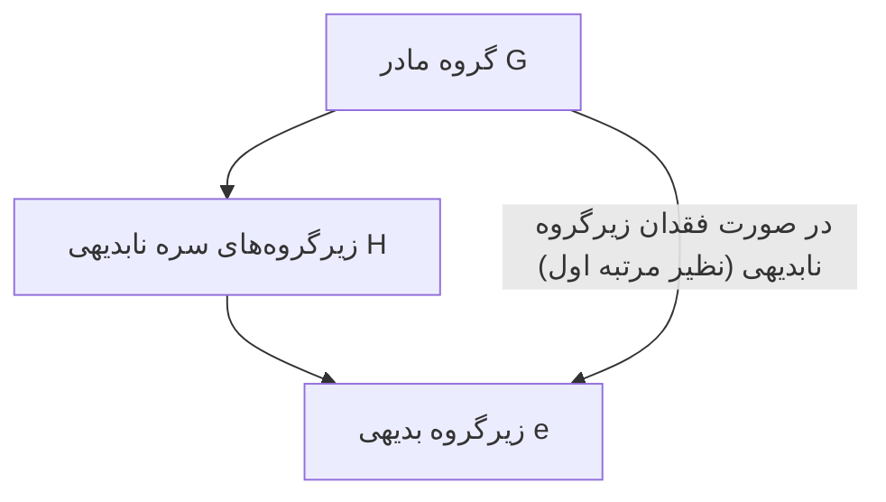

# 💡 مثال زیرگروه‌های بدیهی هر گروه

> [!abstract] هدف آموزشی مثال (Pedagogical Objective)
> در هر گروه دلخواه $(G, *)$ صرف‌نظر از مرتبه، ماهیت عناصر، یا نوع عمل جبری آن، همواره دو زیرمجموعه متمایز (یا منطبق در حالت گروه تک‌عضوی) وجود دارند که بدون نیاز به هیچ فرض ویژه‌ای، اصول موضوع گروهی را تمام و کمال ارضا می‌کنند: زیرمجموعه تک‌عضوی متشکل از تنها عنصر همانی $\{e\}$ و کل مجموعه $G$.
>
> این دو زیرگروه را «زیرگروه‌های بدیهی» (Trivial Subgroups) می‌نامند. شناخت این دو نقطه حدی، چارچوب اولیه رده‌بندی زیرگروه‌ها را پی‌ریزی کرده و تعریف مفاهیم بنیادینی چون «زیرگروه‌های سره»، «گروه‌های ساده» و «ساختار گروه‌های با مرتبه اول» را ممکن می‌سازد (مثال ۸.۲ ص ۸ جزوه).

---

## ۱. بیان صوری مثال (Formal Statement)

> [!EXAMPLE] زیرگروه‌های بدیهی هر گروه (مثال ۸.۲ ص ۸ جزوه)
> فرض کنید $(G, *)$ یک [[تعریف گروه|گروه]] دلخواه با عضو خنثی $e$ باشد. در این صورت، زیرمجموعه‌های زیر همواره زیرگروه $G$ هستند:
>
> ۱. **زیرگروه همانی / زیرگروه بدیهی (Trivial Subgroup):**
>    مجموعه تک‌عضوی $E = \{e\}$ که تنها شامل عضو خنثی گروه است:
>    
>    $$\{e\} \leqslant G$$
>
> ۲. **زیرگروه ناسره / کل گروه (Improper Subgroup):**
>    مجموعه کامل عناصر گروه مادر:
>    
>    $$G \leqslant G$$
>
> این دو زیرگروه را مجموعاً **زیرگروه‌های بدیهی** (Trivial Subgroups) گروه $G$ می‌نامند.

---

## ۲. اثبات گام‌به‌گام زیرگروه بودن زیرمجموعه‌های بدیهی

برای اثبات صحت این گزاره‌ها، از [[قضیه معیار تک‌مرحله‌ای زیرگروه بودن|معیار تک‌مرحله‌ای زیرگروه بودن]] (قضیه ۵.۲) استفاده می‌کنیم:

### اثبات برای زیرگروه تک‌عضوی $E = \{e\}$:
۱. **شرط ناتهی بودن:**
   مجموعه $E$ دارای یک عضو است ($e \in E$)، بنابراین $E \neq \emptyset$.
۲. **اعمال معیار تک‌مرحله‌ای:**
   تنها عضو موجود در $E$ عنصر $e$ است. بنابراین اگر دو عضو دلخواه $x, y \in E$ را انتخاب کنیم، الزاماً $x = e$ و $y = e$ خواهند بود.
   معکوس عضو خنثی برابر با خود عضو خنثی است ($e^{-1} = e$). بنابراین:
   
   $$x * y^{-1} = e * e^{-1} = e * e = e$$
   
   از آنجا که $e \in E$ است، نتیجه می‌شود که:
   
   $$\forall x, y \in E \implies x * y^{-1} \in E$$
   
   بنابراین طبق قضیه ۵.۲، $\{e\} \leqslant G$.

### اثبات برای کل مجموعه $G$:
۱. **شرط ناتهی بودن:**
   چون $G$ طبق اصل موضوع تعریف گروه حداقل شامل عضو خنثی $e$ است، پس $G \neq \emptyset$.
۲. **اعمال معیار تک‌مرحله‌ای:**
   به ازای هر $x, y \in G$، چون $G$ گروه است، معکوس $y^{-1}$ در $G$ وجود دارد. همچنین به دلیل بسته بودن عمل دوتایی در گروه $G$، حاصل ترکیب $x * y^{-1}$ نیز حتماً متعلق به $G$ است:
   
   $$\forall x, y \in G \implies x * y^{-1} \in G$$
   
   بنابراین طبق قضیه ۵.۲، $G \leqslant G$.

---

## ۳. اصطلاح‌شناسی و دسته‌بندی زیرگروه‌ها بر پایه زیرگروه‌های بدیهی

شناخت زیرگروه‌های بدیهی امکان تفکیک دقیق زیرگروه‌ها را فراهم می‌آورد:

* **زیرگروه سره (Proper Subgroup):**
  زیرگروهی مانند $H \leqslant G$ را سره می‌نامند هرگاه $H \neq G$ باشد و با نماد $H < G$ نشان می‌دهند. در این حالت $H$ تمام اعضای $G$ را در بر ندارد.
* **زیرگروه ناسره (Improper Subgroup):**
  خود گروه $G$ به عنوان زیرگروهی از خودش ($G \leqslant G$).
* **زیرگروه نابدیهی (Non-trivial Subgroup):**
  زیرگروهی مانند $H \leqslant G$ که شامل عناصری فراتر از عضو همانی باشد ($H \neq \{e\}$).
* **زیرگروه سره نابدیهی (Proper Non-trivial Subgroup):**
  زیرگروهی که در زنجیره شمول زیر قرار گیرد:
  
  $$\{e\} \subsetneq H \subsetneq G$$

---

## ۴. مصداق‌ها در دستگاه‌های مختلف جبری

* **در گروه جمعی اعداد صحیح $(\mathbb{Z}, +)$:**
  عضو خنثی صفر است ($e = 0$). زیرگروه بدیهی تک‌عضوی برابر است با $\{0\} = 0\mathbb{Z}$ و زیرگروه ناسره برابر با $\mathbb{Z} = 1\mathbb{Z}$ است. تمامی زیرگروه‌های مضارب $m\mathbb{Z}$ به ازای $|m| \ge 2$ زیرگروه‌های سره نابدیهی هستند.
* **در گروه ضربی اعداد حقیقی ناصفر $(\mathbb{R}^*, \cdot)$:**
  عضو خنثی یک است ($e = 1$). زیرگروه بدیهی $\{1\}$ و زیرگروه ناسره $\mathbb{R}^*$ است. زیرگروه اعداد مثبت $\mathbb{R}^+$ و زیرگروه دو عضوی $\{1, -1\}$ نمونه‌هایی از زیرگروه‌های سره نابدیهی هستند.
* **در گروه ماتریس‌های معکوس‌پذیر $GL_n(\mathbb{R})$:**
  عضو خنثی ماتریس همانی $I_n$ است. زیرگروه بدیهی برابر است با $\{I_n\}$ و زیرگروه ناسره $GL_n(\mathbb{R})$. گروه خطی خاص $SL_n(\mathbb{R})$ یک زیرگروه سره نابدیهی است.

---

## ۵. قضایای ساختاری مرتبط و پیش‌ارجاع‌ها

* **گروه‌های فاقد هرگونه زیرگروه سره نابدیهی:**
  اگر مرتبه یک گروه متناهی عددی اول باشد ($|G| = p$)، طبق قضیه لاگرانژ مرتبه هر زیرگروه باید مقسوم‌علیه $p$ باشد. چون مقسوم‌علیه‌های $p$ تنها ۱ و $p$ هستند، این گروه‌ها **تنها و تنها دارای همان دو زیرگروه بدیهی $\{e\}$ و $G$ هستند** و هیچ زیرگروه سره نابدیهی ندارند (پیش‌ارجاع: [[نتیجه دوری بودن هر گروه از مرتبه اول]] (اثبات دوری بودن و فقدان زیرگروه نابدیهی در گروه‌های با مرتبه اول)).
* **گروه‌های ساده (Simple Groups):**
  گروه‌هایی که هیچ زیرگروه نرمال سره نابدیهی ندارند (پیش‌ارجاع: [[تعریف زیرگروه نرمال]] (زیرگروه ناوردا تحت تزویج)).

---

## ۶. دام‌ها و هشدارهای مفهومی (Pitfalls)

> [!WARNING] دام‌های رایج مفهومی
> ۱. **گروه تک‌عضوی:**
> اگر گروه مادر از همان ابتدا تک‌عضوی باشد ($G = \{e\}$ با مرتبه $|G| = 1$)، آنگاه زیرگروه بدیهی $\{e\}$ با کل گروه $G$ منطبق است: $\{e\} = G$. در این حالت استثنایی، گروه دقیقاً دارای **یک** زیرگروه است و هیچ زیرگروه سره‌ای اصولاً وجود ندارد.
>
> ۲. **تفاوت نمادگذاری در دستگاه جمعی:**
> در دستگاه جمعی، زیرگروه بدیهی به صورت $\{0\}$ نوشته می‌شود، نه $\{e\}$ و نه عدد خالی $0$. دقت کنید که زیرگروه یک «مجموعه» است؛ بنابراین نوشتن $0 \leqslant \mathbb{Z}$ غلط است و باید به صورت $\{0\} \leqslant \mathbb{Z}$ نوشته شود.
