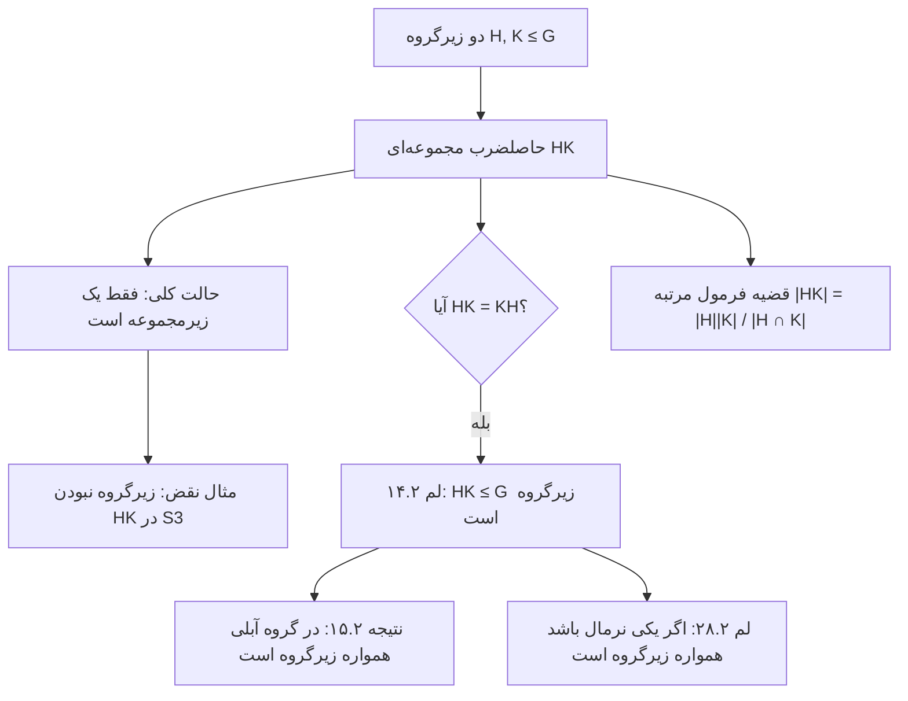

# 📘 تعریف حاصلضرب دو زیرمجموعه و زیرگروه

> [!abstract] انگیزه پیدایش و تصویر ذهنی (Intuition & Motivation)
> هنگامی که دو [[تعریف زیرگروه|زیرگروه]] $H$ و $K$ از یک گروه مادر $G$ مفروض باشند، تمایل داریم ساختارهای ترکیبی حاصل از آن‌ها را بررسی نماییم. پیش‌تر دیدیم که «اشتراک» دو زیرگروه ($H \cap K$) همواره زیرگروه است، در حالی که «اتحاد» آن‌ها ($H \cup K$) تقریباً هرگز زیرگروه نمی‌شود (مگر آنکه یکی مشمول دیگری باشد؛ رجوع به [[مثال نقض زیرگروه نبودن اتحاد دو زیرگروه]]).
>
> طبیعی‌ترین راهکار برای آمیختن دو زیرگروه، اعمال عمل دوتایی گروه میان تک‌تک اعضای آن‌هاست. این عملیات، مجموعه موسوم به **حاصلضرب دو زیرگروه** ($HK$) را پدید می‌آورد. با این حال، شگفتی بنیادین جبر این است که $HK$ صرفاً یک «زیرمجموعه» از $G$ است و در حالت کلی هیچ تضمینی وجود ندارد که خود تشکیل یک ساختار زیرگروهی بدهد!

---

## ۱. تعریف صوری حاصلضرب مجموعه‌ای (Formal Definition)

فرض کنید $(G, *)$ یک [[تعریف گروه|گروه]] دلخواه و $H$ و $K$ دو زیرمجموعه (به ویژه دو زیرگروه) از $G$ باشند ($H, K \leqslant G$).

> [!DEFINITION] تعریف صوری حاصلضرب دو زیرمجموعه (تعریف ۱۳.۲ جزوه علائیان)
> مجموعه تمامی عناصری از $G$ که از ترکیب یک عضو از $H$ با یک عضو از $K$ حاصل می‌شوند را **حاصلضرب** (یا حاصل ترکیب مجموعه‌ای) $H$ در $K$ نامیده و با $HK$ نشان می‌دهیم:
> 
> * **در دستگاه ضربی و انتزاعی:**
>   
>   $$HK = \{ h * k \mid h \in H \quad , \quad k \in K \}$$
>   
> * **در دستگاه جمعی (مجموعه مجموع):**
>   
>   $$H + K = \{ h + k \mid h \in H \quad , \quad k \in K \}$$

### بسط به حاصلضرب چندین زیرمجموعه
به طریق مشابه و با بهره‌گیری از خاصیت شرکت‌پذیری عمل گروه، حاصلضرب متوالی چندین زیرمجموعه $H_1, H_2, \dots, H_n$ به صورت زیر تعریف می‌شود:

$$H_1 H_2 \dots H_n = \{ h_1 * h_2 * \dots * h_n \mid h_i \in H_i \quad , \quad i = 1, \dots, n \}$$

---

## ۲. رفتار ساختاری و چالش زیرگروه نبودن در حالت کلی

بسیار حائز اهمیت است که میان «زیرمجموعه بودن» و «زیرگروه بودن» تفکیک قائل شویم:

۱. **حضور عضو همانی:**
   از آنجا که $H$ و $K$ زیرگروه‌اند، $e \in H$ و $e \in K$. بنابراین:
   
   $$e = e * e \in HK$$
   
   پس $HK$ همواره مجموعه‌ای ناتهی و حاوی عضو همانی گروه است. همچنین $H \subseteq HK$ (با انتخاب $k = e$) و $K \subseteq HK$ (با انتخاب $h = e$).

۲. **چالش بسته بودن نسبت به عمل دوتایی:**
   اگر دو عضو دلخواه $x, y \in HK$ را در نظر بگیریم، $x = h_1 * k_1$ و $y = h_2 * k_2$. حاصل ترکیب آن‌ها برابر است با:
   
   $$x * y = (h_1 * k_1) * (h_2 * k_2) = h_1 * (k_1 * h_2) * k_2$$
   
   برای این‌که $x * y$ مجدداً به فرم $h_3 * k_3$ درآید، باید بتوان عبارت میانی $k_1 * h_2 \in KH$ را به فرمی در $HK$ بازآرایی کرد. اگر گروه غیرجابجایی باشد، چنین تبدیلی همواره مقدور نیست!

۳. **چالش بسته بودن نسبت به وارون‌گیری:**
   معکوس یک عضو $x = h * k \in HK$ برابر است با:
   
   $$x^{-1} = (h * k)^{-1} = k^{-1} * h^{-1}$$
   
   از آنجا که $k^{-1} \in K$ و $h^{-1} \in H$، مشاهده می‌شود که $x^{-1} \in KH$؛ اما دلیلی ندارد که $x^{-1}$ الزاماً متعلق به خود $HK$ باشد!

> [!WARNING] نتیجه بنیادین
> در حالت کلی، حاصلضرب دو زیرگروه $HK$ **زیرگروه نیست**! (مشاهده نمونه نقض صریح در [[مثال زیرگروه نبودن حاصلضرب دو زیرگروه در گروه متقارن سه]]).

---

## ۳. جایگاه در شبکه مفاهیم جبری

شرط لازم و کافی برای آنکه حاصلضرب مجموعه‌ای $HK$ به یک زیرگروه واقعی ارتقا یابد، در [[لم شرط لازم و کافی زیرگروه بودن حاصلضرب دو زیرگروه]] بررسی می‌شود ($HK = KH$).
همچنین اگر حداقل یکی از زیرگروه‌ها نرمال باشد، این شرط خودبه‌خود محقق می‌گردد.

