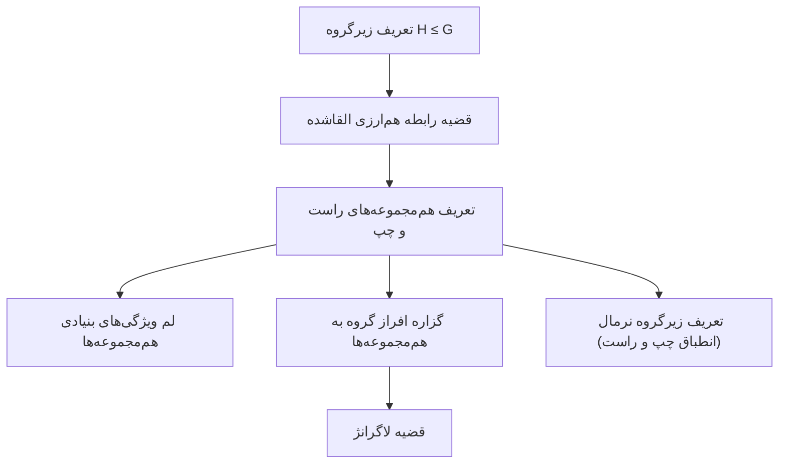

# 📘 تعریف هم‌مجموعه‌های راست و چپ

> [!abstract] انگیزه پیدایش و تصویر ذهنی (Intuition & Motivation)
> در جبر خطی، اگر یک زیرفضای برداری $W$ را با یک بردار ثابت $v$ جمع کنیم، یک «زیرفضای آفین» یا صفحه موازی به فرم $v + W$ پدید می‌آید که موازی با زیرفضای اولیه بوده و تمام نقاط آن با یک بردار جابجایی انتقال یافته‌اند. در نظریه گروه‌ها نیز مفهوم **هم‌مجموعه** (Coset که در منابع کهن‌تر «همرده» نیز نامیده شده) نقشی کاملاً مشابه را ایفا می‌کند: با تثبیت یک [[تعریف زیرگروه|زیرگروه]] $H \leqslant G$ و اثر دادن یک عنصر خارجی $x \in G$ روی تک‌تک اعضای $H$، یک «انتقال جبری» از کل زیرگروه در فضای گروه $G$ به دست می‌آید.
>
> از دیدگاه نظریه رابطه‌ها، هم‌مجموعه‌ها دقیقاً همان **رده‌های هم‌ارزی** حاصل از [[قضیه رابطه هم‌ارزی القاشده توسط زیرگروه|رابطه هم‌ارزی القاشده توسط زیرگروه]] هستند. در یک گروه ناآبلی، از آنجا که حاصل ترکیب عناصر به ترتیب قرارگیری آن‌ها بستگی دارد، انتقال زیرگروه از سمت راست ($Hx$) الزاماً با انتقال آن از سمت چپ ($xH$) یکسان نبوده و این تمایز جهت، کلید کشف تقارن‌های ژرف‌تر نظیر زیرگروه‌های نرمال است.

---

## ۱. تعریف صوری هم‌مجموعه‌ها (Formal Definition)

فرض کنید $(G, *)$ یک [[تعریف گروه|گروه]] دلخواه و $H$ یک [[تعریف زیرگروه|زیرگروه]] از $G$ باشد ($H \leqslant G$).

> [!DEFINITION] تعریف صوری هم‌مجموعه راست و چپ (تعریف ۷.۲ جزوه)
> به ازای هر عنصر $x \in G$:
>
> ۱. **هم‌مجموعه راست (Right Coset):** مجموعه حاصل از ترکیب تمامی عناصر $H$ با عنصر $x$ از سمت راست را هم‌مجموعه راست $H$ در $G$ تولیدشده توسط $x$ نامیده و با $Hx$ نمایش می‌دهیم:
> 
> $$Hx = \{ h * x \mid h \in H \}$$
> 
> ۲. **هم‌مجموعه چپ (Left Coset):** مجموعه حاصل از ترکیب عنصر $x$ با تمامی عناصر $H$ از سمت چپ را هم‌مجموعه چپ $H$ در $G$ تولیدشده توسط $x$ نامیده و با $xH$ نمایش می‌دهیم:
> 
> $$xH = \{ x * h \mid h \in H \}$$
> 
> در این تعریف، عنصر $x$ را **نماینده** (Representative) آن هم‌مجموعه می‌نامند.

### استخراج هم‌مجموعه به عنوان رده هم‌ارزی

مطابق [[قضیه رابطه هم‌ارزی القاشده توسط زیرگروه|قضیه رابطه هم‌ارزی القاشده]]، رابطه $\sim$ بر روی عناصر $G$ به صورت زیر تعریف می‌شود:

$$y \sim x \iff y * x^{-1} \in H$$

رده هم‌ارزی شامل عنصر $x$ دقیقاً برابر است با:

$$[x] = \{ y \in G \mid y \sim x \} = \{ y \in G \mid y * x^{-1} \in H \}$$

اگر قرار دهیم $y * x^{-1} = h \in H$، آنگاه با ترکیب دو طرف از راست با $x$ نتیجه می‌شود $y = h * x$. بنابراین:

$$[x] = \{ h * x \mid h \in H \} = Hx$$

این تحلیل اثبات می‌کند که هر هم‌مجموعه راست، یک رده هم‌ارزی صوری تحت رابطه القایی است.

---

## ۲. جدول قرارداد نمادگذاری در دستگاه‌های سه‌گانه

مطابق منشور [[فاز ۰ - قرارداد نمادگذاری و خطوط قرمز فصل دوم]]، نگارش هم‌مجموعه‌ها بسته به زمینه جبری به صورت زیر تفکیک می‌شود:

| دستگاه جبری | نماد هم‌مجموعه راست | نماد هم‌مجموعه چپ | اصطلاح مجاز فارسی | اصطلاحات و نگارش‌های ممنوع |
| :--- | :---: | :---: | :--- | :--- |
| **گروه انتزاعی $(G, *)$** | $Hx$ یا $H * x$ | $xH$ یا $x * H$ | هم‌مجموعه راست / چپ | ❌ ضرب زیرگروه در عنصر |
| **گروه ضربی $(G, \cdot)$** | $Hx$ یا $H \cdot x$ | $xH$ یا $x \cdot H$ | هم‌مجموعه راست / چپ | ❌ استفاده از نماد کسری نظیر $\frac{H}{x}$ |
| **گروه جمعی $(G, +)$** | $H + x$ | $x + H$ | هم‌مجموعه جمعی راست / چپ | ❌ نوشتن $Hx$ در ساختار جمعی |

---

## ۳. خواص ساختاری بنیادین و نقش مفهومی نماینده

۱. **نقش نماینده و عدم یکتایی آن:**
   عنصر $x$ در نماد $Hx$ تنها یک «برچسب» یا «نماینده» برای کل مجموعه است. همان‌طور که در رده‌های هم‌ارزی مرسوم است، هر عضو دلخواه متعلق به $Hx$ می‌تواند به عنوان نماینده تام‌الاختیار آن هم‌مجموعه انتخاب شود؛ یعنی اگر $y \in Hx$، آنگاه $Hy = Hx$ (رجوع به [[لم ویژگی‌های بنیادی هم‌مجموعه‌ها و هم‌پنداشتی هم‌ارزی]]).

۲. **هم‌مجموعه حاصل از عضو خنثی:**
   اگر عضو همانی $e$ را به عنوان نماینده برگزینیم:
   
   $$He = \{ h * e \mid h \in H \} = H \quad , \quad eH = \{ e * h \mid h \in H \} = H$$
   
   بنابراین خود زیرگروه $H$ همواره هم یک هم‌مجموعه راست و هم یک هم‌مجموعه چپ (با نماینده $e$ یا هر عضو دیگر $H$) است.

۳. **برابری کاردینالیتی هم‌مجموعه‌ها:**
   تک‌تک هم‌مجموعه‌های راست و چپ دارای کاردینالیتی کاملاً یکسان و برابر با کاردینالیتی زیرگروه مادر $H$ هستند:
   
   $$|Hx| = |xH| = |H|$$

۴. **هم‌ارزی و انطباق در گروه‌های آبلی:**
   اگر $G$ یک [[تعریف گروه جابجایی|گروه جابجایی (آبلی)]] باشد، به دلیل برقراری $\forall h \in H: h * x = x * h$، همواره هم‌مجموعه راست با هم‌مجموعه چپ منطبق است:
   
   $$\forall x \in G \implies Hx = xH \quad (\text{یا در نماد جمعی: } H + x = x + H)$$

---

## ۴. مصداق‌ها و مرز تعریف (Examples & Boundary Cases)

* **مثال کانونی در گروه جمعی اعداد صحیح:**
   در گروه جمعی $(\mathbb{Z}, +)$، زیرگروه مضارب $n$ یعنی $H = n\mathbb{Z}$ را در نظر بگیرید. هم‌مجموعه‌های جمعی این زیرگروه به فرم زیر هستند:
   
   $$n\mathbb{Z} + r = \{ qn + r \mid q \in \mathbb{Z} \}$$
   
   این مجموعه‌ها دقیقاً همان **رده‌های هم‌ارزی به هنگ $n$** (رده‌های باقیمانده حساب پیمانه‌ای) هستند که اعداد صحیح را به $n$ دسته مجزا افراز می‌کنند.

* **تمایز هم‌مجموعه‌های چپ و راست در گروه متقارن $S_3$:**
   در گروه نامتقارن جایگشت‌های سه حرفی $S_3$ با زیرگروه $H = \{e, (2\ 3)\}$، هم‌مجموعه راست تولیدشده توسط $b = (1\ 3)$ برابر است با $Hb = \{ (1\ 3), (1\ 3\ 2) \}$، در حالی که هم‌مجموعه چپ متناظر برابر است با $bH = \{ (1\ 3), (1\ 2\ 3) \}$. مشاهده می‌شود که $Hb \neq bH$ (تحلیل جامع در [[مثال هم‌مجموعه‌های گروه متقارن مرتبه سه]]).

* **مرز تعریف و حالت‌های حدی:**
   * اگر $H = \{e\}$ (زیرگروه بدیهی همانی)، آنگاه به ازای هر $x \in G$، هم‌مجموعه راست تک‌عضوی است: $\{e\}x = \{x\}$.
   * اگر $H = G$، آنگاه تنها یک هم‌مجموعه وجود دارد که خود $G$ است: $Gx = G$.

---

## ۵. جایگاه در زنجیره استنتاج جبری

---

## ۶. دام‌ها و هشدارهای مفهومی (Pitfalls)

> [!WARNING] هشدارهای مهم مفهومی
> ۱. **هم‌مجموعه لزوماً یک زیرگروه نیست:**
> یک هم‌مجموعه $Hx$ در حالت کلی یک ساختار گروهی ندارد. $Hx$ تنها و تنها زمانی یک زیرگروه از $G$ است که $x \in H$ باشد (که در این صورت $Hx = H$). برای هر $x \notin H$، عضو همانی $e$ در $Hx$ حضور ندارد ($e \notin Hx$)، بنابراین $Hx$ حتی شرط اولیه زیرگروه بودن را ارضا نمی‌کند.
>
> ۲. **پرهیز از فرض تساوی هم‌مجموعه چپ و راست:**
> در یک گروه ناآبلی، هرگز نباید فرض کرد که $xH = Hx$. تساوی هم‌مجموعه چپ و راست یک رویداد همگانی نیست، بلکه ویژگی اختصاصی [[تعریف زیرگروه نرمال|زیرگروه‌های نرمال]] است.
>
> ۳. **پرهیز از واژه «ضرب» برای عمل انتزاعی:**
> مطابق خطوط قرمز فاز ۰، نباید از واژه «ضرب زیرگروه در عنصر» استفاده شود، بلکه باید اصطلاح دقیق «حاصل ترکیب عناصر زیرگروه با عنصر مورد نظر تحت عمل $*$» به کار رود.
