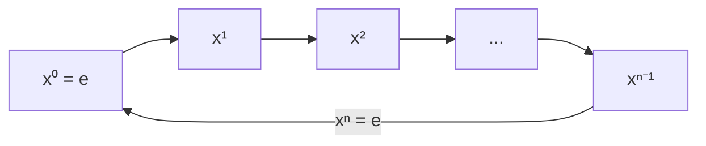

# 📜 قضیه برابری مرتبه عنصر با مرتبه زیرگروه دوری تولیدشده

> [!abstract] پیام و اهمیت قضیه (Theorem Core Message)
> واژه «مرتبه» در نظریه گروه‌ها در دو بستر به ظاهر متمایز به کار می‌رود: 
> ۱. **مرتبه گروه (یا زیرگروه):** که مفهومی مجموعه‌ای و برابر با تعداد عناصر (کاردینالیتی) است ($|G|$).
> ۲. **مرتبه عنصر:** که مفهومی محاسباتی و جبری بر پایه کمینه‌ترین توان همانی‌ساز است ($|x|$).
> 
> این قضیه بنیادین (قضیه ۱۸.۲ ص ۱۹ و ۲۰ جزوه علائیان) پیوند عمیق میان این دو برداشت را برقرار می‌سازد: **مرتبه جبری یک عنصر دقیقاً برابر است با مرتبه مجموعه‌ای زیرگروهی که توسط آن عنصر تولید می‌شود** ($|\langle x \rangle| = |x|$). این یکپارچگی مفهومی، پلی مستقیم برای اثبات قضیه لاگرانژ و نتایج شگفت‌انگیز آن است.

---

## ۱. صورت صوری قضیه (Formal Statement)

فرض کنید $(G, *)$ یک [[تعریف گروه|گروه]] دلخواه، $x \in G$ عنصری دلخواه، و $X = \langle x \rangle = \{ x^n \mid n \in \mathbb{Z} \}$ زیرگروه دوری تولیدشده توسط $x$ باشد.

> [!THEOREM] قضیه برابری مرتبه عنصر و مرتبه زیرگروه دوری (قضیه ۱۸.۲ ص ۱۹ جزوه)
> در هر گروه دلخواه:
> 
> $$|X| = |\langle x \rangle| = |x| = o(x)$$
> 
> به طوری که:
> 
> * **(آ) حالت نامتناهی:**
>   اگر $x$ از مرتبه نامتناهی باشد ($|x| = \infty$)، آنگاه تمامی توان‌های صحیح $x$ متمایزند؛ یعنی به ازای هر $r, s \in \mathbb{Z}$:
>   
>   $$x^r = x^s \iff r = s$$
>   
>   و بنابراین زیرگروه دوری $X = \langle x \rangle$ مجموعه‌ای نامتناهی است ($|X| = \infty$).
> 
> * **(ب) حالت متناهی:**
>   اگر $x$ از مرتبه متناهی $n$ باشد ($|x| = n$)، آنگاه به ازای هر $r, s \in \mathbb{Z}$:
>   
>   $$x^r = x^s \iff r \equiv s \pmod n$$
>   
>   و در این حالت، زیرگروه دوری $X$ دقیقاً از $n$ عضو متمایز تشکیل می‌شود:
>   
>   $$X = \langle x \rangle = \{ e, x, x^2, \dots, x^{n-1} \} \implies |X| = n$$

---

## ۲. تحلیل ساختاری و رفتار توان‌ها

### ارتباط با حساب همنهشتی
این قضیه نشان می‌دهد که توان‌های یک عنصر با مرتبه متناهی $n$، یک حلقه تناوبی با طول دوره $n$ می‌سازند. با افزایش نما، عناصر زیرگروه تکرار می‌شوند و نمای عنصر دقیقاً در دستگاه هم‌ارزی به پیمانه $n$ عمل می‌کند:

بنابراین، برای شناخت کامل رفتار جبری زیرگروه $\langle x \rangle$ تنها کافی است باقیمانده توان‌ها در تقسیم بر $n$ را بررسی کنیم.

---

## ۳. برهان صوری و مستقل (Formal Proof)

> [!SOLUTION]- مشاهده برهان صوری مستقل
> اثبات جامع هر دو بند (آ) و (ب) از طریق معیار همانی توان‌ها و حساب همنهشتی در یادداشت پیوست در دسترس است:
> ![[اثبات قضیه برابری مرتبه عنصر با مرتبه زیرگروه دوری تولیدشده]]

---

## ۴. نتایج و کاربردها

* **تقارن نمادگذاری:** این قضیه توجیه ریاضی کاملی برای استفاده از یک نماد مشترک ($| \cdot |$) هم برای کاردینالیتی زیرگروه و هم برای مرتبه عنصر فراهم می‌کند.
* **پیش‌نیاز قضیه لاگرانژ:** از آنجا که $|\langle x \rangle| = |x|$ است، به محض آنکه قضیه لاگرانژ عاد شدن مرتبه هر زیرگروه بر مرتبه گروه را اثبات کند، عاد شدن مرتبه هر عنصر بر مرتبه گروه متناهی به عنوان نتیجه‌ای فوری به دست می‌آید.
