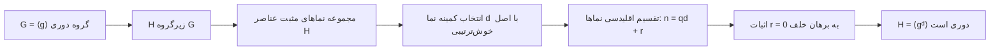

# 📜 قضیه دوری بودن تمامی زیرگروه‌های یک گروه دوری

> [!abstract] پیام و اهمیت قضیه (Theorem Core Message)
> آیا ویژگی‌های یک گروه بزرگ‌تر لزوماً به زیرگروه‌های آن به ارث می‌رسد؟ در حالت کلی خیر؛ برای نمونه، زیرگروه‌های یک گروه متناهیاً تولیدشده ممکن است لزوماً متناهیاً تولیدشده نباشند. 
> 
> با این حال، در خانواده گروه‌های دوری یکی از زیباترین قوانین وراثت ساختاری برقرار است: **هر زیرگروه از یک گروه دوری، بدون استثنا دوری است**. این قضیه سنگ‌بنای درک توپولوژی جبری و ساختار ایده‌آل‌ها در جبر جابجایی است و اثبات می‌کند که دوری بودن ساختاری به‌شدت پایدار و ارث‌پذیر است.

---

## ۱. صورت صوری قضیه (Formal Statement)

فرض کنید $(G, *)$ یک [[تعریف گروه|گروه]] دوری دلخواه با مولد $g$ باشد ($G = \langle g \rangle$) و $H$ یک [[تعریف زیرگروه|زیرگروه]] از $G$ باشد ($H \leqslant G$).

> [!THEOREM] قضیه دوری بودن تمامی زیرگروه‌ها (قضیه ۱۵.۲ ص ۱۸ جزوه)
> اگر $G$ یک گروه دوری باشد، آنگاه هر زیرگروه $H \leqslant G$ نیز دوری است. 
> 
> به علاوه، اگر $H \neq \{e\}$ باشد، آنگاه $H$ توسط عنصری به فرم $g^d$ تولید می‌شود که در آن $d$ **کوچک‌ترین عدد صحیح مثبت** است به قسمی که $g^d \in H$:
> 
> $$H = \langle g^d \rangle$$

---

## ۲. تحلیل ساختاری و پیش‌نیازهای برهان

### سازوکار تقلیل به نظریه اعداد
این قضیه پل مستقیمی میان «جبر مجرد» و «حساب مقدماتی اعداد» برقرار می‌سازد:
1. **اصل خوش‌ترتیبی اعداد طبیعی ($\mathbb{N}$):** تضمین می‌کند که از میان تمام توان‌های مثبت متعلق به زیرگروه، یک کمینه مطلق به نام $d$ وجود دارد.
2. **الگوریتم تقسیم اقلیدسی:** اثبات می‌کند که هر نمای اختیاری $n$ باید مضربی دقیق از $d$ باشد، زیرا در غیر این صورت باقیمانده‌ای اکیداً کوچک‌تر پدید می‌آید که کمینگی $d$ را نقض می‌کند.

---

## ۳. برهان صوری و مستقل (Formal Proof)

> [!SOLUTION]- مشاهده برهان صوری مستقل
> اثبات گام‌به‌گام و دقیق این قضیه بر پایه اصل خوش‌ترتیبی و الگوریتم تقسیم اقلیدسی در یادداشت پیوست در دسترس است:
> ![[اثبات قضیه دوری بودن تمامی زیرگروه‌های یک گروه دوری]]

---

## ۴. نتایج و کاربردهای کلیدی (Corollaries & Applications)

* **ساختار زیرگروه‌های اعداد صحیح:**
  از آنجا که $(\mathbb{Z}, +)$ دوری است، تمام زیرگروه‌های آن به فرم $n\mathbb{Z}$ دوری هستند ([[نتیجه ساختار دوری تمامی زیرگروه‌های گروه جمعی اعداد صحیح]]).
* **تک-ایده‌آلی بودن حلقه اعداد صحیح (PID):**
  این قضیه مستقیماً نشان می‌دهد که هر ایده آل در حلقه اعداد صحیح اصلی است، زیرا ایده‌آل‌ها زیرگروه‌های جمعی هستند.
* **ساختار زیرگروه‌های گروه‌های دوری متناهی:**
  اگر $|G| = n$ دوری باشد، به ازای هر مقسوم‌علیه $d$ از $n$، دقیقاً یک زیرگروه با مرتبه $d$ وجود دارد که دوری است.
