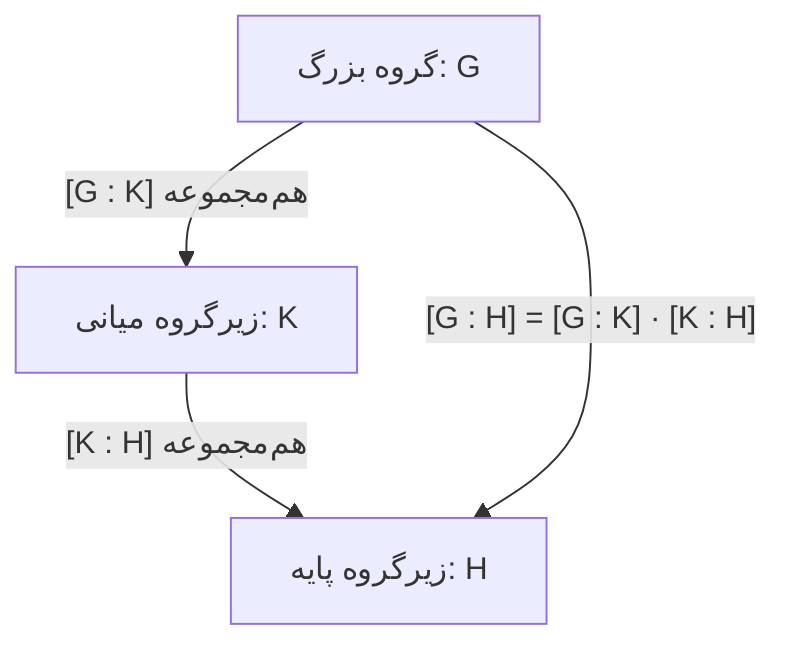

# 📜 قضیه ضرب شاخص‌ها در برج زیرگروه‌ها

> [!abstract] پیام و اهمیت قضیه (Theorem Core Message)
> هنگامی که سه زیرگروه به صورت تو در تو یک «برج» (Tower) تشکیل می‌دهند ($H \leqslant K \leqslant G$)، ساختار هم‌مجموعه‌ها چگونه رفتار می‌کند؟
> 
> **قضیه ضرب شاخص‌ها** (که در ادبیات ریاضی به **قانون برج** یا Tower Law نامور است و در صفحه ۲۰ جزوه علائیان آمده) بیان می‌دارد که رابطه شاخص‌ها خاصیتی ضربی و زنجیره‌ای دارد: **شاخص زیرگروه پایینی در کل گروه، حاصل‌ضرب شاخص‌های گام‌به‌گام میانی است ($[G : H] = [G : K] \cdot [K : H]$)**. 
> 
> این ویژگی دقیقاً همتای «قاعده زنجیره‌ای» در حساب دیفرانسیل و «فرمول ضرب ابعاد» در تئوری توسیع میدان‌ها ($[L : F] = [L : K][K : F]$) در نظریه گالوا است و حتی برای گروه‌های نامتناهی با شاخص‌های متناهی با قدرت تمام صادق است.

---

## ۱. صورت صوری قضیه (Formal Statement)

فرض کنید $(G, *)$ یک [[تعریف گروه|گروه]] دلخواه باشد و $H$ و $K$ دو [[تعریف زیرگروه|زیرگروه]] از $G$ باشند به طوری که رابطه ترتیبی زیر را برآورده سازند:

$$H \leqslant K \leqslant G$$

> [!THEOREM] قضیه ضرب شاخص‌ها (نتیجه ص ۲۰ جزوه)
> اگر $H \leqslant K \leqslant G$ باشد، آنگاه:
> 
> $$[G : H] = [G : K] \cdot [K : H]$$
> 
> این فرمول به طور عام برقرار است؛ به ویژه:
> * اگر شاخص‌های $[G : K]$ و $[K : H]$ متناهی باشند، شاخص $[G : H]$ نیز متناهی و برابر با حاصل‌ضرب عددی آن‌ها است.
> * اگر حداقل یکی از شاخص‌های سمت راست نامتناهی باشد، شاخص $[G : H]$ نیز نامتناهی خواهد بود.

---

## ۲. بیان فرمول در گروه‌های متناهی بر پایه قضیه لاگرانژ

اگر گروه $G$ متناهی باشد، بنا بر [[قضیه لاگرانژ درباره مرتبه زیرگروه در گروه متناهی|قضیه لاگرانژ]]، شاخص هر زیرگروه برابر با نسبت مستقیم مرتبه‌ها است ($[A : B] = \frac{|A|}{|B|}$). بنابراین:

$$[G : H] = \frac{|G|}{|H|} = \frac{\frac{|G|}{|K|}}{\frac{|H|}{|K|}} = \frac{[G : K]}{\frac{1}{[K : H]}} = [G : K] \cdot [K : H]$$

این محاسبه حسابی ساده، صحت شهودی فرمول را در حالت متناهی آشکار می‌سازد، اما برهان جامع و بدون نیاز به فرض متناهی بودن گروه، بر پایه هندسه نمایندگان هم‌مجموعه‌ها استوار است.

---

## ۳. برهان صوری و مستقل (Formal Proof)

> [!SOLUTION]- مشاهده برهان صوری مستقل
> اثبات صوری دوگانه (شامل روش سازنده نمایندگان هم‌مجموعه‌ها برای حالت عام و روش کسری لاگرانژ برای گروه‌های متناهی) در یادداشت پیوست در دسترس است:
> ![[اثبات قضیه ضرب شاخص‌ها در برج زیرگروه‌ها]]

---

## ۴. نتایج و کاربردهای کلیدی

* **ترانزیتیو بودن متناهی بودن شاخص‌ها:** اگر شاخص $H$ در $K$ متناهی باشد و شاخص $K$ در $G$ نیز متناهی باشد، شاخص $H$ در $G$ قطعاً متناهی است.
* **پیش‌بینی مرتبه زیرگروه‌های میانی:** اگر $[G : H] = p$ یک عدد اول باشد، هیچ زیرگروه اکید میانی میان $H$ و $G$ نمی‌تواند وجود داشته باشد، زیرا اگر $H \leqslant K \leqslant G$ باشد، آنگاه $[G : K] \mid p$ و لذا یا $K = H$ است یا $K = G$.
