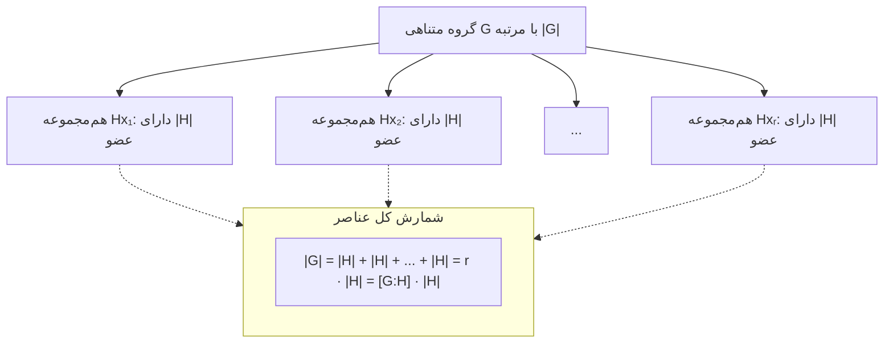

# 📜 قضیه لاگرانژ درباره مرتبه زیرگروه در گروه متناهی

> [!abstract] پیام و اهمیت قضیه (Theorem Core Message)
> آیا ممکن است یک گروه از مرتبه ۱۲، زیرگروهی با مرتبه ۵ داشته باشد؟ یا گروهی از مرتبه ۳۰ بتواند زیرگروهی با مرتبه ۷ در خود جای دهد؟
> 
> **قضیه لاگرانژ** (Lagrange's Theorem - قضیه ۱۹.۲ ص ۲۰ جزوه علائیان) قاطع‌ترین پاسخ را فراهم می‌کند: **خیر!**
> این قضیه که مهم‌ترین و پرکاربردترین قضیه در جبر مجرد مقدماتی به شمار می‌رود، یک محدودیت ساختاری فوق‌العاده سفت‌وسخت بر مرتبه زیرگروه‌ها تحمیل می‌کند: **مرتبه هر زیرگروه باید مرتبه کل گروه را بدون باقیمانده عاد کند**. بنابراین، نامزدهای احتمالی برای اندازه زیرگروه‌ها، منحصراً مقسوم‌علیه‌های اندازه گروه مادر هستند.

---

## ۱. صورت صوری قضیه (Formal Statement)

فرض کنید $(G, *)$ یک [[تعریف گروه متناهی و مرتبه گروه|گروه متناهی]] با عضو خنثی $e$ باشد و $H$ یک [[تعریف زیرگروه|زیرگروه]] دلخواه از $G$ باشد ($H \leqslant G$).

> [!THEOREM] قضیه لاگرانژ (قضیه ۱۹.۲ ص ۲۰ جزوه)
> اگر $G$ یک گروه متناهی و $H$ زیرگروهی دلخواه از آن باشد، آنگاه:
> 
> ۱. مرتبه زیرگروه $H$ مقسوم‌علیه مرتبه گروه $G$ است:
> 
> $$|H| \mid |G|$$
> 
> ۲. رابطه دقیق شمارشی زیر همواره برقرار است:
> 
> $$|G| = |H| \cdot [G : H]$$
> 
> که در آن $[G : H]$ نمایانگر [[تعریف شاخص زیرگروه در گروه|شاخص زیرگروه]] $H$ در $G$ (تعداد کل هم‌مجموعه‌های متمایز راست یا چپ $H$ در $G$) است.
> 
> بنابراین، شاخص زیرگروه را می‌توان از خارج‌قسمت مستقیم کاردینالیتی‌ها به دست آورد:
> 
> $$[G : H] = \frac{|G|}{|H|}$$

---

## ۲. تحلیل ساختاری و ایده هندسی برهان

راز شکوه قضیه لاگرانژ در دو حقیقت بنیادی درباره هم‌مجموعه‌ها نهفته است:
1. **افراز کامل و بدون هم‌پوشانی:** گروه $G$ به عنوان یک کل، به اجتماع مجزایی از هم‌مجموعه‌های چپ (یا راست) زیرگروه $H$ افراز می‌شود ([[گزاره افراز گروه به هم‌مجموعه‌های مجزا]]). هیچ عنصری بیرون نمی‌ماند و هیچ دو هم‌مجموعه متمایزی نقطه مشترک ندارند.
2. **هم‌اندازگی مطلق الیاف (Uniform Size):** به کمک عمل ضرب راست یا چپ، یک تناظر دوسویی (تطابق کامل) میان عناصر زیرگروه $H$ و هر یک از هم‌مجموعه‌های آن وجود دارد؛ بنابراین تک‌تک هم‌مجموعه‌ها دقیقاً دارای $|H|$ عضو هستند ([[لم ویژگی‌های بنیادی هم‌مجموعه‌ها و هم‌پنداشتی هم‌ارزی]]).

اگر تعداد این هم‌مجموعه‌های مجزا را $r = [G : H]$ بنامیم، کل عناصر گروه مانند کاشی‌کاری منظمی از $r$ کاشی یک‌اندازه خواهد بود:

---

## ۳. هشدار مهم: عدم برقراری عکس قضیه لاگرانژ!

> [!CAUTION] کج‌فهمی رایج پیرامون عکس قضیه
> قضیه لاگرانژ بیان می‌دارد: «اگر $H \leqslant G$ باشد، آنگاه $|H| \mid |G|$».
> اما **عکس این قضیه در حالت کلی صادق نیست!** 
> یعنی اگر $d$ یک مقسوم‌علیه مرتبه گروه $G$ باشد ($d \mid |G|$)، **لزوماً زیرگروهی از مرتبه $d$ درون $G$ وجود ندارد**.
> * **پادمثال معیار:** گروه متناوب $A_4$ دارای مرتبه ۱۲ است ($|A_4| = 12$). عدد ۶ مقسوم‌علیه ۱۲ است ($6 \mid 12$)، ولی گروه $A_4$ **هیچ زیرگروهی از مرتبه ۶ ندارد** (رجوع شود به تحلیل تفصیلی در [[مثال نقض عدم برقراری عمومی عکس قضیه لاگرانژ در گروه متناوب چهار]]).

---

## ۴. برهان صوری و مستقل (Formal Proof)

> [!SOLUTION]- مشاهده برهان صوری مستقل
> اثبات گام‌به‌گام و دقیق قضیه لاگرانژ بر پایه افراز هم‌مجموعه‌ها و اصل ضرب در یادداشت پیوست در دسترس است:
> ![[اثبات قضیه لاگرانژ درباره مرتبه زیرگروه در گروه متناهی]]

---

## ۵. نتایج و کاربردهای کلیدی (Corollaries)

از قضیه لاگرانژ، نتایج بسیار درخشانی استخراج می‌شوند:
1. **عادلی مرتبه عنصر:** مرتبه هر عضو مقسوم‌علیه مرتبه گروه است: $|x| \mid |G|$ ([[نتیجه عادلی مرتبه عنصر بر مرتبه گروه متناهی]]).
2. **قضیه اویلر-فرما برای توان همانی:** به ازای هر $x \in G$، $x^{|G|} = e$ ([[نتیجه قضیه لاگرانژ درباره توان همانی مرتبه گروه]]).
3. **دوری بودن گروه‌های مرتبه اول:** هر گروه که مرتبه آن عددی اول باشد، الزاماً دوری و آبلی است ([[نتیجه دوری بودن هر گروه از مرتبه اول]]).
4. **فرمول برج شاخص‌ها:** برای زنجیره زیرگروهی $H \leqslant K \leqslant G$ رابطه ضربی $[G:H] = [G:K][K:H]$ برقرار است ([[قضیه ضرب شاخص‌ها در برج زیرگروه‌ها]]).
