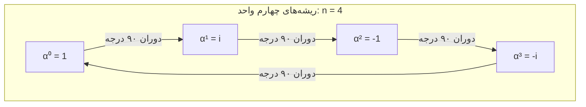

# 💡 مثال گروه دوری ریشه‌های nام واحد و اعداد صحیح

> [!abstract] اهمیت و نقش نمونه‌های متعارف (Role of Canonical Examples)
> در مطالعه ساختارهای جبری، داشتن مدل‌های شهودی و انضمامی برای مفاهیم انتزاعی بسیار ضروری است. در نظریه گروه‌های دوری، دو خانواده اصلی از اشیاء ریاضی نقش الگوی بنیادین (Archetype) را برای تمامی گروه‌های دوری ایفا می‌کنند:
> 1. **گروه جمعی اعداد صحیح $(\mathbb{Z}, +)$:** که تجسم بی‌نقص یک گروه دوری نامتناهی از نگاه گسسته و خطی است.
> 2. **گروه ضربی ریشه‌های $n$ام واحد ($P_n$ یا $U_n$):** که تجسم هندسی و پیوسته یک گروه دوری متناهی بر روی دایره مثلثاتی واحد در صفحه اعداد مختلط است.

---

## ۱. نمونه اول: گروه جمعی اعداد صحیح $(\mathbb{Z}, +)$ (گروه دوری نامتناهی)

مطابق بند (ب) از مثال ۱۳.۲ جزوه (ص ۱۷ و ۱۸):
مجموعه اعداد صحیح $\mathbb{Z}$ همراه با عمل جمع متعارف یک [[تعریف گروه|گروه]] است.

> [!EXAMPLE] بررسی دوری بودن $(\mathbb{Z}, +)$
> در نماد جمعی، توان‌های یک عنصر به صورت ضرایب صحیح آن عنصر نوشته می‌شوند:
> 
> $$\langle c \rangle = \{ nc \mid n \in \mathbb{Z} \}$$
> 
> اگر عنصر $c = 1$ را به عنوان مولد برگزینیم:
> 
> $$\langle 1 \rangle = \{ n \cdot 1 \mid n \in \mathbb{Z} \} = \{ \dots, -3, -2, -1, 0, 1, 2, 3, \dots \} = \mathbb{Z}$$
> 
> بنابراین $(\mathbb{Z}, +)$ یک گروه دوری نامتناهی با مولد $1$ است.

### تحلیل مولدهای $\mathbb{Z}$
توجه به این نکته ضروری است که در گروه جمعی اعداد صحیح، تنها دو عضو وجود دارند که قادرند کل گروه را به تنهایی تولید کنند:
* مولد اول: $1$، زیرا هر عدد صحیح $k$ برابر با $k \cdot 1$ است.
* مولد دوم: $-1$، زیرا هر عدد صحیح $k$ برابر با $(-k) \cdot (-1)$ است:
  
  $$\mathbb{Z} = \langle 1 \rangle = \langle -1 \rangle$$

هر عضو دیگر مانند $m \geqslant 2$ تنها یک زیرگروه سره به صورت $m\mathbb{Z} = \langle m \rangle$ (مجموعه مضارب $m$) تولید می‌کند.

---

## ۲. نمونه دوم: گروه ضربی ریشه‌های $n$ام واحد ($P_n$) (گروه دوری متناهی)

مطابق بند (آ) از مثال ۱۳.۲ جزوه (ص ۱۷):
فرض کنید $n$ یک عدد طبیعی مثبت باشد ($n \in \mathbb{N}$). معادله $z^n = 1$ در میدان اعداد مختلط $\mathbb{C}$ دارای دقیقاً $n$ ریشه متمایز است. مجموعه این ریشه‌ها را با $P_n$ نمایش می‌دهیم:

$$P_n = \{ z \in \mathbb{C} \mid z^n = 1 \}$$

> [!EXAMPLE] دوری بودن گروه ریشه‌های $n$ام واحد
> بنا بر فرمول اویلر، عدد نپر و ریشه اول واحد را به صورت زیر تعریف می‌کنیم:
> 
> $$\alpha = e^{\frac{2\pi i}{n}} = \cos\left(\frac{2\pi}{n}\right) + i \sin\left(\frac{2\pi}{n}\right)$$
> 
> بنا بر قضیه دموآور، توان‌های متوالی $\alpha$ عبارتند از:
> 
> $$\alpha^k = \left(e^{\frac{2\pi i}{n}}\right)^k = e^{\frac{2k\pi i}{n}} \quad (k = 0, 1, \dots, n-1)$$
> 
> به ازای $k = n$:
> 
> $$\alpha^n = e^{\frac{2n\pi i}{n}} = e^{2\pi i} = 1$$
> 
> بنابراین تمام $n$ عضو مجموعه $P_n$ به صورت توان‌های متوالی $\alpha$ حاصل می‌شوند:
> 
> $$P_n = \{ 1, \alpha, \alpha^2, \dots, \alpha^{n-1} \} = \langle \alpha \mid \alpha^n = 1 \rangle$$
> 
> در نتیجه $P_n$ یک گروه دوری متناهی از مرتبه $n$ تحت عمل ضرب مختلط است و $\alpha$ مولد آن است.

### هندسه ریشه‌های واحد
از دیدگاه هندسی، عناصر گروه $P_n$ نقاطی روی دایره مثلثاتی واحد $|z| = 1$ در صفحه مختلط هستند که زاویه هر نقطه متوالی با مبدأ، دقیقاً به اندازه $\frac{2\pi}{n}$ رادیان دوران یافته است. این نقاط رئوس یک **$n$-ضلعی منتظم** محاط در دایره یکانی را تشکیل می‌دهند و عمل ضرب در این گروه متناظر با دوران صفحه به اندازه مضارب $\frac{2\pi}{n}$ رادیان است.

---

## ۳. جدول مقایسه‌ای دو مدل معیار

| ویژگی ساختاری | مدل نامتناهی: $(\mathbb{Z}, +)$ | مدل متناهی: $(P_n, \cdot)$ |
| :--- | :---: | :---: |
| **مرتبه گروه** | $\infty$ | $n$ |
| **دستگاه نمادگذاری** | جمعی | ضربی |
| **عنصر همانی** | $0$ | $1$ |
| **مولد معیار** | $1$ (و $-1$) | $\alpha = e^{\frac{2\pi i}{n}}$ |
| **تعداد مولدها** | دقیقاً ۲ مولد | $\varphi(n)$ مولد (ریشه‌های اولی) |
| **وارون عضو دلخواه** | منفی عضو: $-k$ | مزدوج یا توان مکمل: $\alpha^{n-k}$ |

---

## ۴. ارتباط با قضیه رده‌بندی کامل گروه‌های دوری

این دو مثال صرفاً نمونه‌های تصادفی نیستند؛ بلکه بنا بر «قضیه رده‌بندی کامل گروه‌های دوری» ([[نتیجه رده‌بندی کامل گروه‌های دوری|قضیه رده‌بندی گروه‌های دوری]]):
* هر گروه دوری نامتناهی، با گروه جمعی $(\mathbb{Z}, +)$ **یک‌ریخت (ایزومورف)** است:
  
  $$G \cong \mathbb{Z}$$
  
* هر گروه دوری متناهی از مرتبه $n$، با گروه ریشه‌های $n$ام واحد $P_n$ و با گروه همنهشتی‌های جمعی $(\mathbb{Z}_n, +)$ **یک‌ریخت** است:
  
  $$G \cong \mathbb{Z}_n \cong P_n$$

این یک‌ریختی نشان می‌دهد که رفتار جبری تمام گروه‌های دوری جهان، دقیقاً همان رفتار همین دو نمونه کلاسیک است.
