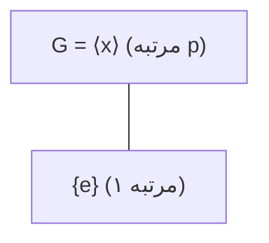

# 📜 نتیجه دوری بودن هر گروه از مرتبه اول

> [!abstract] پیام و اهمیت قضیه (Corollary Core Message)
> اعداد اول در حساب، اتم‌های تجزیه‌ناپذیر هستند. هنگامی که این صلبیت حسابی با ساختار جبری گروه پیوند می‌خورد، پدیده‌ای شگفت‌آور رخ می‌دهد: **هیچ فضای تنوعی برای ساختار یک گروه از مرتبه اول باقی نمی‌ماند!**
> 
> این نتیجه (نتیجه ۲۱.۲ ص ۲۰ و ۲۱ جزوه علائیان) به عنوان یکی از نیرومندترین دستاوردهای قضیه لاگرانژ بیان می‌دارد: **هر گروه از مرتبه اول، بدون استثنا دوری و آبلی است**. این قضیه رده‌بندی کاملی برای تمامی گروه‌های متناهی از مرتبه‌های ۲، ۳، ۵، ۷، ۱۱، ۱۳ و غیره ارائه می‌دهد و اثبات می‌کند که تا حد یک‌ریختی، به ازای هر عدد اول $p$ تنها یک گروه با مرتبه $p$ در جهان وجود دارد: گروه همنهشتی جمعی $\mathbb{Z}_p$.

---

## ۱. صورت صوری گزاره (Formal Statement)

فرض کنید $p$ یک عدد اول طبیعی باشد ($p \in \mathbb{P} = \{2, 3, 5, 7, 11, \dots\}$) و $(G, *)$ یک [[تعریف گروه|گروه]] دلخواه از مرتبه $p$ باشد ($|G| = p$).

> [!COROLLARY] نتیجه دوری بودن گروه‌های مرتبه اول (نتیجه ۲۱.۲ ص ۲۰ جزوه)
> اگر $G$ گروهی متناهی از مرتبه اول $p$ باشد، آنگاه:
> 
> ۱. **دوری و جابجایی بودن:** گروه $G$ الزاماً یک [[تعریف گروه دوری و مولد|گروه دوری]] است، و بنابراین یک [[تعریف گروه جابجایی|گروه جابجایی (آبلی)]] است:
> 
> $$G \cong \mathbb{Z}_p$$
> 
> ۲. **تولیدکنندگی همگانی اعضای غیرهمانی:** هر عضو غیرهمانی $x \in G$ با $x \neq e$ یک مولد تام‌الاختیار برای گروه $G$ است:
> 
> $$G = \langle x \rangle$$
> 
> ۳. **سادگی و عدم وجود زیرگروه سره:** گروه $G$ هیچ زیرگروه سره غیربدیهی ندارد؛ تنها زیرگروه‌های آن زیرگروه بدیهی $\{e\}$ و کل گروه $G$ هستند.

---

## ۲. تحلیل ساختاری و عواقب جبری

### ۱. یکتایی تا حد یک‌ریختی
این قضیه نخستین گام بزرگ در پروژه تاریخی «رده‌بندی گروه‌های متناهی» است. به ازای هر عدد اول $p$:
* مرتبه ۲: تنها گروه متناظر $\mathbb{Z}_2$ است.
* مرتبه ۳: تنها گروه متناظر $\mathbb{Z}_3$ است.
* مرتبه ۵: تنها گروه متناظر $\mathbb{Z}_5$ است.
هیچ گروه ناآبلی با مرتبه اول وجود ندارد.

### ۲. ساختار مشبکه زیرگروه‌ها
مشبکه زیرگروه‌های یک گروه مرتبه اول ساده‌ترین شکل ممکن را دارد: تنها شامل دو نقطه است که توسط یک یال به هم متصل شده‌اند:

هیچ زیرگروه میانی دیگری بر پایه قضیه لاگرانژ نمی‌تواند وجود داشته باشد، زیرا مقسوم‌علیه‌های $p$ تنها ۱ و $p$ هستند.

---

## ۳. برهان صوری و مستقل (Formal Proof)

> [!SOLUTION]- مشاهده برهان صوری مستقل
> اثبات صوری این نتیجه با بهره‌گیری از قضیه لاگرانژ و اول بودن مرتبه در یادداشت پیوست در دسترس است:
> ![[اثبات نتیجه دوری بودن هر گروه از مرتبه اول]]

---

## ۴. ارتباط با ساختارهای همجوار

* **گروه‌های ساده (Simple Groups):** گروهی را ساده نامند که هیچ زیرگروه نرمال سره غیربدیهی نداشته باشد. چون گروه‌های مرتبه اول اصلاً هیچ زیرگروه سره‌ای ندارند، تمامی گروه‌های مرتبه اول گروه‌های ساده آبلی هستند.
* **مرتبه عناصر:** در یک گروه از مرتبه اول $p$، عضو همانی مرتبه ۱ دارد و تمام $p - 1$ عضو دیگر همگی دارای مرتبه دقیقاً برابر با $p$ هستند.
