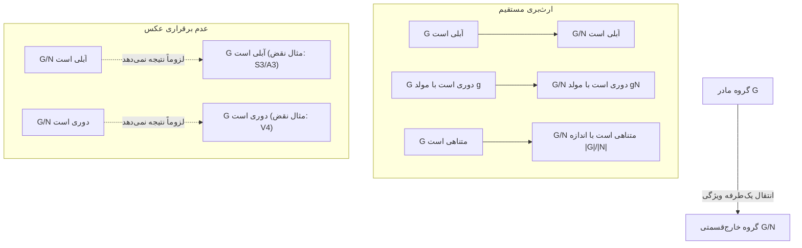

# 📜 قضیه خواص ساختاری گروه خارج‌قسمتی

> [!abstract] پیام و اهمیت قضیه (Theorem Core Message)
> گروه خارج‌قسمتی $G/N$ صرفاً یک ساختار جبری منفرد نیست، بلکه یک «تصویر ساده‌شده» از ساختار هندسی و جبری گروه مادر $G$ است. این قضیه شاهوار پنج‌گانه (قضیه ۳۲.۲ ص ۲۸-۲۹ جزوه علائیان) نشان می‌دهد که ویژگی‌های عالی گروه مانند **جابجایی (آبلی بودن)** و **تولیدپذیری دوری** چگونه از بالا به پایین یعنی از $G$ به $G/N$ سرازیر می‌شوند، و چگونه می‌توان با استفاده از ابزار تحلیلی **کموتاتورها**، وضعیت آبلی بودن خارج‌قسمت را حتی در صورت ناآبلی بودن گروه مادر به دقت مهار کرد.

---

## ۱. صورت صوری گزاره (Formal Statement)

فرض کنید $G$ یک [[تعریف گروه|گروه]] دلخواه و $N$ یک [[تعریف زیرگروه نرمال|زیرگروه نرمال]] در $G$ باشد ($N \trianglelefteq G$).

> [!THEOREM] قضیه ۳۲.۲ جزوه علائیان (خواص ساختاری گروه خارج‌قسمتی)
> تحت مفروضات فوق، احکام پنج‌گانه زیر برقرارند:
>
> ۱. **ارث‌بری آبلی بودن (Abelian Inheritance):**  
> اگر $G$ آبلی باشد، آنگاه گروه خارج‌قسمتی $G/N$ نیز آبلی است:
> 
> $$G \text{ is abelian} \implies G/N \text{ is abelian}$$
>
> ۲. **قانون توان‌ها و معیار همانی (Powers & Triviality Criterion):**  
> به ازای هر عنصر $x \in G$ و هر عدد صحیح $m \in \mathbb{Z}$ داریم:
> 
> $$(xN)^m = x^m N$$
> 
> علاوه بر این، توان $m$ام رده برابر عضو همانی $G/N$ می‌شود اگر و فقط اگر توان $m$ام عنصر در زیرگروه $N$ قرار گیرد:
> 
> $$(xN)^m = eN = N \iff x^m \in N$$
>
> ۳. **ارث‌بری دوری بودن (Cyclic Inheritance):**  
> اگر $G$ یک [[تعریف گروه دوری و مولد|گروه دوری]] با مولد $g$ باشد ($G = \langle g \rangle$)، آنگاه گروه خارج‌قسمتی $G/N$ نیز دوری بوده و به وسیله هم‌مجموعه $gN$ تولید می‌شود:
> 
> $$G = \langle g \rangle \implies G/N = \langle gN \rangle$$
>
> ۴. **مرتبه و شاخص در حالت متناهی (Finite Order & Lagrange):**  
> اگر $G$ یک گروه متناهی باشد، آنگاه $G/N$ نیز متناهی است و مرتبه آن از تقسیم مرتبه گروه بر مرتبه زیرگروه نرمال به دست می‌آید:
> 
> $$|G/N| = [G : N] = \frac{|G|}{|N|}$$
>
> ۵. **معیار کموتاتوری آبلی بودن خارج‌قسمت (Commutator Criterion):**  
> گروه خارج‌قسمتی $G/N$ آبلی است اگر و تنها اگر به ازای هر دو عنصر $x, y \in G$، عنصر کموتاتور $x^{-1}y^{-1}xy$ در زیرگروه $N$ قرار داشته باشد:
> 
> $$G/N \text{ is abelian} \iff \forall x, y \in G : x^{-1}y^{-1}xy \in N$$

---

## ۲. تحلیل فرض‌ها و شرایط لازم (Hypothesis Analysis)

* **نابرقراری عکس ویژگی‌های ارث‌بری (Converse Failures):**
  * **عکس قسمت (آ) برقرار نیست:** ممکن است $G/N$ آبلی باشد، در حالی که گروه مادر $G$ کاملاً غیرآبلی است!  
    *مثال:* در گروه متقارن غیرآبلی $S_3$ از مرتبه ۶، زیرگروه دورهای سه‌تایی $A_3$ نرمال است و گروه خارج‌قسمتی $S_3/A_3$ از مرتبه ۲ و در نتیجه آبلی (حتی دوری) است، اما خود $S_3$ جابجایی نیست.
  * **عکس قسمت (پ) برقرار نیست:** ممکن است $G/N$ دوری باشد، اما $G$ دوری نباشد. همان مثال $S_3/A_3 \cong \mathbb{Z}_2$ نشان می‌دهد که خارج‌قسمت دوری است، ولی $S_3$ دوری نیست. همچنین برای گروه غیردوری کلاین $V_4 \cong \mathbb{Z}_2 \times \mathbb{Z}_2$، هر خارج‌قسمت بر زیرگروه دو عضوی برابر با $\mathbb{Z}_2$ و دوری است.
* **فلسفه قسمت (ث) - زیرگروه مشتق یا کموتاتور:**  
  حکم قسمت (ث) بیان می‌کند که $G/N$ زمانی آبلی می‌شود که زیرگروه نرمال $N$ تمام «آلودگی‌های ناآبلی بودن» $G$ را در خود ببلعد! کوچک‌ترین زیرگروهی که شامل تمام کموتاتورهای $x^{-1}y^{-1}xy$ است، زیرگروه مشتق $G'$ نام دارد و این حکم می‌گوید: $G/N \text{ is abelian} \iff G' \leqslant N$.

---

## ۳. برهان صوری و مستقل (Formal Proof)

> [!SOLUTION]- مشاهده برهان صوری مستقل
> اثبات صوری یکایک این بندهای پنج‌گانه بر مبنای استقرا، قضیه لاگرانژ و فاکتورگیری جبری در پیوند مستقل زیر تدوین گردیده است:
> ![[اثبات قضیه خواص ساختاری گروه خارج‌قسمتی]]

---

## ۴. نتایج و کاربردهای کلیدی (Corollaries & Applications)

* **دوری بودن $\mathbb{Z}/n\mathbb{Z}$:**  
  کاربرد مستقیم بند (پ) برای گروه دوری $(\mathbb{Z}, +)$ ثابت می‌کند که تمام گروه‌های خارج‌قسمتی اعداد صحیح به پیمانه $n$ دوری هستند (به [[نتیجه دوری بودن گروه خارج‌قسمتی اعداد صحیح به هنگ n]] مراجعه شود).
* **آبلی‌سازی گروه‌ها (Abelianization):**  
  بند (ث) نشان می‌دهد که اگر $N = G'$ (زیرگروه کموتاتور) باشد، بزرگ‌ترین تصویر آبلی از گروه $G$ حاصل می‌شود که به آن آبلی‌ساز $G^{\text{ab}} = G/[G, G]$ می‌گویند.
* **محاسبه مرتبه عناصر در خارج‌قسمت:**  
  از بند (ب) نتیجه می‌شود که مرتبه هر عنصر $xN$ در $G/N$، همواره مقسوم‌علیهی از مرتبه عنصر $x$ در $G$ است:
  
  $$|xN| \ \Big| \ |x|$$

---

## ۵. دام‌ها و هشدارهای مفهومی (Pitfalls)

> [!WARNING] هشدارهای مفهومی و تله‌های رایج
> ۱. **تله عکس استلزام:** هرگز از آبلی بودن یا دوری بودن گروه خارج‌قسمتی، نتیجه نگیرید که گروه اصلی آبلی یا دوری بوده است!
> ۲. **قرارداد نمادگذاری در ساختارهای جمعی:** در گروه‌های جمعی، توان $m$ام تبدیل به ضرب اسکالر می‌شود:
> 
> $$m \cdot (x + N) = (mx) + N$$
> 
> و شرط همانی به صورت $mx \in N$ نوشته می‌شود نه $x^m \in N$.
