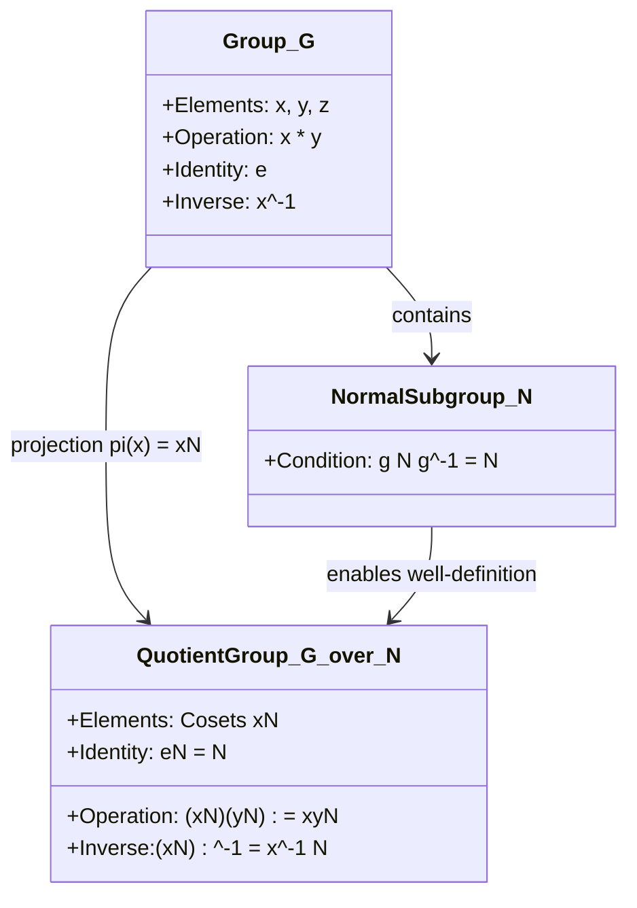

# 📜 قضیه ساختار گروه خارج‌قسمتی

> [!abstract] پیام و اهمیت قضیه (Theorem Core Message)
> مفهوم «ساخت خارج‌قسمتی» (Quotient Construction) یکی از شکوهمندترین و بنیادین‌ترین ابزارهای جبر مدرن است. ایده شهودی آن «نادیده گرفتن تفاوت‌های جزئی» یا «فشرده‌سازی اطلاعات» گروه $G$ از طریق هم‌پنداشتن عناصری است که تفاضل یا مضرب مشترک آن‌ها در زیرگروه $N$ قرار دارد.
>
> در این فرایند، رده‌های هم‌ارزی (هم‌مجموعه‌ها) خود به عنوان «عناصر منفرد» یک ساختار جدید متولد می‌شوند. این قضیه شاهوار (قضیه ۳۱.۲ ص ۲۷ جزوه علائیان) تضمین می‌کند که هرگاه زیرگروه فاکتورگیرنده **نرمال** باشد ($N \trianglelefteq G$)، این مجموعه نوظهور رده‌ها یعنی $G/N$ با عمل حاصل ترکیب رده‌ها، تمامی اصول موضوع گروه (بسته بودن، شرکت‌پذیری، عضو خنثی و عضو معکوس) را مو‌به‌مو به ارث برده و یک گروه کامل را تشکیل می‌دهد.

---

## ۱. صورت صوری گزاره (Formal Statement)

فرض کنید $G$ یک [[تعریف گروه|گروه]] با عمل دوتایی انتزاعی و $N$ یک [[تعریف زیرگروه نرمال|زیرگروه نرمال]] در $G$ باشد ($N \trianglelefteq G$).  
مجموعه تمام هم‌مجموعه‌های چپ $N$ در $G$ را با $G/N$ نشان می‌دهیم:

$$G/N = \{ xN \mid x \in G \}$$

عمل دوتایی حاصل ترکیب بر روی $G/N$ را به صورت ضرب رده‌ای تعریف می‌کنیم:

$$(xN)(yN) = xyN \quad , \quad \forall xN, yN \in G/N$$

> [!THEOREM] قضیه ۳۱.۲ جزوه علائیان (ساختار گروه خارج‌قسمتی)
> مجموعه $G/N$ به همراه عمل ضرب رده‌ای، تشکیل یک گروه کامل می‌دهد که **گروه خارج‌قسمتی $G$ بر $N$** (Quotient Group of $G$ modulo $N$) نامیده می‌شود و در اصول زیر صدق می‌کند:
>
> ۱. **بسته بودن (Closure):** حاصل ترکیب هر دو هم‌مجموعه مجدداً یک هم‌مجموعه در $G/N$ است:
> 
> $$(xN)(yN) = xyN \in G/N$$
>
> ۲. **شرکت‌پذیری (Associativity):** به ازای هر $xN, yN, zN \in G/N$:
> 
> $$((xN)(yN))(zN) = (xN)((yN)(zN))$$
>
> ۳. **عضو همانی (Identity Element):** هم‌مجموعه خود زیرگروه یعنی $eN = N$ (که در آن $e$ عضو خنثی $G$ است)، نقش عضو همانی گروه خارج‌قسمتی را ایفا می‌کند:
> 
> $$(xN)(eN) = (eN)(xN) = xN$$
>
> ۴. **عضو وارون (Inverse Element):** هر هم‌مجموعه $xN \in G/N$ دارای عضو وارون یکتای $(xN)^{-1} = x^{-1}N \in G/N$ است به طوری که:
> 
> $$(xN)(x^{-1}N) = (x^{-1}N)(xN) = eN = N$$

---

## ۲. تحلیل فرض‌ها و شرایط لازم (Hypothesis Analysis)

* **نرمال بودن به عنوان شرط تکوین گروه:**  
  اگر زیرگروه $N$ نرمال نباشد ($N \not\trianglelefteq G$)، ساختار خارج‌قسمتی متولد نمی‌شود! بدون نرمال بودن، حتی بسته بودن و خوش‌تعریفی عمل برقرار نیست، زیرا ضرب دو هم‌مجموعه به عنوان زیرمجموعه در حالت کلی یک هم‌مجموعه منفرد تولید نمی‌کند. بنابراین قید $N \trianglelefteq G$ یک الزام ساختاری تقلیل‌ناپذیر است.
* **ارث‌بری قوانین جبری از گروه مادر:**  
  توجه شود که شرکت‌پذیری، همانی و وارون در $G/N$ اختراعات جدیدی نیستند؛ بلکه مستقیماً از شرکت‌پذیری، همانی $e$ و وارون‌های موجود در گروه مادر $G$ به ارث می‌رسند.

---

## ۳. برهان صوری و مستقل (Formal Proof)

> [!SOLUTION]- مشاهده برهان صوری مستقل
> اثبات صوری یکایک اصول چهارگانه گروه خارج‌قسمتی بر پایه خوش‌تعریفی لم ۳۰.۲ در یادداشت مستقل زیر ارائه گردیده است:
> ![[اثبات قضیه ساختار گروه خارج‌قسمتی]]

---

## ۴. نتایج و کاربردهای کلیدی (Corollaries & Applications)

* **نگاشت تصویر کانونی (Canonical Projection):**  
  نگاشت پوشای $\pi: G \to G/N$ با ضابطه $\pi(x) = xN$ یک هم‌ریختی گروهی است که هسته آن دقیقاً زیرگروه نرمال $N$ است: $\ker \pi = N$. این واقعیت نشان می‌دهد که هر زیرگروه نرمال، هسته یک هم‌ریختی مناسب است.
* **شاه‌قضیه اول یک‌ریختی (First Isomorphism Theorem):**  
  هر تصویر هم‌ریختی از گروه $G$ با یک گروه خارج‌قسمتی از آن یک‌ریخت است:
  
  $$G / \ker \varphi \cong \operatorname{im} \varphi$$
  
* **طبقه‌بندی ساختاری گروه‌ها:**  
  بررسی گروه‌های ساده (گروه‌هایی که هیچ زیرگروه نرمال غیربدیهی ندارند و بنابراین فاقد خارج‌قسمت غیربدیهی هستند) اساس برنامه طبقه‌بندی گروه‌های متناهی است.

---

## ۵. دام‌ها و هشدارهای مفهومی (Pitfalls)

> [!WARNING] هشدار مفهومی: ماهیت عناصر گروه خارج‌قسمتی
> ۱. **عناصر $G/N$ مجموعه هستند، نه عضو منفرد!** عنصری از $G/N$ مانند $xN$، یک زیرمجموعه از عناصر $G$ است. ضرب در $G/N$، عمل روی این زیرمجموعه‌هاست.
> ۲. **پرهیز از خط کسری و نمادهای گمراه‌کننده:** هرگز ساختار گروه خارج‌قسمتی را به صورت کسری $\frac{G}{N}$ ننویسید. نماد استاندارد منحصراً $G/N$ است.
> ۳. **عدم زیرگروه بودن $G/N$ در $G$:** گروه خارج‌قسمتی $G/N$ هرگز زیرگروهی از $G$ نیست؛ زیرا اعضای آن اصلاً عضوی از $G$ نیستند بلکه زیرمجموعه‌هایی از $G$ (افرازهای $G$) می‌باشند!
> 
> برای بررسی تفصیلی، به [[دام مفهومی لزوم نرمال بودن در تشکیل گروه خارج‌قسمتی]] مراجعه شود.
