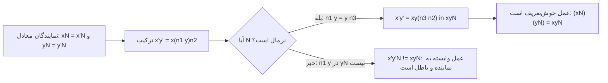

# 📜 لم خوش‌تعریفی ضرب هم‌مجموعه‌ها تحت زیرگروه نرمال

> [!abstract] پیام و اهمیت قضیه (Theorem Core Message)
> در جبر انتزاعی، هدف اساسی از بررسی هم‌مجموعه‌ها، تعریف یک عمل جبری بر روی مجموعه این رده‌هاست تا ساختار جبری جدیدی بسازیم. ایده طبیعی برای ترکیب دو هم‌مجموعه، ضرب نمایندگان آن‌هاست: $(xN) \cdot (yN) = (xy)N$.
>
> با این حال، چون یک هم‌مجموعه دارای چندین نماینده معادل است ($xN = x'N$ به شرط $x^{-1}x' \in N$)، این سؤال حیاتی مطرح می‌شود: **آیا حاصل ترکیب دو هم‌مجموعه به انتخاب نماینده بستگی دارد یا خیر؟** اگر بستگی داشته باشد، عمل تعریف‌نشده (Ill-defined) و فاقد معنای ریاضی خواهد بود.
>
> این لم بنیادین (لم ۳۰.۲ ص ۲۷ جزوه علائیان) اثبات می‌کند که **نرمال بودن زیرگروه ($N \trianglelefteq G$)** دقیقاً همان شرط ساختاری لازم و کافی است که خوش‌تعریفی این عمل را تضمین می‌کند و نشان می‌دهد که ضرب مجموعه‌ای رده‌ها دقیقاً منطبق بر رده حاصل ترکیب نمایندگان است: $(xN)(yN) = xyN$.

---

## ۱. صورت صوری گزاره (Formal Statement)

فرض کنید $G$ یک [[تعریف گروه|گروه]] با عمل دوتایی انتزاعی و $N$ یک [[تعریف زیرگروه نرمال|زیرگروه نرمال]] در $G$ باشد ($N \trianglelefteq G$).

> [!THEOREM] لم ۳۰.۲ جزوه علائیان (خوش‌تعریفی ضرب هم‌مجموعه‌ها)
> اگر $G$ گروهی دلخواه و $N \trianglelefteq G$ باشد، آنگاه به ازای هر دو عنصر $x, y \in G$، حاصلضرب مجموعه‌ای دو هم‌مجموعه چپ $xN$ و $yN$ برابر با هم‌مجموعه چپ حاصل ترکیب $xy$ در $N$ است:
>
> $$(xN)(yN) = xyN$$
>
> به بیان هم‌ارز از دیدگاه استقلال از نماینده (Representative Independence): اگر $x, x', y, y' \in G$ به قسمی باشند که $xN = x'N$ و $yN = y'N$، آنگاه قطعاً:
>
> $$xyN = x'y'N$$

---

## ۲. تحلیل فرض‌ها و شرایط لازم (Hypothesis Analysis)

* **لزوم نرمال بودن زیرگروه $N$:**  
  برقراری تساوی مجموعه‌ای $(xN)(yN) = xyN$ مستلزم جابجایی مجموعه‌ای $Ny = yN$ است. اگر $N$ یک زیرگروه غیرنرمال باشد، عنصری مانند $y \in G$ وجود دارد به طوری که $Ny \ne yN$. در این صورت، حاصلضرب دو مجموعه $xN$ و $yN$ در حالت کلی حتی یک هم‌مجموعه منفرد نخواهد بود، بلکه اجتماعی از چند هم‌مجموعه مجزا می‌گردد.
* **استقلال از نماینده:**  
  وقتی می‌نویسیم $x' \in xN$ و $y' \in yN$، عناصری چون $n_1, n_2 \in N$ وجود دارند که $x' = x n_1$ و $y' = y n_2$. حاصل ترکیب این دو عنصر برابر است با:
  
  $$x' y' = (x n_1)(y n_2) = x (n_1 y) n_2$$
  
  برای آنکه $x'y'$ درون $xyN$ قرار گیرد، الزاماً باید بتوان عامل $n_1 y$ را به فرم $y n_3$ (با $n_3 \in N$) بازنویسی کرد. این تبدیل دقیقاً متناظر با پایداری $N$ تحت تزویج با $y$ یعنی $y^{-1} n_1 y \in N$ است که همان تعریف صلب زیرگروه نرمال است.

---

## ۳. برهان صوری و مستقل (Formal Proof)

> [!SOLUTION]- مشاهده برهان صوری مستقل
> برهان کامل این لم با دو رویکرد مجموعه‌ای مستقیم و آزمون استقلال از نماینده در پیوند زیر تدوین شده است:
> ![[اثبات لم خوش‌تعریفی ضرب هم‌مجموعه‌ها تحت زیرگروه نرمال]]

---

## ۴. نتایج و کاربردهای کلیدی (Corollaries & Applications)

* **تأسیس گروه خارج‌قسمتی:**  
  این لم سنگ‌بنای مستقیم اثبات [[قضیه ساختار گروه خارج‌قسمتی]] است؛ زیرا اصل بسته بودن و خوش‌تعریفی عمل در مجموعه رده‌ها را مهیا می‌کند.
* **هم‌ریختی نگاشت کانونی خارج‌قسمتی:**  
  نگاشت تصویر کانونی $\pi: G \to G/N$ با ضابطه $\pi(x) = xN$، به دلیل این لم مستقیماً در خاصیت هم‌ریختی صدق می‌کند:
  
  $$\pi(xy) = xyN = (xN)(yN) = \pi(x)\pi(y)$$
  
  این ویژگی، شالوده اثبات قضایای یک‌ریختی از جمله [[قضیه اول یک‌ریختی گروه‌ها]] است.

---

## ۵. دام‌ها و هشدارهای مفهومی (Pitfalls)

> [!WARNING] هشدار مفهومی: خلط میان جابجایی عناصر و جابجایی رده‌ها
> در برهان تساوی $x(Ny)N = xyN^2$، توجه اکید داشته باشید که تساوی مجموعه‌ای $Ny = yN$ هرگز به معنای $n y = y n$ برای اعضای منفرد نیست! بلکه به این معناست که برای هر $n \in N$، عضوی دیگر چون $n' \in N$ یافت می‌شود که $n y = y n'$. جابجایی در سطح رده‌ها رخ می‌دهد، نه لزوماً در سطح تک‌تک عناصر گروه.
>
> همچنین برای تحلیل تفصیلی خطای نوشتن ضرب هم‌مجموعه‌ها در غیاب فرض نرمال بودن، به [[دام مفهومی لزوم نرمال بودن در تشکیل گروه خارج‌قسمتی]] مراجعه کنید.
