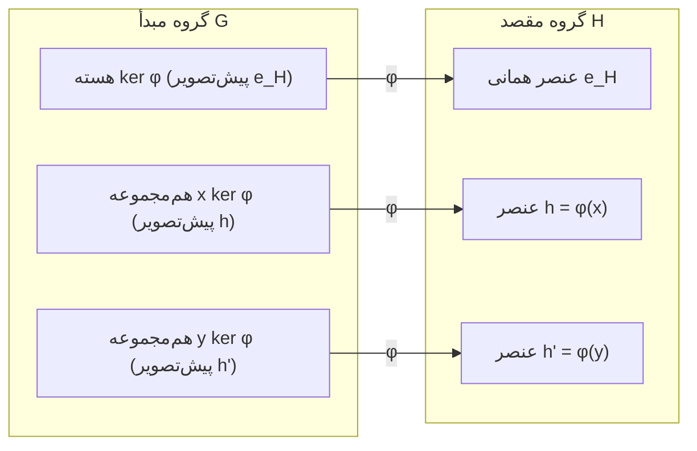

# 📘 تعریف هسته و تصویر هم‌ریختی گروهی

> [!abstract] انگیزه پیدایش و تصویر ذهنی (Intuition & Motivation)
> هنگامی که یک هم‌ریختی گروهی $\varphi: G \to H$ ساختار گروه $G$ را به درون گروه $H$ تصویر می‌کند، دو ناحیه هندسی و جبری فوق‌العاده حیاتی پدید می‌آید:
> 
> ۱. **هسته (Kernel):** ناحیه‌ای در گروه مبدأ که زیر لنز هم‌ریختی تماماً خرد شده و در نقطه همانی مقصد ($e_H$) ناپدید می‌گردد. هسته در حقیقت «سنجه تلفات اطلاعات» و معیار خطای انقباض نگاشت است؛ هر چه هسته بزرگ‌تر باشد، اطلاعات بیشتری از ساختار اصلی محو شده است.
> ۲. **تصویر (Image):** ردپای بازتولیدشده گروه $G$ در قلمرو مقصد $H$.
> 
> این دو مفهوم، اسکلت ساختاری قضیه بنیادین هم‌ریختی (قضیه اول یک‌ریختی) را پی‌ریزی می‌کنند و رفتار موضعی و سراسری هر تبدیلی را در جبر تعیین می‌نمایند (تعریف ۳۶.۲ ص ۳۲ جزوه).

---

## ۱. تعریف صوری هسته و تصویر (Formal Definition)

فرض کنید $(G, *)$ و $(H, \star)$ دو [[تعریف گروه|گروه]] دلخواه بوده و $\varphi: G \to H$ یک [[تعریف هم‌ریختی و بروریختی گروه‌ها|هم‌ریختی گروهی]] باشد.

> [!DEFINITION] تعریف هسته و تصویر هم‌ریختی (تعریف ۳۶.۲ جزوه)
> * **هسته هم‌ریختی (Kernel):**  
>   مجموعه تمامی عناصری از گروه مبدأ $G$ که تحت نگاشت $\varphi$ به عنصر همانی گروه مقصد ($e_H$) فرستاده می‌شوند، **هسته $\varphi$** نامیده شده و با نماد $\ker \varphi$ نمایش داده می‌شود:
>   
> $$\ker \varphi = \{k \in G \mid \varphi(k) = e_H\}$$
> 
> * **تصویر هم‌ریختی (Image):**  
>   مجموعه تمام تصاویری از گروه مقصد $H$ که حداقل یک پیش‌تصویر در $G$ داشته باشند، **تصویر $\varphi$** نامیده شده و با نماد $\operatorname{im} \varphi$ یا $\varphi(G)$ تعریف می‌گردد:
>   
> $$\operatorname{im} \varphi = \varphi(G) = \{h \in H \mid \exists x \in G : \varphi(x) = h\} = \{\varphi(x) \mid x \in G\}$$

---

## ۲. ساختار تارهای نگاشت و لایه‌بندی جبری (Fibers & Foliation)

یکی از عمیق‌ترین بینش‌های حاکم بر هسته، خاصیت انتقال هم‌مجموعه‌ای آن است:

> [!NOTE] قضیه لایه‌بندی تارهای پیش‌تصویر (Fiber Decomposition)
> فرض کنید $x, y \in G$ باشند. تصاویر این دو عضو تحت هم‌ریختی برابرند اگر و فقط اگر هر دو به یک هم‌مجموعه چپ یکسان از هسته تعلق داشته باشند:
> 
> $$\varphi(x) = \varphi(y) \iff \varphi(x)^{-1} \star \varphi(y) = e_H \iff \varphi(x^{-1} * y) = e_H \iff x^{-1} * y \in \ker \varphi \iff x \ker \varphi = y \ker \varphi$$

این گزاره اثبات می‌کند که پیش‌تصویر هر نقطه منفرد $h \in \operatorname{im} \varphi$ (که اصطلاحاً یک **تار / Fiber** نامیده می‌شود)، تهی نیست بلکه دقیقاً یک **هم‌مجموعه کامل** از $\ker \varphi$ در گروه $G$ است:

$$\varphi^{-1}(\{h\}) = x \ker \varphi \quad (\text{به شرطی که } \varphi(x) = h)$$

بنابراین، گروه مبدأ $G$ به قطعات و لایه‌های موازی و مساوی که هر یک کپی تغییرشکل‌یافته‌ای از هسته هستند، افراز می‌گردد.

---

## ۳. ویژگی‌های ساختاری کلیدی (Key Structural Traits)

بنا بر [[قضیه ویژگی‌های بنیادی هم‌ریختی و نرمال بودن هسته|قضیه ۳۷.۲ جزوه]]:
۱. **جایگاه هسته:**  
   هسته همواره یک [[تعریف زیرگروه نرمال|زیرگروه نرمال]] در گروه مبدأ است:
   
$$\ker \varphi \trianglelefteq G$$

۲. **جایگاه تصویر:**  
   تصویر همواره یک زیرگروه در گروه مقصد است:
   
$$\operatorname{im} \varphi \leqslant H$$

   *(توجه: تصویر لزوماً در $H$ نرمال نیست، مگر آن‌که $\varphi$ پوشا باشد یا $H$ آبلی باشد).*
۳. **تک‌ریختی و تلاشی هسته:**  
   بنا بر [[لم شرط لازم و کافی تک‌ریختی با پوچی هسته]]، هم‌ریختی $\varphi$ یک‌به‌یک است اگر و تنها اگر هسته آن فقط شامل عضو همانی باشد ($\ker \varphi = \{e_G\}$).

---

## ۴. مصداق‌ها و مرزهای تعریف (Examples & Boundary Cases)

* **هم‌ریختی دترمینان:**  
  برای $\det: GL_n(\mathbb{R}) \to \mathbb{R}^*$، هسته برابر است با ماتریس‌های با دترمینان ۱ یعنی گروه خطی خاص $SL_n(\mathbb{R})$ و تصویر کل $\mathbb{R}^*$ است.
* **هم‌ریختی لگاریتم:**  
  در نگاشت $\varphi: \mathbb{R}^* \to \mathbb{R}$ با $\varphi(x) = \ln|x|$، هسته مجموعه دوعضوی $\{1, -1\}$ و تصویر کل محور حقیقی $\mathbb{R}$ است (ر.ک. [[مثال محاسبه هسته و تصویر هم‌ریختی لگاریتم]]).
* **هم‌ریختی همانی:**  
  برای نگاشت همانی $\operatorname{id}_G: G \to G$، هسته بدیهی $\ker(\operatorname{id}_G) = \{e_G\}$ و تصویر کل گروه $\operatorname{im}(\operatorname{id}_G) = G$ است.
* **هم‌ریختی پوچ / صفر:**  
  برای نگاشت $\varphi_0(x) = e_H$، هسته تمام گروه $G$ و تصویر زیرگروه تک‌عضوی $\{e_H\}$ است.

---

## ۵. دام‌ها و هشدارهای مفهومی (Pitfalls)

> [!WARNING] دام ۱: اشتباه در محل استقرار مجموعه‌ها
> یکی از رایج‌ترین خطاهای مقدماتی، جابجا نوشتن فضای تعلق هسته و تصویر است:
> * هسته همواره زیرمجموعه‌ای از **گروه مبدأ** است: $\ker \varphi \subseteq G$.
> * تصویر همواره زیرمجموعه‌ای از **گروه مقصد** است: $\operatorname{im} \varphi \subseteq H$.

> [!WARNING] دام ۲: ممنوعیت حروف نامتعارف و ایتالیک طبق خطوط قرمز
> طبق دستورالعمل‌های رسمی فاز صفر:
> * نماد هسته منحصراً با فونت استاندارد KaTeX به صورت `\ker \varphi` نوشته می‌شود؛ نوشتن `Ker(\varphi)` با حروف ایتالیک ممنوع است.
> * نماد تصویر منحصراً با اپراتور `\operatorname{im} \varphi` نوشته می‌شود؛ استفاده از فرم‌هایی چون `Im(\varphi)` خطا محسوب می‌گردد.
