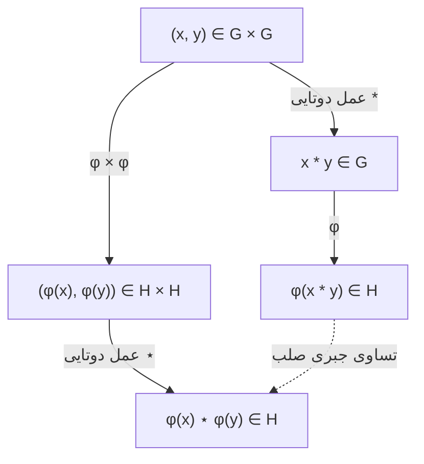

# 📘 تعریف هم‌ریختی و بروریختی گروه‌ها

> [!abstract] انگیزه پیدایش و تصویر ذهنی (Intuition & Motivation)
> در جبر مجرد، ارزش یک ساختار جبری صرفاً در عناصر تشکیل‌دهنده آن نیست، بلکه در **روابط درونی و نحوه تعامل عناصر تحت عمل دوتایی** نهفته است. برای مقایسه دو گروه مختلف، انتقال ساختار میان آن‌ها، یا فشرده‌سازی اطلاعات یک گروه در گروهی ساده‌تر، به نگاشت‌هایی نیاز داریم که این «هندسه جبری» را حفظ کنند.
> 
> مفهوم **«هم‌ریختی گروهی» (Group Homomorphism)** دقیقاً نقش چنین لنز ساختارپاسداری را ایفا می‌کند. یک هم‌ریختی مانند یک دوربین عکاسی است: ممکن است بخش‌هایی از جزئیات را در هم ادغام کند (فروپاشی چندین عضو بر روی یک عضو خنثی)، اما زاویه‌ها، نظم و ساختار روابط میان عناصر را بدون تحریف بازتاب می‌دهد. این مفهوم، ستون فقرات اتصال گروه‌ها به یکدیگر و مدخل اصلی ورود به نظریه [[قضیه اول یک‌ریختی گروه‌ها|قضایای یک‌ریختی]] است (تعریف ۳۴.۲ ص ۲۹-۳۰ جزوه).

---

## ۱. تعریف صوری هم‌ریختی و بروریختی (Formal Definition)

فرض کنید $(G, *)$ و $(H, \star)$ دو [[تعریف گروه|گروه]] با اعمال دوتایی انتزاعی دلخواه باشند.

> [!DEFINITION] تعریف هم‌ریختی و بروریختی گروه‌ها (تعریف ۳۴.۲ جزوه)
> تابعی مانند $\varphi: G \to H$ را یک **هم‌ریختی گروهی** (Homomorphism) می‌نامیم، هرگاه به ازای هر دو عنصر دلخواه $x, y \in G$، شرط حفظ ساختار برقرار باشد:
> 
> $$\varphi(x * y) = \varphi(x) \star \varphi(y)$$
> 
> به بیان صریح، حاصل ترکیب عناصر $x$ و $y$ تحت عمل $*$ در گروه مبدأ $G$، پس از اعمال نگاشت $\varphi$، دقیقاً برابر با حاصل ترکیب تصاویر $\varphi(x)$ و $\varphi(y)$ تحت عمل $\star$ در گروه مقصد $H$ است.
> 
> * چنانچه نگاشت $\varphi$ علاوه بر هم‌ریختی، **پوشا (برو / Onto)** باشد (یعنی $\operatorname{im} \varphi = H$)، آن را **«بروریختی» یا «اپیمورفیسم» (Epimorphism)** می‌نامیم.

### طبقه‌بندی تخصصی هم‌ریختی‌ها بر پایه خواص نگاشتی

در ادبیات جبر مجرد، بسته به ویژگی‌های مجموعه‌ای نگاشت $\varphi: G \to H$، نام‌گذاری‌های زیر به کار می‌رود:

۱. **تک‌ریختی یا مونومورفیسم (Monomorphism):**  
   اگر هم‌ریختی $\varphi$ یک‌به‌یک (Injective) باشد. در این حالت، گروه $G$ به عنوان یک نسخه یک‌ریخت درون $H$ جاسازی (Embed) می‌شود.
۲. **بروریختی یا اپیمورفیسم (Epimorphism):**  
   اگر هم‌ریختی $\varphi$ پوشا (Surjective) باشد. در این حالت، گروه $H$ به صورت خارج‌قسمتی از $G$ پدیدار می‌شود.
۳. **یک‌ریختی یا ایزومورفیسم (Isomorphism):**  
   اگر هم‌ریختی $\varphi$ هم یک‌به‌یک و هم پوشا (دوسویی / Bijective) باشد. در این حالت دو ساختار کاملاً هم‌ارز و یکسان هستند ($G \cong H$).
۴. **درون‌ریختی یا اندومورفیسم (Endomorphism):**  
   اگر هم‌ریختی از یک گروه به خود همان گروه تعریف شود ($\varphi: G \to G$).
۵. **خودریختی یا اتومورفیسم (Automorphism):**  
   اگر یک‌ریختی از گروه $G$ بر روی خود گروه $G$ برقرار باشد ($\varphi: G \to G$ دوسویی).

---

## ۲. نمودار جابجایی و معماری نگاشت (Commutative Diagram)

معادله ساختارپاسدار $\varphi(x * y) = \varphi(x) \star \varphi(y)$ را می‌توان به زبان نظریه دسته‌ها از طریق تعویض‌پذیری نمودار زیر توصیف کرد:

این نمودار نشان می‌دهد که فرقی نمی‌کند ابتدا عناصر در دامنه ترکیب شوند و سپس تصویر گردند، یا ابتدا تصویر شده و سپس در هم‌دامنه با عمل دوتایی مقصد ترکیب شوند؛ نتیجه در هر دو مسیر کاملاً یکسان است.

---

## ۳. ویژگی‌های ساختاری اولیه (Initial Structural Properties)

از تعریف فوق، بلافاصله نتایج ساختاری زیر حاصل می‌شود (که به تفضیل در [[قضیه ویژگی‌های بنیادی هم‌ریختی و نرمال بودن هسته]] اثبات می‌گردند):

۱. **انتقال عنصر خنثی:**  
   عنصر همانی گروه مبدأ همواره به عنصر همانی گروه مقصد نگاشته می‌شود:
   
$$\varphi(e_G) = e_H$$

۲. **انتقال عضو معکوس:**  
   تصویر معکوس هر عنصر، معکوس تصویر آن عنصر در مقصد است:
   
$$\varphi(x^{-1}) = (\varphi(x))^{-1}$$

۳. **حفظ توان‌های صحیح:**  
   به ازای هر $n \in \mathbb{Z}$ و هر $x \in G$ داریم:
   
$$\varphi(x^n) = (\varphi(x))^n$$

۴. **پایداری زیرگروهی:**  
   اگر $K \leqslant G$ باشد، آنگاه تصویر آن نیز زیرگروهی از مقصد است ($\varphi(K) \leqslant H$). همچنین پیش‌تصویر هر زیرگروه $L \leqslant H$ زیرگروهی در مبدأ است ($\varphi^{-1}(L) \leqslant G$).

---

## ۴. مصداق‌ها و مرز تعریف (Examples & Boundary Cases)

* **هم‌ریختی همانی (Identity Map):**  
  نگاشت $\operatorname{id}_G: G \to G$ با ضابطه $\operatorname{id}_G(x) = x$ یک هم‌ریختی یک‌به‌یک و پوشا (خودریختی) است.
* **هم‌ریختی بدیهی یا پوچ (Trivial Homomorphism):**  
  نگاشت $\varphi_0: G \to H$ با ضابطه $\varphi_0(x) = e_H$ برای تمام $x \in G$، همواره یک هم‌ریختی معتبر است زیرا:
  
$$\varphi_0(x * y) = e_H = e_H \star e_H = \varphi_0(x) \star \varphi_0(y)$$

* **کاتالوگ هم‌ریختی‌های استاندارد ریاضی:**  
  بررسی پنج هم‌ریختی برجسته (علامت اعداد حقیقی، مزدوج مختلط، قدر مطلق مختلط، نگاشت نمایی و دترمینان ماتریس‌ها) در یادداشت اختصاصی [[مثال کاتالوگ هم‌ریختی‌های کانونی]] تدوین شده است.
* **پادمثال / نقض ساختار (Non-example):**  
  نگاشت انتقال $f: (\mathbb{R}, +) \to (\mathbb{R}, +)$ با ضابطه $f(x) = x + 1$ یک هم‌ریختی گروهی نیست، زیرا:
  
$$f(x + y) = x + y + 1 \neq (x + 1) + (y + 1) = f(x) + f(y)$$

  علاوه بر این، $f(0) = 1 \neq 0$ که نقض‌کننده خاصیت انتقال همانی است.

---

## ۵. دام‌ها و هشدارهای مفهومی (Pitfalls)

> [!WARNING] دام ۱: خلط عمل دوتایی مبدأ با عمل دوتایی مقصد
> هرگز عمل گروه مبدأ را با عمل گروه مقصد یکسان فرض نکنید. در تساوی $\varphi(x * y) = \varphi(x) \star \varphi(y)$، نماد $*$ متعلق به هندسه درونی $G$ و نماد $\star$ متعلق به هندسه $H$ است. برای مثال در نگاشت نمایی $\mu: (\mathbb{R}, +) \to (\mathbb{R}^+, \cdot)$ با ضابطه $\mu(t) = e^t$، عمل مبدأ «جمع» و عمل مقصد «ضرب» است:
> 
> $$\mu(s + t) = e^{s+t} = e^s \cdot e^t = \mu(s) \cdot \mu(t)$$

> [!WARNING] دام ۲: ممنوعیت استفاده از واژه «ضرب» برای عمل انتزاعی
> طبق گاردریل‌های صلب فاز صفر، در گروه‌هایی با عمل انتزاعی $*$، از به کار بردن واژه‌های «ضرب» یا «حاصل‌ضرب» اکیداً خودداری شود؛ همواره عبارت اصیل **«حاصل ترکیب عناصر تحت عمل $*$»** به کار می‌رود.

> [!WARNING] دام ۳: هم‌ریختی بودن متضمن یک‌به‌یک یا پوشا بودن نیست
> یک هم‌ریختی عمومی ممکن است بسیاری از عناصر متمایز را به یک نقطه فشرده کند، یا تنها بخش بسیار کوچکی از هم‌دامنه را پوشش دهد. مطالعه دقیق میزان این فشردگی و این پوشش، مستلزم مطالعه دو مفهوم کلیدی [[تعریف هسته و تصویر هم‌ریختی گروهی|هسته و تصویر هم‌ریختی]] است.
