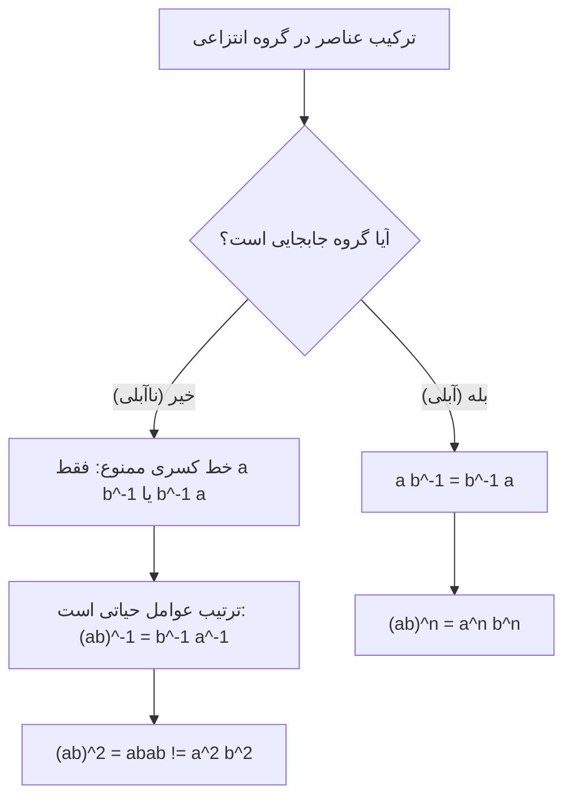

# ⚠️ دام مفهومی: استفاده از نماد و عملیات ضرب در گروه‌های انتزاعی

> [!DANGER] استدلال وسوسه‌کننده غلط (The Tempting False Logic)
> «چون در کتاب‌های جبر معمولاً عمل دوتایی گروه با کنار هم نوشتن عناصر ($xy$) یا علامت ستاره ($x * y$) نمایش داده شده و "ضرب" خوانده می‌شود، پس می‌توان تمامی قواعد آشنای جبر دبیرستانی و حساب اعداد حقیقی را بر آن اعمال کرد:
> 
> مثلاً به جای $a b^{-1}$ خط کسری کشید و نوشت $\frac{a}{b}$؛ خارج‌قسمت را به صورت $\frac{G}{N}$ نشان داد؛ توان‌ها را به صورت $(ab)^2 = a^2 b^2$ پخش کرد؛ و وارون حاصلضرب را به صورت $(ab)^{-1} = a^{-1}b^{-1}$ پنداشت!»

---

## ۱. باور غلط رایج (The Common Misconception)

این دام ریشه در پدیده «اینرسی شناختی» (Cognitive Inertia) دارد؛ یعنی ذهن دانشجویان عادت‌های دیرینه حساب دبیرستانی با اعداد حقیقی یا مختلط را که ساختارهایی کاملاً جابجایی (آبلی) و دارای تقسیم هستند، ناخودآگاه به ساختارهای بسیار کلی‌تر و غیرجابجایی جبر مجرد تسری می‌دهد.  
به‌کارگیری واژه «ضرب» و نمادهای متناظر آن بدون درک انتزاعی بودن عملگر $*$, منجر به بروز زنجیره‌ای از خطاهای مرگبار محاسباتی و نمادگذاری می‌گردد.

---

## ۲. کالبدشکافی خطای استدلال و نقاط شکست (Dissection of Errors)

### خطای اول: ابهام کشنده خط کسری و عمل تقسیم
در گروه‌های غیرجابجایی، عنصری به نام «تقسیم بر $b$» یا نمادی چون $\frac{a}{b}$ مطلقاً وجود ندارد!  
علت آن است که ضرب در وارون، به سمت چپ و راست حساس است:
* اگر $b^{-1}$ را از راست ضرب کنیم: $a b^{-1}$
* اگر $b^{-1}$ را از چپ ضرب کنیم: $b^{-1} a$

در یک گروه غیرآبلی، عموماً $a b^{-1} \ne b^{-1} a$ است.  
حال اگر کسی بنویسد $\frac{a}{b}$، خواننده هرگز نخواهد فهمید منظور $a b^{-1}$ بوده است یا $b^{-1} a$! این نمادگذاری به لحاظ ریاضی مبهم، تعریف‌نشده و غیرقابل تفسیر است.

### خطای دوم: توزیع توان‌ها $(ab)^n \ne a^n b^n$
در جبر مقدماتی، تساوی $(ab)^2 = a^2 b^2$ بدیهی تلقی می‌شود. اما در یک گروه دلخواه:

$$(ab)^2 = (ab)(ab) = a(ba)b$$

برای تبدیل این عبارت به $a^2 b^2 = aabb$، باید بتوان دو عامل میانی یعنی $b$ و $a$ را جابجا کرد ($ba = ab$). اگر گروه ناآبلی باشد، $ba \ne ab$ بوده و در نتیجه:

$$(ab)^2 \ne a^2 b^2$$

توزیع توان بر روی حاصل ترکیب تنها و تنها در گروه‌های آبلی مجاز است.

### خطای سوم: نقض ترتیب وارون‌ها در حاصل ترکیب (پوتین و جوراب)
یکی از خطاهای متداول دیگر، نوشتن $(ab)^{-1} = a^{-1}b^{-1}$ است. بیایید حاصل ترکیب این عبارت با $ab$ را بسنجیم:

$$(ab)(a^{-1}b^{-1}) = a(ba^{-1})b^{-1}$$

این عبارت تنها زمانی به عضو خنثی $e$ فرو می‌پاشد که $ba^{-1} = a^{-1}b$ باشد که در ساختارهای ناآبلی برقرار نیست. وارون درست بنا به قانون فیزیکی کفش و جوراب (ابتدا جوراب را می‌پوشیم سپس کفش، اما هنگام درآوردن ابتدا کفش را خارج می‌کنیم سپس جوراب!) همواره معکوس ترتیب عوامل است:

$$(ab)^{-1} = b^{-1} a^{-1}$$

### خطای چهارم: خلط دستگاه جمعی و ضربی
در گروه‌هایی که ساختار آن‌ها جمعی است مانند $(\mathbb{Z}, +)$ یا فضای برداری، نباید از ترمینولوژی یا نمادهای ضربی استفاده کرد:
* عضو خنثی جمعی $0$ است، نه $e$ یا $1$.
* وارون جمعی عنصر $x$، قرینه آن $-x$ است، نه $x^{-1}$.
* هم‌مجموعه جمعی به صورت $x + H$ نوشته می‌شود، نه $xH$.

---

## ۳. مثال نقض و گواه ملموس در ماتریس‌های معکوس‌پذیر $GL_2(\mathbb{R})$

برای درک عمق فاجعه ابهام خط کسری، گروه ماتریس‌های معکوس‌پذیر مرتبه دو را در نظر می‌گیریم:

$$A = \begin{pmatrix} 1 & 1 \\ 0 & 1 \end{pmatrix} \quad , \quad B = \begin{pmatrix} 0 & 1 \\ 1 & 0 \end{pmatrix} \quad \in GL_2(\mathbb{R})$$

وارون ماتریس $B$ برابر با خود آن است ($B^{-1} = B$). اکنون دو شیوه ضرب در وارون را محاسبه می‌کنیم:
۱. **ضرب وارون از سمت راست ($A B^{-1}$):**
   
   $$A B^{-1} = \begin{pmatrix} 1 & 1 \\ 0 & 1 \end{pmatrix} \begin{pmatrix} 0 & 1 \\ 1 & 0 \end{pmatrix} = \begin{pmatrix} 1 & 1 \\ 1 & 0 \end{pmatrix}$$

۲. **ضرب وارون از سمت چپ ($B^{-1} A$):**
   
   $$B^{-1} A = \begin{pmatrix} 0 & 1 \\ 1 & 0 \end{pmatrix} \begin{pmatrix} 1 & 1 \\ 0 & 1 \end{pmatrix} = \begin{pmatrix} 0 & 1 \\ 1 & 1 \end{pmatrix}$$

ملاحظه می‌شود که دو ماتریس حاصل کاملاً با یکدیگر متفاوتند:

$$A B^{-1} \ne B^{-1} A$$

اگر دانشجویی بنویسد $\frac{A}{B}$، هیچ ریاضیدانی در دنیا نمی‌تواند بگوید خروجی کدام‌یک از این دو ماتریس است!

---

## ۴. استدلال و صورت‌بندی درست (منشور خطوط قرمز فاز ۰)

برای جلوگیری از هرگونه لغزش، رعایت چهار قاعده صلب زیر از سند [[فاز ۰ - قرارداد نمادگذاری و خطوط قرمز فصل دوم]] الزامی است:

> [!NOTE] خطوط قرمز رسمی نگارش جبر مجرد
> ۱. **واژگان مجاز عمل انتزاعی:** هرگاه ساختار جبری با عملگر انتزاعی $*$ بیان می‌شود، منحصراً بگویید:  
>    **«حاصل ترکیب عناصر تحت عمل $*$»**  
>    و از گفتن «ضرب دو عنصر» یا «حاصل‌ضرب» پرهیز کنید.
> ۲. **ممنوعیت مطلق خط کسری در گروه‌ها:**  
>    نوشتن هرگونه کسر مانند $\frac{a}{b}$ یا خط کسری برای خارج‌قسمت $\frac{G}{N}$ در جبر ناآبلی اکیداً ممنوع است. منحصراً از $a b^{-1}$ یا $b^{-1} a$ و برای خارج‌قسمت از $G/N$ استفاده نمایید.
> ۳. **تفکیک نظام جمعی و ضربی:**  
>    در گروه‌های جمعی، از واژگان و نمادهای متناظر (عضو صفر $0$، قرینه $-x$، مضرب $nx$، هم‌مجموعه $x + H$) تبعیت کنید.

---

## ۵. چک‌لیست پیشگیری و تشخیص سریع (Self-Diagnostic Checklist)

- [ ] آیا از به کار بردن خط کسری ($\frac{a}{b}$) و واژه «تقسیم» در جبر ناآبلی به طور مطلق خودداری کرده‌ام؟
- [ ] آیا در معکوس کردن حاصل ترکیب‌ها، قاعده وارون‌سازی معکوس ترتیب عوامل ($(ab)^{-1} = b^{-1} a^{-1}$) را رعایت کرده‌ام؟
- [ ] آیا توان‌ها را در گروه‌های غیرآبلی کورکورانه توزیع نکرده‌ام ($(ab)^2 \ne a^2 b^2$)؟
- [ ] در گروه‌های جمعی، آیا به جای $e$ از $0$ و به جای $x^{-1}$ از $-x$ استفاده کرده‌ام؟
- [ ] آیا برای عملگر انتزاعی $*$, عبارت استاندارد «حاصل ترکیب عناصر» را به کار برده‌ام؟
