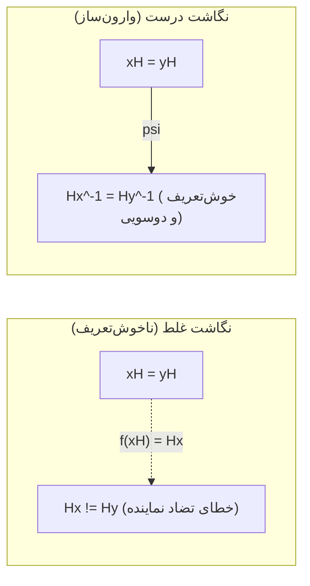

# ⚠️ دام مفهومی: خوش‌تعریفی نگاشت تناظر هم‌مجموعه‌های چپ و راست

> [!DANGER] استدلال وسوسه‌کننده غلط (The Tempting False Logic)
> «برای اثبات اینکه در هر زیرگروه دلخواه $H \leqslant G$، تعداد هم‌مجموعه‌های چپ با تعداد هم‌مجموعه‌های راست برابر است ($|\mathcal{L}_H| = |\mathcal{R}_H|$)، طبیعی‌ترین و ساده‌ترین کار این است که هر هم‌مجموعه چپ $xH$ را به هم‌مجموعه راست متناظرش یعنی $Hx$ نگاشت دهیم:
> 
> $$f: \mathcal{L}_H \to \mathcal{R}_H \quad , \quad f(xH) = Hx$$
> 
> این ضابطه کاملاً متقارن و شهودی است و بدیهی است که یک تناظر یک‌به‌یک و پوشا بین هم‌مجموعه‌های چپ و راست برقرار می‌کند!»

---

## ۱. باور غلط رایج (The Common Misconception)

بسیاری از دانشجویان هنگام تلاش برای اثبات برابری تعداد هم‌مجموعه‌های چپ و راست زیرگروه (شاخص چپ و راست)، فوراً تابع به ظاهر بدیهی $f(xH) = Hx$ را پیشنهاد می‌دهند.  
خطای ذهنی ناشی از آن است که ذهن انسان تمایل دارد عملگرها را متقارن ببیند و از این واقعیت غفلت می‌کند که یک هم‌مجموعه دارای نماینده یکتا نیست و تابعی که روی کلاس‌های هم‌ارزی تعریف می‌شود، پیش از هر چیز باید آزمون صلب **خوش‌تعریفی (Well-Definedness)** را با موفقیت پشت سر بگذارد.

---

## ۲. کالبدشکافی خطای استدلال و نقطه شکست (Dissection of Error & Point of Failure)

برای آن‌که $f$ یک تابع ریاضی معتبر باشد، باید نشان داد که اگر دو ورودی از نظر مجموعه‌ای یکسان باشند، خروجی‌های آن‌ها نیز الزاماً برابر شوند:

$$xH = yH \overset{?}{\implies} f(xH) = f(yH) \iff Hx = Hy$$

بیایید شرایط جبری این دو تساوی را موشکافی کنیم:
1. شرط برابری دو هم‌مجموعه چپ:
   
   $$xH = yH \iff x^{-1}y \in H$$
   
2. شرط برابری دو هم‌مجموعه راست:
   
   $$Hx = Hy \iff x y^{-1} \in H$$

آیا رابطه $x^{-1}y \in H$ لزوماً ایجاب می‌کند که $x y^{-1} \in H$؟  
**پاسخ منفی است!**  
اگر وارون عنصر $x^{-1}y$ را محاسبه کنیم، داریم:

$$(x^{-1}y)^{-1} = y^{-1}(x^{-1})^{-1} = y^{-1}x \in H$$

اما $x y^{-1}$ وارون $x^{-1}y$ نیست! بلکه مزدوج وارون آن است:

$$x y^{-1} = x (y^{-1} x) x^{-1}$$

این رابطه نشان می‌دهد که $x y^{-1}$ زمانی در $H$ قرار می‌گیرد که زیرگروه $H$ تحت تزویج با $x$ پایدار باشد؛ یعنی **تنها زمانی که $H$ یک زیرگروه نرمال باشد!**  
اگر زیرگروه $H$ نرمال نباشد، عنصری چون $y^{-1}x \in H$ وجود دارد که مزدوج آن یعنی $x y^{-1}$ خارج از $H$ می‌افتد. در این حالت:

$$xH = yH \quad \text{اما} \quad Hx \ne Hy$$

این امر به این معناست که نگاشت پیشنهادی $f(xH) = Hx$ وابسته به انتخاب نماینده است و **اصلاً یک تابع خوش‌تعریف نیست!**

---

## ۳. مثال نقض و گواه ملموس در گروه متقارن $S_3$

برای لمس عینی این شکست منطقی، زیرگروه دو عضوی $H = \{ e , (12) \}$ را در گروه متقارن $S_3$ در نظر می‌گیریم:

$$G = S_3 = \{ e , (12) , (13) , (23) , (123) , (132) \} \quad , \quad H = \{ e , (12) \}$$

دو عنصر $x = (13)$ و $y = (123)$ را برمی‌گزینیم و هم‌مجموعه چپ آن‌ها را بررسی می‌کنیم:

$$x^{-1} y = (13)^{-1} (123) = (13)(123) = (12) \in H$$

چون $x^{-1} y \in H$ است، این دو عنصر هم‌مجموعه چپ کاملاً یکسانی را تولید می‌کنند:

$$xH = yH = \{ (13) , (123) \}$$

اکنون خروجی‌های نگاشت فرضی $f$ را با این دو نماینده محاسبه می‌کنیم:
* خروجی با نماینده $x = (13)$:
  
  $$Hx = H(13) = \{ e \cdot (13) , (12)(13) \} = \{ (13) , (132) \}$$
  
* خروجی با نماینده $y = (123)$:
  
  $$Hy = H(123) = \{ e \cdot (123) , (12)(123) \} = \{ (123) , (23) \}$$

مشاهده می‌کنید که:

$$Hx \ne Hy$$

یک ورودی یکسان ($xH = yH$) به دو خروجی کاملاً متفاوت و مجزا منجر گردید! بنابراین ضابطه ساده‌لوحانه $f(xH) = Hx$ کاملاً مردود و باطل است.

---

## ۴. استدلال و صورت‌بندی درست: نگاشت وارون‌ساز (The Inversion Map)

راهکار درخشان و نبوغ‌آمیز جبردانان برای غلبه بر این بن‌بست، به‌کارگیری **وارون جبری** برای تغییر ترتیب عمل است.  
نگاشت کانونیکال $\psi$ را به صورت زیر تعریف می‌کنیم:

$$\psi: \mathcal{L}_H \to \mathcal{R}_H \quad , \quad \psi(xH) = H x^{-1}$$

### برهان خوش‌تعریفی صلب نگاشت $\psi$:
فرض کنید $xH = yH$. این تساوی هم‌ارز است با:

$$x^{-1}y \in H$$

از آنجا که $H$ یک زیرگروه است و نسبت به وارون بسته است، وارون این عنصر نیز الزاماً در $H$ زندگی می‌کند:

$$(x^{-1}y)^{-1} \in H$$

با استفاده از قانون وارون حاصل ترکیب دو عنصر ($(ab)^{-1} = b^{-1}a^{-1}$):

$$(x^{-1}y)^{-1} = y^{-1}(x^{-1})^{-1} = y^{-1}x \in H$$

از سوی دیگر، شرط برابری دو هم‌مجموعه راست $H x^{-1}$ و $H y^{-1}$ این است که:

$$(x^{-1})(y^{-1})^{-1} \in H \iff x^{-1}y \in H$$

یا به بیان دیگر:

$$(y^{-1})^{-1} (x^{-1}) \in H \iff y x^{-1} \in H$$

چون $y^{-1}x \in H \iff (y^{-1}x)^{-1} = x^{-1}y \in H$، ملاحظه می‌شود که به دلیل قانون معکوس شدن ترتیب عوامل در وارون ضربی، شرط دقیقاً تطابق پیدا می‌کند!  
بنابراین:

$$xH = yH \implies H x^{-1} = H y^{-1}$$

و نگاشت $\psi(xH) = H x^{-1}$ برای **هر زیرگروه دلخواه (حتی غیرنرمال و در هر گروه غیرآبلی)** یک تابع خوش‌تعریف و یک تناظر دوسویی کامل (بیجکشن) است.

---

## ۵. چک‌لیست پیشگیری و تشخیص سریع (Self-Diagnostic Checklist)

- [ ] آیا در مواجهه با نگاشت‌های تعریف‌شده بر کلاس‌های هم‌ارزی، پیش از هر ادعایی آزمون خوش‌تعریفی ($x \sim y \implies f(x) = f(y)$) را چک کرده‌ام؟
- [ ] آیا توجه دارم که تبدیل چپ به راست در گروه‌های ناآبلی مستلزم معکوس شدن ترتیب عوامل است؟
- [ ] آیا از نگاشت وارون‌ساز $\psi(xH) = H x^{-1}$ برای اثبات برابری کاردینالیتی هم‌مجموعه‌های چپ و راست استفاده کرده‌ام؟
