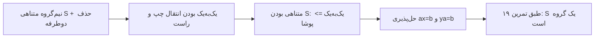

# 🗝️ حل تمرین تشکیل گروه توسط نیم‌گروه حذفی متناهی و مثال نقض نامتناهی

> [!abstract] ایده کشف مسیر (چطور به ذهن می‌رسد؟)
> **روایت اکتشافی پولیا:**  
> این مسئله دقیقاً پس از تمرین ۱۸ و تمرین ۱۹ در جزوه آمده و چیدمان آن‌ها تصادفی نیست!  
> در تمرین ۱۹ دیدیم که اگر در یک نیم‌گروه $(S, *)$ معادلات $ax = b$ و $ya = b$ همیشه جواب داشته باشند، $S$ گروه است.  
> حال به فرض جدید نگاه کنید: به جای حل‌پذیری معادلات، **قانون حذف** و **متناهی بودن $S$** را داریم.  
> به عنوان یک قاعده طلایی در ترکیبیات، هرگاه تابعی از یک مجموعه متناهی به **خودش** یک‌به‌یک باشد، به ناچار **پوشا** نیز هست (اصل لانه کبوتری). قانون حذف از چپ دقیقاً می‌گوید نگاشت $x \mapsto ax$ یک‌به‌یک است! پس در حالت متناهی پوشا نیز هست، یعنی $ax = b$ همیشه جواب دارد؛ و همین منطق برای سمت راست جواب $ya = b$ را تضمین می‌کند.  
> همچنین، با فهمیدن اینکه «تبدیل یک‌به‌یکی به پوشایی» صرفاً به دلیل متناهی بودن $S$ رخ داده است، فوراً درمی‌یابیم که در یک مجموعه نامتناهی مثل $\mathbb{Z} \setminus \{0\}$، ضرب در $2$ یک‌به‌یک (حذفی) هست اما پوشا نیست، پس معادله $2x = 1$ بی‌جواب می‌ماند و گروه تشکیل نمی‌شود.

---

## ۱. اجرای کامل و گام‌به‌گام برهان ریاضی (Rigorous Execution)

> [!PROOF] اثبات صوری و گام‌به‌گام
>
> ### بخش اول: اثبات گروه بودن نیم‌گروه حذفی متناهی
>
> فرض می‌کنیم $(S, *)$ یک نیم‌گروه متناهی و ناتهی باشد (مثلاً $|S| = n \in \mathbb{N}$) و قوانین حذف از چپ و راست در آن برقرار باشند (حاصل ترکیب $u * v$ را به صورت $uv$ می‌نویسیم).
>
> **گام اول (تعریف نگاشت‌های انتقال چپ و راست و اثبات یک‌به‌یک بودن آن‌ها):**  
> یک عضو دلخواه $a \in S$ را ثابت در نظر می‌گیریم و دو نگاشت $L_a: S \to S$ و $R_a: S \to S$ را به صورت زیر تعریف می‌کنیم:
>
> $$L_a(x) = ax, \qquad R_a(y) = ya \qquad (\forall x, y \in S)$$
>
> از آنجا که $S$ نسبت به عمل $*$ بسته است، برد هر دو نگاشت درون $S$ قرار دارد.  
> * برای $L_a$: اگر $L_a(x_1) = L_a(x_2)$، آنگاه $a x_1 = a x_2$. طبق قانون حذف از چپ، نتیجه می‌شود $x_1 = x_2$. پس $L_a$ یک‌به‌یک است.
> * برای $R_a$: اگر $R_a(y_1) = R_a(y_2)$، آنگاه $y_1 a = y_2 a$. طبق قانون حذف از راست، نتیجه می‌شود $y_1 = y_2$. پس $R_a$ یک‌به‌یک است.
>
> *(به بیان ملموس‌تر، اگر $S = \{s_1, s_2, \dots, s_n\}$ باشد، عناصر $a s_1, a s_2, \dots, a s_n$ متمایزند و چون همه در $S$ قرار دارند، مجموعه $\{a s_1, \dots, a s_n\}$ برابر با کل $S$ است.)*
>
> **گام دوم (استفاده از متناهی بودن $S$ برای استنتاج پوشا بودن):**  
> بنا بر اصل لانه کبوتری، هر نگاشت یک‌به‌یک از یک مجموعه متناهی $S$ به خودش ($|L_a(S)| = |S| = n$ و $L_a(S) \subseteq S$) الزاماً **پوشا** است؛ یعنی $L_a(S) = S$ و به طور مشابه $R_a(S) = S$.
>
> **گام سوم (حل‌پذیری معادلات و استنتاج گروه بودن):**  
> از پوشا بودن $L_a$ و $R_a$ به ازای هر $a \in S$ نتیجه می‌شود که به ازای هر $a, b \in S$:
> 1. عضوی مانند $x \in S$ وجود دارد که $L_a(x) = b$، یعنی $ax = b$.
> 2. عضوی مانند $y \in S$ وجود دارد که $R_a(y) = b$، یعنی $ya = b$.
>
> اکنون طبق [[تمرین شرط لازم و کافی حل‌پذیری معادلات خطی برای گروه بودن نیم‌گروه]] (تمرین ۱۹)، هر نیم‌گروه ناتهی که در آن معادلات $ax = b$ و $ya = b$ همیشه دارای جواب باشند، یک گروه است. لذا $(S, *)$ تشکیل گروه می‌دهد.
>
> ---
>
> ### بخش دوم: مثال نقض در حالت نامتناهی ($S = \mathbb{Z} \setminus \{0\}$)
>
> مجموعه نامتناهی $S = \mathbb{Z} - \{0\}$ را تحت عمل **ضرب معمولی اعداد صحیح** ($\cdot$) در نظر می‌گیریم و تمام شرایط را بررسی می‌کنیم:
> 1. **نیم‌گروه بودن:**
>    * **بسته‌بودن:** حاصل‌ضرب دو عدد صحیح ناصفر، عددی صحیح و ناصفر است ($\forall a, b \in S \implies a \cdot b \in S$).
>    * **شرکت‌پذیری:** ضرب اعداد صحیح شرکت‌پذیر است؛ $(a \cdot b) \cdot c = a \cdot (b \cdot c)$.
> 2. **برقراری قوانین حذف از طرفین:** اگر $a, b, c \in \mathbb{Z} - \{0\}$ و $a \cdot c = b \cdot c$ (یا $c \cdot a = c \cdot b$) باشد، آنگاه $(a - b) \cdot c = 0$. چون $c \neq 0$ و $\mathbb{Z}$ مقسوم‌علیه صفر ندارد، الزاماً $a - b = 0$ و در نتیجه $a = b$. پس قوانین حذف دوطرفه برقرار است.
> 3. **گروه نبودن:** در این ساختار عضو همانی $1 \in S$ وجود دارد، اما اعضای $S \setminus \{1, -1\}$ دارای معکوس ضربی درون $S$ نیستند! برای نمونه عدد $2 \in S$ معکوسی در $S$ ندارد، زیرا معکوس ضربی آن در $\mathbb{R}$ برابر $\frac{1}{2}$ است که عضو $\mathbb{Z} - \{0\}$ نیست (معادله $2x = 1$ در $S$ جواب ندارد).
>
> بنابراین $(\mathbb{Z} - \{0\}, \cdot)$ یک نیم‌گروه حذفی نامتناهی است که گروه نیست.
>
> $\blacksquare$

---

### روش دوم: اثبات مستقیم بخش اول با تکرار توان‌ها (بدون اتکا به تمرین ۱۹)

> [!NOTE] مسیر اثبات جایگزین (تولید همانی و معکوس با دنباله توان‌ها)
> در نیم‌گروه حذفی متناهی $S$:
> 1. **ساخت عضو همانی برای $a \in S$:** دنباله نامتناهی $a, a^2, a^3, \dots$ در مجموعه متناهی $S$ نمی‌تواند همگی متمایز باشد؛ پس $1 \leqslant i < j$ وجود دارند که $a^i = a^j$. قرار می‌دهیم $k = j - i \geqslant 1$، پس $a^i = a^{i+k}$.  
>    اکنون برای هر عنصر دلخواه $x \in S$ داریم:
>
> $$a^i x = a^{i+k} x = a^i (a^k x)$$
>
> با اعمال $i$ بار قانون حذف از چپ (یا یک‌بار حذف $a^i$ از چپ)، به دست می‌آید $x = a^k x$. به طور متقارن از $x a^i = x a^{i+k} = (x a^k) a^i$ و حذف از راست داریم $x = x a^k$.  
> پس عنصر $e := a^k \in S$ یک **عضو همانی دوطرفه** برای کل $S$ است!
> 2. **ساخت عضو معکوس برای هر $b \in S$:** به جای آنکه از $e = a^k$ فقط برای $a$ معکوس بگیریم، برای هر $b \in S$ دلخواه نیز اعداد $m \geqslant 1$ و $r \geqslant 1$ وجود دارند که $b^m = b^{m+r}$؛ به همان ترتیب $e' := b^r$ نیز عضو همانی کل $S$ است و به دلیل یکتایی عضو همانی داریم $b^r = e' = e$.
>    * اگر $r = 1$ باشد، آنگاه $b = e$ و معکوس آن خود $e$ است.
>    * اگر $r > 1$ باشد، آنگاه $b \cdot b^{r-1} = b^{r-1} \cdot b = b^r = e$، پس $b^{-1} = b^{r-1} \in S$.
>
> بنابراین هر عنصر $b \in S$ دارای معکوس در $S$ است و $(S, *)$ یک گروه است.

---

## ۲. نگاه به عقب، تحلیل دام‌ها و تعمیم ساختاری (Looking Back & Insights)

### الف) هشدار درباره خطاهای رایج ذهنی (Pitfalls)
* ⚠️ **فراموش کردن لزوم هر دو قانون حذف (چپ و راست):** در یک نیم‌گروه **متناهی**، اگر تنها یکی از قوانین حذف (مثلاً فقط حذف از چپ) برقرار باشد، ساختار الزاماً گروه نیست! برای نمونه، مجموعه $S = \{a, b\}$ با عمل $x * y = y$ متناهی است و قانون حذف از چپ را دارد ($cx = cy \implies x = y$)، اما قانون حذف از راست در آن برقرار نیست ($ac = bc \implies c = c$ بی‌اطلاع از $a, b$) و گروه هم نیست.
* ⚠️ **تعمیم نادرست مثال نقض نامتناهی به کل $\mathbb{Z}$ تحت ضرب:** اگر کسی $S = (\mathbb{Z}, \cdot)$ (شامل صفر) را به عنوان مثال نقض نیم‌گروه حذفی نامتناهی بیاورد **غلط** است! زیرا با حضور صفر، قانون حذف برقرار نیست ($2 \cdot 0 = 3 \cdot 0$ ولی $2 \neq 3$). حذف صفر از $\mathbb{Z}$ در مثال $S = \mathbb{Z} - \{0\}$ دقیقاً برای تأمین خاصیت حذف‌پذیری ضروری است.

### ب) مصداق‌های دیگر مثال نقض و ارتباط با حوزه‌های ریاضی
* **مثال نقض نامتناهی بدون عضو همانی:** نیم‌گروه جمعی اعداد طبیعی $(\mathbb{N}, +) = (\{1, 2, 3, \dots\}, +)$ نیز یک نیم‌گروه حذفی نامتناهی است که حتی عضو همانی هم ندارد (چه برسد به معکوس!). همچنین $(\mathbb{N}, \cdot)$ یک مونوئید حذفی نامتناهی است که گروه نیست.
* **کاربرد در نظریه حلقه‌ها (حوزه‌های صحیح متناهی):** همین ایده اثبات دقیقاً به کار می‌رود تا ثابت شود **هر حوزه صحیح متناهی یک میدان است** (قضیه ودربرن-نوع ابتدایی): عناصر ناصفر یک حوزه صحیح متناهی نسبت به ضرب، یک نیم‌گروه حذفی متناهی می‌سازند، پس گروه ضربی تشکیل می‌دهند و هر عنصر ناصفر وارون ضربی دارد.
