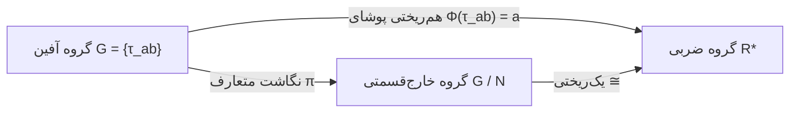

# 🗝️ حل تمرین گروه تبدیلات خطی آفین زیرگروه نرمال انتقالات و خارج‌قسمتی

> [!abstract] ایده کشف مسیر (چطور به ذهن می‌رسد؟)
> **روایت اکتشافی پولیا:**  
> هنگامی که فرمول ترکیب $\tau_{ab}\tau_{cd} = \tau_{ac, ad+b}$ را محاسبه می‌کنیم، چشم ما بلافاصله متوجه الگوی مؤلفه اول می‌شود: در مؤلفه اول فقط $a \cdot c$ ظاهر می‌شود و هیچ ردپایی از $b$ یا $d$ در آن نیست!  
> این رفتار بدان معناست که نگاشتِ «برداشتن ضریب مقیاس $a$» یعنی $\Phi(\tau_{ab}) = a$ به گروه ضربی $\mathbb{R}^*$، ترکیب را به ضرب تبدیل می‌کند و بنابراین یک هم‌ریختی گروهی است. از آنجا که هسته یک هم‌ریختی همواره زیرگروه نرمال است و مجموعه $\{\tau_{1b} \mid b \in \mathbb{R}\}$ دقیقاً همان نگاشت‌هایی است که ضریب مقیاسشان $1$ (عضو همانی $\mathbb{R}^*$) است، نرمال بودن $N$ و یک‌ریختی $G / N \cong \mathbb{R}^*$ هر دو به طور طبیعی از این هم‌ریختی می‌جوشند.

---

## ۱. اجرای کامل و گام‌به‌گام برهان ریاضی (Rigorous Execution)

> [!PROOF] اثبات صوری و گام‌به‌گام
> ### بخش (آ): اثبات گروه بودن $G$ و نرمال بودن $N$
> 
> **گام ۱ (بسته بودن تحت عمل ترکیب توابع):**  
> دو عضو دلخواه $\tau_{ab}, \tau_{cd} \in G$ را در نظر می‌گیریم که در آن‌ها $a, c \in \mathbb{R} \setminus \{0\}$ و $b, d \in \mathbb{R}$. به ازای هر $x \in \mathbb{R}$ داریم:
> 
> $$(\tau_{ab} \circ \tau_{cd})(x) = \tau_{ab}\big(\tau_{cd}(x)\big) = \tau_{ab}(cx + d) = a(cx + d) + b = (ac)x + (ad + b) = \tau_{ac, \, ad+b}(x)$$
> 
> از آنجا که $a \neq 0$ و $c \neq 0$، داریم $ac \neq 0$ و همچنین $ad + b \in \mathbb{R}$. بنابراین:
> 
> $$\tau_{ab} \tau_{cd} = \tau_{ac, \, ad+b} \in G$$
> 
> پس عمل ترکیب روی $G$ بسته است.
> 
> **گام ۲ (شرکت‌پذیری):**  
> از آنجا که اعضای $G$ توابعی از $\mathbb{R}$ به $\mathbb{R}$ هستند و عمل ترکیب توابع همواره خاصیت شرکت‌پذیری دارد، برای هر سه عضو $\tau_{ab}, \tau_{cd}, \tau_{ef} \in G$ داریم:
> 
> $$(\tau_{ab} \tau_{cd}) \tau_{ef} = \tau_{ab} (\tau_{cd} \tau_{ef})$$
> 
> *(همچنین با محاسبه مستقیم نیز هر دو سمت برابر $\tau_{ace, \, acf + ad + b}$ می‌شود.)*
> 
> **گام ۳ (وجود عضو خنثی):**  
> نگاشت $\tau_{1,0}$ را در نظر بگیرید که برای آن $a = 1 \neq 0$ و $b = 0 \in \mathbb{R}$ است؛ لذا $\tau_{1,0} \in G$ و به ازای هر $x \in \mathbb{R}$ داریم $\tau_{1,0}(x) = 1 \cdot x + 0 = x$. برای هر $\tau_{ab} \in G$:
> 
> $$\tau_{ab} \tau_{1,0} = \tau_{a \cdot 1, \, a \cdot 0 + b} = \tau_{ab} \quad , \quad \tau_{1,0} \tau_{ab} = \tau_{1 \cdot a, \, 1 \cdot b + 0} = \tau_{ab}$$
> 
> پس $\tau_{1,0} = \operatorname{id}_{\mathbb{R}}$ عضو همانی گروه $G$ است.
> 
> **گام ۴ (وجود عضو معکوس):**  
> به ازای هر $\tau_{ab} \in G$، از آنجا که $a \neq 0$، عدد حقیقی $a^{-1} \neq 0$ موجود است، پس عنصر $\tau_{a^{-1}, \, -ba^{-1}}$ در $G$ قرار دارد. ترکیب این دو نگاشت را از چپ و راست بررسی می‌کنیم:
> 
> $$\tau_{ab} \tau_{a^{-1}, \, -ba^{-1}} = \tau_{a \cdot a^{-1}, \, a(-ba^{-1}) + b} = \tau_{1, \, -b + b} = \tau_{1,0}$$
> 
> $$\tau_{a^{-1}, \, -ba^{-1}} \tau_{ab} = \tau_{a^{-1} \cdot a, \, a^{-1}b - ba^{-1}} = \tau_{1, \, 0} = \tau_{1,0}$$
> 
> بنابراین هر عضو از $G$ معکوس‌پذیر است و $(\tau_{ab})^{-1} = \tau_{a^{-1}, \, -ba^{-1}}$.  
> نتیجه می‌شود $(G, \circ)$ یک گروه است.
> 
> **گام ۵ (اثبات $N \trianglelefteq G$):**  
> ابتدا نشان می‌دهیم $N = \{ \tau_{1,b} \mid b \in \mathbb{R} \}$ زیرگروهی از $G$ است:
> * عضو خنثی $\tau_{1,0}$ در $N$ قرار دارد، پس $N \neq \varnothing$.
> * برای هر دو عضو دلخواه $\tau_{1,b}, \tau_{1,d} \in N$، داریم $(\tau_{1,d})^{-1} = \tau_{1^{-1}, \, -d \cdot 1^{-1}} = \tau_{1, -d}$، پس:
> 
> $$\tau_{1,b} (\tau_{1,d})^{-1} = \tau_{1,b} \tau_{1,-d} = \tau_{1 \cdot 1, \, 1(-d) + b} = \tau_{1, b-d} \in N$$
> 
> بنا بر [[قضیه معیار تک‌مرحله‌ای زیرگروه بودن]]، $N \leqslant G$.
> 
> اکنون برای اثبات نرمال بودن $N$ در $G$، عضو دلخواه $\tau_{a,c} \in G$ (با $a \neq 0$) و عضو دلخواه $\tau_{1,b} \in N$ را در نظر گرفته و مزدوج $\tau_{1,b}$ تحت $\tau_{a,c}$ را محاسبه می‌کنیم:
> 
> $$\tau_{1,b} \tau_{a,c} = \tau_{1 \cdot a, \, 1 \cdot c + b} = \tau_{a, \, c+b}$$
> 
> حال از سمت چپ با $(\tau_{a,c})^{-1} = \tau_{a^{-1}, \, -ca^{-1}}$ ترکیب می‌کنیم:
> 
> $$(\tau_{a,c})^{-1} \tau_{1,b} \tau_{a,c} = \tau_{a^{-1}, \, -ca^{-1}} \tau_{a, \, c+b} = \tau_{a^{-1}a, \, a^{-1}(c+b) - ca^{-1}} = \tau_{1, \, a^{-1}c + a^{-1}b - a^{-1}c} = \tau_{1, \, a^{-1}b} \in N$$
> 
> از آنجا که مزدوج هر عضو از $N$ توسط هر عضو از $G$ در $N$ باقی می‌ماند، بنا بر [[لم شرط لازم و کافی برابری زیرگروه با مزدوج‌هایش]] داریم:
> 
> $$N \trianglelefteq G$$
> 
> ---
> 
> ### بخش (ب): اثبات یک‌ریختی $G / N \cong \mathbb{R}^*$
> 
> نگاشت $\Phi: G \to \mathbb{R}^*$ را به صورت زیر تعریف می‌کنیم:
> 
> $$\Phi(\tau_{ab}) = a \quad (\forall \tau_{ab} \in G)$$
> 
> **۱. خوش‌تعریفی نگاشت $\Phi$:**  
> فرض کنید $\tau_{ab} = \tau_{cd}$ به عنوان دو تابع روی $\mathbb{R}$. آنگاه به ازای تمام $x \in \mathbb{R}$ داریم $ax + b = cx + d$. با قرار دادن $x = 0$ نتیجه می‌شود $b = d$، و با قرار دادن $x = 1$ و حذف $b = d$ داریم $a = c$. پس نمایش ضرایب $(a, b)$ یکتا است و $\Phi(\tau_{ab}) = a = c = \Phi(\tau_{cd})$ خوش‌تعریف است.
> 
> **۲. هم‌ریختی بودن $\Phi$:**  
> برای هر دو عضو $\tau_{ab}, \tau_{cd} \in G$ داریم:
> 
> $$\Phi(\tau_{ab} \tau_{cd}) = \Phi(\tau_{ac, \, ad+b}) = ac = \Phi(\tau_{ab}) \cdot \Phi(\tau_{cd})$$
> 
> پس $\Phi$ یک [[تعریف هم‌ریختی و بروریختی گروه‌ها|هم‌ریختی گروهی]] است.
> 
> **۳. پوشا بودن $\Phi$:**  
> به ازای هر $a \in \mathbb{R}^*$، چون $a \neq 0$، عنصر $\tau_{a,0} \in G$ وجود دارد و $\Phi(\tau_{a,0}) = a$. بنابراین:
> 
> $$\operatorname{im} \Phi = \mathbb{R}^*$$
> 
> **۴. تعیین هسته $\ker \Phi$:**  
> عنصر همانی گروه ضربی $\mathbb{R}^*$ عدد $1$ است؛ لذا:
> 
> $$\ker \Phi = \{ \tau_{ab} \in G \mid \Phi(\tau_{ab}) = 1 \} = \{ \tau_{1b} \mid b \in \mathbb{R} \} = N$$
> 
> **۵. اعمال قضیه اول یک‌ریختی:**  
> بنا بر [[قضیه اول یک‌ریختی گروه‌ها]]، داریم:
> 
> $$G / \ker \Phi \cong \operatorname{im} \Phi \implies G / N \cong \mathbb{R}^*$$
> 
> $\blacksquare$

---

## ۲. نگاه به عقب، تحلیل دام‌ها و روش‌های جایگزین (Looking Back & Insights)

### الف) خطاهای رایج و دام‌های مفهومی
* ⚠️ **دام ۱ (نادیده گرفتن خوش‌تعریفی $\Phi$):** در تعریف نگاشت روی مجموعه‌ای از توابع بر حسب پارامترهای نمایشی (مانند $a$ و $b$)، حتماً باید بررسی کرد که تساوی دو تابع ($\tau_{ab} = \tau_{cd}$) به تساوی پارامترها ($a = c$ و $b = d$) منجر می‌شود.
* ⚠️ **دام ۲ (پنداشتن آبلی بودن $G$):** گروه تبدیلات آفین $G = \operatorname{Aff}(\mathbb{R})$ **ناآبلی** است (زیرا در حالت کلی $ad + b \neq cb + d$). جالب است که هم زیرگروه نرمال $N \cong (\mathbb{R}, +)$ آبلی است و هم گروه خارج‌قسمتی $G / N \cong (\mathbb{R}^*, \cdot)$ آبلی است، اما خود $G$ آبلی نیست!

### ب) نمایش ماتریسی و دیاگرام ساختاری
* **تفسیر ماتریسی:** هر تبدیل آفین $\tau_{ab}$ متناظر با ماتریس بالامثلثی $2 \times 2$ به فرم $\begin{pmatrix} a & b \\ 0 & 1 \end{pmatrix}$ است، زیرا ضرب ماتریسی آن دقیقاً قانون ترکیب $\tau_{ab}\tau_{cd}$ را بازتولید می‌کند:

$$\begin{pmatrix} a & b \\ 0 & 1 \end{pmatrix} \begin{pmatrix} c & d \\ 0 & 1 \end{pmatrix} = \begin{pmatrix} ac & ad+b \\ 0 & 1 \end{pmatrix}$$

