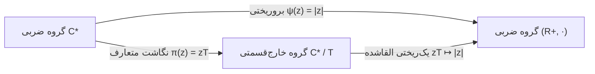

# 🗝️ حل تمرین یک‌ریختی گروه خارج‌قسمتی دایره‌ای با اعداد حقیقی مثبت

> [!abstract] ایده کشف مسیر (چطور به ذهن می‌رسد؟)
> **روایت اکتشافی پولیا:**  
> هر عدد مختلط ناصفر $z$ دارای دو مؤلفه است: **اندازه (شعاع)** $|z| \in \mathbb{R}^+$ و **زاویه (جهت)** روی دایره واحد $T$.  
> هنگام گرفتن خارج‌قسمت $\mathbb{C}^* / T$، ما عملاً تفاوت زاویه‌ها را نادیده می‌گیریم و تمام نقاطِ هم‌فاصله از مبدأ (واقع بر یک دایره به شعاع $r$) را در یک هم‌مجموعه واحد ادغام می‌کنیم. تنها شاخصی که برای تمایز میان این دایره‌ها باقی می‌ماند، همان **شعاعِ دایره یعنی $|z|$** است! از آنجا که قدر مطلق ضرب برابر ضرب قدر مطلق‌هاست، نگاشت $\psi(z) = |z|$ از $\mathbb{C}^*$ به $\mathbb{R}^+$ مستقیماً دروازه اعمال قضیه اول یک‌ریختی را می‌گشاید.

---

## ۱. اجرای کامل و گام‌به‌گام برهان ریاضی (Rigorous Execution)

> [!PROOF] اثبات صوری و گام‌به‌گام
> نگاشت $\psi: \mathbb{C}^* \to \mathbb{R}^+$ را برای هر عدد مختلط ناصفر $z \in \mathbb{C}^*$ به صورت زیر تعریف می‌کنیم:
> 
> $$\psi(z) = |z|$$
> 
> *(توجه: برای هر $z = a + bi \in \mathbb{C}^* = \mathbb{C} \setminus \{0\}$، داریم $|z| = \sqrt{a^2 + b^2} > 0$، لذا تصویر نگاشت همواره در $\mathbb{R}^+$ قرار دارد و $\psi$ خوش‌تعریف است.)*
> 
> **گام اول (اثبات هم‌ریختی بودن $\psi$):**  
> بنا بر خواص پایه‌ای قدر مطلق اعداد مختلط، برای هر دو عضو $z_1, z_2 \in \mathbb{C}^*$ داریم:
> 
> $$\psi(z_1 z_2) = |z_1 z_2| = |z_1| \cdot |z_2| = \psi(z_1) \cdot \psi(z_2)$$
> 
> *(یادآوری اثبات $|z_1 z_2| = |z_1||z_2|$: داریم $|z_1 z_2|^2 = (z_1 z_2)\overline{(z_1 z_2)} = (z_1 \overline{z_1})(z_2 \overline{z_2}) = |z_1|^2 |z_2|^2$، و با توجه به مثبت بودن قدر مطلق‌ها جذر می‌گیریم.)*  
> بنابراین $\psi$ یک [[تعریف هم‌ریختی و بروریختی گروه‌ها|هم‌ریختی گروهی]] از $(\mathbb{C}^*, \cdot)$ به $(\mathbb{R}^+, \cdot)$ است.
> 
> **گام دوم (اثبات پوشا بودن $\psi$):**  
> برای هر عضو دلخواه $r \in \mathbb{R}^+$، از آنجا که $r > 0$، خودِ $r$ را می‌توان به عنوان یک عدد مختلط ناصفر ($r = r + 0i \in \mathbb{C}^*$) در نظر گرفت. در این صورت:
> 
> $$\psi(r) = |r| = r$$
> 
> بنابراین هر عضو در $\mathbb{R}^+$ دارای پیش‌تصویر در $\mathbb{C}^*$ است و $\psi$ یک **بروریختی** (هم‌ریختی پوشا) می‌باشد:
> 
> $$\operatorname{im} \psi = \mathbb{R}^+$$
> 
> **گام سوم (تعیین هسته $\ker \psi$):**  
> عنصر همانی گروه ضربی $\mathbb{R}^+$ عدد $1$ است. بنابراین هسته هم‌ریختی $\psi$ عبارت است از:
> 
> $$\ker \psi = \{ z \in \mathbb{C}^* \mid \psi(z) = 1 \} = \{ z \in \mathbb{C}^* \mid |z| = 1 \} = T$$
> 
> *(دقت کنید که این تساوی همچنین نرمال بودن $T \trianglelefteq \mathbb{C}^*$ را به عنوان هسته یک هم‌ریختی دوباره تضمین می‌کند.)*
> 
> **گام چهارم (اعمال قضیه اول یک‌ریختی گروه‌ها):**  
> اکنون تمام شرایط [[قضیه اول یک‌ریختی گروه‌ها]] برای هم‌ریختی $\psi: \mathbb{C}^* \to \mathbb{R}^+$ برقرار است. پس:
> 
> $$\mathbb{C}^* / \ker \psi \cong \operatorname{im} \psi$$
> 
> با جایگذاری $\ker \psi = T$ و $\operatorname{im} \psi = \mathbb{R}^+$ نتیجه می‌شود:
> 
> $$\mathbb{C}^* / T \cong (\mathbb{R}^+, \cdot)$$
> 
> $\blacksquare$

---

## ۲. نگاه به عقب، تحلیل دام‌ها و روش‌های جایگزین (Looking Back & Insights)

### الف) تفسیر هندسی و دیاگرام یک‌ریختی
* از دیدگاه هندسه تحلیلی در صفحه مختلط، هر هم‌مجموعه $zT = \{ zt \mid |t| = 1 \}$ دقیقاً **دایره‌ای به مرکز مبدأ و شعاع $r = |z|$** است (ر.ک. [[مثال هندسی هم‌مجموعه‌های گروه دایره‌ای در گروه ضربی مختلط]]). بنابراین خارج‌قسمت‌گیری $\mathbb{C}^* / T$ هر دایره هم‌مرکز به شعاع $r$ را به نقطه مثبت $r \in \mathbb{R}^+$ متناظر می‌کند.

### ب) روش جایگزین (یک‌ریختی مستقیم و تجزیه قطبی)
* می‌توان به طور مستقیم نگاشت $\bar{\psi}: \mathbb{C}^* / T \to \mathbb{R}^+$ را با ضابطه $\bar{\psi}(zT) = |z|$ تعریف کرد:
  * **خوش‌تعریفی:** اگر $z_1 T = z_2 T$، آنگاه $z_1 z_2^{-1} \in T \implies |z_1 z_2^{-1}| = 1 \implies |z_1| = |z_2|$.
  * **هم‌ریختی:** $\bar{\psi}((z_1 T)(z_2 T)) = \bar{\psi}((z_1 z_2)T) = |z_1 z_2| = |z_1||z_2|$.
  * **یک‌به‌یک بودن:** اگر $|z_1| = |z_2|$، آنگاه $|z_1 z_2^{-1}| = 1 \implies z_1 z_2^{-1} \in T \implies z_1 T = z_2 T$.
  * **پوشا بودن:** برای هر $r \in \mathbb{R}^+$، $\bar{\psi}(rT) = |r| = r$.
* **دام رایج:** فراموش کردن ناصفر بودن اعداد در تعریف دامنه؛ عدد $0$ در $\mathbb{C}^*$ عضویت ندارد و اگر $0$ را شامل می‌کردیم نه $\mathbb{C}$ گروه ضربی بود و نه $|0| = 0$ در $\mathbb{R}^+$ قرار می‌گرفت.
* **ارتباط با هم‌ریختی لگاریتم:** با ترکیب $\psi$ با هم‌ریختی $\ln: (\mathbb{R}^+, \cdot) \to (\mathbb{R}, +)$، نتیجه می‌شود $\mathbb{C}^* / T \cong (\mathbb{R}, +)$ نیز برقرار است!
