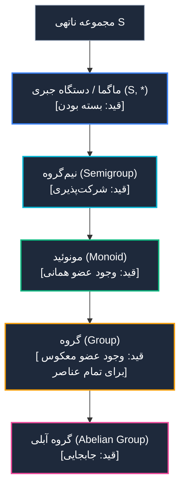

# 🌐 مبانی ساختارهای جبری (Foundations of Algebraic Structures)

> [!abstract] چارچوب و قلمرو حاکم
> این سند، **نظریه حاکم (`theory_scope`)** بر تمامی یادداشت‌های درس مبانی جبر و ماتریس‌ها است. در این چارچوب صوری، ساختارهای ریاضی به عنوان زوج‌ها یا چندتایی‌های مرتب متشکل از یک **مجموعه حامل ناتهی (Underlying Set)** و یک یا چند **عمل دوتایی بسته** تعریف می‌شوند که اصول موضوعه مشخصی (نظیر شرکت‌پذیری، عضو خنثی، عضو وارون و توزیع‌پذیری) را ارضا می‌کنند.

---

## ۱. سلسله‌مراتب دستگاه‌های جبری تک‌عملگری (Hierarchy of Magmas)

سیر تکامل ساختارها با اضافه شدن اصول موضوعه به صورت زیر تدوین می‌شود:

---

## ۲. اصول موضوعه پایه‌ای حاکم بر نظریه (Axioms)

1. **اصل بسته بودن (Closure):**  
   $$\forall a, b \in S \implies a * b \in S$$
2. **اصل شرکت‌پذیری (Associativity):**  
   $$\forall a, b, c \in S \implies (a * b) * c = a * (b * c)$$
3. **اصل عضو همانی (Identity Element):**  
   $$\exists e \in S \quad \text{s.t.} \quad \forall a \in S \implies a * e = e * a = a$$
4. **اصل عضو معکوس (Inverse Element):**  
   $$\forall a \in S, \quad \exists a^{-1} \in S \quad \text{s.t.} \quad a * a^{-1} = a^{-1} * a = e$$
5. **اصل جابجایی (Commutativity):**  
   $$\forall a, b \in S \implies a * b = b * a$$

---

## ۳. نقشه‌های راه و فصول تحت حاکمیت این نظریه

* 📚 **[[00-MOC نقشه راه کلان درس مبانی جبر و ماتریس‌ها]]:** برنامه جامع درسی و سرفصل‌های پنج‌گانه.
* 📚 **[[00-درسنامه و نقشه راه فصل اول - نیم‌گروه‌ها]]:** نخستین پیاده‌سازی کامل دستگاه‌های تک‌عملگری (نیم‌گروه‌ها).
